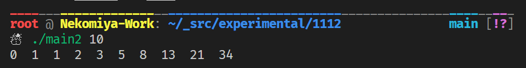
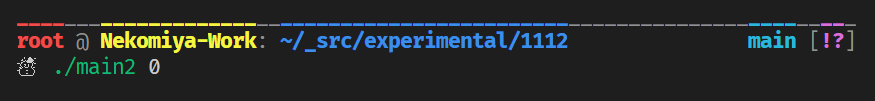
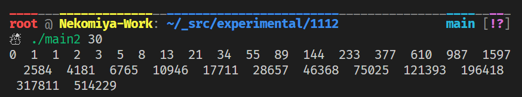
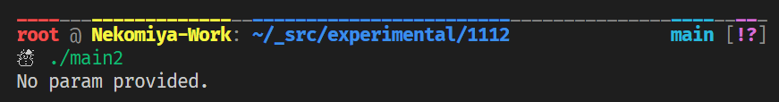

# OS Program II

<center style="color: orange">d0870654 金栩菲</center>

### Chosen Problem

I chose exercise 4.26. (The second exercise)

### Platform

Ubuntu 20.04 WSL on Windows 11 build 25160

Compiler: `gcc (Ubuntu 9.4.0-1ubuntu1~20.04.1) 9.4.0`

C Runtime: `libc`

### Procedure

- Store common variables shared by all threads as global static variables, here we set the pointer to required Fibonacci Array `fibs` as a global static variable.
- Check for input array size $n$, if it equals zero, then no need to generate array, return no-parameter message.
- Otherwise, create a child thread from main thread, and join it.
- In child thread:
  - allocate memory according to the input size
  - fill `fibs[0]` if $n>1$, fill `fibs[1]` if $n>2$
  - fill other elements using the recurrence equation $f(k) = f(k-1)+f(k-2)$ until $f(n-1)$
- In main thread, then:
  - wait child thread to terminate
  - transverse `fibs` and print all numbers
  - if `fibs` already allocated, free the memory.
- exit.

### Snippets

snippet to use variable that can be shared by threads

```
static long* fibs = NULL;
```

snippet to create thread

```
pthread_t generator;
pthread_create(&generator, NULL, (void*)fibon, (void*)&n);
pthread_join(generator, NULL);
```

### Screenshots

n = 10



n = 0



n = 30



param not provided 



### Harvest

- Learned how to create threads in C using methods in `pthread`
- Learned how to pass arguments to child threads
- Learned which kinds of variables can be shared among threads, which not
- Learned that static variables are stored in `data` segment of the memory.