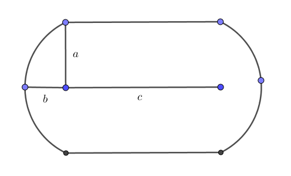
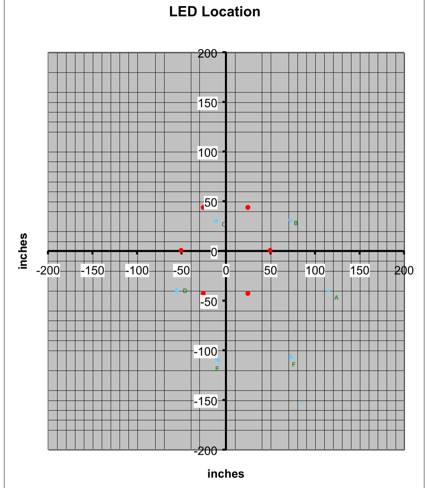

## Q1

Let output be $1$ when the dimmer is activated. Then the truth table is

| [IN] Red Sensor (R) | [IN] Green Sensor (G) | [IN] Blue Sensor (B) | [OUT] Output (f) |
| ------------------- | --------------------- | -------------------- | ---------------- |
| 0                   | 0                     | 0                    | 0                |
| 1                   | 0                     | 0                    | 1                |
| 0                   | 1                     | 0                    | 0                |
| 0                   | 0                     | 1                    | 0                |
| 1                   | 1                     | 0                    | 1                |
| 1                   | 0                     | 1                    | 0                |
| 0                   | 1                     | 1                    | 1                |
| 1                   | 1                     | 1                    | 1                |

From the truth table we can derive the Boolean expression:

$$f(R,G,B)=R\bar{G}\bar{B}+R\bar{G}B+\bar{R}GB+RGB$$

By the Boolean identity $a+\bar{a}=1$, we can simplify the expression:

$f(R,G,B)=R\bar{G}(\bar{B}+B)+(\bar{R}+R)GB=R\bar{G}+GB$

Its equivalent circuit is

**If the override switch is taken into account, the Boolean expression would be:**

$g(R,G,B,S)=\bar{S}f(R,G,B)=\bar{S}(R\bar{G}+GB)$

Its equivalent circuit is

## Q2

**Errors:**

Convert to meters:

- Length of the face: $4.195\pm 0.25\times 10^{-3}$ m
- Width of the face: $3.55\pm 0.25\times 10^{-3}$ m
- Thickness of the sensor’s head: $1.46\pm 0.32\times 10^{-3}$ m
- Height of the sensor: $3.81\times 10^{-2}$ m
- Radius of the sensor’s leg: $5.25\pm 6.5\times 10^{-4}$ m
- Distance of the two legs of the sensor: $2.54\pm 0.13\times 10^{-3}$ m

Absolute error: $2.5\times 10^{-4}$ m

Relative error: 

- Length: $\dfrac{0.25}{4.195}=6.0\times 10^{-2}$
- Width: $\dfrac{0.25}{3.55}=7.0\times 10^{-2}$

**Scientific notations:**

Here are some of the advantages of scientific notation:

- When writing very small or very large numbers, scientific notation makes the number shorter. 
- Number of significant digits and order of magnitude can be instantly found when using scientific notation, while using normal notation, you cannot tell which digits are significant digits.
- Scientific notation is normalized, thus is easy to manipulate its fractional and exponential part separately.

For example, the speed of light, $v=300,000,000$ m/s

- can be shorten to $3.000\times 10^{8}$ m/s, which is much shorter
- $v$ is not EXACTLY $300,000,000$ m/s, but about $299,792,458$ m/s, adopting normal notation, we cannot tell which are the significant digits, but with scientific notation, we can tell that there are $4$ significant digits, and the order of magnitude is $8$
- if we multiply two numbers in scientific notation, say $v$ with $2000=2\times 10^3$, we can get the result by multiply their fractional and exponential parts separately and then handle the carry digit: $3\times 2=6,8+3=11$, hence $2000v=6\times 10^{11}$

**Floating point:**

A floating point system can be expressed as 

$$s=\pm\left(d_0+\dfrac{d_1}{\beta^1}+\dfrac{d_2}{\beta^2}+\cdots+\dfrac{d_{n-1}}{\beta^{n-1}}\right)\times \beta^\alpha$$

where $0\leqslant d_i< \beta,\alpha\in[L,U]$, if $d_0=0$ iff $s=0$, the system is normalized. Computer uses binary bits to express floating point numbers, i.e. $\beta=2$. $d_i\in\{0,1\}$.

- For single precision (`float`) floating point numbers, $\alpha\in[-126,127]$ 
- For double precision (`double`) floating point numbers, $\alpha\in[-1022,1023]$

**Relation:**

- Both floating point numbers and numbers in scientific notation are formed with fractional & exponential parts
- the integer part of the fractional part of both normalized floating point numbers and numbers in scientific notation won't exceed the base number ($10$ for scientific notation and $2$ for floating point numbers)

**Area of the surface:**

By the given nominal dimensions, $c=2.54\pm 0.13\times 10^{-3}$ m, $a=1.775\pm 0.125\times 10^{-3}$ m (half width), $2b+c=4.195\pm 0.25\times 10^{-3}$ m

Left and right edges are arcs, its radius satisfies $(r-b)^2+a^2=r^2$, hence $r=\dfrac{b^2+a^2}{2b}$. The area of the surface

$S=2ca+2\arcsin(a/r)r^2$. Substitute all letters with values, we'd get $S=19.24\pm 3.75\times 10^{-6}$ ㎡.

## Q3

**Information of the graph:**

The graph shows that the suggested distance $s$ increases proportionally to the diagonal size of the image $d$. From two points $(1,40)$, $(6.2,160)$ we can calculate the expression: $d=23.0769s +16.9231$ ($s$ in meter, $d$ in inch).

Supported diagonal image size from $40$ inches to $200$ inches. Corresponding distance from $1$ to about $7.93$.

**Pixel distance:**

At the maximum permitted distance from the wall, the diagonal image size is 200 inches, aspect ratio 4:3, hence the width is $200/5\times 4=160$ inches. The pixel distance is $160/1024=0.15625$ inch $\approx3.968\times 10^{-3}$ m.

**Advantage of coordinate systems:**

- Each location has its own coordinates. (bijection)
- The coordinates are generally uniformly distributed, hence easy to find and easy to calculate distance between points.

**Computer related questions:**

A centralized orthogonal 2D Cartesian coordinate system is used when describing the position of a point on a computer screen. (Possibly $[-1,1]\times[-1,1]$)

Screen information is stored in graphic cards' memory, raw data may be expressed as $32$ bits per pixel by Red, Green, Blue, Alpha channel in order (8 bits per channel).

**LEDs' positions:**

LEDs' positions can be expressed as $50(\cos \dfrac{n\pi}{3},\sin \dfrac{n\pi}{3})$, $n=0,1,\cdots 5$. (inch)

Round into integers:

- A: $n=0$, $(50,0)$ 
- B: $n=1,(25,43)$
- C: $n=2,(-25,43)$
- D: $n=3,(-50,0)$
- E: $n=4,(-25,-43)$
- F: $n=5,(25,-43)$

## Q4

In screen (200'') coordinates, the top left pixel is $(0,0)$, hence the transform pattern is `x / 160 * 1024 + 512, -y / 120 * 768 + 384`

- A: $(832,384)$
- B: $(672,107)$
- C: $(352,107)$
- D: $(192,384)$
- E: $(352,661)$
- F: $(672,661)$

**12**

Center of 6 points: $(A'+D')/2=(30,-40)$

Diameter: x coordinate of $A'-D'=(166,0)$ is $166$

hence required scaling is $100/166\approx0.6$, offset $(-30,40)$. (offset first then scale with respect to the origin)