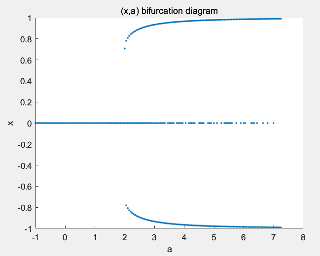
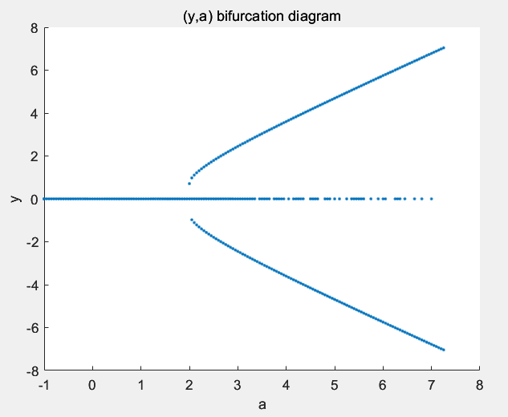

$\dfrac{dx}{dt}=-x+ay-y\sqrt{x^2+y^2}=f(x,y)$

$\dfrac{dy}{dt}=-y+x\sqrt{x^2+y^2}=g(x,y)$

### Q1

$\forall a\in\mathbb{R}$, let $x=y=0$, we have $\dfrac{dx}{dt}=\dfrac{dy}{dt}=0$, hence $0=\begin{bmatrix}0\\0\end{bmatrix}$ is an equilibrium point.

### Q2

$\dfrac{\partial (f,g)}{\partial (x,y)}=\begin{bmatrix}\dfrac{\partial f}{\partial x}&\dfrac{\partial f}{\partial y}\\\dfrac{\partial g}{\partial x}&\dfrac{\partial g}{\partial y}\end{bmatrix}=
\begin{bmatrix}-1-\dfrac{xy}{\sqrt{x^2+y^2}}&a-\dfrac{x^2+2y^2}{\sqrt{x^2+y^2}}\\
\dfrac{2x^2+y^2}{\sqrt{x^2+y^2}}&-1+\dfrac{xy}{\sqrt{x^2+y^2}}\end{bmatrix}=J(x,y)$

at $x_0(t)=0=\begin{bmatrix}0\\0\end{bmatrix}$, we have $J(0,0)=\begin{bmatrix}-1&a\\0&-1\end{bmatrix}$, as it’s an upper triangular matrix, its eigenvalues are the diagonal items, i.e. $\lambda_1=-1,\lambda_2=-1$, all of them have negative real parts. Thus $[0,0]^T$ is an exponential stable equilibrium point of the system.

### Q3

Note that $h(x,y)=xf(x,y)+yg(x,y)=axy-(x^2+y^2)$, which is a smooth bivariate function on $\mathbb{R^2}$. WLOG, assume that there exists an equilibrium point other than $[0,0]^T$ s.t. $y=kx$, then 

$h(x,y)=axy-(x^2+y^2)=(ak-1-k^2)x^2=0\Rightarrow x=0\text{ or }k^2-ak+1=(k-1)^2+(2-a)=0$, but if $a<2$, the second equation won’t hold for all $a,k$ (including $k=\infty$), hence $x=0$. Similarly, let $x=ky$, we can get $y=0$. Therefore, $[0,0]^T$ is the only equilibrium point if $a<2$.

### Q4

If $a=2$, then $h(x,y)=-(x-y)^2=0\Rightarrow x=y$. Let $x=y=t$, $f(t,t)=t-\sqrt{2}t\sqrt{t^2}=g(t,t)=-t+\sqrt{2}t\sqrt{t^2}=0\Rightarrow t_1=\dfrac{1}{\sqrt{2}},t_2=0,t_3=-\dfrac{1}{\sqrt{2}}$

Therefore we derived another 2 additional equilibrium points $(x_1,y_1)=\left(-\dfrac{1}{\sqrt{2}},-\dfrac{1}{\sqrt{2}}\right)$, $(x_2,y_2)=\left(\dfrac{1}{\sqrt{2}},\dfrac{1}{\sqrt{2}}\right)$

At these 2 points, we have $J(x_1,y_1)=J(x_2,y_2)=\begin{bmatrix}-\dfrac{3}{2}&\dfrac{1}{2}\\\dfrac{3}{2}&-\dfrac{1}{2}\end{bmatrix}=A$.

solving $|A-\lambda I|=2\lambda+\lambda^2=0$, we got its 2 eigenvalues $\lambda_1=0,\lambda_2=-2$, indicating that at these equilibrium points, the system is marginally stable.

### Q5

If $a>2$, there are 4 equilibrium points in pairs excluding $[0,0]^T$, which is marginally stable equilibrium point, as we stated in Q1.

Besides, from the diagonal items we can know that the eigenvalues of $J(x,y)$ must be symmetric with respect to $-1$ since $|J(x,y)-\lambda I|$ has the form $(-\lambda-1)^2+\dfrac{\gamma(a;x,y)}{x^2+y^2}=(-\lambda-1)^2+2 \left(x^2+y^2\right)-\dfrac{a \left(2 x^2+y^2\right)}{\sqrt{x^2+y^2}}\quad(*)$, therefore, only 3 situations exist:

- (1) $\lambda$, solutions of $(*)$, all have negative real part, which holds when absolute value of the latter item of $(*)$ smaller than $1$, indicating exponential stable equilibrium point.
- (2) $\lambda=-2$ or $0$, when latter item of $(*)$ equals $0$, indicating marginally stable equilibrium point.
- (3) otherwise, the real part of one of the $\lambda$‘s is negative while the other is positive, indicating unstable saddle point.

Note that (2) corresponds only to $a=2$, for large $a$, by observing the trending of eigenvalues of $J(x,y)$ with respect to $a$, 2 equilibrium points are stable, while the other 2 are unstable saddle point with real part of eigenvalue smaller than $-1$.

### Q6

Results:





Codes:

```matlab
clear all;

as = -1:0.05:10;

options = odeset('RelTol', 1e-7);

D1 = [];
D2 = [];
for a = as
    for j = 1:100
        x0 = rand() * 10 - 5;
        y0 = rand() * 10 - 5;
        [t, A] = ode45(@sys, [0, 100], [x0, y0], options, [], a);
        x=A(:,1);
        y=A(:,2);
        for i=floor(length(x)/2):length(x)-1  
            if((x(i)>=x(i-1))&&(x(i)>=x(i+1)))||((x(i)<=x(i-1))&&(x(i)<=x(i+1)))
              D1=[D1;a x(i)];
            end
            if((y(i)>=y(i-1))&&(y(i)>=y(i+1)))||((y(i)<=y(i-1))&&(y(i)<=y(i+1)))
              D2=[D2;a y(i)];
            end
        end
    end
end

figure;
scatter(D1(:, 1), D1(:, 2), 'Marker', '.')
xlabel("a")
ylabel("x")
title("(x,a) bifurcation diagram")

figure;
scatter(D2(:, 1), D2(:, 2), 'Marker', '.')
xlabel("a")
ylabel("y")
title("(y,a) bifurcation diagram")

function dx = sys(t, x, flag, a)
    dx = zeros(2, 1);
    dx(1) = -x(1) + a * x(2) - x(2) * sqrt(x(1) * x(1) + x(2) * x(2));
    dx(2) = -x(2) + x(1) * sqrt(x(1) * x(1) + x(2) * x(2));
end
```

