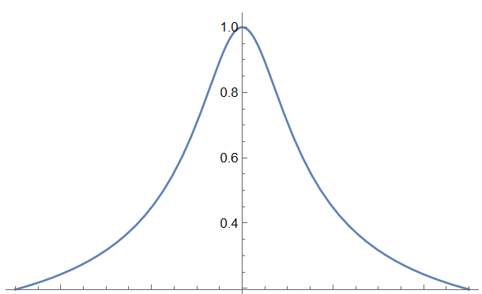
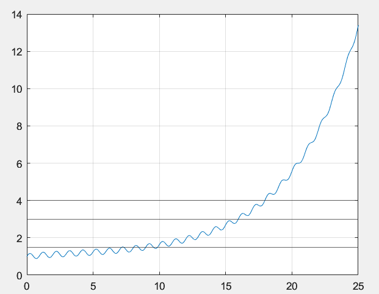
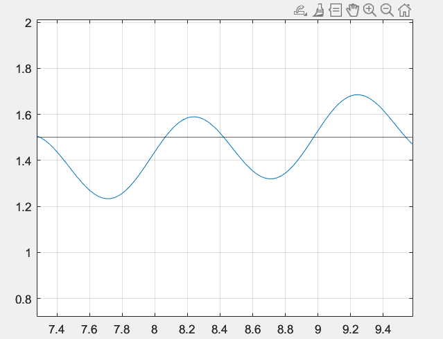
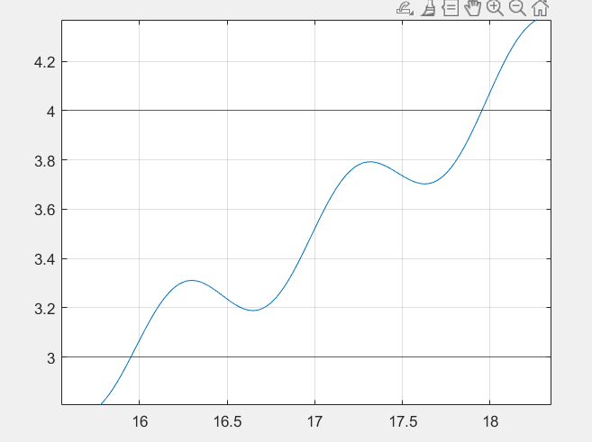
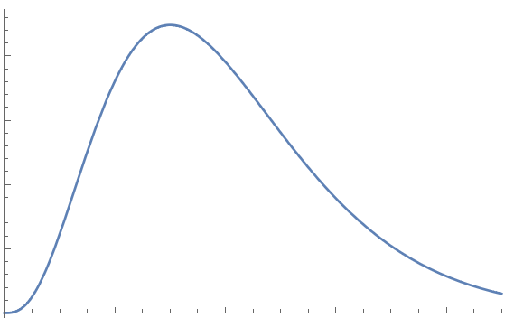
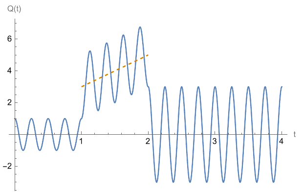

## Question 1

Firstly, if $\tau_p=0$, we get $-(T-T_\infty(t))=0$, which reveals a trivial solution $T=T_\infty(t)=A\exp(t/\tau_w)+B+C\cos(\omega t)$.

If $\tau_p\neq 0$, 

**Method 1:** The solution can be written as $T(t)=T_h(t)+T_p(t)$

**Step 1: Find $T_h(t)$:** The corresponding homogenous equation is
$$
\dfrac{dT}{dt}+\dfrac{T}{\tau_p}=0
$$
and $T_h(t)=\exp(\lambda t)$, then 
$$
\exp(\lambda t)(\lambda+\dfrac{1}{\tau_p})=0\quad\Rightarrow\quad \lambda=-\dfrac{1}{\tau_p}
$$
Hence $T_h(t)=\exp(-\dfrac{t}{\tau_p})$.

**Step 2: Find $T_p(t)$ By undetermined coefficients.** 

$T_p(t)$ has form $T_p(t)=C_1\exp(t/\tau_w)+C_2+C_3\cos(\omega t)+C_4\sin(\omega t)$

Hence
$$
\dfrac{T_p(t)}{dt}+\dfrac{T}{\tau_p}=C_1(1/\tau_w+1/\tau_p)\exp(t/\tau_w)+C_2/\tau_p+(-C_3\omega+C_4/\tau_p)\sin(\omega t)+(C_3/\tau_p+\omega C_4)\cos\omega t=\dfrac{A\exp(t/\tau_w)+B+C\cos(\omega t)}{\tau_p}
$$
Followed by
$$
C_1(1/\tau_w+1/\tau_p)=A/\tau_p\quad\Rightarrow\quad C_1=\dfrac{A\tau_w}{\tau_p+\tau_w}\\
C_2/\tau_p=B/\tau_p\quad\Rightarrow\quad C_2=B\\
-C_3\omega+C_4/\tau_p=0,C_3/\tau_p+\omega C_4=C/\tau_p\quad\Rightarrow\quad C_3=\dfrac{C}{1+\tau_p^2\omega^2},C_4=\dfrac{C\tau_p\omega}{1+\tau_p^2\omega^2}
$$
Therefore
$$
T(t)=C_1\exp(-\dfrac{t}{\tau_p})+\dfrac{A\tau_w}{\tau_p+\tau_w}\exp(\dfrac{t}{\tau_w})+\dfrac{C}{1+\tau_p^2\omega^2}(\cos\omega t+\tau_p\omega \sin\omega t)+B
$$
**Step 2: Find $T_p(t)$ by Auxiliary Problem:**
$$
\dfrac{dY}{dt}+\dfrac{1}{\tau_p}Y=1\exp(\alpha t)
$$
where $Y=D\exp(\alpha t)$, then we have
$$
D\exp(\alpha t)[\alpha+\dfrac{1}{\tau_p}]=1 \exp(\alpha t)\quad \Rightarrow\quad D=\dfrac{1}{\alpha+1/\tau_p}
$$
So $Y=\dfrac{\exp(\alpha t)}{\alpha+1/\tau_p}$. 

Since $\dfrac{T_\infty(t)}{\tau_p}=\dfrac{A}{\tau_p}\exp(t/\tau_w)+\dfrac{B}{\tau_p}+\dfrac{C}{\tau_p}\cos(\omega t)$, the particular solution can be written as $T_p(t)=T_{p1}(t)+T_{p2}(t)+T_{p3}(t)$, with
$$
\dfrac{dT_{p1}}{dt}+\dfrac{T_{p1}}{\tau_p}=\dfrac{A}{\tau_p}\exp(t/\tau_w)\\
\dfrac{dT_{p2}}{dt}+\dfrac{T_{p2}}{\tau_p}=\dfrac{B}{\tau_p}\\
\dfrac{dT_{p3}}{dt}+\dfrac{T_{p3}}{\tau_p}=\dfrac{C}{\tau_p}\cos(\omega  t)\\
$$
Hence 
$$
T_{p_1}(t)=\dfrac{A}{\tau_p}Y|_{\alpha=1/\tau_w}=\dfrac{A\exp(t/\tau_w)}{\tau_p(1/\tau_w+1/\tau_p)}=\dfrac{A\tau_w}{\tau_p+\tau_w}\exp(\dfrac{t}{\tau_w})\\
T_{p_2}(t)=\dfrac{B}{\tau_p}Y|_{\alpha=0}=B\\
T_{p_3}(t)=\dfrac{C}{\tau_p}\mathrm{Re}Y|_{\alpha=i\omega}=\dfrac{C}{1+\tau_p^2\omega^2}(\cos\omega t+\tau_p\omega \sin\omega t)\\
$$
Therefore
$$
T(t)=T_h(t)+T_{p1}(t)+T_{p2}(t)+T_{p3}(t)=C_1\exp(-\dfrac{t}{\tau_p})+\dfrac{A\tau_w}{\tau_p+\tau_w}\exp(\dfrac{t}{\tau_w})+\dfrac{C}{1+\tau_p^2\omega^2}(\cos\omega t+\tau_p\omega \sin\omega t)+B
$$
where $C_1$ is a constant.

**Step 3: Initial Conditions**. Since $T(0)=T_0$, we have
$$
C_1+\dfrac{A\tau_w}{\tau_p+\tau_w}+\dfrac{C}{1+\tau_p^2\omega^2}+B=T_0\quad \Rightarrow\quad C_1=T_0-(\dfrac{A\tau_w}{\tau_p+\tau_w}+\dfrac{C}{1+\tau_p^2\omega^2}+B)
$$
Thus
$$
T(t)=T_h(t)+T_{p1}(t)+T_{p2}(t)+T_{p3}(t)=\left[T_0-(\dfrac{A\tau_w}{\tau_p+\tau_w}+\dfrac{C}{1+\tau_p^2\omega^2}+B)\right]\exp(-\dfrac{t}{\tau_p})+\dfrac{A\tau_w}{\tau_p+\tau_w}\exp(\dfrac{t}{\tau_w})+\dfrac{C}{1+\tau_p^2\omega^2}(\cos\omega t+\tau_p\omega \sin\omega t)+B
$$
**Plot of the transition function: $\alpha=i\omega$**, the transition function is
$$
g(\omega)=|\dfrac{1}{i\omega+1/\tau_p}|=\left|\dfrac{1/\tau_p-i\omega}{\omega^2+1/\tau_p^2}\right|=\dfrac{\tau_p^2}{1+\tau_p^2\omega^2}
$$


**Why no steady state?** the equation is of first order, hence the homogenous solution is exponential, the solution either explodes, or tends to $T_\infty(t)$ but never equals it.

**Plot the solution:**

```matlab
clear all; close all; clc;
%Assignment 2 Problem 1
tmax=25; %max time
dt=tmax/1000;% sampling width or delta t
t=0:dt:tmax; % vector (array) of time samples

%set parameters
T0=1; % initial temp
tp=1; % tau p
tw=5; % tau w
A=0.1; % A value
B=1.0; % B value
C=1.0; % C value
w=2*pi; % omega
% set D for initial condition
D=T0-A*tw/(tp+tw)-B-C/(1+tp^2*w^2);

% temperature solution
T=D*exp(-t/tp)+A*tw*exp(t/tw)/(tp+tw)+C*(cos(w*t)+tp*w*sin(w*t))/(1+tp^2*w^2)+B;

% plot temperature
plot(t,T);
yline([1.5*T0,3*T0,4*T0])
grid on;
```



From the graph



For about 8.7 yrs the average temperature stays within $1.5T_0$.



And it takes about 2 yrs for the temperature to climb from $3T_0$ to $4 T_0$.

**Method 2:**

**Step 1: ** the equation (1) can be normalized as
$$
\left\{\begin{array}{l}
\dfrac{dT}{dt}+\dfrac{T}{\tau_p}=\dfrac{1}{\tau_p}T_\infty(t),\qquad T_\infty(t)=A\exp(t/\tau_w)+B+C\cos(\omega t)\\
T(0)=T_0
\end{array}\right.
$$

**Step 2: ** Integrated function 
$$
P(t)=\exp(\int\dfrac{1}{\tau_p}dt)=\exp(\dfrac{t}{\tau_p})
$$
**Step 3: ** Use the integrated function
$$
\exp(\dfrac{t}{\tau_p})\dfrac{dT}{dt}+\exp(\dfrac{t}{\tau_p})\dfrac{T}{\tau_p}=\exp(\dfrac{t}{\tau_p})\dfrac{T_\infty(t)}{\tau_p}\\
\Rightarrow\ \dfrac{d}{dt}\left[T(t)\exp(\dfrac{t}{\tau_p})\right]=\exp(\dfrac{t}{\tau_p})\dfrac{T_\infty(t)}{\tau_p}
$$
**Step 4: ** Verify step 3
$$
LHS=\exp(\dfrac{t}{\tau_p})\dfrac{dT}{dt}+\dfrac{T}{\tau_p}\exp(\dfrac{t}{\tau_p})=\exp(\dfrac{t}{\tau_p})\dfrac{T_\infty(t)}{\tau_p}=RHS
$$
eliminate $\exp(\dfrac{t}{\tau_p})$, we have
$$
\dfrac{dT}{dt}+\dfrac{T}{\tau_p}=\dfrac{T_\infty(t)}{\tau_p}
$$
which is exactly the same as the original ODE.

**Step 5: ** Integrate
$$
\begin{array}{rl}
T(t)\exp(\dfrac{t}{\tau_p})&\displaystyle=\int\dfrac{d}{dt}\left[T(t)\exp(\dfrac{t}{\tau_p})\right]dt=\int\exp(\dfrac{t}{\tau_p})\dfrac{T_\infty(t)}{\tau_p}dt\\
&=\displaystyle\dfrac{A}{\tau_p}\int\exp(\dfrac{t}{\tau_p}+\dfrac{t}{\tau_w})dt+\dfrac{B}{\tau_p}\int\exp(\dfrac{t}{\tau_p})dt+\dfrac{C}{\tau_p}\int\exp(\dfrac{t}{\tau_p})\cos\omega t\\
&=\dfrac{A\tau_w}{\tau_p+\tau_w}\exp(\dfrac{(\tau_p+\tau_w)t}{\tau_p \tau_w})+B\exp(\dfrac{t}{\tau_p})+\dfrac{C}{1+\tau_p^2\omega^2}(\cos\omega t+\tau_p\omega \sin\omega t)\exp(\dfrac{t}{\tau_p})+D
\end{array}
$$
where $D$ is a constant.

**Step 6: **Initial condition $T(0)=T_0$
$$
LHS=T(0)=\dfrac{A\tau_w}{\tau_p+\tau_w}+B+\dfrac{C}{1+\tau_p^2\omega^2}+D=RHS=T_0
$$
Hence
$$
D=T_0-\dfrac{A\tau_w}{\tau_p+\tau_w}-B-\dfrac{C}{1+\tau_p^2\omega^2}
$$
Therefore 
$$
T(t)=\left[T_0-(\dfrac{A\tau_w}{\tau_p+\tau_w}+\dfrac{C}{1+\tau_p^2\omega^2}+B)\right]\exp(-\dfrac{t}{\tau_p})+\dfrac{A\tau_w}{\tau_p+\tau_w}\exp(\dfrac{t}{\tau_w})+\dfrac{C}{1+\tau_p^2\omega^2}(\cos\omega t+\tau_p\omega \sin\omega t)+B
$$


## Question 2

The 2 order ODE that describes a damped spring-mass system with a mass $m$ kg, damping constant $c$ kg/s and spring constant $k$ N/m should be
$$
m \dfrac{d^2y}{dt^2}+c\dfrac{dy}{dt}+ky=f(t)
$$
where $f(t)$ is the external force.

#### a) 

The auxiliary homogenous to the equation above is $m \dfrac{d^2y}{dt^2}+c\dfrac{dy}{dt}+ky=0$

Basic solution form: $y(t)=\exp(\lambda t)$, substitute it back into the equation, we have 
$$
\exp(\lambda t)(m\lambda^2+c\lambda+k)=0\quad \Rightarrow \quad m\lambda^2+c\lambda+k=m(\lambda+\dfrac{c}{2m})^2+k-\dfrac{c^2}{4m}\neq 0\qquad(*)
$$
If the system is critically damped, then $(*)$ has a unique solution, hence $k-\dfrac{c^2}{4m}=0$, i.e. $c=2\sqrt{mk}$. If $k=1/m$, then $c$ should be $2$.

#### b)

The ODE describing a critically damped model without external forcing is $m \dfrac{d^2y}{dt^2}+c\dfrac{dy}{dt}+ky=0$.

Given $k=1/m, c=2\sqrt{mk}=2$, we'd have
$$
m \dfrac{d^2y}{dt^2}+2\dfrac{dy}{dt}+\dfrac{1}{m}y=0
$$
which is a 2 order homogenous ODE. 

**Step 1: Get $\lambda$. The solution has form $y(t)=\exp(\lambda t)$, therefore**
$$
LHS=\exp(\lambda t)(m\lambda^2+2\lambda+\dfrac{1}{m})=0\Rightarrow m\lambda^2+2\lambda+\dfrac{1}{m}=0\Rightarrow\lambda_1=\lambda_2=-\sqrt{\dfrac{k}{m}}=-\dfrac{1}{m}
$$
**Step 2: Solve Condition. By Step 1, we know that $y(t)=(A+Bt)\exp(-\dfrac{1}{m}t)$**

By $y(0)=y_0=A\exp(0)=A$, we have $A=y_0$.

By $y'(0)=v(0)=v_0$, and $y'(t)=\exp(-\dfrac{t}{m})(B-\dfrac{1}{m}(A+Bt))$, we have
$$
y'(0)=\exp(0)(B-\dfrac{A}{m})=v_0\quad \Rightarrow\quad B=v_0+\dfrac{y_0}{m}
$$
Therefore, $y(t)=(y_0+(v_0+\dfrac{y_0}{m})t)\exp\left(-\dfrac{t}{m}\right)$.

#### c) 

If the system is externally forced by $F(t)=\dfrac{F_0t}{\tau}\exp(-t/m)$, Then the corresponding ODE should be
$$
m \dfrac{d^2y}{dt^2}+2\dfrac{dy}{dt}+\dfrac{1}{m}y=\dfrac{F_0t}{\tau}\exp(-t/m)
$$
Note that $-\dfrac{1}{m}$ is the eigenvalue of multiplicity 2 of the auxiliary problem, hence the particular solution has the form $y_p(t)=t^2(A+Bt)\exp(-t/m)$. Adopting parallel differentiation method, we can deduce that
$$
y_p'(t)=(2At+3Bt^2-\dfrac{1}{m}(At^2+Bt^3))\exp(-t/m)\\
y_p''(t)=\left[(2A+6Bt-\dfrac{1}{m}(2At+3Bt^2))-\dfrac{1}{m}(2At+3Bt^2-\dfrac{1}{m}(At^2+Bt^3))\right]\exp(-t/m)
$$
Simplified to be
$$
y_p'(t)=(2At+(3B-\dfrac{A}{m}A)t^2-\dfrac{B}{m}t^3)\exp(-t/m)\\
y_p''(t)=\left[2A+(6B-\dfrac{4A}{m})t+(-\dfrac{6B}{m}+\dfrac{A}{m^2})t^2+\dfrac{B}{m^2}t^3\right]\exp(-t/m)
$$


Hence
$$
\begin{array}{rl}
my''_p(t)+2y_p'(t)+\dfrac{1}{m}y_p(t)&=\exp(-t/m)\left[2Am+6Bmt\right]\\
&=2m(A+3Bt)\exp(-t/m)=\dfrac{F_0t}{\tau}\exp(-t/m)
\end{array}
$$
Followed by
$$
2mA=0\quad\Rightarrow\quad A=0,\qquad6mBt=\dfrac{F_0t}{\tau}\quad \Rightarrow\quad B=\dfrac{F_0}{6m\tau}
$$
Therefore a particular solution is $y_p(t)=\dfrac{F_0t^3}{6m\tau}\exp(-t/m)$.

#### d)

Substitute $y_p(t)=\dfrac{F_0t^3}{6m\tau}\exp(-t/m)$ back into the LHS of the ODE, we have
$$
y_p'(t)=\dfrac{F_0}{6m\tau}(3t^2-\dfrac{1}{m}t^3)\exp(-t/m)\\
y_p''(t)=\dfrac{F_0}{6m\tau}(6t-\dfrac{3}{m}t^2-\dfrac{1}{m}(3t^2-\dfrac{1}{m}t^3))\exp(-t/m)=\dfrac{F_0}{6m\tau}(6t-\dfrac{6}{m}t^2+\dfrac{1}{m^2}t^3)
$$
Hence adding them together we have
$$
\begin{array}{rl}
my''_p(t)+2y_p'(t)+\dfrac{1}{m}y_p(t)&=\exp(-t/m)\dfrac{F_0}{6m\tau}\left[m(6t-\dfrac{6}{m}t^2+\dfrac{1}{m^2}t^3)+2(3t^2-\dfrac{1}{m}t^3)+\dfrac{t^3}{m}\right]\\
&=\exp(-t/m)\dfrac{F_0}{6m\tau}\left[6mt\right]\\
&=\exp(-t/m)\dfrac{F_0t}{\tau}=F(t)
\end{array}
$$
Therefore our solution is correct.

#### e)

As the solution to the ODE can be write as $y(t)=y_h(t)+y_p(t)$, if $y_h(t)$ disappears, i.e. $y(0)=y_p(t)$, and
$$
y_h(t)\equiv 0\quad \Rightarrow\quad \forall\ t,y_h(t)=0,y_h'(t)=0
$$
the initial condition must be $y(0)=y_h(0)+y_p(0)=y_p(0),\ y'(0)=y_h'(0)+y_p'(0)=y_p'(0)$.

Observation:

1. $y(t)>0$ iff. $t>0$, $y(t)<0$ iff. $t<0$, $y(t)=0$ iff. $t=0$
2. $y'(t)=y_p'(t)=\dfrac{F_0}{6m\tau}(3-\dfrac{t}{m})t^2\exp(-t/m)\left\{\begin{array}{l}<0&t>3m\\>0&t\in[0,3m]\\0&t=3m\end{array}\right.$

Therefore $y(t)$ increases on $[0,3m]$ from $0$ and decreases on $(3m,+\infty)$ but won't intersect with $x$-axis.

**Sketch: **



## Question 3

By Hook's Law, the ODE of an undamped oscillation with spring constant $k$ can be written as 
$$
m\dfrac{d^2y}{dt^2}+ky=f(t)
$$
where $f(t)$ is the external input

#### a

Additional conditions: 
$$
f(t)=F_0\sin(\omega t-\varphi)=F_0\cos\varphi \sin\omega t-F_0\cos\omega t\sin\varphi,\quad y(0)=0,y'(0)=0
$$
The solution should be $y(t)=y_h(t)+y_p(t)$

**Step 1: Find $y_h$. Characteristic equation:**
$$
m\dfrac{d^2y}{dt^2}+ky=0
$$
Solution form $y_h(t)=\exp(\lambda t)$, hence $\exp(\lambda t)(m\lambda^2+k)=0\Rightarrow \lambda=\pm i\sqrt{k/m}$. Therefore
$$
y_h(t)=a\exp(i\sqrt{k/m})+b\exp(-i\sqrt{k/m})=A\cos\sqrt{\dfrac{k}{m}}t+B\sin\sqrt{\dfrac{k}{m}}t=\sqrt{A^2+B^2}\sin(\sqrt{\dfrac{k}{m}}t+\arctan\dfrac{A}{B})
$$
where $a,b,A=a+b,B=a-b\in\mathbb{R}$.

**Step 2: Find $y_p(t)$. Auxiliary problem:**

Since $\omega\neq \sqrt{\dfrac{k}{m}}$, there's no duplications, the corresponding Auxiliary Problem ($Y=D\exp(\alpha t)$)
$$
mY''(t)+kY(t)=1\cdot \exp(\alpha t)\quad\Rightarrow\quad D\exp(\alpha t)(m\alpha^2+k)=\exp(\alpha t)\quad\Rightarrow\quad D=\dfrac{1}{m\alpha^2+k}
$$

Hence $Y(t)=\dfrac{\exp(\alpha t)}{m\alpha^2+k}$. Since $F(t)=F_0\cos\varphi \sin\omega t-F_0\cos\omega t\sin\varphi$, we can let $\alpha=i\omega$, then
$$
Y(t)=\dfrac{\cos\omega t-i\sin\omega t}{k-m\omega^2}
$$
Followed by
$$
y_p(t)=F_0\cos\varphi \mathrm{Im}Y-F_0\sin\varphi \mathrm{Re}Y=\dfrac{F_0}{-m\omega^2+k}\sin(\omega t-\varphi)
$$
And
$$
y(t)=y_h(t)+y_p(t)=\sqrt{A^2+B^2}\sin(\sqrt{\dfrac{k}{m}}t+\arctan\dfrac{A}{B})+\dfrac{F_0}{-m\omega^2+k}\sin(\omega t-\varphi)
$$
**Step 3: Zero Initial Conditions**

$y(0)=0$ gives
$$
0=y(0)=\sqrt{A^2+B^2}\sin(\arctan\dfrac{A}{B})-\dfrac{F_0}{-m\omega^2+k}\sin\varphi\quad \Rightarrow \quad A=\dfrac{F_0\sin\varphi}{-m\omega^2+k}
$$
$y'(0)=0$ gives
$$
0=y'(0)=\sqrt{A^2+B^2}\sqrt{\dfrac{k}{m}}\cos(\arctan\dfrac{A}{B})+\dfrac{\omega F_0}{-m\omega^2+k}\cos(-\varphi)\quad\Rightarrow\quad B=\dfrac{\omega F_0\cos\varphi}{m\omega^2-k}\sqrt{\dfrac{m}{k}}
$$
Therefore the complete solution is 
$$
y(t)=y_h(t)+y_p(t)=\dfrac{F_0\sin\varphi\cos\sqrt{\dfrac{k}{m}}t}{-m\omega^2+k}+\dfrac{\omega F_0\cos\varphi\sin\sqrt{\dfrac{k}{m}}t}{m\omega^2-k}\sqrt{\dfrac{m}{k}}+\dfrac{F_0}{-m\omega^2+k}\sin(\omega t-\varphi)
$$
**Step 4: Sketch. (Omitted)**

#### b)

Additional conditions: 
$$
f(t)=F_0\sin(\omega t-\varphi),\quad\omega=\sqrt{\dfrac{k}{m}},\quad y(0)=0,y'(0)=0
$$
The solution should be $y(t)=y_h(t)+y_p(t)$

**Step 1: Find $y_p$. Auxiliary equation:**
$$
m\dfrac{d^2y}{dt^2}+ky=0
$$
Solution form $y_h(t)=\exp(\lambda t)$, hence $\exp(\lambda t)(m\lambda^2+k)=0\Rightarrow \lambda=\pm i\sqrt{k/m}$. Therefore
$$
y_h(t)=a\exp(i\sqrt{k/m})+b\exp(-i\sqrt{k/m})=A\cos\sqrt{\dfrac{k}{m}}t+B\sin\sqrt{\dfrac{k}{m}}t=\sqrt{A^2+B^2}\sin(\omega t+\arctan\dfrac{A}{B})
$$
where $a,b,A=a+b,B=a-b\in\mathbb{R}$.

**Step 2: Find $y_p(t)$​. Auxiliary problem:**
$$
mY''(t)+kY(t)=1\cdot \exp(\alpha t)
$$
Obviously $y_p(t)$ has $\exp(i\sqrt{\dfrac{k}{m}}t),\ \exp(-i\sqrt{\dfrac{k}{m}}t)$, hence duplicates $y_h(t)$, therefore $Y=Dt\exp(\alpha t)$, which leads to
$$
Y'(t)=D\exp(\alpha t)(1+\alpha t),\quad Y''(t)=D\exp(\alpha t)(\alpha+\alpha(1+\alpha t))=D\exp(\alpha t)(2\alpha+\alpha^2 t)\quad \Rightarrow\\
mY''(t)+kY(t)=D\exp(\alpha t)(m(2\alpha+\alpha^2t)+kt)=1\cdot \exp(\alpha t)
$$
We can deduce that
$$
D=\dfrac{1}{2\alpha m+(k+m\alpha^2)t}=\dfrac{1}{2\sqrt{mk}}
$$
Since $F(t)=F_0\cos\varphi \sin\omega t-F_0\cos\omega t\sin\varphi$, $\alpha=i\omega=i\sqrt{\dfrac{k}{m}}$. Thus
$$
Y(t)=\dfrac{t\exp(\alpha t)}{2\sqrt{mk}}=\dfrac{t\cos\sqrt{\dfrac{k}{m}}t+it\sin\sqrt{\dfrac{k}{m}}t}{2\sqrt{mk}}
$$
Hence
$$
y_p(t)=F_0\cos\varphi \mathrm{Im}Y-F_0\sin\varphi \mathrm{Re}Y=-\dfrac{F_0t}{2\sqrt{km}}\cos(\sqrt{\dfrac{k}{m}} t-\varphi)
$$
Therefore
$$
y(t)=y_h(t)+y_p(t)=\sqrt{A^2+B^2}\sin(\sqrt{\dfrac{k}{m}} t+\arctan\dfrac{A}{B})-\dfrac{F_0t}{2\sqrt{km}}\cos(\sqrt{\dfrac{k}{m}} t-\varphi)
$$
**Step 3: Zero Initial Conditions**

$y(0)=0$ gives
$$
0=y(0)=\sqrt{A^2+B^2}\sin(\arctan\dfrac{A}{B})\quad \Rightarrow \quad A=0
$$
$y'(0)=0$ gives
$$
0=y'(0)=\sqrt{A^2+B^2}\sqrt{\dfrac{k}{m}}\cos(\arctan\dfrac{A}{B})-\dfrac{F_0}{2\sqrt{km}}\cos\varphi\quad\Rightarrow\quad B=\dfrac{F_0 \cos\varphi}{2k}
$$
Therefore the complete solution is 
$$
y(t)=y_h(t)+y_p(t)=\dfrac{F_0 \cos\varphi}{2k}\sin\sqrt{\dfrac{k}{m}}t-\dfrac{F_0t}{2\sqrt{km}}\cos(\sqrt{\dfrac{k}{m}} t-\varphi)
$$
**Step 4: Sketch. (Omitted)**

## Question 4

Form from `Week4Class1Part2.pdf`

**Equation:** 
$$
L\dfrac{d^2Q}{dt^2}+R\dfrac{dQ}{dt}+\dfrac{1}{C}Q=E(t),\qquad Q(0)=Q_0,Q'(0)=I_0
$$
 if the LC-circuit has zero resistance, i.e. $R=0$, then 
$$
L\dfrac{d^2Q}{dt^2}+\dfrac{1}{C}Q=E(t),\qquad Q(0)=Q_0,Q'(0)=I_0
$$
where $E(t)=\left\{\begin{array}{lr}2t+1&t\in[1,2]\\0&\text{otherwise}\end{array}\right.$. Solution $Q(t)=Q_h(t)+Q_p(t)$

**Step 1: Get $Q_h$. System:**
$$
L\dfrac{d^2Q}{dt^2}+\dfrac{1}{C}Q=0
$$
Solution form $Q(t)=\exp(\lambda t)$, hence 
$$
\exp(\lambda t)(L\lambda^2+\dfrac{1}{C})=0\quad\Rightarrow \quad\lambda_1=i\sqrt{\dfrac{1}{LC}} \quad\lambda_2=-i\sqrt{\dfrac{1}{LC}}
$$
therefore $Q_h(t)=a\exp\left(i\sqrt{\dfrac{1}{LC}}\right)+b\exp\left(-i\sqrt{\dfrac{1}{LC}}\right)=A\cos\sqrt{\dfrac{1}{LC}}t+B\sin\sqrt{\dfrac{1}{LC}}t$

where $a,b,A=a+b,B=a-b\in\mathbb{R}$.

**Step 2: Get $Q_p$. Since when $t\in[1,2]$, the equation is homogenous, $Q_p(t)=0$, we only need to consider $t\not\in[1,2]$. System:**
$$
L\dfrac{d^2Q}{dt^2}+\dfrac{1}{C}Q=E(t)=2t+1
$$
The RHS is polynomial, hence we can let $Q(t)=At+B$, then
$$
0\cdot L+\dfrac{1}{C}(At+B)=2t+1\quad\Rightarrow \quad A=2C,B=C
$$
therefore $Q_p(t)=C(2t+1)$.

**Step 3: Condition.**

By Step 1,2, we have 
$$
Q(t)=Q_h(t)+Q_p(t)=\left\{\begin{array}{lr}A_1\cos\sqrt{\dfrac{1}{LC}}t+B_1\sin\sqrt{\dfrac{1}{LC}}t=Q_1(t)&0\leqslant t<1\\
A_2\cos\sqrt{\dfrac{1}{LC}}t+B_2\sin\sqrt{\dfrac{1}{LC}}t+C(2t+1)=Q_2(t)&t\in[1,2]\\
A_3\cos\sqrt{\dfrac{1}{LC}}t+B_3\sin\sqrt{\dfrac{1}{LC}}t=Q_3(t)&t>2
\end{array}\right.
$$
By the initial values $Q(0)=Q_0,Q'(0)=I_0$, we have 
$$
A_1\cos 0+B_1\sin 0=Q(0)=Q_0\Rightarrow A_1=Q_0\\
-A_1\sqrt{\dfrac{1}{LC}}\sin\sqrt{\dfrac{1}{LC}}\cdot 0+B_1\sqrt{\dfrac{1}{LC}}\cos\sqrt{\dfrac{1}{LC}}\cdot 0=B_1\sqrt{\dfrac{1}{LC}}=Q'(0)=I_0\Rightarrow B_1=I_0\sqrt{LC}
$$
Hence,
$$
Q(t)=Q_h(t)+Q_p(t)=\left\{\begin{array}{lr}Q_0\cos\sqrt{\dfrac{1}{LC}}t+I_0\sqrt{LC}\sin\sqrt{\dfrac{1}{LC}}t=Q_1(t)&0\leqslant t<1\\
A_2\cos\sqrt{\dfrac{1}{LC}}t+B_2\sin\sqrt{\dfrac{1}{LC}}t+C(2t+1)=Q_2(t)&t\in[1,2]\\
A_3\cos\sqrt{\dfrac{1}{LC}}t+B_3\sin\sqrt{\dfrac{1}{LC}}t=Q_3(t)&t>2
\end{array}\right.\quad (A_i,B_i\in \mathbb{R},i\in\{2,3\})
$$
**Continuity conditions**. If we require first order continuity, then around $t=1,2$, we'd have
$$
\lim_{t\rightarrow 1^-}Q_1(t)=\lim_{t\rightarrow 1^+}Q_2(t)\Rightarrow (Q_0-A_2)\cos\sqrt{\dfrac{1}{LC}}+(I_0\sqrt{LC}-B_2)\sin\sqrt{\dfrac{1}{LC}}=3C\\
\lim_{t\rightarrow 2^-}Q_2(t)=\lim_{t\rightarrow 2^+}Q_3(t)\Rightarrow (A_2-A_3)\cos2\sqrt{\dfrac{1}{LC}}+(B_2-B_3)\sin2\sqrt{\dfrac{1}{LC}}=-3C
$$
If we additionally require second order continuity, then around $t=1,2$, we'd have
$$
Q'(t)=Q_h'(t)+Q_p'(t)=\left\{\begin{array}{lr}-Q_0\sqrt{\dfrac{1}{LC}}\sin\sqrt{\dfrac{1}{LC}}t+I_0\cos\sqrt{\dfrac{1}{LC}}t=Q_1'(t)&0\leqslant t<1\\
-A_2\sqrt{\dfrac{1}{LC}}\sin\sqrt{\dfrac{1}{LC}}t+B_2\sqrt{\dfrac{1}{LC}}\cos\sqrt{\dfrac{1}{LC}}t+2C=Q_2'(t)&t\in[1,2]\\
-A_3\sqrt{\dfrac{1}{LC}}\sin\sqrt{\dfrac{1}{LC}}t+B_3\sqrt{\dfrac{1}{LC}}\cos\sqrt{\dfrac{1}{LC}}t=Q_3'(t)&t>2
\end{array}\right.\quad (A_i,B_i\in \mathbb{R},i\in\{2,3\})
$$

$$
\lim_{t\rightarrow 1^-}Q_1'(t)=\lim_{t\rightarrow 1^+}Q_2'(t)\Rightarrow (A_2-Q_0)\sqrt{\dfrac{1}{LC}}\sin\sqrt{\dfrac{1}{LC}}+(B_2-I_0\sqrt{LC})\sqrt{\dfrac{1}{LC}}\cos\sqrt{\dfrac{1}{LC}}=2C\\
\lim_{t\rightarrow 2^-}Q_2(t)=\lim_{t\rightarrow 1^+}Q_2'(t)\Rightarrow (A_3-A_2)\sqrt{\dfrac{1}{LC}}\sin2\sqrt{\dfrac{1}{LC}}+(B_3-B_2)\sqrt{\dfrac{1}{LC}}\cos2\sqrt{\dfrac{1}{LC}}=-2C
$$

**Step 4: Sketch.**

Since for any $A,B\in\mathbb{R}$, we have $A\cos at+B\sin at=\sqrt{A^2+B^2}\sin(at+\arctan \dfrac{A}{B})$, hence $Q_1(t)$ is a sine function with phase angle $\in(0,\pi/2)$, aptitude $\sqrt{A^2+B^2}$. Similarly for $Q_3(t)$. And $Q_2(t)$ is a linear function plus a sine function, by the 2 order continuity, we can roughly draw the graph.




## Question 5

#### a) Equations:

$$
\left\{\begin{array}{l}
\dfrac{dM_1}{dt}=\underbrace{QC_{in}}_{\text{external input}}+\underbrace{a\dfrac{M_2}{V}}_{\text{from Tank 2}}-\underbrace{(Q+a)\dfrac{M_1}{V}}_{\text{to Tank2}}\\
\dfrac{dM_2}{dt}=\underbrace{(Q+a)\dfrac{M_1}{V}}_{\text{from Tank1}}-\underbrace{a\dfrac{M_2}{V}}_{\text{to Tank 1}}-\underbrace{Q\dfrac{M_2}{V}}_{\text{output}}
\end{array}\right.
$$

Here the liquid volumes of the 2 tanks keep constant. Convert it to matrix form we have
$$
\dfrac{dX}{dt}=\dfrac{1}{V}\begin{bmatrix}-(Q+a)&a\\(Q+a)&-a-Q\end{bmatrix}X+\begin{bmatrix}QC_{in}\\0\end{bmatrix}=AX+b
$$

#### b) Eigenvalues

Note that 
$$
|A-\lambda I|=\begin{vmatrix}-\dfrac{Q+a}{V}-\lambda&\dfrac{a}{V}\\\dfrac{Q+a}{V}&-\dfrac{Q+a}{V}-\lambda\end{vmatrix}=\dfrac{a(Q+2\lambda V)+(Q+\lambda V)^2}{V^2}=0
$$
solutions:
$$
\lambda_1=-\dfrac{Q+a}{V}+\dfrac{\sqrt{a^2+aQ}}{V}\qquad \lambda_2=-\dfrac{Q+a}{V}-\dfrac{\sqrt{a^2+aQ}}{V}
$$

#### c) Eigenvectors

For $\lambda_1$, we have $(A-\lambda_1 I)X_1=0$, where $X_1$ is the eigenvector corresponding to $\lambda_1$.
$$
\begin{bmatrix}-\dfrac{\sqrt{a^2+aQ}}{V}&\dfrac{a}{V}\\\dfrac{Q+a}{V}&-\dfrac{\sqrt{a^2+aQ}}{V}\end{bmatrix}X_1=0\ \quad\Rightarrow\quad X_1=\begin{bmatrix}\sqrt{\dfrac{a}{Q+a}}\\1\end{bmatrix}
$$


For $\lambda_2$, we have $(A-\lambda_2 I)X_2=0$, where $X_2$ is the eigenvector corresponding to $\lambda_2$.
$$
\begin{bmatrix}\dfrac{\sqrt{a^2+aQ}}{V}&\dfrac{a}{V}\\\dfrac{Q+a}{V}&\dfrac{\sqrt{a^2+aQ}}{V}\end{bmatrix}X_2=0\ \quad\Rightarrow\quad X_2=\begin{bmatrix}-\sqrt{\dfrac{a}{Q+a}}\\1\end{bmatrix}
$$

#### d) Particular solution

Let the particular solution be the constant vector $M_p^T=(M_{p_1},M_{p_2})$, substitute it back into the equation, we have
$$
\dfrac{1}{V}\begin{bmatrix}-(Q+a)&a\\(Q+a)&-a-Q\end{bmatrix}M_p+\begin{bmatrix}QC_{in}\\0\end{bmatrix}=\dfrac{dM_p}{dt}=0=AM_p+b
$$
That is,
$$
AM_p=-\begin{bmatrix}QC_{in}\\0\end{bmatrix}
$$
By Crame's rule,
$$
M_{p_1}=\dfrac{
\begin{vmatrix}
-QC_{in}&\dfrac{a}{V}\\
0&-\dfrac{Q+a}{V}
\end{vmatrix}
}{\begin{vmatrix}
-\dfrac{Q+a}{V}&\dfrac{a}{V}\\
\dfrac{Q+a}{V}&-\dfrac{Q+a}{V}
\end{vmatrix}}=\dfrac{Q(Q+a)C_{in}/V}{Q(Q+a)/V^2}=C_{in}V
$$

$$
M_{p_1}=\dfrac{
\begin{vmatrix}
-\dfrac{Q+a}{V}&-QC_{in}\\
\dfrac{Q+a}{V}&0
\end{vmatrix}
}{\begin{vmatrix}
-\dfrac{Q+a}{V}&\dfrac{a}{V}\\
\dfrac{Q+a}{V}&-\dfrac{Q+a}{V}
\end{vmatrix}}=\dfrac{Q(Q+a)C_{in}/V}{Q(Q+a)/V^2}=C_{in}V
$$

therefore $M_p^T=\left(VC_{in},VC_{in}\right)$.

Here, as we let $M_p$ be constant, the $\dfrac{dX}{dt}$ becomes $0$, hence the solution is also the one to the steady state.

#### e)

$$
X=a_1\exp(\lambda_1 t)X_1+a_2\exp(\lambda_2 t)X_2 +M_p^T
$$


## s

The 2 order ODE that describes a damped spring-mass system with a mass $m$ kg, damping constant $c$ kg/s and spring constant $k$ N/m should be
$$
m \dfrac{d^2y}{dt^2}+c\dfrac{dy}{dt}+ky=f(t)
$$
where $f(t)$ is the external force.

#### a) 

The auxiliary homogenous to the equation above is $m \dfrac{d^2y}{dt^2}+c\dfrac{dy}{dt}+ky=0$

Basic solution form: $y(t)=\exp(\lambda t)$, substitute it back into the equation, we have 
$$
\exp(\lambda t)(m\lambda^2+c\lambda+k)=0\quad \Rightarrow \quad m\lambda^2+c\lambda+k=m(\lambda+\dfrac{c}{2m})^2+k-\dfrac{c^2}{4m}\neq 0\qquad(*)
$$
If the system is critically damped, then $(*)$ has a unique solution, hence $k-\dfrac{c^2}{4m}=0$, i.e. $c=2\sqrt{mk}$. If $k=1/m$, then $c$ should be $2$.

#### b)

The ODE describing a critically damped model without external forcing is $m \dfrac{d^2y}{dt^2}+c\dfrac{dy}{dt}+ky=0$.

Given $k=1/m, c=2\sqrt{mk}$, we'd have $m \dfrac{d^2y}{dt^2}+2\sqrt{mk}\dfrac{dy}{dt}+\dfrac{1}{m}y=0$.

