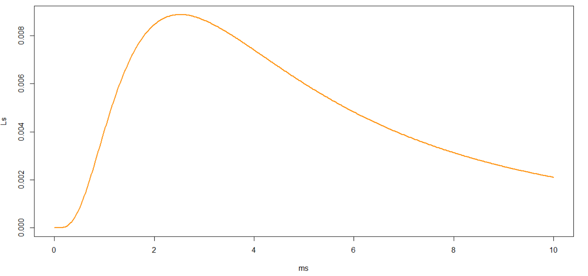
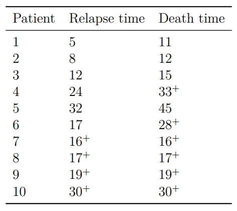
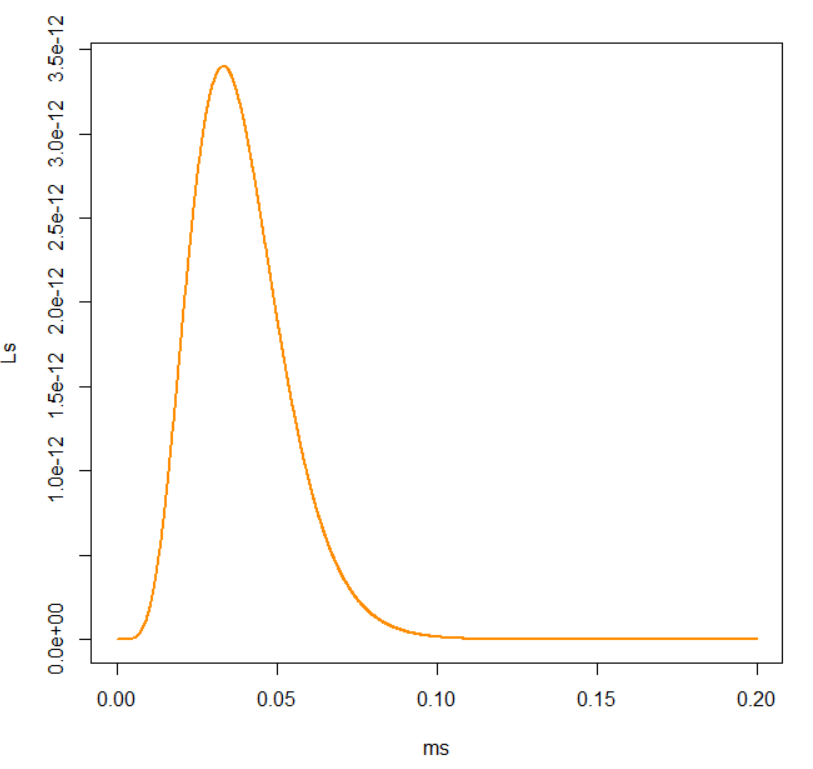
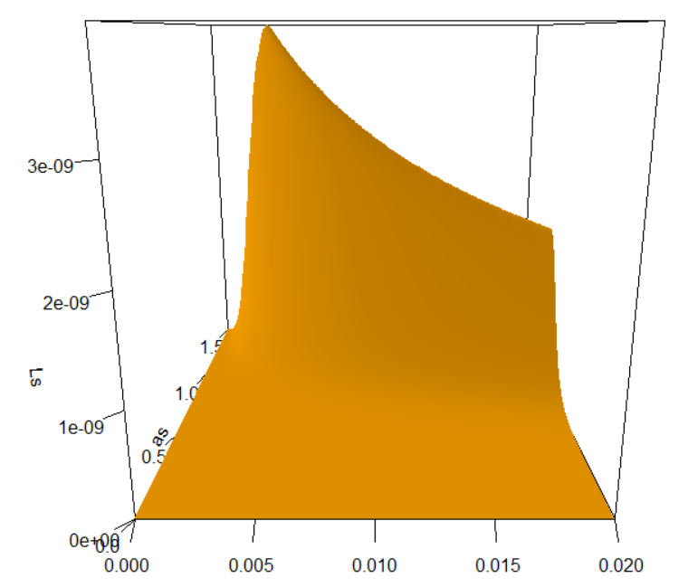
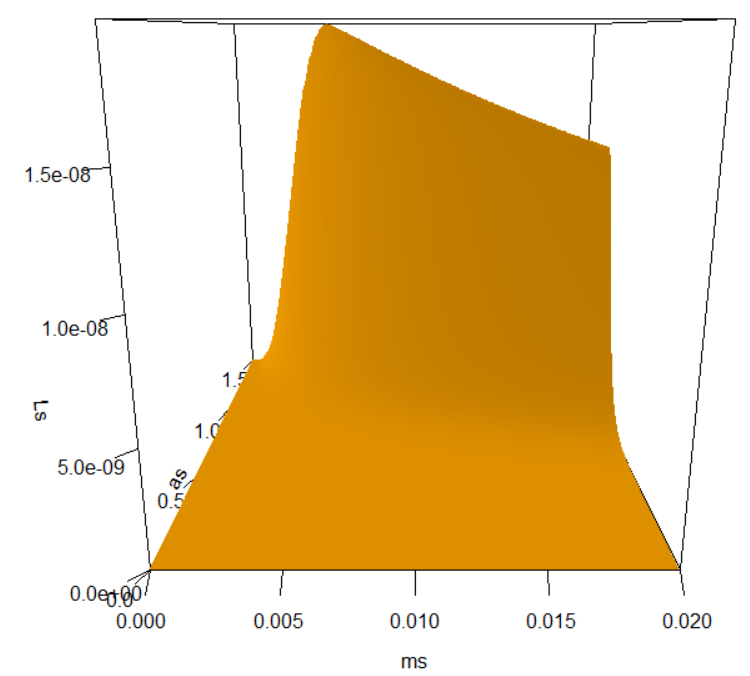
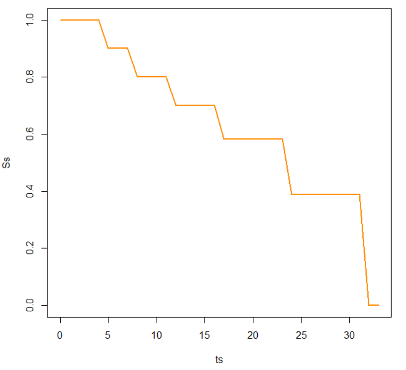

### Question 1

1. Firstly, the investigator knows the existence of this individual and partially have the information about he/she, hence it is **censoring**. Secondly, the observation interval of time is $[0,30]$, and the end of study time is prespecified, hence it is **right censoring of Type I with censoring time $R=60$**. 

   There's also truncation at left ($L=30$) as we have no information about her before age 30.

2. Firstly, the investigator knows the existence of this individual and partially have the information about he/she, hence it is **censoring**. Secondly, the time of taking a disease is continuous, but due to factors of subjective factor, the investigator didn't know she had caught cancer until a clinic exam at a PREDETERMINED time, hence he can only draw the conclusion that she caught cancer BEFORE the exam and AFTER the last exam (i.e. between the 12th and 15th year). Therefore, this is **interval censoring of Type I with censoring time $\{52,55\}$.**

   There's also truncation at left ($L=40$) as we have no information about her before age 40.

3. Firstly, the investigator knows the existence of this individual and partially have the information about he/she, hence it is **censoring**. Besides, This individual had to exit the experiment due to dying from a disease unrelated to what the investigator is interested in, which is an independent competing event (has a censoring time that is statistically independent of her failure time). Hence the event of interest is not observable for her. Therefore, this is **random right censoring with censoring time $R=61$.**

   There's also truncation at left ($L=50$) as we have no information about her before age 50.

4. For investigators, moving away from the community is the same as dying from another cancer, i.e. she had a censoring time that is statistically independent of her failure time. Hence it's also **random right censoring with censoring time $R=55$.**

   There's also truncation at left ($L=42$) as we have no information about her before age 40.

5. $$
   L=\dfrac{S(60)}{S(30)}\cdot\dfrac{S(52)-S(55)}{S(40)}\cdot\dfrac{S(61)}{S(50)}\cdot\dfrac{S(55)}{S(42)}
   $$

### Question 2

1. By the definition, the survival function is 
   $$
   S_\lambda(t)=P(T>t)=\int_t^{+\infty}f(t)dt=\dfrac{1}{1+\lambda t^\alpha}
   $$
   Hence the likelihood for $t_1=0.5,t_2=1,t_3=0.75,t_4=0.25^-,t_5=1.25^-$ should be
   $$
   L(\lambda|t_1,t_2,\cdots,t_5)=f(t_1)f(t_2)f(t_3)(1-S_\lambda(t_4))(1-S_\lambda(t_5))\qquad\hookleftarrow\\
   =\dfrac{\alpha\lambda\cdot 0.5^{\alpha-1}}{(1+\lambda t^\alpha)^2}\dfrac{\alpha\lambda\cdot 1^{\alpha-1}}{(1+\lambda t^\alpha)^2}\dfrac{\alpha\lambda\cdot 0.75^{\alpha-1}}{(1+\lambda t^\alpha)^2}(1-\dfrac{1}{1+\lambda\cdot0.25^\alpha})(1-\dfrac{1}{1+\lambda\cdot1.25^\alpha} )\qquad\hookleftarrow\\
   =\frac{\left(\frac{8}{3}\right)^{1-\alpha } 5^{\alpha } \alpha ^3
      \lambda ^5}{(\lambda +1)^2 \left(2^{\alpha }+\lambda \right)^2
      \left(4^{\alpha }+\lambda \right)
      \left(\left(\frac{3}{4}\right)^{\alpha } \lambda +1\right)^2
      \left(\left(\frac{5}{4}\right)^{\alpha } \lambda +1\right)}
   $$
   
2. The following block contains the codes for plotting $L(\lambda|t_1,t_2,\cdots,t_5)$

    ```R
    require(graphics)
    
    f <- function(t, a, m) {
        a * m * 0.5 ^ (a - 1) / (1 + m * t ^ a) ^ 2
    }
    S <- function(t, a, m) {
        1 / (1 + m * t ^ a)
    }
    
    ts <- c(0.5, 1, 0.75, 0.25, 1.25);
    
    L <- function(m) {
        f(ts[1], a, m) * f(ts[2], a, m) * f(ts[3], a, m) * (1 - S(ts[4], a, m)) * (1 - S(ts[5], a, m))
    }
    
    ms <- seq(0,10,by=.02);
    Ls <- L(ms);
    
    plot(ms, Ls, type = 'l', col = 'darkorange', lwd = 2)
    ```

​	

​	The peak is reached at about $\lambda=2.5$.

### Question 3



The time to relapse had an exponential distribution with hazard rate $\lambda$, hence the PDF and survival function are
$$
f_1(t)=\lambda\exp(-\lambda t)\mathbf{1}(t\geqslant0),\quad S_1(t)=P(T>t)=\int_t^{+\infty}f_1(t)dt=\exp(-\lambda t)\mathbf{1}(t\geqslant0)
$$
The time to death had a Weibull distribution with parameter $\theta$ and $\alpha$, hence the PDF and survival function are
$$
f_2(t)=\alpha \theta t^{\alpha-1}\exp(-\theta t^\alpha)\mathbf{1}(t\geqslant0),\quad S_2(t)=P(T>t)=\int_t^{+
\infty}f_2(t)dt=\exp(-\theta t^\alpha)\mathbf{1}(t\geqslant0)
$$

1. For the relapse rate, the likelihood function can be written as
   $$
   L_1(\lambda|t_{1,1},t_{1,2},\cdots,t_{1,10})=\left(\prod_{i=1}^6f_1(t_{1,i})\right)\left(\prod_{i=7}^{10}S_1(t_{1,i})\right)=\lambda^6\exp(-\lambda\sum_{i=1}^{10}t_{1,i})
   $$
   Plot in R:

   ```R
   require(graphics)
   
   ts <- c(5, 8, 12, 24, 32, 17, 16, 17, 19, 30);
   
   L <- function(m) {
       m ^ 6 * exp(-m * sum(ts))
   }
   
   ms <- seq(0, 0.2,by=.001);
   Ls <- L(ms);
   
   plot(ms, Ls, type = 'l', col = 'darkorange', lwd = 2)
   ```

   

​	The peak is reached at about $\lambda = 0.035$.

2. For the death rate, the likelihood function can be written as
   $$
   L_2(\theta,\alpha|t_{2,1},t_{2,2},\cdots,t_{2,10})=\left(\prod_{i\in\{1,2,3,5\}}f_2(t_{2,i})\right)\left(\prod_{i\not\in\{1,2,3,5\}}S_1(t_{2,i})\right)=\alpha^4\theta^4t_{2,1}^{\alpha-1}t_{2,2}^{\alpha-1}t_{2,3}^{\alpha-1}t_{2,5}^{\alpha-1}\exp\left(-\theta\sum_{i=1}^{10}t_{2,i}^\alpha\right)
   $$
   Plot in R:

   ```R
   require(graphics)
   
   ts <- c(11,12,15,33,45,28,16,17,19,30);
   
   L <- function(m, a) {
       a^4*m^4*ts[1]^(a-1)*ts[2]^(a-1)*ts[3]^(a-1)*ts[5]^(a-1)*exp(-m*sum(ts^a))
   }
   
   ms <- seq(0, 0.02,by=.0001);
   as <- seq(0, 1.5,by=.001);
   Ls <- matrix(0, nrow=length(ms), ncol=length(as));
   for (i in 1:length(ms)) {
       for (j in 1:length(as)) {
           Ls[i, j] <- L(ms[i], as[j]);
       }
   }
   
   persp(ms, as, Ls, col = "orange", shade = 0.2, border=NA, nticks = 5, ticktype = "detailed")
   ```

   

​	The peak is reached at about $\theta = 0.0093,\alpha=1.1586$. (By adopting Newton's Method)

3. Since we don't know whether patient 7~10 is relapsed after the study, hence they're truncated. The likelihood for the parameters $\theta,\alpha$ becomes
   $$
   L_3(\theta,\alpha|t_{2,1},t_{2,2},\cdots,t_{2,6})=\left(\prod_{i\in\{1,2,3,5\}}f_2(t_{2,i})\right)\left(\prod_{i=4,6}S_1(t_{2,i})\right)=\alpha^4\theta^4t_{2,1}^{\alpha-1}t_{2,2}^{\alpha-1}t_{2,3}^{\alpha-1}t_{2,5}^{\alpha-1}\exp\left(-\theta\sum_{i=1}^{6}t_{2,i}^\alpha\right)
   $$
    Plot in R:

   ```R
   require(graphics)
   
   ts <- c(11,12,15,33,45,28);
   
   L <- function(m, a) {
       a^4*m^4*ts[1]^(a-1)*ts[2]^(a-1)*ts[3]^(a-1)*ts[5]^(a-1)*exp(-m*sum(ts^a))
   }
   
   ms <- seq(0, 0.02,by=.0001);
   as <- seq(0, 1.5,by=.001);
   Ls <- matrix(0, nrow=length(ms), ncol=length(as));
   for (i in 1:length(ms)) {
       for (j in 1:length(as)) {
           Ls[i, j] <- L(ms[i], as[j]);
       }
   }
   
   persp(ms, as, Ls, col = "orange", shade = 0.2, border=NA, nticks = 5, ticktype = "detailed")
   ```

   

   The peak is reached at about $\theta = 0.0479,\alpha=0.8831$. (By adopting Newton's Method). Compared with (2), estimated $\theta$ increases while  estimated $\alpha$ decreases by a large increment.

### Question 4


2. We're performing the 4-step Redistribution of Mass’ algorithm.

	**Step 1: **Arrange data in increasing order, with censored observations to the right of uncensored observations in the case of ties.
	
	**Step 2: **Put mass 1/n at each observation.
	
	**Step 3: **Start from the smallest observation and move ‘right’. Each time a censored observation is reached, redistribute its mass evenly to all observations to the right.
	
	**Step 4: ** Repeat Step 3 until all censored observations (except largest observations) have no mass. If largest ($v_g$) is censored, regard this mass as $> v_g$
	
	| Step 1 | $5$             | $8$             | $12$            | $16^+$            | $17$            | $17^+$          | $19^+$          | 24              | $30^+$          | $32$            |
	| ------ | --------------- | --------------- | --------------- | ----------------- | --------------- | --------------- | --------------- | --------------- | --------------- | --------------- |
	| Step 2 | $\dfrac{1}{10}$ | $\dfrac{1}{10}$ | $\dfrac{1}{10}$ | $\dfrac{1}{10}$   | $\dfrac{1}{10}$ | $\dfrac{1}{10}$ | $\dfrac{1}{10}$ | $\dfrac{1}{10}$ | $\dfrac{1}{10}$ | $\dfrac{1}{10}$ |
	| Step 3 |                 |                 |                 | $\hookrightarrow$ | $\dfrac{1}{60}$ | $\dfrac{1}{60}$                | $\dfrac{1}{60}$               | $\dfrac{1}{60}$                |   $\dfrac{1}{60}$           |  $\dfrac{1}{60}$               |
	|        |                 |                 |                 |  |  | $\hookrightarrow$ | $\dfrac{7}{240}$ | $\dfrac{7}{240}$ | $\dfrac{7}{240}$ | $\dfrac{7}{240}$ |
	|        |                 |                 |                 |                   |                 |                 | $\hookrightarrow$ | $\dfrac{7}{144}$ | $\dfrac{7}{144}$ | $\dfrac{7}{144}$ |
	| | | | | | | | | | $\hookrightarrow$ | $\dfrac{7}{36}$ |
	| Step 4 | $1/10$ | $1/10$ | $1/10$ | | $7/60$ |  |  | $7/36$ |  | $7/18$ |
	
	Hence 
	$$
	\hat{S}(t)=\left\{
	\begin{array}{ll}
	1&0\leq t<5\\
	9/10&5\leq t<8\\
	4/5&8\leq t<12\\
	7/10&12\leq t<17\\
	7/12&17\leq t<24\\
	7/18&24\leq t<32\\
	\text{not defined}&t\geq 32
	\end{array}
	\right.
	$$

​	which is the corresponding survival function

3. R code

   ```R
   require(graphics)
   
   S <- function(it) {
       res <- 0;
       if (it < 5) {
           res <- 1;
       } else if (it < 8) {
           res <- 9 / 10;
       } else if (it < 12) {
           res <- 4 / 5;
       } else if (it < 17) {
           res <- 7 / 10;
       } else if (it < 24) {
           res <- 7 / 12;
       } else if (it < 32) {
           res <- 7 / 18;
       } else {
           res <- 0;
       }
       return(res)
   }
   
   ts <- seq(0, 33, by=1);
   Ss <- lapply(ts, S)
   
   plot(ts, Ss, type = 'l', col = 'darkorange', lwd = 2)
   ```

   

4. From $\hat{S}(t)$ we can find the median 
   $$
   \mu\approx\dfrac{1}{10}\times 6.5+\dfrac{1}{10}\times 10+\dfrac{1}{10}\times 14.5+\dfrac{7}{60}\times20.5+\dfrac{7}{36}\times 28\approx 10.94
   $$
   
