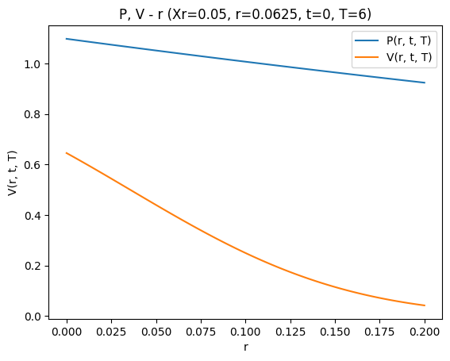

# MATH40082 Mini Task 2 10767474

### Question 1

According to the description, $R_{r,t,T}$ is normally distributed with mean $f(r,t,T)$ and variance $ v^2(t,T)$. Hence for any real constant $x$, we have 
$$
\dfrac{R_{r,t,T}-f(r,t,T)}{|v(t,T)|}\sim N(0,1)\qquad\quad P\left(\dfrac{R_{r,t,T}-f(r,t,T)}{|v(t,T)|}<x\right)=\Phi(x)
$$
where $\Phi(x)=\dfrac{1}{2}\text{erfc}(-\dfrac{x}{\sqrt{2}})$ is the CDF for standard normal distribution.

For a given constant $X_r$, let $x = \dfrac{X_r-f(r,t,T)}{|v(t,T)|}$, we'd get 
$$
N(h)=P(R_{r,t,T}<X_r)=\Phi\left(\dfrac{X_r-f(r,t,T)}{|v(t,T)|}\right)=\dfrac{1}{2}\text{erfc}\left(-\dfrac{X_r-f(r,t,T)}{\sqrt{2v^2(t,T)}}\right)
$$
which equals to
$$
\dfrac{1}{2}\text{erfc}\left(-\dfrac{X_r-e^{-\kappa (T-t)}r-(1-e^{-\kappa(T-t)})\theta+\dfrac{\sigma^2}{2\kappa^2}(1-e^{-\kappa(T-t)})^3}{\sqrt{\dfrac{2\sigma^2}{3\kappa}(1-e^{-3\kappa (T-t)})}}\right)
$$
if we expand it using the given conditions
$$
f(r,t,T)=m(r,t,T)-2q(t,T)\\
v^2(t,T)=\dfrac{\sigma^2}{3\kappa}(1-e^{-3\kappa(T-t)})\\
m(r,t,T)=e^{-\kappa(T-t)}r+(1-e^{-\kappa(T-t)})\theta\\
q(t,T)=\dfrac{\sigma^2}{4\kappa^2}(1-e^{-\kappa(T-t)})^3
$$

### Question 2

By the given conditions and the formula of a put option, we have
$$
V(r,t,T)=P(r,t,T)N(h)=\dfrac{1}{2}\text{erfc}\left(-\dfrac{X_r-e^{-\kappa (T-t)}r-(1-e^{-\kappa(T-t)})\theta+\dfrac{\sigma^2}{2\kappa^2}(1-e^{-\kappa(T-t)})^3}{\sqrt{\dfrac{2\sigma^2}{3\kappa}(1-e^{-3\kappa (T-t)})}}\right)\times\\\exp\left(\dfrac{2}{3}k^2(t,T)-\dfrac{1}{12}t(T-t)+\dfrac{\theta-r}{16\kappa}(1-e^{-2\kappa (T-t)})\right)
$$
let $t=0$, $r=r_0=0.0265$, $T=6$, and the constants be $X_r=5,\kappa=0.1416, \theta=0.067, \sigma=0.0277$, use the program in Question 3, we can calculate out that $V(r_0,t=0,T)\approx 0.5381$.

### Question 3

Codes to evaluate and output to file:

```c++
#include <iostream>
#include <fstream>
#include <sstream>

struct Arguments {
	double sigma = 0.;
	double kappa = 0.;
	double theta = 0.;

	double Xr = 0.;
};

double q(double t, double T, Arguments args) {
	return args.sigma * args.sigma * std::pow((1 - std::exp(-args.kappa * (T - t))), 3) 
		/ (4 * args.kappa * args.kappa);

}

double ksq(double t, double T, const Arguments& args) {
	return args.sigma * args.sigma * (
			(3 * std::exp(-args.kappa * (T - t))) - 
			2 * std::exp(-2 * args.kappa * (T - t)) + 
			args.kappa * (T - t) - 1
		) / (2 * std::pow(args.kappa, 3));
}

double n(double r, double t, double T, const Arguments& args) {
	return r * (T - t) / 3 -
		(args.theta - r) * (1 - std::exp(-2 * args.kappa * (T - t))) / (4 * args.kappa);
}

double m(double r, double t, double T, const Arguments& args) {
	return std::exp(-args.kappa * (T - t))* r + (1 - std::exp(-args.kappa * (T - t))) * args.theta;
}

double vsq(double t, double T, const Arguments& args) {
	return args.sigma * args.sigma * (1 - std::exp(-3 * args.kappa * (T - t)))
		/ (3 * args.kappa);
}

double f(double r, double t, double T, const Arguments& args) {
	return m(r, t, T, args) - 2 * q(t, T, args);
}

double P(double r, double t, double T, const Arguments& args) {
	return std::exp(ksq(t, T, args) * 2. / 3. - n(r, t, T, args) / 4);
}

double V(double r, double t, double T, const Arguments& args) {
	return 0.5 * std::erfc(-(args.Xr - f(r, t, T, args)) / std::sqrt(2 * vsq(t, T, args)));
}

int main()
{
	Arguments args = {
		.sigma = 0.0277, .kappa = 0.1416, .theta = 0.067, .Xr = 0.05
	};

	double t = 0, T = 6, q2res = V(0.0265, t, T, args);

	std::cout << "Question 2 result: " << q2res << std::endl;

	// Q3
	std::fstream file("result.csv", std::ios::ate | std::ios::out);

	if (!file.is_open()) {
		std::cout << "Failed to open file." << std::endl;
		return -1;
	}

	int N = 100;
	double step = 0.2 / (N - 1);
	double r = 0;

	std::cout << "\nQuestion 3 result: (r, P, V)\n" << std::endl;
	for (int i = 0; i < N; ++i, r += step) {
		std::stringstream stream;
		stream << r << "," << P(r, t, T, args) << "," << V(r, t, T, args) << std::endl;
		std::cout << stream.str();
		file << stream.str();
	}

	file.close();
	return 0;
}
```

Output:

```c++
Question 2 result: 0.538129

Question 3 result: (r, P, V)

0,1.09772,0.645578
0.0020202,1.09581,0.637671
0.0040404,1.09391,0.629705
0.00606061,1.09201,0.621682
0.00808081,1.09011,0.613607
0.010101,1.08822,0.605482
0.0121212,1.08633,0.597311
0.0141414,1.08444,0.589098
0.0161616,1.08255,0.580845
0.0181818,1.08067,0.572556
0.020202,1.0788,0.564236
0.0222222,1.07692,0.555886
0.0242424,1.07505,0.547512
0.0262626,1.07318,0.539117
0.0282828,1.07132,0.530704
0.030303,1.06946,0.522277
0.0323232,1.0676,0.513841
0.0343434,1.06575,0.505398
0.0363636,1.06389,0.496953
0.0383838,1.06205,0.488509
0.040404,1.0602,0.480071
0.0424242,1.05836,0.471641
0.0444444,1.05652,0.463224
0.0464646,1.05468,0.454823
0.0484848,1.05285,0.446443
0.0505051,1.05102,0.438086
0.0525253,1.0492,0.429757
0.0545455,1.04737,0.421459
0.0565657,1.04556,0.413196
0.0585859,1.04374,0.404971
0.0606061,1.04193,0.396788
0.0626263,1.04012,0.38865
0.0646465,1.03831,0.380561
0.0666667,1.0365,0.372524
0.0686869,1.0347,0.364541
0.0707071,1.03291,0.356617
0.0727273,1.03111,0.348755
0.0747475,1.02932,0.340956
0.0767677,1.02753,0.333226
0.0787879,1.02575,0.325565
0.0808081,1.02397,0.317977
0.0828283,1.02219,0.310465
0.0848485,1.02041,0.303032
0.0868687,1.01864,0.295679
0.0888889,1.01687,0.288409
0.0909091,1.0151,0.281224
0.0929293,1.01334,0.274127
0.0949495,1.01158,0.26712
0.0969697,1.00982,0.260204
0.0989899,1.00807,0.253382
0.10101,1.00632,0.246655
0.10303,1.00457,0.240024
0.105051,1.00282,0.233492
0.107071,1.00108,0.22706
0.109091,0.999341,0.220729
0.111111,0.997604,0.214501
0.113131,0.995871,0.208375
0.115152,0.994141,0.202355
0.117172,0.992414,0.196439
0.119192,0.99069,0.190629
0.121212,0.988969,0.184927
0.123232,0.987251,0.179331
0.125253,0.985536,0.173843
0.127273,0.983824,0.168463
0.129293,0.982115,0.163191
0.131313,0.980408,0.158028
0.133333,0.978705,0.152973
0.135354,0.977005,0.148027
0.137374,0.975308,0.143189
0.139394,0.973613,0.138458
0.141414,0.971922,0.133836
0.143434,0.970233,0.12932
0.145455,0.968548,0.124911
0.147475,0.966865,0.120609
0.149495,0.965186,0.116411
0.151515,0.963509,0.112319
0.153535,0.961835,0.10833
0.155556,0.960164,0.104444
0.157576,0.958496,0.100661
0.159596,0.956831,0.096978
0.161616,0.955169,0.0933951
0.163636,0.953509,0.0899109
0.165657,0.951853,0.0865243
0.167677,0.950199,0.083234
0.169697,0.948548,0.0800387
0.171717,0.946901,0.0769369
0.173737,0.945256,0.0739274
0.175758,0.943613,0.0710087
0.177778,0.941974,0.0681794
0.179798,0.940338,0.0654378
0.181818,0.938704,0.0627825
0.183838,0.937073,0.060212
0.185859,0.935445,0.0577245
0.187879,0.93382,0.0553186
0.189899,0.932198,0.0529926
0.191919,0.930579,0.0507449
0.193939,0.928962,0.0485737
0.19596,0.927348,0.0464774
0.19798,0.925737,0.0444544
0.2,0.924129,0.042503
```

Codes to plot:

```python
import matplotlib.pyplot as plt
import numpy as np

data = np.loadtxt("result.csv", delimiter=',')
data

plt.figure()
plt.plot(data[:, 0], data[:, 1], label="P(r, t, T)")
plt.plot(data[:, 0], data[:, 2], label="V(r, t, T)")
plt.legend()
plt.title("P, V - r (Xr=0.05, r=0.0625, t=0, T=6)")
plt.show()
```

Plotted image:


