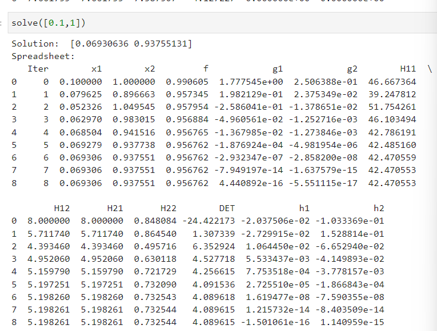
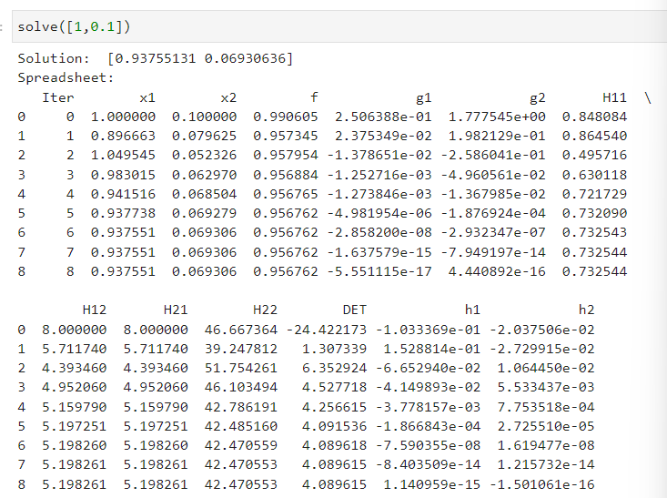
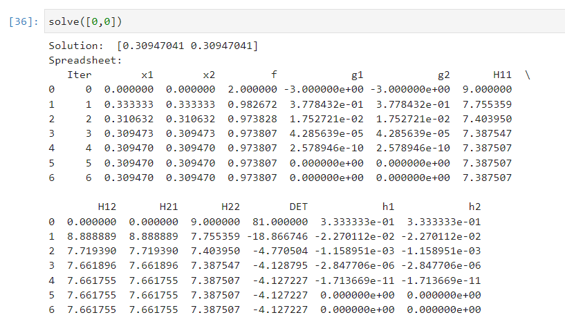

## Q1

1. By the given definition, a _vector quadratic function_ is a function $f$ that can be written 
   $$
   f:\mathbb{R}\to \mathbb{R},\text{ where } f(x)\equiv x^TAx+b^Tx+c
   $$
   where $A$ is an $n\times n$ matrix, $x$ and $b$ are $n\times1$ vectors belong to $\mathbb{R}$, and $c$ is a scalar.

   Note that the given function 
   $$
   f(x_1,x_2)\equiv x_1^2+2x_2^2+3x_1x_2+4x_1+5x_2+6\\=[x_1\ x_2]
   \begin{bmatrix}1&\dfrac{3}{2}\\\dfrac{3}{2}&2\end{bmatrix}\begin{bmatrix}x_1\\x_2\end{bmatrix}+[4\ 5]\begin{bmatrix}x_1\\x_2\end{bmatrix}+6
   $$
   hence let $A=\begin{bmatrix}1&\dfrac{3}{2}\\\dfrac{3}{2}&2\end{bmatrix},x=\begin{bmatrix}x_1\\x_2\end{bmatrix},b=\begin{bmatrix}4\\5\end{bmatrix}$, we can write $f(x)\equiv x^TAx+b^Tx+c$. Therefore $f(x)$ is a vector quadratic function.

2. Let $a=(1,-1,3)^T,x=(u,v,w)^T$, then 

   $g(u,v,w)=g(x)\equiv(u-v+3w-2)^2=(a^Tx-2)^2=(a^Tx-2)^T(a^Tx-2)\\=((a^Tx)^T-2^T)(a^Tx-2)=(x^Ta-2)(a^Tx-2)=x^T(aa^T)x-4a^Tx+4$

   note that if let 
   $$
   A=aa^T,b=-4a
   $$
   then $A\in\mathbb{R}^{3\times 3}$, and the equation can be written as $g(u,v,w)=g(x)=x^TAx+b^Tx+4$, hence $g(u,v,w)$ is a vector quadratic function.

3. Since $f:\mathbb{R}^n\to\mathbb{R}$, $g:\mathbb{R}^m\to\mathbb{R}$, and $g(y)\equiv f(Ry+s)$, as $y\in\mathbb{R}^m=\mathbb{R}^{m\times1}$, we can conclude that $R=\mathbb{R}^{n\times m}$ and $s\in\mathbb{R}^{n}=\mathbb{R}^{n\times 1}$.

   As $f$ is a vector quadratic function, by the definition, there exists $A\in\mathbb{R}^{n\times n}$, $b\in\mathbb{R}^{n}$ and a scalar $c\in \mathbb{R}$, such that $\forall\ x\in\mathbb{R}^n, f(x)=x^TAx+b^Tx+c$. Therefore we have
   $$
   \begin{array}{rl}
   g(y)=f(Ry+s)&=(Ry+s)^TA(Ry+s)+b^T(Ry+s)+c\\
   &=(y^TR^T+s^T)A(Ry+s)+b^TRy+b^Ts+c\\
   &=(y^TR^TARy+s^TARy+y^TR^TAs+s^TAs)+b^TRy+b^Ts+c\\
   &=y^T\underbrace{R^TAR}_{\in\mathbb{R}^{m\times m}}y+\underbrace{(R^TA^Ts+R^TAs+R^Tb)^T}_{\in\mathbb{R}^m}y+\underbrace{(s^TAs+b^Ts+c)}_{\text{scalar}}
   \end{array}
   $$
   hence we can find 
   $$
   B=R^TAR\in\mathbb{R}^{m\times m},d=R^TA^Ts+R^TAs+R^Tb\in\mathbb{R}^{m}, h=s^TAs+b^Ts+c\qquad(*)
   $$
   such that $\forall\ y\in\mathbb{R}^{m},g(y)=y^TBy+d^Ty+h$. This implies that $g$ is also a vector quadratic function.

   **critical point: ** Note that for any $i\in\mathbb{N},1\leqslant i\leqslant m$,
   $$
   \dfrac{\partial g}{\partial y_i}=2B\begin{bmatrix}0&0&\cdots&0&y_i&0&\cdots\end{bmatrix}^T+d_i
   $$
   we'd have
   $$
   Dg(y)=2By+d\qquad\text{(FOC)}
   $$
   hence solve the equation we know the critical point set is $\{y\in\mathbb{R}^m:2By=-d\}$, where $B,d$ are defined above, moreover, if $B$ is invertible, then $y=-\dfrac{1}{2}B^{-1}d$ is the unique critical point.

## Question 2

1. Rewrite the given function we have
   $$
   \begin{array}{rl}
   f(x_1,x_2,x_3)&\equiv 12x_1+10x_2-x_1^2-2x_2^2-3x_3^2+2x_1x_2+2x_2x_3+100\\
   &=\begin{bmatrix}x_1&x_2&x_3\end{bmatrix}
   \begin{bmatrix}-1&1&0\\1&-2&1\\0&1&-3\end{bmatrix}
   \begin{bmatrix}x_1\\x_2\\x_3\end{bmatrix}
   +\begin{bmatrix}12&10&0\end{bmatrix}
   \begin{bmatrix}x_1\\x_2\\x_3\end{bmatrix}+100\\
   &=x^TAx+b^Tx+c
   \end{array}
   $$
    where $x=(x_1,x_2,x_3)^T,b=(12,10,0)^T,c=100,A=\begin{bmatrix}-1&1&0\\1&-2&1\\0&1&-3\end{bmatrix}$ is symmetric. Thus we explained that $f$ can be written as vector quadratic function in the standard form.

   To find its maximum, we come up with the FOC: $2Ax+b=0_3$, note that $|A|=-2\neq 0$, hence 
   $$
   x^*=-\dfrac{1}{2}A^{-1}b=\dfrac{1}{4}
   \begin{bmatrix}
   5&3&1\\3&3&1\\1&1&1
   \end{bmatrix}
   \begin{bmatrix}
   12\\10\\0
   \end{bmatrix}=\begin{bmatrix}
   \dfrac{45}{2}\\\dfrac{33}{2}\\\dfrac{11}{2}
   \end{bmatrix}
   $$
   which is the unique critical point. Then we check the 2nd order condition, since $A$ is symmetric, and
   $$
   |A-\lambda I_3|=\begin{vmatrix}-1-\lambda&1&0\\1&-2-\lambda&1\\0&1&-3-\lambda\end{vmatrix}=-(\lambda+2)(\lambda^2+4\lambda+1)=0
   $$
   $A$'s eigenvalues are $\lambda_1=-2<0,\lambda_2=-2-\sqrt{3}<0,\lambda_3=-2+\sqrt{3}<0$, we know that $A$ is negative definite. Therefore, $x^*$ is a global maximum point of $f$,
   $$
   \max_xf(x)=f(x^*)=f(\dfrac{45}{2},\dfrac{33}{2},\dfrac{11}{2})=\dfrac{635}{2}
   $$

2. Assume $A$ is symmetric and positive definite, then
   $$
   f(x)=x^TAx+b^Tx+c=(Ax+b)^Tx
   $$
   note that the $i$-th item of $f(x)$ is $\displaystyle(\sum_{j=1}^na_jx_j+b_i)x_i=a_ix_i^2+(\sum_{j=1,\\j\neq i}^na_jx_j+b_i)x_i$, which is maximized when $x_i=-\dfrac{\displaystyle \sum_{j=1,j\neq i}^na_jx_j+b_i}{2a_i}$ by the result given. Go through all $i$ from $1$ to $n$, we'd have $n$ equations, and they can be written in matrix form:
   $$
   \forall\ 1\leqslant i\leqslant n,x_i=-\dfrac{\displaystyle \sum_{j=1,j\neq i}^na_jx_j+b_i}{2a_i}\quad\Rightarrow\quad 2Ax+b=0_n
   $$
   since $A$ is symmetric and positive definite, it is also invertible, therefore the solution to the equation, $x^*=-\dfrac{1}{2}A^{-1}b$. 

   Let $x= x^*+\Delta x$, we have 
   $$
   \begin{array}{rl}
   f(x^*+\Delta x)&=(Ax^*+A\Delta x+b)^T(x^*+\Delta x)\\
   &=f(x^*)+\Delta x^T(2Ax^*+b)+\Delta x^T A\Delta x\\
   &=f(x^*)+\Delta x^TA\Delta x
   \end{array}
   $$
   Since $A$ is positive definite, for any $\Delta x\in\mathbb{R}^n$, there will be $f(x^*+\Delta x)\geqslant  f(x^*)$, and the 'equality' hold iff. $\Delta x=0$. This implies that $x^*$ is indeed a global minimum point for $f(x)$.

   Therefore we generalized the result to the following theorem:

   > If $A$ is positive definite, $f(x)=x^T Ax+b^Tx+c$, then $f(x)$ has a unique global minimum point $x^*=-\dfrac{1}{2}A^{-1}b$.
   >
   > Similarly, we'd have: if $A$ is negative definite, $f(x)=x^T Ax+b^Tx+c$, then $f(x)$ has a unique global maximum point $x^*=-\dfrac{1}{2}A^{-1}b$.

## Question 3

1. Let $F(P)=Q^S(P)-Q^D(P)=3P-1000e^{-0.01P}$, then at the equilibrium point, we have $Q^S(P)=Q^D(P)\Leftrightarrow F(P)=0$. Let the initial value $P_0=1$, adopting Newton's numerical method, we'd come up with the recursion formula:
   $$
   P_{n+1}=P_n-\dfrac{F(P_n)}{F'(P_n)}=P_n-\dfrac{3P_n-1000e^{-0.01P_n}}{3+10e^{-0.01P_n}}
   $$
   Python code:

   ```python
   import numpy as np
   
   p0 = 999999 # inf
   f = lambda p: 3 * p - 1000 * np.exp(-0.01 * p)
   fp = lambda p: 3 + 10 * np.exp(-0.01 * p)
   
   tol = 1e-13; n = 1000; i = 0
   
   p1 = 1 
   while abs(p0 - p1) > tol and i < n:
       i += 1
       p0 = p1
       print(p0)
       p1 = p0 - f(p0) / fp(p0)
   
   print("Solution: p = ", p1)
   ```

   Output: `Solution: p = 110.45420183245118 `. Therefore the approximate solution is $p\approx 110.454$.

2. We'll generate the spreedsheet using `pandas` and adopting the Newton-Raphson Algorithm with initial guess $x=(0,0)^T$. First, we'd calculate some derivatives of $f(x_1,x_2)$:
   $$
   f(x)=f(x_1,x_2)\equiv \exp(-3x_1)+\exp(-3x_2)+20x_1^2x_2^2\\
   g(x)=\nabla f(x)=(-3\exp (-3x_1)+40x_1x_2^2,-3\exp(-3x_2)+40x_1^2x_2)\\
   Hf(x)=\begin{bmatrix}
   9\exp(-3x_1)+40x_2^2&80x_1x_2\\
   80x_1x_2&9\exp(-3x_2)+40x_1^2
   \end{bmatrix}
   $$
   Python code:

   ```python
   import pandas as pd
   import numpy as np
   
   f = lambda x: np.exp(-3*x[0])+np.exp(-3*x[1])+20*(x[0]*x[1])**2
   fp = lambda x: np.array([
       -3*np.exp(-3*x[0])+40*x[0]*x[1]**2,
       -3*np.exp(-3*x[1])+40*x[1]*x[0]**2,
   ])
   fpp = lambda x: np.array([
       [9*np.exp(-3*x[0])+40*x[1]**2, 80*x[0]*x[1]],
       [80*x[0]*x[1], 9*np.exp(-3*x[1])+40*x[0]**2]
   ])
   
   x0 = np.array([np.inf,np.inf])
   x1 = np.array([0,0])
   j = 0; n = 1000
   tol = 1e-13
   
   step = -np.linalg.inv(fpp(x1)) @ fp(x1)
   row = {
       "Iter": [0], 
       "x1": [x1[0]], 
       "x2": [x1[1]],
       "f": [f(x1)],
       "g1": [fp(x1)[0]],
       "g2": [fp(x1)[1]],
       "H11": [fpp(x1)[0][0]],
       "H12": [fpp(x1)[0][1]],
       "H21": [fpp(x1)[1][0]],
       "H22": [fpp(x1)[1][1]],
       "DET": [np.linalg.det(fpp(x1))],
       "h1": [step[0]],
       "h2": [step[1]]
   }
   
   data = pd.DataFrame(row)
   
   while np.linalg.norm(x0 - x1) > tol and j < n:
       x0 = x1
       p = fp(x0)
       pp = fpp(x0)
       h = -np.linalg.inv(pp) @ p
       x1 = x0 + h
       j += 1
       
       # write row
       step = -np.linalg.inv(fpp(x1)) @ fp(x1)
       row_ = {}
       row_["Iter"] = j
       row_["x1"], row_["x2"] = x1[0], x1[1]
       row_["f"] = f(x1)
       row_["g1"], row["g2"] = fp(x1)
       row_["H11"], row_["H12"], row_["H21"], row_["H22"] = fpp(x1).flatten()
       row_["DET"] = np.linalg.det(fpp(x1))
       row_["h1"], row_["h2"] = step 
       data.loc[len(data)] = row_
       
       if np.linalg.norm(p) < tol:
           break
           
   print("Solution: ", x1)
   print("Spreadsheet: ")
   print(data)
   ```

   See the attachment for the output. By giving initial values, we can find 3 critical points: $(0,93755,0.06931),(0,06931,0.93755),(0.30947,030947)$.

   

   

   

3. We have shown in the spreadsheet that at the 3 critical points, the determinant of $H$ is positive, positive, and negative respectively. Hence the first 2 critical points, i.e.  $(0,93755,0.06931),(0,06931,0.93755)$ are global minimum of the function.

## Question 4

1. Let $r$ be the cost of each machine to rent per unit time, $w$ be the wage of each consultants per unit time as well. Denotations $K_1,K_2,L_1,L_2$ are used as given.

   Then the optimization problem can be described as a maximization problem of the profit function:
   $$
   \begin{array}{rl} \displaystyle\max_{K_1,K_2,L_1,L_2}\Pi(K_1,K_2,L_1,L_2)&=F(K_1,L_1)+G(K_2,L_2)-rK-wL\\
   &=(\sqrt{K_1}+2\sqrt{L_1})+(3\sqrt{K_2}+4\sqrt{L_2})-rK-wL\\
   \text{s.t.}& L_1,L_2,K_1,K_2\geqslant 0\\
   &L_1+L_2=L\geqslant 0\\
   &K_1+K_2=K\geqslant 0
   \end{array}
   $$
   where $r,w,L,K$ are all positive constants.

2. Lagrangean function (since $-rK-wL$ is constant):
   $$
   L(K_1,K_2,L_1,L_2;\lambda,\mu)=\Pi-\lambda(K_1+K_2-K)-\mu(L_1+L_2-L)\\
   =(\sqrt{K_1}+2\sqrt{L_1})+(3\sqrt{K_2}+4\sqrt{L_2})-rK-wL-\lambda(K_1+K_2-K)-\mu(L_1+L_2-L)
   $$
   First order conditions:
   $$
   \left\{\begin{array}{l}
   \dfrac{\partial L}{\partial K_1}=0\\
   \dfrac{\partial L}{\partial K_2}=0\\
   \dfrac{\partial L}{\partial L_1}=0\\
   \dfrac{\partial L}{\partial L_2}=0\\
   \dfrac{\partial L}{\partial \lambda}=0\\
   \dfrac{\partial L}{\partial \mu}=0
   \end{array}\right.\quad\Rightarrow\quad \left\{\begin{array}{l}
   \dfrac{1}{2\sqrt{K_1}}-\lambda=0\\
   \dfrac{3}{2\sqrt{K_2}}-\lambda=0\\
   \dfrac{1}{\sqrt{L_1}}-\mu=0\\
   \dfrac{2}{\sqrt{L_2}}-\mu=0\\
   K_1+K_2-K=0\\
   L_1+L_2-L=0
   \end{array}\right.
   $$

3. Solve the equations above (especially the 1st, 2nd, and the 5th equations), we have
   $$
   K_1^*=\dfrac{K}{10}
   $$

4. Similarly, we have
   $$
   K_2^*=\dfrac{9K}{10},\quad L_1^*=\dfrac{L}{5},\quad L_2^*=\dfrac{4L}{5}
   $$
   at the same time, $\lambda = \dfrac{\sqrt{10}}{2\sqrt{K}},\mu=\dfrac{\sqrt{5}}{\sqrt{L}}$.

5. Using the definitions above,
   $$
   M(K,L)=\Pi\left(\dfrac{K}{10},\dfrac{9K}{10},\dfrac{L}{5},\dfrac{4L}{5}\right)=\sqrt{10K}+2\sqrt{5L}-rK-wL
   $$

6. $\lambda$ is the marginal product of capital while $\mu$ is the marginal product of labour.

## Question 5

Let $g(x,y)=f(\lambda x+(1-\lambda)y)-\lambda f(x)-(1-\lambda)f(y)$, since $f(x)\equiv 1-x^T x$, we have 
$$
\begin{array}{rl}
g(x,y)&=1-(\lambda x+(1-\lambda)y)^T(\lambda x+(1-\lambda)y)-\lambda (1-x^Tx)-(1-\lambda)(1-y^Ty)\\
&=\lambda\bar\lambda( x^Tx-2 x^Ty+ y^Ty)=\lambda\bar\lambda(x-y)^T(x-y)\geqslant 0
\end{array}
$$
where $\bar\lambda =1-\lambda$, for any $\lambda\in (0,1)$, and '=' holds iff. $x=y$. hence $\forall\ x,y\in\mathbb{R}^n,x\neq y,\lambda\in (0,1)$, we have $g(x,y)>0$, i.e.
$$
f(\lambda x+(1-\lambda)y)>\lambda f(x)+(1-\lambda)f(y)
$$
this indicates that $f(x)$ is strictly concave.

1. $C(K,L)=K+2L$, $F(K,L)=3K+L$. According to the problem, $K,L\geqslant 0$. The minimum cost problem can be formulated to 
   $$
   \min_{K,L} K+2L\quad\text{subject to.}\quad F(K,L)=3K+L=Y=20, \quad K,L\geqslant 0
   $$

2. To standard Kuhn-Tucker format:
   $$
   \max_{K,L} -K-2L\\
   \text{subject to.  } -F(K,L)=-3K-L\leqslant -Y=-20,-K\leqslant 0,-L\leqslant 0
   $$
   with 
   $$
   \begin{array}{l}
   f(K,L)=-K-2L\\
   g_1(K,L)=-F(K,L)=-3K-L,\ b_1=-Y=-20\\
   g_2(K,L)=-K,\ b_2=0\\
   g_3(K,L)=-L,\ b_3=0
   \end{array}
   $$
   Hence the Lagrangean function is
   $$
   L(K,L)\equiv -K-2L-\lambda(-F(K,L)+Y)+\mu_1 K+\mu_2 L
   $$
    i.e.
   $$
   L(K,L)\equiv -K-2L-\lambda(-3K-L+20)+\mu_1K+\mu_2L
   $$

3. and the four sets of necessary conditions are (we suppress the *'s on the parameters)

   - FOC1: $-1+3\lambda +\mu_1=0$
   - FOC2: $-2+\lambda +\mu_2=0$
   - CNSTR1: $F(K,L)=3K+L\geqslant Y=20$, LM1: $\lambda \geqslant 0$
   - CNSTR2: $K\geqslant 0$, LM2: $\mu_1\geqslant 0$
   - CNSTR3: $L\geqslant 0$, LM3: $\mu_2\geqslant0$
   - CS1: $\lambda(F(K,L)-Y)=\lambda(3K+L-20)=0$
   - CS2: $\mu_1K=0$
   - CS3: $\mu_2L=0$

4. Problem in primal-format:
   $$
   \max_x c^Tx,\qquad c=(-1,-2)^T,x=(K,L)^T\\
   \text{subject to.}\qquad Ax\leqslant b,\qquad A=(-3,1),b=-20\\
   \qquad x\geqslant 0_2
   $$

5. Dual format:
   $$
   \min_x b^Ty=-20y_1\\
   \text{subject to.}\qquad-3y_1\geqslant -1,y_1\geqslant  -2,y_1\geqslant 0
   $$
   we have $0\leqslant y_1\leqslant\dfrac{20}{3}$, hence when the minimum is reached, $y_1=\dfrac{20}{3}$.

6. For a primal-format linear programming problem
   $$
   \max_x c^Tx,\quad \text{subject to.}\quad Ax\leqslant b,x\geqslant 0_n
   $$
   if $x_1,x_2$ are the 2 distinct solutions, $x_3=\lambda x_1+(1-\lambda)x_2$, $\lambda \in (0,1)$, is a convex combination of $x_1,x_2$, then 
   $$
   c^Tx_3=c^T(\lambda x_1+(1-\lambda)x_2)=\lambda c^Tx_1+(1-\lambda)c^Tx_2=\lambda M+(1-\lambda)M=M
   $$
   where $M$ is the optimal value. And 
   $$
   Ax_3=\lambda Ax_1+(1-\lambda)Ax_2\leqslant \lambda b+(1-\lambda )b=b\\
   x_3=\lambda x_1+(1-\lambda)x_2\geqslant 0
   $$
   hence $x_3$ lies in the feasible region and $c^Tx_3$ also reaches the optimal value. That is $x_3$ is also an optimal solution of the problem.