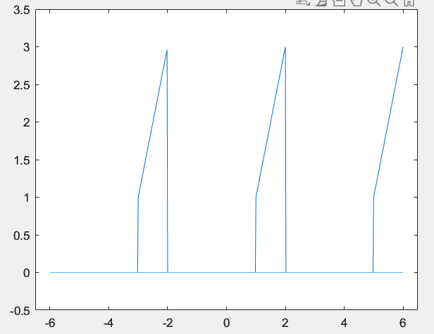
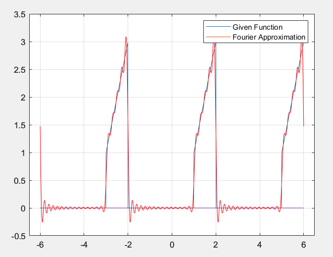
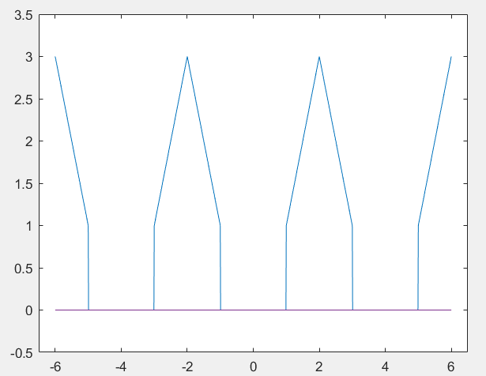
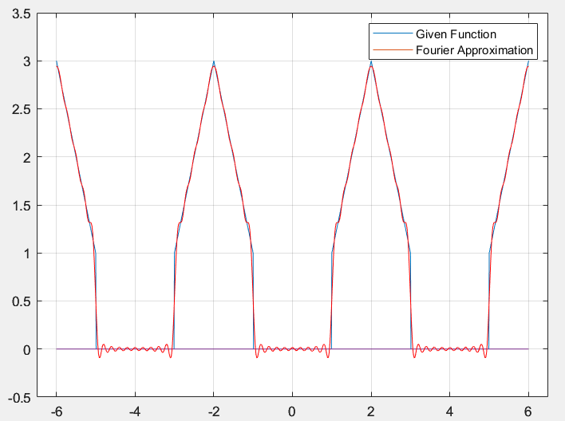
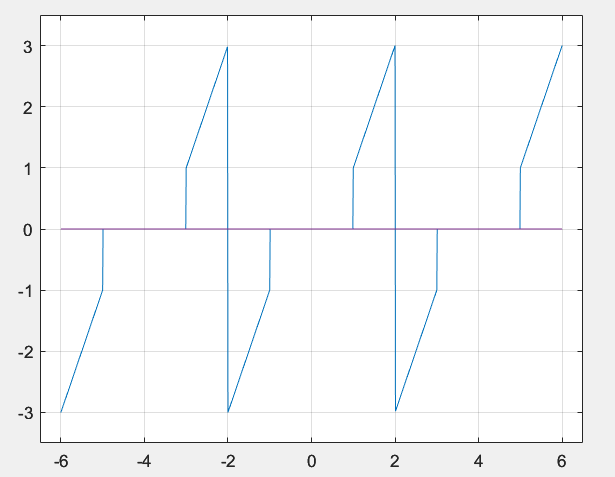
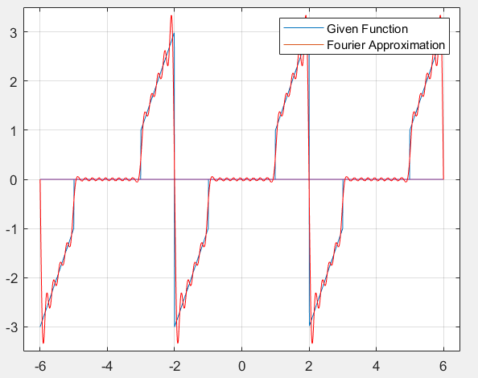

## Question 1

Given function:
$$
f(t)=\left\{\begin{array}{ll}
0&-2\leq t\leq 1\\
2t-1&1\leq t\leq 2
\end{array}\right.
$$
**Step 1: Sketch**

Code to sketch the periodic extension of the function with period $4$:

```matlab
clear all; close all; clc;

L = 2; 
dt = 0.01;

xs = -3*L:dt:3*L;
ys = zeros(length(xs));
for i = 1:length(xs)
    ys(i) = f(xs(i));
end

figure(1)

plot(xs, ys)
xlim([-3*L-0.5, 3*L+0.5])
ylim([-0.5, 3.5])

function y = f(t)
    if t < -2
        y = f(t + 4);
    elseif t > 2
        y = f(t - 4);
    elseif (t >= 1) && (t <= 2)
        y = 2*t - 1;
    else
        y = 0;
    end
end
```




**Step 2: Get $a_n,b_n$**

Since the first period is symmetric about the origin over $[-L,L]$, we have
$$
\hat f(t)=\dfrac{a_0}{2}+\sum_{n=1}^{+\infty}a_n\cos\dfrac{n\pi t}{L}+b_n\sin\dfrac{n\pi t}{L}
$$
where 
$$
\begin{align*}
a_0&=\dfrac{1}{L}\int_{-L}^Lf(t)dt=\dfrac{1}{2}\int_1^2(2t-1)dt=\dfrac{1}{2}\left[t^2-t\right]_1^2=1\\
a_n&=\dfrac{1}{L}\int_{-L}^Lf(t)\cos\dfrac{n\pi t}{L}dt=\dfrac{1}{2}\int_1^2(2t-1)\cos\dfrac{n\pi t}{2}dt=\dfrac{1}{2}\left[\dfrac{8\cos\dfrac{n\pi t}{2}+2n\pi(2t-1)\sin\dfrac{n\pi t}{2}}{n^2\pi^2}\right]_1^2\\
&=\dfrac{4(-1)^n-4\cos\dfrac{n\pi}{2}-n\pi\sin\dfrac{n\pi}{2}}{n^2\pi^2}\\
b_n&=\dfrac{1}{L}\int_{-L}^Lf(t)\sin\dfrac{n\pi t}{L}dt=\dfrac{1}{2}\int_1^2(2t-1)\sin\dfrac{n\pi t}{2}dt=\dfrac{1}{2}\left[\dfrac{8\sin\dfrac{n\pi t}{2}-2n\pi(2t-1)\cos\dfrac{n\pi t}{2}}{n^2\pi^2}\right]_1^2\\
&=\dfrac{n\pi\cos\dfrac{n\pi}{2}-3n\pi(-1)^n-4\sin\dfrac{n\pi}{2}}{n^2\pi^2}\\
\end{align*}
$$
Hence 
$$
\begin{align*}
\hat f(t)&=\dfrac{1}{2}+\sum_{n=1}^{+\infty}\left[
\dfrac{4(-1)^n-4\cos\dfrac{n\pi}{2}-n\pi\sin\dfrac{n\pi}{2}}{n^2\pi^2}\cos\dfrac{n\pi t}{2}+
\dfrac{n\pi\cos\dfrac{n\pi}{2}-3n\pi(-1)^n-4\sin\dfrac{n\pi}{2}}{n^2\pi^2}\sin\dfrac{n\pi t}{2}
\right]\\
&=\dfrac{1}{2}+\sum_{n=1}^{+\infty}\dfrac{1}{n^2\pi^2}\left[n\pi\sin\dfrac{n\pi(t-1)}{2}-4\cos\dfrac{n\pi(1-t)}{2}-3n\pi(-1)^n\sin\dfrac{n\pi t}{2}-4(-1)^n\cos\dfrac{n\pi t}{2}\right]
\end{align*}
$$
**Step 3: Sketch**

Code to sketch $\hat{f}(t)$ over $[-3L,3L]=[-6,6]$:

```matlab
clear all; close all; clc;

L = 2; 
dt = 0.01;

ts = -3*L:dt:3*L;
NumberOfTerms = 20;

a0=1;
f=ones(1,length(ts))*a0/2;
hold on;
grid on;
for n=1:NumberOfTerms
    an = 4*(-1)^n-4*cos(n*pi/2.)-n*pi*sin(n*pi/2.);
    bn = n*pi*cos(n*pi/2.)-3*n*pi*(-1)^n-4*sin(n*pi/2.);
    an = an / (n^2*pi^2);
    bn = bn / (n^2*pi^2);
    f=f+an*cos(n*pi*ts/L)+bn*sin(n*pi*ts/L);
end
plot(ts,f,'r'); hold on; grid on;
```

Result (together with the first graph):



At $t=\pm nL$, 

- when $n$ is odd, there are sudden jumps since at these points, the original function is not continuous. Fourier series at them will finally converge pointwisely to the average of left and right limits.

  Moreover, the amplitudes of the finite sum of the first $m$ terms of the Fourier series reach a high level around these points, due to the Gibbs phenomenon.

- when $n$ is even, the value of the truncated Fourier series changes smoothly w.r.t $t$ since at these points, the original function is continuous. Fourier series at them will finally converge pointwisely to $0$.

  Moreover, the amplitudes of the finite sum of the first $m$ terms of the Fourier series reach a low level around these points, since they are far away from the nearest discontinuities.

## Question 2

The original function and its even extension:
$$
f(t)=\left\{\begin{array}{ll}
0&0\leq t\leq 1\\
2t-1&1\leq t\leq 2
\end{array}\right.\qquad\to^{\text{even extension}}\qquad 
\tilde f(t)=\left\{\begin{array}{ll}
0&-1\leq t\leq 1\\
2t-1&1\leq t\leq 2\\
-2t-1&-2\leq t\leq -1
\end{array}\right.
$$
**Step 1: Sketch**

Code to sketch the periodic extension of the even extension function with period $4$:

```matlab
clear all; close all; clc;

L = 2; 
dt = 0.01;

ts = -3*L:dt:3*L;
ys = zeros(length(ts));
for i = 1:length(ts)
    ys(i) = f_ori(ts(i));
end

figure(1)

plot(ts, ys)
xlim([-3*L-0.5, 3*L+0.5])
ylim([-0.5, 3.5])

function y = f_ori(t)
    if t < -2
        y = f_ori(t + 4);
    elseif t > 2
        y = f_ori(t - 4);
    elseif (t >= 1) && (t <= 2)
        y = 2*t - 1;
    elseif (t >= -2) && (t <= -1)
        y = -2*t - 1;
    else
        y = 0;
    end
end
```



**Step 2: Get $a_n,b_n$**

Since the first period is symmetric about the origin over $[-L,L]$ and is even, we have
$$
\hat{\tilde{f}}(t)=\dfrac{a_0}{2}+\sum_{n=1}^{+\infty}a_n\cos\dfrac{n\pi t}{L}\color{lightgray}+b_n\sin\dfrac{n\pi t}{L}
$$
where $b_n=0$ since sine functions are odd
$$
\begin{align*}
a_0&=\dfrac{1}{L}\int_{-L}^L\tilde f(t)dt=\dfrac{1}{2}\left[\int_1^2(2t-1)dt+\int_{-2}^{-1}(-2t-1)dt\right]=2\\
a_n&
=\dfrac{1}{L}\int_{-L}^L\tilde f(t)\cos\dfrac{n\pi t}{L}dt
=\dfrac{1}{2}\left[\int_1^2(2t-1)\cos\dfrac{n\pi t}{2}dt+\int_{-2}^{-1}(-2t-1)\cos\dfrac{n\pi t}{2}dt\right]\\
&=\int_1^2(2t-1)\cos\dfrac{n\pi t}{2}dt\\
&=\dfrac{8(-1)^n-8\cos\dfrac{n\pi}{2}-2n\pi\sin\dfrac{n\pi}{2}}{n^2\pi^2}
\end{align*}
$$
Hence 
$$
\begin{align*}
\hat{\tilde f}(t)&=2+\sum_{n=1}^{+\infty}
\dfrac{8(-1)^n-8\cos\dfrac{n\pi}{2}-2n\pi\sin\dfrac{n\pi}{2}}{n^2\pi^2}\cos\dfrac{n\pi t}{2}
\end{align*}
$$
**Step 3: Sketch**

Code to sketch $\hat{f}(t)$ over $[-3L,3L]=[-6,6]$:

```matlab
clear all; close all; clc;

L = 2; 
dt = 0.01;

ts = -3*L:dt:3*L;
NumberOfTerms = 20;

a0=2;
f=ones(1,length(ts))*a0/2;
hold on;
grid on;
for n=1:NumberOfTerms
    an = 8*(-1)^n-8*cos(n*pi/2.)-2*n*pi*sin(n*pi/2.);
    bn = 0;
    an = an / (n^2*pi^2);
    f=f+an*cos(n*pi*ts/L)+bn*sin(n*pi*ts/L);
end
plot(ts,f,'r'); hold on; grid on;
```

Result (together with the first graph):



At $t=\pm nL$, the value of the truncated Fourier series changes smoothly w.r.t $t$ since at these points, the original function is continuous. Fourier series at them will finally converge pointwisely to $3$.

Moreover, the amplitudes of the finite sum of the first $m$ terms of the Fourier series also cease due to the continuity of the extension function.

## Question 3

The original function and its odd extension:
$$
f(t)=\left\{\begin{array}{ll}
0&0\leq t\leq 1\\
2t-1&1\leq t\leq 2
\end{array}\right.\qquad\to^{\text{odd extension}}\qquad 
\tilde f(t)=\left\{\begin{array}{ll}
0&-1\leq t\leq 1\\
2t-1&1\leq t\leq 2\\
2t+1&-2\leq t\leq -1
\end{array}\right.
$$
**Step 1: Sketch**

Code to sketch the periodic extension of the even extension function with period $4$:

```matlab
clear all; close all; clc;

L = 2; 
dt = 0.01;

ts = -3*L:dt:3*L;
ys = zeros(length(ts));
for i = 1:length(ts)
    ys(i) = f_ori(ts(i));
end

figure(1)

plot(ts, ys)
xlim([-3*L-0.5, 3*L+0.5])
ylim([-0.5, 3.5])

function y = f_ori(t)
    if t < -2
        y = f_ori(t + 4);
    elseif t > 2
        y = f_ori(t - 4);
    elseif (t >= 1) && (t <= 2)
        y = 2*t - 1;
    elseif (t >= -2) && (t <= -1)
        y = 2*t + 1;
    else
        y = 0;
    end
end
```



**Step 2: Get $a_n,b_n$**

Since the first period is symmetric about the origin over $[-L,L]$ and is even, we have
$$
\hat{\tilde{f}}(t)={\color{lightgray}\dfrac{a_0}{2}+}\sum_{n=1}^{+\infty}{\color{lightgray}a_n\cos\dfrac{n\pi t}{L}+}\ b_n\sin\dfrac{n\pi t}{L}
$$
where $a_n=0$ since cosine functions are odd, also, since $a_0$ corresponds to $f_0(t)=1$, which is also an even base, $a_0=0$ as well.
$$
\begin{align*}
b_n&
=\dfrac{1}{L}\int_{-L}^L\tilde f(t)\sin\dfrac{n\pi t}{L}dt
=\dfrac{1}{2}\left[\int_1^2(2t-1)\sin\dfrac{n\pi t}{2}dt+\int_{-2}^{-1}(2t+1)\sin\dfrac{n\pi t}{2}dt\right]\\
&=\int_1^2(2t-1)\sin\dfrac{n\pi t}{2}dt\\
&=\dfrac{2n\pi\cos\dfrac{n\pi}{2}-6n\pi(-1)^n-8\sin\dfrac{n\pi}{2}}{n^2\pi^2}
\end{align*}
$$
Hence 
$$
\begin{align*}
\hat{\tilde f}(t)&=2+\sum_{n=1}^{+\infty}
\dfrac{2n\pi\cos\dfrac{n\pi}{2}-6n\pi(-1)^n-8\sin\dfrac{n\pi}{2}}{n^2\pi^2}\sin\dfrac{n\pi t}{2}
\end{align*}
$$
**Step 3: Sketch**

Code to sketch $\hat{f}(t)$ over $[-3L,3L]=[-6,6]$:

```matlab
clear all; close all; clc;

L = 2; 
dt = 0.01;

ts = -3*L:dt:3*L;
NumberOfTerms = 20;

a0=0;
f=ones(1,length(ts))*a0/2;
hold on;
grid on;
for n=1:NumberOfTerms
    an = 0;
    bn = 2*n*pi*cos(n*pi/2.)-6*n*pi*(-1)^n-8*sin(n*pi/2.);
    bn = bn / (n^2*pi^2);
    f=f+an*cos(n*pi*ts/L)+bn*sin(n*pi*ts/L);
end
plot(ts,f,'r'); hold on; grid on;
```

Result (together with the first graph):



The comments around $t=\pm nL$ are similar to those in Question 1, since the properties there are similar.

Since $\tilde f(t)$, which we expanded is the odd extension of $f(t)$, and $f(0)=0$, we can conclude that the series converge to $0$ at these points.

When $n$ is odd, due to the discontinuity, Gibbs phenomenon occurs.

## Question 4

Given function:
$$
f(t)=\left\{\begin{array}{ll}
0&-2\leq t\leq 1\\
2t-1&1\leq t\leq 2
\end{array}\right.
$$
Complex Fourier Series:
$$
\hat f(t)=\sum_{n=-\infty}^{\infty}c_n\exp\dfrac{in\pi t}{L}\qquad c_n=\dfrac{1}{2L}\int_{-L}^Lf(t)\exp\left(-\dfrac{in\pi t}{L}\right)dt
$$
Hence 
$$
\begin{align*}
c_n&
=\dfrac{1}{2L}\int_{-L}^Lf(t)\exp\left(-\dfrac{in\pi t}{L}\right)dt
=\dfrac{1}{4}\int_1^2(2t-1)\exp\left(-\dfrac{in\pi t}{2}\right)dt\\
&=\left.\dfrac{(4+in\pi(2t-1))e^{-\frac{in\pi t}{2}}}{2n^2\pi^2}\middle|\right._1^2\\
&=\dfrac{(4+3in\pi)e^{-\frac{in\pi}{2}}-(4+in\pi)e^{\frac{in\pi}{2}}}{2n^2\pi^2}
\end{align*}
$$
Therefore 
$$
\hat f(t)=\sum_{n=-\infty}^{+\infty}\dfrac{(4+3in\pi)e^{-\frac{in\pi}{2}}-(4+in\pi)e^{\frac{in\pi}{2}}}{2n^2\pi^2}\exp\left(-\dfrac{in\pi t}{L}\right)
$$

## Question 5

