## Question 7

1. In this unity feedback system, $G(s)=\dfrac{k}{(s+2)^3(s+3)}, H(s)=1$, hence the closed loop transfer function is 
    $$
    T(s)=\dfrac{G(s)}{1+G(s)H(s)}=\dfrac{k}{k+(s+3) (s+2)^3}
    $$

2. Characteristic function of $T(s)$ is 
    $$
    1+G(s)H(s)=0\quad\Leftrightarrow\quad s^4+9s^3+30s^2+44s+(24+k)=0
    $$
    We have learned that if the system is stable, then necessarily

    - there's no missing term, satisfied
    - the coefficients have identical sign: $24+k>0$

    Hence $k>-24$. Next, we shall consider the Routh-Hurwitz Criterion:

    | $a_0=1$                                                      | $a_2=30$                                                     | $a_4=24+k$ |
    | ------------------------------------------------------------ | ------------------------------------------------------------ | ---------- |
    | $a_1=9$                                                      | $a_3=44$                                                     | $a_5=0$    |
    | $b_1=-\dfrac{1}{a_1}\begin{vmatrix}a_0&a_2\\a_1&a_3\end{vmatrix}=\dfrac{226}{9}$ | $b_3=-\dfrac{1}{a_1}\begin{vmatrix}a_0&a_4\\a_1&a_5\end{vmatrix}=24+k$ |            |
    | $c_1=-\dfrac{1}{b_1}\begin{vmatrix}a_1&a_3\\b_1&b_3\end{vmatrix}=\dfrac{4000-81k}{226}$ | $c_3=0$                                                      |            |
    | $d_1=-\dfrac{1}{b_1}\begin{vmatrix}b_1&b_3\\c_1&c_3\end{vmatrix}=24+k$ |                                                              |            |

    The system is stable if and only if the values in the first column has identical signs, i.e. positive, 
    $$
    \dfrac{4000-81k}{226}>0\text{ and } 24+k>0\quad\Rightarrow\quad -24<k<\dfrac{4000}{81}
    $$
    Therefore,

    - when $-24<k<\dfrac{4000}{81}$, the system is stable
    - when $k=-24$ or $\dfrac{4000}{81}$, the system is marginally stable
    - otherwise, the system is unstable.

3. For oscillations, at least one pair of poles, say $ia$ and $-ia$ must lie on the imaginary axis, let $g(s)=k+(s+2)^3(s+3)$, then
   $$
   \left\{\begin{align*}
   &g(ia)=24 + 44 ia - 30 a^2 - 9 i a^3 + a^4 + k=0\\
   &g(-ia)=24 - 44 ia - 30 a^2 + 9 i a^3 + a^4 + k=0\\
   &a\neq0
   \end{align*}\right. \quad\Rightarrow 
   \quad
   \left\{\begin{array}{l}
   44-9a^2=0\\
   24-30a^2+a^4+k=0
   \end{array}\right.
   $$
   Therefore $a^2=\dfrac{44}{9}$, the corresponding $k=\dfrac{8000}{81}\approx98.7654$.

   

   We can see that at this time, the system oscillates.

## Question 8

The transfer function is
$$
\begin{align*}
&G(s)=\dfrac{k(s+10)}{s(s+1)(s+3)}, H(s)=1\\
&T(s)=\dfrac{G(s)}{1+G(s)H(s)}=\dfrac{k(s+10)}{s^3+4s^2+(k+3)s+10k}
\end{align*}
$$
The corresponding characteristic function is
$$
1+G(s)H(s)=0\quad\Rightarrow\quad s^3+4s^2+(k+3)s+10k=0
$$
The Routh-Hurwitz Criterion table is given below:

| $a_0=1$                                                      | $a_2=k+3$ |
| ------------------------------------------------------------ | --------- |
| $a_1=4$                                                      | $a_3=10k$ |
| $b_1=-\dfrac{1}{a_1}\begin{vmatrix}a_0&a_2\\a_1&a_3\end{vmatrix}=-\dfrac{3}{2}k+3$ | $b_3=0$   |
| $c_1=-\dfrac{1}{b_1}\begin{vmatrix}a_1&a_3\\b_1&b_3\end{vmatrix}=10k$ |           |

The system is stable if and only if the values in the first column has identical signs, i.e. positive, 
$$
-\dfrac{3}{2}k+3>0\text{ and } 10k>0\quad\Rightarrow\quad 0<k<2
$$
Therefore,

- when $0<k<2$, the system is stable
- when $k=0$ or $1$, the system is marginally stable
- otherwise, the system is unstable.

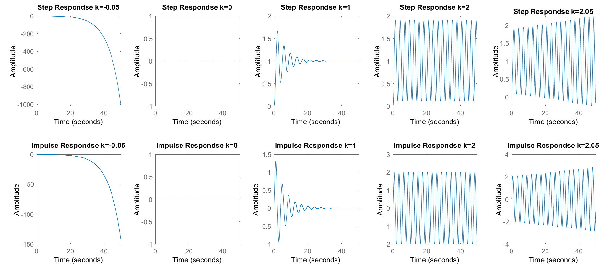

## Question 9

Suppose the disturbance is white noise, i.e. $D(s)=2$, then the output after the disturbance is 
$$
G_1(s)=\dfrac{K(3s+1)}{s},D(s)=2\quad \Rightarrow\quad B_1(s)=G_1(s)+D(s)=\dfrac{(3K+2)s+K}{s}
$$
And since $G_2(s)=\dfrac{2}{s^2+0.8s+1}$, $H(s)=1$, the transfer function of the outer feedback is  
$$
T(s)=\dfrac{B_1(s)G_2(s)}{1+H(s)B_1(s)G_2(s)}=\dfrac{(30K+20)s+10K}{5s^3+4s^2+(30K+25)s+10K}
$$

1. when $K=0.5$, we get

    $$
    T(s)=\dfrac{35s+5}{5s^3+4s^2+40s+5}
    $$

    Plot the output for step & impulse input in Matlab:
    
    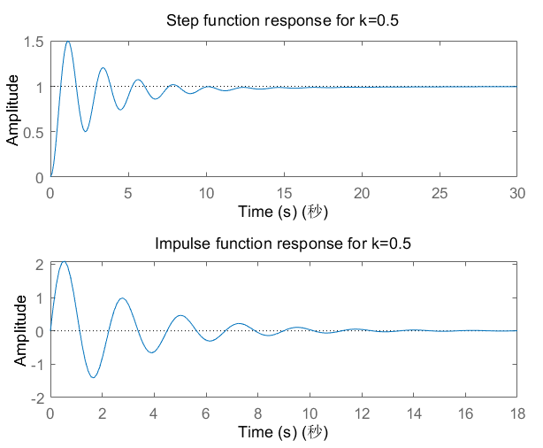

2. We plotted the output response for the system with and without disturbance, while $k=0.5,1.0,1.5,2.0$.

   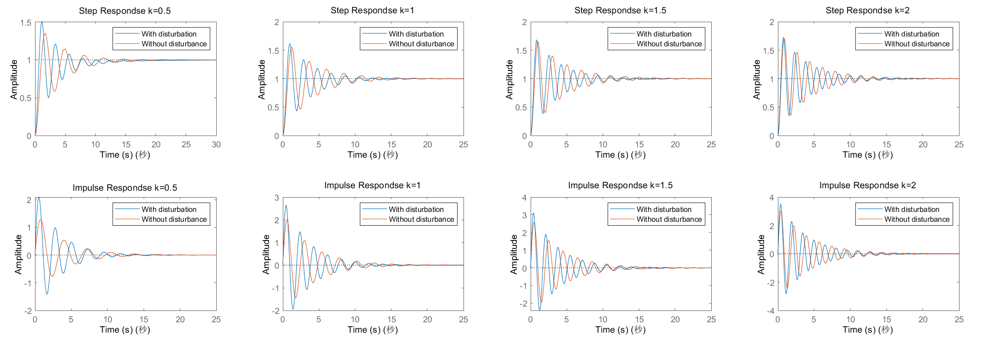

   From the table of graphs, we can realize that the existence of disturbance increases the amplitude and frequency of the input signals.

## Question 10

1. Simulation Result:

   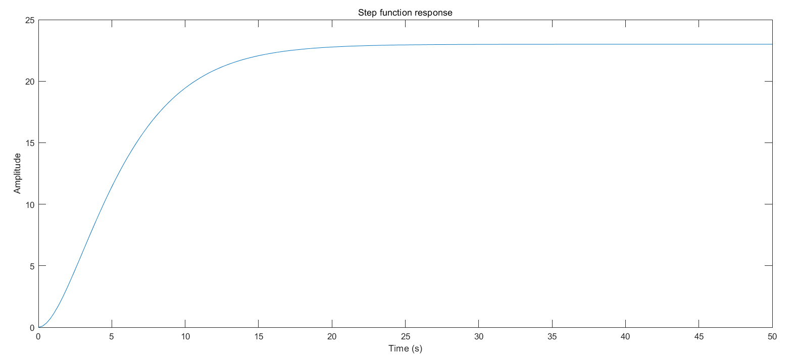

2. According to the Zeigler Nichols Open-Loop Tuning Method, we should evaluate

   - The steady-state gain, **(y2 - y1) / (u2 - u1)**
   - The time delay, **Td**
   - The time constant, **Ts**

   like the graphs shows:

   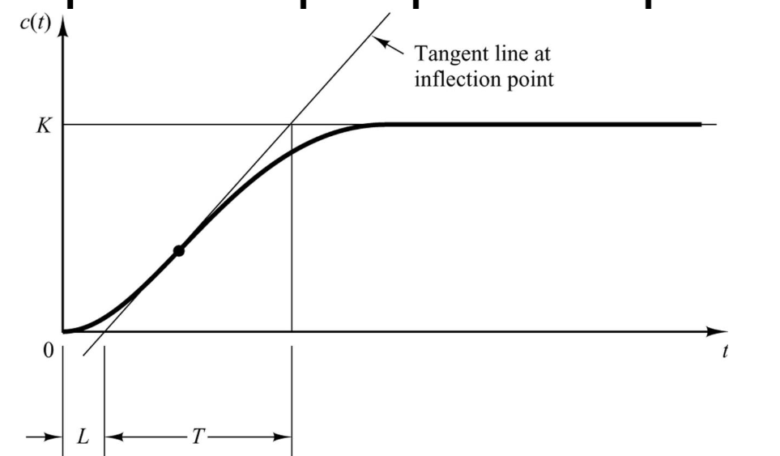

   Using the code `Q10.m`, we can evaluate the necessary parameters by the following steps:

   - use finite difference method to calculate the derivative (second order accuracy)
   - find the peak of the derivative
   - find the upper bound of the response
   - find the intersection points

   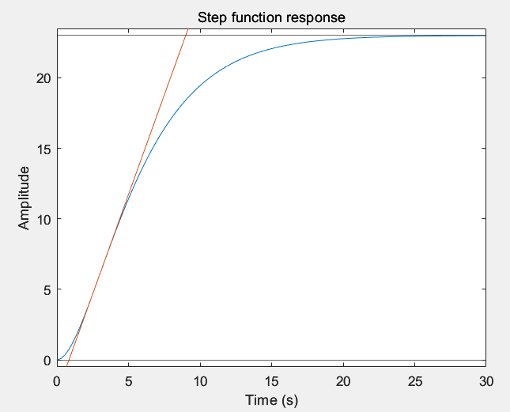

   The output is $T=0.84229,K=8.1555,K=23.0000$, hence we have the following table

   | Controller Type | $K_c$                     | $T_i$                   | $T_d$         |
   | --------------- | ------------------------- | ----------------------- | ------------- |
   | P               | $\dfrac{T}{L}=9.6824$     | $\infty$                | $0$           |
   | PI              | $0.9\dfrac{T}{L}=8.7142$  | $\dfrac{L}{0.3}=2.8076$ | $0$           |
   | PID             | $1.2\dfrac{T}{L}=11.6189$ | $2L=1.68458$            | $0.5L=0.4212$ |

   Hence $G_{PI}=K_c(1+\dfrac{1}{T_is}+T_d s)=\dfrac{8.7142s+3.1038}{s}$. The transfer function of the closed loop PI control response is 
   $$
   T(s)=\dfrac{G_{PI}(s)G(s)}{1+G_{PI}(s)G(s)}=\dfrac{200.4s+71.39}{9s^3+6s^2+201.4s+71.39}
   $$

3. Simulation to step function input:

   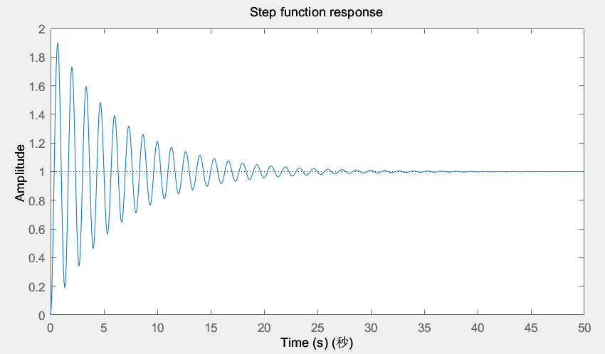

4. Using the tuning tool in Simulink, we got a new pair of parameters:

   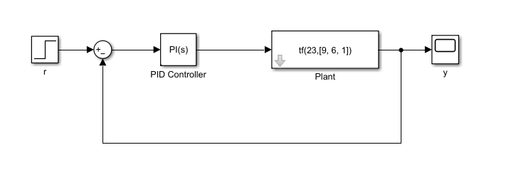

   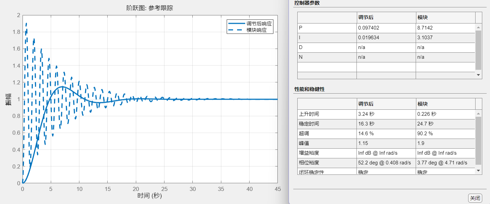

   1. Corresponding $K_c=0.0974,T_i=4.9618$. Responds to step function input is also shown in the graph above.

   2. Simulation for $T_i=1,3,5,7$:

      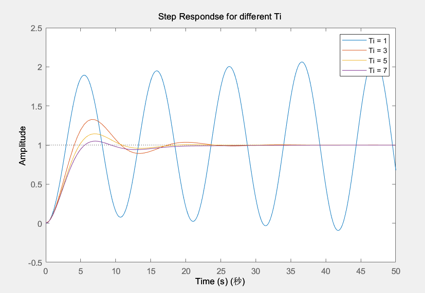

      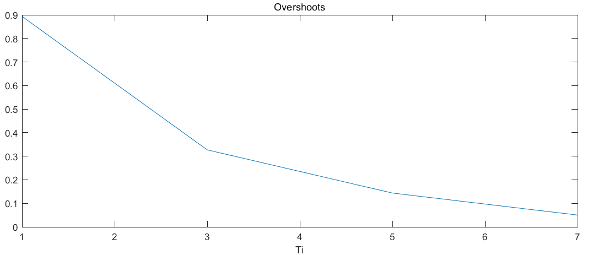

      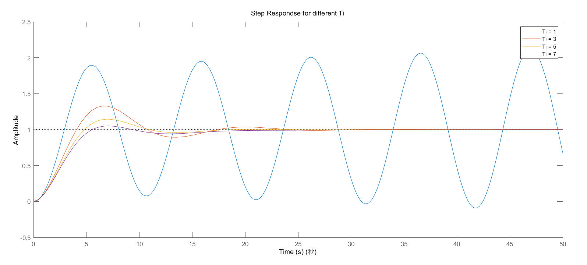

      | $T_i$  | stability | overshoot |
      | ------ | --------- | --------- |
      | 1      | unstable  | 89%       |
      | 3      | stable    | 32%       |
      | 5≈4.96 | stable    | 14%       |
      | 7      | stable    | 5%        |

      As we can see, as $T_i$ increases, the overshoot percentage declines.