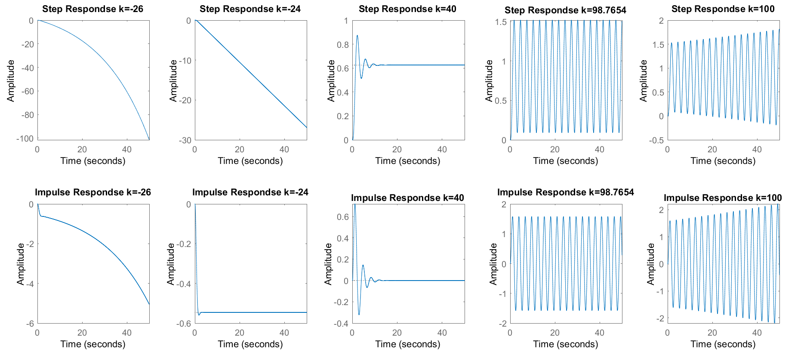

1. In this unity feedback system, $G(s)=\dfrac{k}{(s+2)^3(s+3)}, H(s)=1$, hence the closed loop transfer function is 

    $$
    T(s)=\dfrac{G(s)}{1+G(s)H(s)}=\dfrac{k}{k+(s+3) (s+2)^3}
    $$

2. Characteristic function of $T(s)$ is 
    $$
    1+G(s)H(s)=0\quad\Leftrightarrow\quad s^4+9s^3+30s^2+44s+(24+k)=0
    $$
    We have learned that if the system is stable, then necessarily

    - there's no missing term, satisfied
    - the coefficients have identical sign: $24+k>0$

    Hence $k>-24$. Next, we shall consider the Routh-Hurwitz Criterion:

    | $a_0=1$                                                      | $a_2=30$                                                     | $a_4=24+k$ |
    | ------------------------------------------------------------ | ------------------------------------------------------------ | ---------- |
    | $a_1=9$                                                      | $a_3=44$                                                     | $a_5=0$    |
    | $b_1=-\dfrac{1}{a_1}\begin{vmatrix}a_0&a_2\\a_1&a_3\end{vmatrix}=\dfrac{226}{9}$ | $b_3=-\dfrac{1}{a_1}\begin{vmatrix}a_0&a_4\\a_1&a_5\end{vmatrix}=24+k$ |            |
    | $c_1=-\dfrac{1}{b_1}\begin{vmatrix}a_1&a_3\\b_1&b_3\end{vmatrix}=\dfrac{4000-81k}{226}$ | $c_3=0$                                                      |            |
    | $d_1=-\dfrac{1}{b_1}\begin{vmatrix}b_1&b_3\\c_1&c_3\end{vmatrix}=24+k$ |                                                              |            |

    The system is stable if and only if the values in the first column has identical signs, i.e. positive, 
    $$
    \dfrac{4000-81k}{226}>0\text{ and } 24+k>0\quad\Rightarrow\quad -24<k<\dfrac{4000}{81}
    $$
    Therefore,

    - when $-24<k<\dfrac{4000}{81}$, the system is stable
    - when $k=-24$ or $\dfrac{4000}{81}$, the system is marginally stable
    - otherwise, the system is unstable.

3. For oscillations, at least one pair of poles, say $ia$ and $-ia$ must lie on the imaginary axis, let $g(s)=k+(s+2)^3(s+3)$, then
   $$
   \left\{\begin{align*}
   &g(ia)=24 + 44 ia - 30 a^2 - 9 i a^3 + a^4 + k=0\\
   &g(-ia)=24 - 44 ia - 30 a^2 + 9 i a^3 + a^4 + k=0\\
   &a\neq0
   \end{align*}\right. \quad\Rightarrow 
   \quad
   \left\{\begin{array}{l}
   44-9a^2=0\\
   24-30a^2+a^4+k=0
   \end{array}\right.
   $$
   Therefore $a^2=\dfrac{44}{9}$, the corresponding $k=\dfrac{8000}{81}\approx98.7654$.

   

   We can see that at this time, the system oscillates.

The transfer function is
$$
\begin{align*}
&G(s)=\dfrac{k(s+10)}{s(s+1)(s+3)}, H(s)=1\\
&T(s)=\dfrac{G(s)}{1+G(s)H(s)}=\dfrac{k(s+10)}{s^3+4s^2+(k+3)s+10k}
\end{align*}
$$
The corresponding characteristic function is
$$
1+G(s)H(s)=0\quad\Rightarrow\quad s^3+4s^2+(k+3)s+10k=0
$$
The Routh-Hurwitz Criterion table is given below:

| $a_0=1$                                                      | $a_2=k+3$ |
| ------------------------------------------------------------ | --------- |
| $a_1=4$                                                      | $a_3=10k$ |
| $b_1=-\dfrac{1}{a_1}\begin{vmatrix}a_0&a_2\\a_1&a_3\end{vmatrix}=-\dfrac{3}{2}k+3$ | $b_3=0$   |
| $c_1=-\dfrac{1}{b_1}\begin{vmatrix}a_1&a_3\\b_1&b_3\end{vmatrix}=10k$ |           |

The system is stable if and only if the values in the first column has identical signs, i.e. positive, 
$$
-\dfrac{3}{2}k+3>0\text{ and } 10k>0\quad\Rightarrow\quad 0<k<2
$$
Therefore,

- when $0<k<2$, the system is stable
- when $k=0$ or $1$, the system is marginally stable
- otherwise, the system is unstable.

