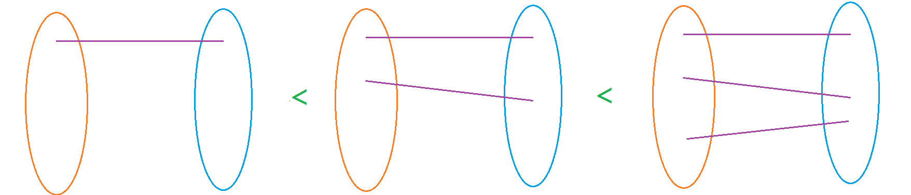

## Q1

There're many ways to prove this.

==**Basic idea: **==Find the injection from the smaller set to the larger set (say, from $A$ to $B$. For finite set, this is simple - just pick a distinct image each time, then since $B$ is larger, there must be an element left. For infinite sets, we need to find a way to measure 'how many elements are covered by mapping $A$ to $B$', hence a partial order need to be introduced, and 'covering the most elements in $B$' can be translated into 'the maximal element of all maps from $A$ to $B$'.

**Trivial** case: $A$ has an injection to $B$. ($A$ smaller than $B$), then nothing to prove.

If **no** injection is from $A$ to $B$, we can guess that $B$ is 'smaller' than $A$. We're going to <u>construct</u> an injection from $B$ to $A$. 

Consider the poset of all injections from <u>**subset**</u> of $B$ to $A$ from sets' perspective:
$$
S=(\{f\subset B\times A\mid f\text{ is an injection}\}, \subset)
$$
then the maximal of $S$ (if exists) maps <u>the most elements in $B$ to the most elements in $A$</u>. We'd apply Zorn's Lemma.

==Any chain in $S$ is bounded:== Take an arbitrary chain in $S$: $(f_i)_{i\in I}$, obviously, $\cup f_i$ is an injection, this can be proved easily by  contradiction:

if $\cup f_i$ is not injective, then $\exist b\in B, a_1,a_2\in A, a_1\neq a_2$, s.t. $(b,a_1),(b,a_2)\in \cup f_i$. 
But as $f_i$ is injective, $\exist i,j\in I,i\neq j$, s.t. $(b,a_1)\in f_i,(b,a_2)\in f_j$ while $(b,a_1)\not\in f_j,(b,a_1)\not\in f_j$, which leads to the conclusion that neither $f_i\subset f_j$ nor $f_j\subset f_i$ holds. This is contradictory to the definition of chain.

<u>**By Zorn's Lemma, $S$ must contains a maximal, denote it as $F$.**</u>

==Claim: $F$ is an injection from $B$ to $A$:== Prove by contradiction. Suppose $F$ is not an injection from $B$ to $A$. By the debate above, there's no doubt that $F$ is an injection. Hence there must be $b\in B$, $b$ is not mapped by $F$. i.e. in other words, $\forall a\in A,(b,a)\not\in F$. At this time,

- if $A$ also has an unmapped item, i.e. $\exist a'\in A,\forall b'\in B, (b',a')\not\in F$, then $F\cup\{(a',b)\}\in S$ as well.
- if $A$ has no unmapped item, i.e. $\forall a'\in A,\exist b'\in B$, s.t. $(b',a')\in F$, then $\{(a,b)\mid (b,a)\in F\}$ is an injection from $A$ to $B$. contradictory.

Hence claim proved. Therefore, there must be an injection either $A\to B$ or $B\to A$.

>  There're other perspective to prove this, for example (just brief ideas, no proof attached)
>
>  1. cardinality. there're 3 occasions 
>
>       - $A$ is larger than $B$: $A$ has cardinality larger than $B$ $\to$ $A$ has a subset that has the same cardinality as $B$ $\to $ we can construct a bijection from $B$ to a subset of $A$.
>
>       - $B$ is larger than $A$: similarly.
>
>       - $A$ has the same cardinality as $B$: we can construct a bijection between $A$ and $B$.
>
>     ==Proof==:
>
>     Due to the Well-Ordering Theorem, for any given sets $A$, $B$, since they're well-orderable, there exist alephs $\aleph_a,\aleph_b$ with $|A|=\aleph_a$ and $|B|=\aleph_b$. i.e. there are bijections $f$ from $A$ to $\aleph_a$ and $g$ from $B$ to $\aleph_b$.
>
>     Since cardinalities are comparable, the cardinalities of $A$ and $B$ are comparable. More specifically, WLOG, 
>
>     - let $\aleph_a<\aleph_b$, then there's injection from $\aleph_a$ to $\aleph_b$, say $h$. Thus $g^{-1}\circ h\circ f$ is an injection from $A$ to $B$
>     - let $\aleph_a=\aleph_b$, then $f\circ g^{-1}$ is a bijection (thus an injection) from $A$ to $B$.
>     
>     **More specifically:**
>     
>     Under the <u>Von Neumann's Definition</u>, the cardinality of a well-ordered set $X$ is the least ordinal number $x$ such that there is a bijection between $X$ and $x$. Hence given two sets $A$ and $B$, by the theorem of well-ordering, $A$, $B$ are well-orderable. Thus we can find an ordinal and cardinal $\lambda_A$, $\lambda_B$ for each of them. And there should be 2 bijections, between $A$ and $\lambda_A$, $B$ and $\lambda_B$ respectively. Denote the 2 bijections as $f_A,f_B$.
>     
>     Ordinals are well-ordered under inclusion, hence is comparable, hence either $\lambda_A<\lambda _B$ or $$\lambda_A=\lambda _B$$ or $$\lambda_A>\lambda _B$$ holds.
>     
>     WLOG, if $\lambda_A\leqslant\lambda_B$, since $\lambda_A< \lambda_B$ (i.e $\lambda_A\sub\lambda_B$), there's an injection (identical mapping) from $\lambda_A$ to $\lambda_B$. Denote it as $g$.
>     
>     Therefore $(f_B\circ g\circ f_A):A\to^{f_A} \lambda_A{\color{purple}\to^{g}}\lambda_B\to^{f_B^{-1}}B$ is an injection from $A$ to $B$. 
>     
>     For the case $\lambda_B<\lambda_A$, the debate is similar, and we can construct an injection from $B$ to $A$.
>     
>  2. Use the axiom of choice together with ordinal number, just imitate the construction given 2 finite sets.
>
>     ==Proof==:
>
>     If $A=\varnothing$ or $B=\varnothing$, the statements holds apparently, and if there exist an injection from $A$ to $B$, then nothing to prove. So we'd only consider the occasion that there's no injection from $A$ to $B$.
>
>     We are going to prove then there's an injection from $B$ to $A$ by direct constructing the injection $f$ from partial injections $f_i$ (seen as a subset of $B\times A$, the first term of it is denote by $D(f_i)$, i.e. the domain and the second term by $R(f_i)$, i.e. the range of the function). 
>
>     By the Axiom of Choice, there are 2 choice functions from $A$ and $B$, say $F_A$ and $F_B$. Then follow the steps below:
>
>     1. begin: $\alpha=0$, $f_\alpha=\varnothing$
>     2. $f_{\alpha+1}=f_\alpha\cup\{(F_B(B-D(f_\alpha)),F_A(A-R(f_\alpha)))\}$, $\alpha\leftarrow \alpha+1$, this step ensure that if $f_\alpha$ is an injection, then so does $f_{\alpha+1}$
>     3. For any limit ordinal $\Omega$, if $f_\alpha$ is defined for all $\alpha <\Omega$, then let $f_\Omega=\bigcup_{\alpha<\Omega}f_\alpha,\alpha\leftarrow \Omega$. By step 2 and the principle of induction, $f_\Omega$ is also injective. 
>
>     Let $f$ be the union of all defined $f_\alpha$ (indexed by $I$), i.e. $f=\bigcup_{i\in I} f_i$, if $f$ is injective, then we proved the statement. Otherwise, $D(f)\sub B$ and $f$ is surjective, or else the step 2 can be executed again. Let $f^{-1}$ be the function from an image of $f$ to one of the preimage of it, then $f^{-1}$ is an injection from $A$ to $B$, which contradicts to our assumption.
>
>     Therefore, if no injection exists from $A$ to $B$, we can construct an injection from $B$ to $A$. The statement is proved.  

## Q2

Prove by contradiction. Suppose there's an infinite successor ordinal number $A=\Omega+a$ ($\Omega$ is the largest limit ordinal less than $A$) that is also a cardinal $B$. Naturally $\Omega\geqslant \omega$.

==**Base idea:**== By the definition of cardinal, $A$ can be bijectively mapped to $B$ but there's no ordinal $A'<A$ that can bijectively mapped to $B$ at the same time. But actually, we can easily construct such a bijection between $\Omega<A$ and $B$ making use of $A$ is infinite, $\Omega \geqslant \omega$: Just <u>shift</u> the first $a$ images right:

Let the bijection between $A+a$ and $B$ be $f$, and $f(i)=b_i,\forall i\in\mathbb{N}$, $f(\Omega+i)=b_i',\forall\ 0\leq i\leq a$, define
$$
\hat f:\left\{
\begin{array}{ll}
i\mapsto b_i'& 0\leqslant i\leqslant a\\
i\mapsto b_{i-a-1} &i>a,i\in\mathbb{N}\\
i\mapsto f(i)& \omega\leqslant i<\Omega
\end{array}
\right.
$$
 which denies the suppose.

## Q3

> There is a set $B\sub A$ which is linearly ordered by $\leqslant $ which is maximal with respect to inclusion.

This means that $B$ is the maximized linearly ordered <u>subset</u> of $A$. 

**Important fact**: $B$ is a chain in $A$. Hence we're going to prove that every poset admits a maximal chain.

**Trivial case: ** No chain exist in $A$. Note that every set of a single item of $A$ is a chain, this will lead to $A=\varnothing$. Which the statement holds naturally.

Otherwise $A\neq\varnothing$. Consider all the chains in $A$, which is a poset under inclusion.
$$
(P,\sub)=(\{p\mid p\text{ is a chain of $A$}\},\sub)
$$
==$(P,\sub)$ is indeed a poset.== This can be easily verified.

==$(P,\sub)$ has maximal.== Since $A\neq \varnothing$, then $P\neq \varnothing$. Take any totally ordered $C\sub (P,\sub)$, We claim that $\displaystyle\cup C$ is a chain in $(P,\sub)$ (Attention, not in $A$). **Proof**:

note that 

- $\forall c\in C\sub P$ , $c$ is a chain of $A$

- $\forall$ $a, b\in \cup C$ of $A$, since $C$ is linearly ordered, we have $\exist A,B\in C$ s.t. $a\in A,b\in B$, and then either $A\sub B$ or $B\sub A$.

  WLOG, we assume $A\sub B$, then $a,b\in B$. and since $B\in P$ is a chain, $B$ is also totally ordered, hence either $a\leqslant b$ or $b\leqslant a$.

Thus $\cup C\in P$ is totally ordered, and it is also an upper bound for $C$ in $(P,\sub)$.

By Zorn's Lemma, $P$ has maximal, hence there's a maximal chain of $A$. Proved.

## Q4

We need to prove

> $\forall$ sets $A,B$, $\forall f:A\to B$, $U\sub P(A)$ is a filter on $A$, then the image 
> $$
> f(U)=\{C\sub A\mid f^{-1}C\in U\}
> $$
> is a filter on B.

==The image of a filter is a filter:== Just check the 4 requirements of a filter:

1. $f(U)\sub P(B)$ holds since $\forall x\in f(U),\exist y\in U,$ s.t $f(y)=x$. (filter is a bunch of subsets)
2. $\varnothing \not\in f(U),B\in f(U)$ holds since $U$ is a filter, $f^{-1}\varnothing =\varnothing\not\in U$, $f^{-1}B=A\in U$. (filter contains the full set but not the empty set)
3. $\forall X, Y\in f(U)$, $X\cap Y\in f(U)$ holds. Since $U$ is a filter, then $\forall P_1,P_2\in U$, there is $P_1\cap P_2\in U$, hence let $P_1=f^{-1}X$, $P_2=f^{-1}Y$, then $f^{-1}X\cap f^{-1}Y=f^{-1}(X\cap Y)\in U$, followed by $X\cap Y\in f(U)$. (filter is closed under intersection)
4. $\forall X\in f(U),X\sub Y\sub B$, $(Y\in f(U))$  holds. Since $U$ is a filter, we have $f^{-1}X\in U$ and naturally $f^{-1}X\sub f^{-1} Y\sub A$, thus $f^{-1}Y\in U\Rightarrow Y\in f(U)$. (filter is closed under taking superset)

Therefore the image of a filter is a filter.

==The image of an ultrafilter is an ultrafilter:== We need additionally prove that there is no larger filter given that $U$ is the largest filter. Or basic idea is a guess: if $f(U)$ is not the largest, then $U$ will also be not the largest.

Along with our guess, just take another filter $G\supe f(U)$ on $B$, we are going to prove $G=f(U)$ by contradiction, i.e. suppose $G\neq f(U)$. Thus there must be $X\in G$, but $X\not\in f(U)$, implying $f^{-1}(X)\not\in U$.

we can let $Y=A-f^{-1}(X)\in U$, note that $Y\sub f^{-1}(f(Y))$, since $U$ is an ultrafilter, the closeness under taking superset would give $f^{-1}(f(Y))\in U$, i.e. $f(Y)\in f(U)$. 

Together with $f(U)\sub G$, we have $f(Y)\in G$. But, $f(Y)\cap X=f(A-f^{-1}(X))\cap X=\varnothing \not\in G$ (Remark: there's a typo in the handwriting script previously sent to you). This violated $G$'s closeness under intersection, indicating our suppose won't hold.

Therefore $G=f(U)$, $f(U)$ is an ultrafilter.

## Q5

==Basic Idea== imitate what we will do to prove the same proposition for finite sets (countable) $A_i$: take $B_i=A_i-\cup_{j<i}A_j$.

For infinite sets, the only problem is the index set - we cannot count it one by one. But with the help of well-ordering theorem, and the introduction of ordinals, this can be handled again.

==Definition:== Given $(A_i)_{i\in I}$, $(B_i)_{i\in I}$, by the well-ordering theorem, we can define the corresponding $B_i$ as 
$$
B_i=A_i-\bigcup_{j\in I,j\leqslant i,j\neq i}A_j
$$
 and $I$, the index set would also be totally ordered and well ordered under some relationship $\leqslant$. that is, $\forall i,j\in I$, either $i\leqslant j$ or $j\leqslant i$.

==$B_i$ is disjoint subsets of $A_i$:== By the construction definition, it is obvious that $B_i\sub A_i$. Now we prove $B_j\cap B_i=\varnothing$, for $i\neq j$.

1. if $i\leqslant j,i\neq j$, we have $B_i\sub A_i$, $A_i\cap B_j=\varnothing$ (since $A_i$ in subtracted from  $A_j$). Also, $B_j\sub A_j-A_i$, hence 
   $$
   B_i\cap B_j\sub A_i\cap (A_j-A_i)=\varnothing
   $$
   i.e. $B_i\cap B_j=\varnothing$.

2. if $i\geqslant j,i\neq j$, we have similar conclusion $B_j\cap B_i=\varnothing$.

==prove $\cup_{i\in I}A_i=\cup_{i\in I} B_i$== 

1. obviously, $\cup_{i\in I}B_i\sub \cup_{i\in I}A_i$ as $B_i\sub A_i,\ \forall i\in I$.

2. to prove $\cup_{i\in I}A_i\sub \cup_{i\in I}B_i$, take $x\in \cup_{i\in I}A_i$, and let 
   $$
   I_0=\{i\in I\mid x\in A_i\}
   $$
   i.e. the indexes of all $A_i$ containing $x$. obviously $I_0$ is non-empty. Since $I$ is well-ordered, $I_0$ would have a minimal element, denote it as $i_0\in I_0$.

   This implies that $\forall j\in I,j\leqslant i_0,j\neq i_0$, we have $x\not\in A_{j}$ (otherwise $i_0$ is not minimal). Consider the fact $x\in A_{i_0}$, we find actually  $x\in A_{i_0}-\bigcup_{j\leqslant i_0,j\in I,j\neq i_0}A_j=B_{i_0}$, hence $x\in B_{i_0}\Rightarrow x\in \cup _{i\in I}B_i$.

   As $x$ is taken arbitrarily, we have proved $\cup_{i\in I}A_i\sub \cup_{i\in I}B_i$.

Therefore $\cup_{i\in I}A_i= \cup_{i\in I}B_i$. The given proposition is proved.

