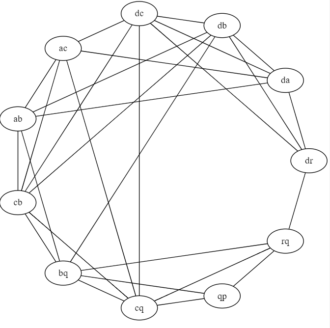
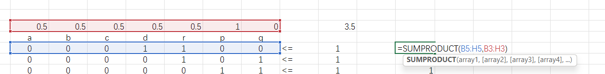
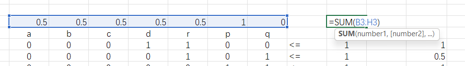
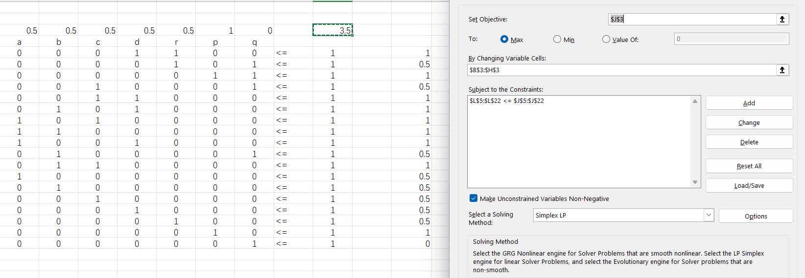
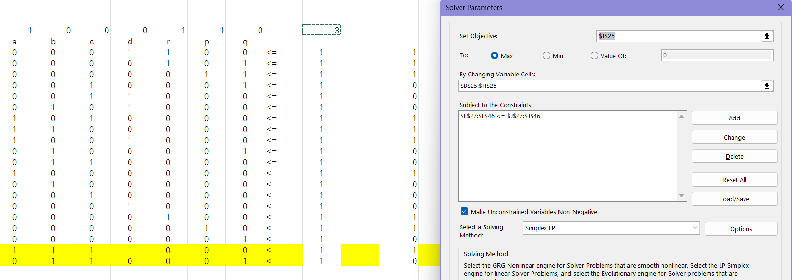
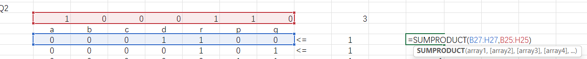
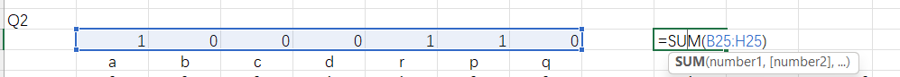

### Q1

1. Graphviz

    ```graphviz
    graph G {
        dr -- rq;
        rq -- qp;
        qp -- bq;
        cq -- rq;
        cq -- qp;
        cq -- bq;
        cq -- cb;
        cq -- ac; 
        cq -- dc;
        rq -- bq;
        bq -- cb;
        bq -- ab;
        bq -- db;
        cb -- dc;
        cb -- ac;
        cb -- ab;
        cb -- db;
        ab -- ac;
        ab -- da;
        ab -- db;
        ac -- dc;
        ac -- da;
        dc -- dr;
        dc -- da;
        dc -- db;
        dr -- da;
        dr -- db;
        da -- db;
    }
    ```
    
    Corresponding line graph $H$:
    
    

2. One of the stable sets within $H$ of cardinality $3$: 
   $$
   S=\{dr,ac,qp\}
   $$

### Q2

1. Screenshots:

   

   

   

   The solution is $x=(0.5,0.5,0.5,0.5,0.5,1,0)$ by simplex method.

2. Maximal clique examples: 

   - $\{c,b,q\}$. Since $cb,cq,bq\in E$, it is a clique. Since $aq,dq,rc,cq\not\in E$, it is maximal.
   - $\{a,b,c,d\}$. Since $ab,ac,ad,bc,bd,cd\in E$, it is a clique. Since $rc,qa,pd\not\in E$, it is maximal.

3. Note we have found all the maximal cliques other than a single node or a single edge in the last subproblem, hence we'd append 2 inequalities to the problem:
   $$
   \begin{align*}
   &x_c+x_b+x_q\leqslant 1\\
   &x_a+x_b+x_c+x_d\leqslant 1
   \end{align*}
   $$
   

   

   

   Therefore the solution is $x=(1,0,0,0,1,1,0)$.
