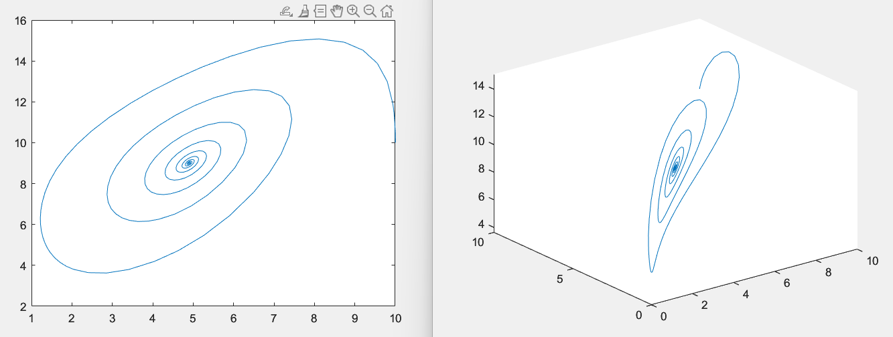
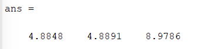
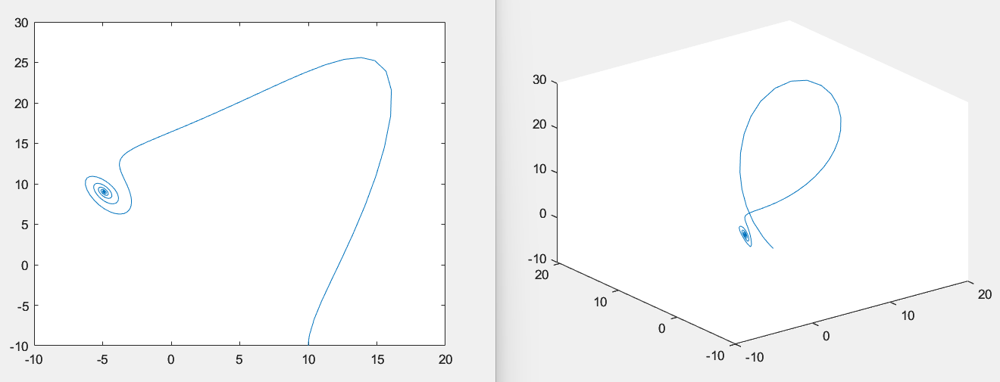
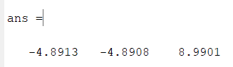
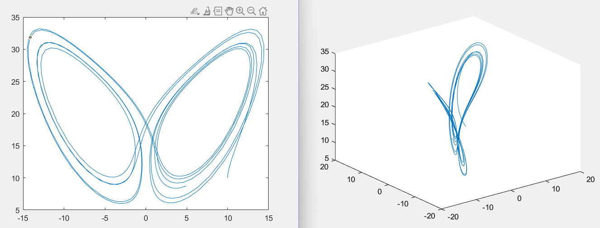
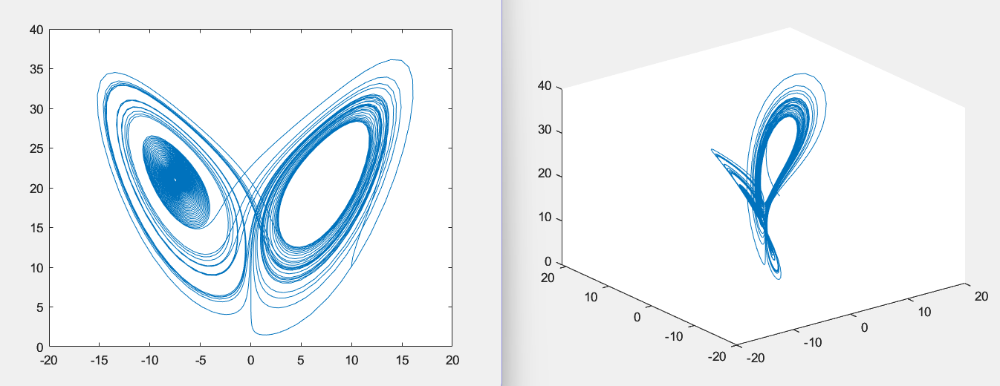
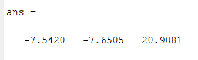
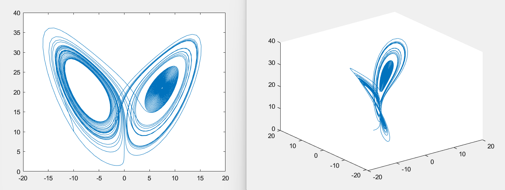
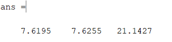

### Prob 9.3.2:  $r=10$

At the fixed point, we have
$$
\begin{align*}
&\dot x=\sigma (y-x)=0\\
&\dot y=rx-y-xz=0\\
&\dot z=xy-bz=0
\end{align*}\qquad (*)
$$
when $\sigma=10,b=8/3,r=10$, we can get 3 solutions: $P_1=(x,y,z)=(0,0,0)$, $P_2=(x,y,z)=(-2\sqrt 6,-2\sqrt 6,9)$, $P_3=(x,y,z)=(2\sqrt6,2\sqrt6,9)$.

Note that when $z=0$, $\dot z=xy$, for any small neighborhood $B_\varepsilon ((0,0,0))$, we can find $(x_1,y_1),(x_2,y_2)$ such that $\dot z|_{(x_1,y_1,0)}>0$ and $\dot z|_{(x_2,y_2,0)}<0$. Therefore $(0,0,0)$ is an unstable fixed point. 

$x_0=y_0=z_0=10$ and $T=10$, result:

The approached fixed point is $P_3\approx(4.8848,3.8891,8.9786)$ by executing `x(end, :)`.

Given initial position $(-10,-10,10)$, we can get a trajectory approaching the other fixed point $P_2\approx(-4.8913,-4.8908,8.9901)$:

### Prob 9.3.3:  $r=22$

when $\sigma=10,b=8/3,r=22$, we can get 3 solutions: $P_1=(x,y,z)=(0,0,0)$, $P_2=(x,y,z)=(-2\sqrt 14,-2\sqrt 14,21)$, $P_3=(x,y,z)=(2\sqrt 14,2\sqrt 14,21)$. For the same reason $(0,0,0)$ is unstable.

Starting from $(10,10,10)$, $T=10$ gives

$T=100$ gives

Hence it approaches $P_2$.

Starting from $(-10,-10,10)$, $T=100$ gives 

Hence the trajectory approaches $P_3$.