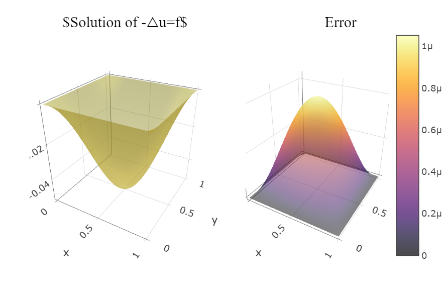
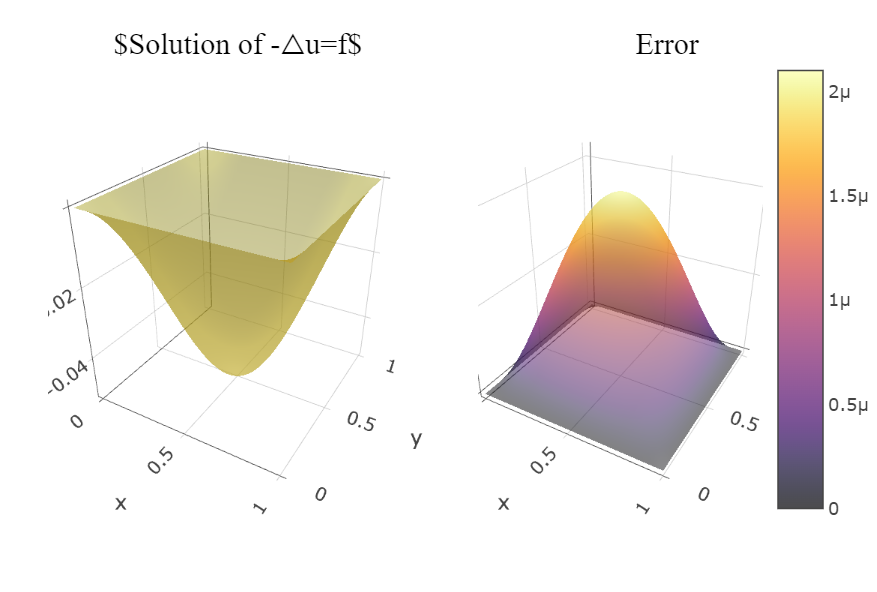
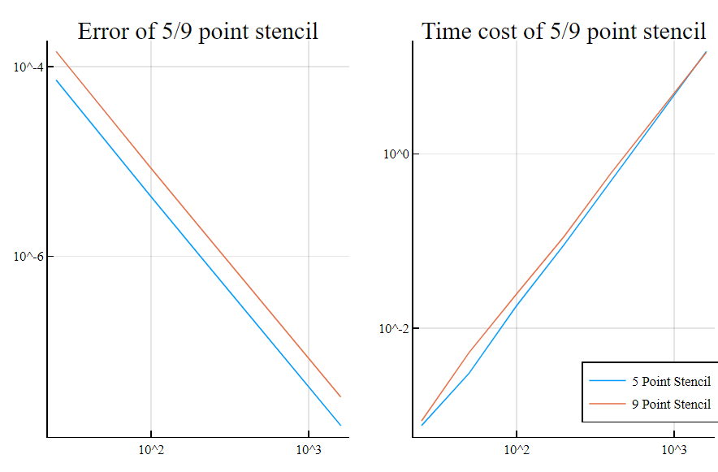
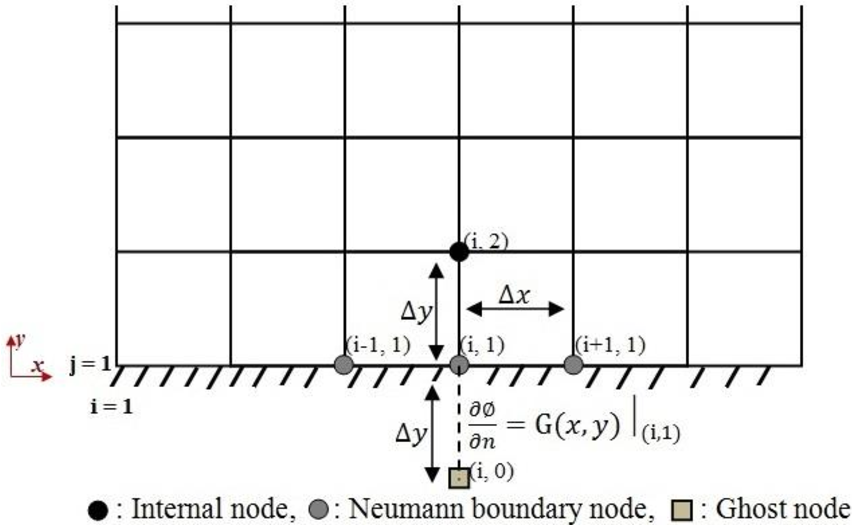
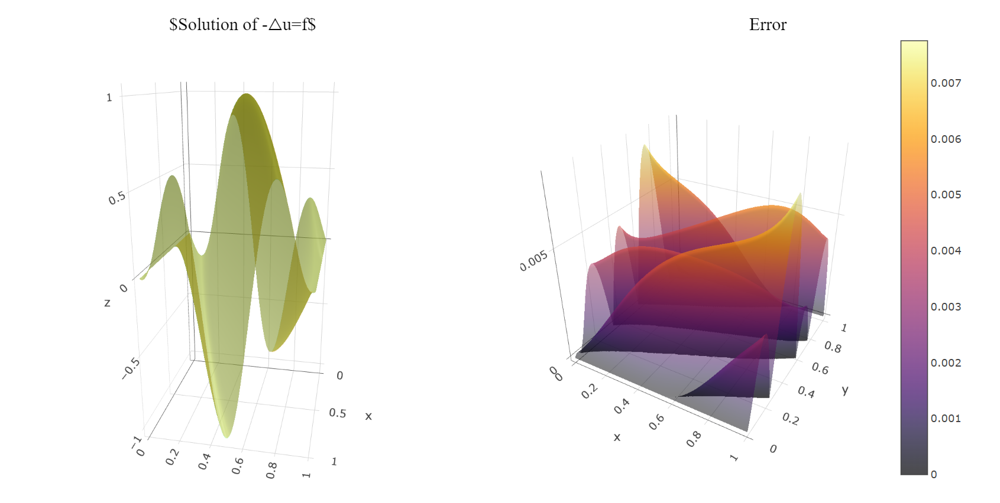

# Report on a Numerical Method for PDE BVP Problems

## Preface

In this report, we focus on the implementation and analysis of various numerical methods for solving partial differential equations (PDEs), with the goal of gaining a comprehensive understanding of their performance. These methods find direct applications in multiple disciplines, including computational fluid dynamics, computational chemistry, and more. 

As we are primarily interested in CFD, we have explored methods that are widely used to simulate fluid dynamics. Specifically, we have evaluated the performance of various PDE numerical methods, including finite difference, finite element, and spectral methods, and compared their accuracy and efficiency for solving fluid dynamics problems. This short essay focuses on the first method - the finite difference method, implement it to solve boundary value problems, and analyze the error and efficiency for the easiest occasion.

### Description of the Problem

For convenience, through out this report, we will use the Poisson Equation $-\Delta u=f$ and heat equation $u_t=a\Delta u +f$ to illustrate different methods, and the boundary is set to be smooth except at finite points. i.e.
$$
-\Delta u=f\text{ on } \Omega,\quad \Gamma=\partial\Omega\quad \label{1}(1)\\
u_t=a\Delta u +f\text{ on } \Omega,\quad \Gamma=\partial\Omega\quad (2) 
$$
Distinct boundary conditions (BC) will be applied, the following list shows the 3 most commonly used BCs:

- Dirichlet BC: $u=g$ on $\Gamma$
-  Neumann BC: $\dfrac{\partial u}{\partial n}=g$ on $\Gamma$
- Robin BC: $au+b\dfrac{\partial u}{\partial n}=g$ on $\Gamma$

Now move on to the main sections of our report.

## Finite Difference Method

This method is particularly suitable for smooth equations with simple boundary shapes. Say we have a square region $\Omega=[0,1]\times[0,1]$, consider the Poisson Equation with Dirichlet BC:
$$
-\Delta u=f\text{ on } \Omega,\quad \Gamma=\partial\Omega,\quad u=g \text{ on } \Gamma
$$
We are going to give out the standard **five-point stencil** of this problem.

Firstly, divide $\Omega$ with 2 bunches of equidistant lines parallel to the x- and y-axis. Let $h=\dfrac{1}{n}$,
$$
x=ih,\ y=jh,\quad i=0,1,2,\cdots,n\quad j=0,1,2,\cdots,n
$$
The intersection of the 2 bunch of lines are named nodes and denoted as $P_{ij}=(x_i,y_j)$, then $\Omega$ contains $2(n+1)(2n+1)$ nodes and the internal nodes can be defined:
$$
\mathcal{N}_{h}^I=\{(x_i,y_j)\mid 1\leqslant i\leqslant n-1,1\leqslant j\leqslant n-1\}
$$
The basic idea of approximating the derivative is to use difference quotients, by performing Taylor expansion, we have
$$
\dfrac{d^2v}{dx^2}=\dfrac{v(x-h)-2v(x)+v(x+h)}{h^2}\label{eq:aa}
$$
for a function $v(x)$, here we used central finite difference approximation, but I'd mention that there are a lot of schemes in the family of schemas, each of difference form and order. Here is just one example.

> **Remark**: the proof and error estimate of $\eqref{eq:aa}$ is quite easy,
> $$
> \begin{align*}
> &v(x-h)=v(x)-\dfrac{v'(x)h}{1!}+\dfrac{v''(x)h^2}{2!}-\dfrac{v'''(x)h^3}{3!}+o(h^3)\\
> &v(x+h)=v(x)+\dfrac{v'(x)h}{1!}+\dfrac{v''(x)h^2}{2!}+\dfrac{v''’(x)h^3}{3!}+o(h^3)
> \end{align*}
> $$
> Hence 
> $$
> v(x-h)-2v(x)+v(x+h)=v''(x)h^2+o(h^3)=v''(x)h^2+\dfrac{h^4}{12}v^{(4)}(\xi),\quad \xi\in(x-h,x+h)\label{eq:fde}
> $$
> hence the approximation holds and is of the second order.
>
> In the following paragraph, We will not give the full proof of similar equations since most of them come from Taylor Series and are easy to verify.

Therefore we have
$$
\begin{align*}
&u_{xx}(x_i,x_j)\approx\dfrac{u(x_{i-1},y_j)-2u(x_i,y_j)+u(x_{i+1},y_j)}{h^2}\\
&u_{xx}(x_i,x_j)\approx\dfrac{u(x_{i},y_{j-1})-2u(x_i,y_j)+u(x_{i},y_{j+1})}{h^2}
\end{align*}
$$
Let $u_{ij}=u(x_i,y_j)$ and $f_{ij}=f(x_i,y_j)$, then we achieved our discretization schema (5-point stencil) for the $\Delta$ operator:
$$
\begin{align}
\Delta_h u_{ij}&=\dfrac{u_{i-1,j}-2u_{ij}+u_{i,j+1}}{h^2}+\dfrac{u_{i,j-1}-2u_{ij}+u_{i+1,j}}{h^2}\\
&=\dfrac{u_{i-1,j}+u_{i+1,j}+u_{i,j-1}+u_{i,j+1}-4u_{ij}}{h^2}\label{5pts}\\
&=-f_{ij}
\end{align}
$$
At the boundary points, $u_{ij}=g(x_i,y_j)$, $i=0\vee j=0\vee i=n\vee j=n$. By $\eqref{eq:fde}$, we have a estimated truncation bound: $\exist\ \xi\in(x_{i-1},x_{i+1}),\eta\in(y_{i-1},y_{i+1})$ such that 
$$
R_{ij}=f(x_i,y_j)+\Delta_h u(x_i,y_j)=-\Delta_h u(x_i,y_j)+(\Delta u)(x_i,y_j)=\dfrac{h^2}{12}(u^{(4,0)}(\xi,y_j)+u^{(0,4)}(x_i,\eta))\label{err}
$$
To solve the discretized equations, we can use <u>sparse Matrix</u> to store all the coefficients.

There's also 9-point stencil that can be seen as a linear combination of a 5-point stencil and a <u>rotated</u> 5-point stencil.
$$
\begin{align*}
\Delta_h u_{ij}&=\{(1-\alpha)\ \begin{array}{|c|c|c|}
\hline 
0&1&0\\\hline1&-4&1\\\hline0&1&0\\\hline
\end{array}+\dfrac{\alpha}{2}\ \begin{array}{|c|c|c|}
\hline 
1&0&1\\\hline0&-4&0\\\hline1&0&1\\\hline
\end{array}\ \}u_{ij}
\end{align*}
$$
Let $\alpha=\dfrac{1}{3}$, we get a typical 9-point Laplacian formula,
$$
\Delta_h u_{ij}=\dfrac{1}{6h^2}(4u_{i-1,j}+4u_{i+1,j}+4u_{i,j-1}+4u_{i,j+1}+u_{i-1,j-1}+u_{i-1,j+1}+u_{i+1,j-1}+u_{i+1,j+1}-20u_{ij})
$$

### Implementation

The coefficient matrix of 5-point stencil is obtained by the following function:

```julia
function GenerateCoeffMatrix5Point(N::Int64, h::Float64, allocator::Function)
    nonzero_size = (N - 2) * (N - 2) * 5 + 4 * N - 4
    ids_row = zeros(Int64, nonzero_size);
    ids_col = zeros(Int64, nonzero_size);

    values = zeros(Float64, nonzero_size);

    row = 1;
    count = 1;
    for i = 1 : N, j = 1 : N
        if i != 1 && i != N && j != 1 && j != N
            ids_row[count] = row;
            ids_col[count] = allocator(i - 1, j);
            values[count] = 1 / h ^ 2;
            count += 1;

            ids_row[count] = row;
            ids_col[count] = allocator(i + 1, j);
            values[count] = 1 / h ^ 2;
            count += 1;

            ids_row[count] = row;
            ids_col[count] = allocator(i, j - 1);
            values[count] = 1 / h ^ 2;
            count += 1;

            ids_row[count] = row;
            ids_col[count] = allocator(i, j + 1);
            values[count] = 1 / h ^ 2;
            count += 1;
        end

        # center
        ids_row[count] = row;
        ids_col[count] = allocator(i, j);
        values[count] = -4 / h ^ 2; 
        count += 1;

        # next equation
        row += 1;
    end

    return sparse(ids_row, ids_col, values);
end
```

The coefficient matrix of the 9-point stencil is obtained similarly in the function `GenerateCoeffMatrix9Point`, due to limitations on the length of the article, we have omitted this section of code.

Consider when ==$f(x,y)=\sin \pi x\sin\pi y$== and ==$g=0$==, the [analytical solution](https://math.stackexchange.com/questions/3630678/analytical-solution-to-poissons-equation-with-sinusoidal-source) is ==$u(x,y)=-\dfrac{\sin(\pi x)\sin(\pi y)}{2\pi^2} $==. 

- The 5-Point Stencil together with the default backslash operator produces the follow result (Max absolute error $10^{-6}$ and elapsed time is $0.069$ second if using $200\times 200$ grid)

  

- The 9-Point Stencil together with the default backslash operator produces the follow result (Max absolute error $2.1\times10^{-6}$ and elapsed time is $0.115$ second if using $200\times 200$ grid)

  

Code to solve the equation:

```julia
N = 200;
L = H = 1.0;
h = L / (N - 1);

A = GenerateCoeffMatrix5Point(N, h)

# fill right
f = (x, y) -> sin(pi * x) * sin(pi * y)
f_ij = (i, j) -> f((i - 1) * h, (j - 1) * h)

g = (x, y) -> 0
g_ij = (i, j) -> g((i - 1) * h, (j - 1) * h)

id = (i, j) -> (i - 1) * N + j

rhs = zeros(Float64, size(A)[1]);

for k = 1 : N
    rhs[id(k, 1)] = -4 * g_ij(k, 1) / h ^ 2;
    rhs[id(k, N)] = -4 * g_ij(k, N) / h ^ 2;
    rhs[id(1, k)] = -4 * g_ij(1, k) / h ^ 2;
    rhs[id(N, k)] = -4 * g_ij(N, k) / h ^ 2;
end

for i = 2 : N - 1, j = 2 : N - 1
    rhs[id(i, j)] = f_ij(i, j);
end

# 5 points
@time sol = reshape(A \ rhs, (N, N))
```

Codes to plot:

```julia
ana_sol_f(x, y) = -sin(pi * x) * sin(pi * y) / (2 * pi ^ 2);

xs = 0:h:L;
ys = 0:h:L;
surface(xs, ys, reshape(sol, (N, N)), 
    fill=:greens, fillalpha=0.5, 
    legend=false
)

ana_sol = ana_sol_f.(xs', ys)

plot(
    surface!(xs, ys, ana_sol , fill=:orange, fillalpha=0.5, legend=false,
        xlabel=L"$x$", ylabel=L"$y$", zlabel=L"$u(x,y)$",
        title=L"Solution of -△u=f"
    ),
    surface(xs, ys, abs.(ana_sol - sol), fillalpha=0.7, title="Error")
)

maximum(vec(abs.(ana_sol - sol))) # max error
```

Taking different grid sizes, we measured that (the complexity depends on the implementation of the backslash operator in Julia)



> ==**Remark:**==
>
> Solving $Ax=b$ will be of high cost when the size of $A$ is extremely large. So an iterative method is demanded. One choice is the SOR (Successive Over Relaxation) method.
>
> ```julia
> function sor(A::Array{Float64,2}, b::Array{Float64,1}, x0::Array{Float64,1}, maxiter::Int64, tol::Float64, omega::Float64)
>     n = size(A, 1)
>     x = copy(x0)
>     for k = 1:maxiter
>         for i = 1:n
>             sigma = 0.0
>             for j = 1:i-1
>                 sigma += A[i,j]*x[j]
>             end
>             for j = i+1:n
>                 sigma += A[i,j]*x0[j]
>             end
>             x[i] = (1-omega)*x0[i] + omega*(b[i]-sigma)/A[i,i]
>         end
>         if norm(x-x0) < tol
>             break
>         end
>         x0 = copy(x)
>     end
>     return x
> end
> ```
>
> But unfortunately, it performs bad in this problem, mostly probably due to that the matrix is extremely sparse, but this piece of code doesn't make use of this property.

### Neumann Boundary Conditions

Taking the same grid and consider the Poisson equation with mixed Dirichlet and Neumann boundary conditions:
$$
-\Delta u=f,\ (x,y)\in\Omega,\quad \dfrac{\partial u}{\partial n}=g,\ (x,y)\in\Gamma=\{0,1\}\times[0,1],\quad u=g,\ (x,y)\in\partial \Omega-\Gamma
$$
Where 
$$
\begin{align*}
&g(0,y)=-5\sin(\pi y)\sin(-10y),\ \ g(1,y)=5\sin(\pi y)\sin(5-10y),\ \ g(x,0)=g(x,1)=0\\
&f(x,y)=-\left(125+\pi ^2\right) \sin (\pi  y) \cos (5 (x-2 y))+20 \pi 
   \cos (\pi  y) \sin (5 (x-2 y))
\end{align*}
$$
The analytical solution for the problem is $u(x,y)=\sin(\pi(y-1))\cos(5x-10y)$.

To make use the central difference, we introduce ghost nodes outside the simulation region, for example, if the boundary condition is applied on the left boundary (i.e. $x=0$), then we introduces $(x_{-1},y_i)$ where $x_{-1}=-h$, and have
$$
\begin{align*}
\dfrac{u_{-1,j}-u_{1,j}}{2h}=g_{0,j},\quad \dfrac{4u_{0,j}-u_{-1,j}-u_{1,j}-u_{0,j-1}-u_{0,j+1}}{h^2}=f_{0,j}
\end{align*}
$$
Eliminating $u_{-1,j}$, we get
$$
\dfrac{4u_{0,j}-2u_{1,j}-u_{0,j-1}-u_{0,j+1}}{h^2}=f_{0,j}+\dfrac{2g_{0,j}}{h},\ 1\leqslant j\leqslant n-1
$$
The following [graph](https://d3i71xaburhd42.cloudfront.net/ab7a34f4a8c382be06715f3fbef7e8ee4c3ca167/32-Figure1.2-1.png) shows the basic idea



Somehow our experiments shows that the convergence of this pattern is not so good, we divided each axis into as many as 1000 nodes to suppress the error to $10^{-2}$ and it costs $5.26$ seconds to solve. See `P2.jl` for the codes. To optimize the process, maybe higher order finite difference schema need to be applied. Since this report doesn't mean to focus on this issue, it is omitted.



We can observe that for this method, curved boundary is hard to handle, one of workarounds is to interpolate the neighborhood nodes, but since the implementation is complex - we need to interpolate a lot of nodes and calculate the coefficients for them, we skipped the try.

### Initial Value Problem on Time

Consider the general heat equation consisting both space and time:
$$
\left\{
\begin{align*}
&u_t = a^2\Delta u,\ (x,y)\in\Omega=[0,1]^2\\
&u(t,0,y)=\sin\pi y\cos t,\ u_x(t,1,y)=0\\
&u(t,x,0)=u(t,x,1)=0\\
&u(0,x,y)=\cos\pi x\sin\pi y\cos t
\end{align*}
\right.
$$
We put a heat source at the left, and constrain the temperature on the top and bottom edge, and let the right boundary be free. To solve this problem numerically, surely we can discretize both time and space, but this causes a problem: 

- To make the grid finite, we must limit the upper bound of the time span, if we want to see further evolution, we must solve again
- The heat distribution on the space region only depends on the previous distribution, but we don't make use of this.

Hence naturally, we find discretizing the space and evolute along the time is a better choice. This gives:
$$
u_t=a^2(\dfrac{u_{i-1,j}+u_{i+1,j}+u_{i,j-1}+u_{i,j+1}-4u_{i,j}}{h^2})\label{ut}
$$
 the boundary conditions gives 
$$
\begin{array}{llll}
(x=0)& u_t=-\sin t\sin\pi y_i\\
(x=1)& u_t=a^2(\dfrac{2u_{i,n-1}+u_{i-1,n}+u_{i+1,n}-4u_{i,n}}{h^2})\\
(y=0,y=1)&u_t=0
\end{array}
$$
Hence $\eqref{ut}$ can be written as an ODE $u_t=F(u,t)$, then we can apply some ODE solvers such as Runge-Kutta Method to get the state of the next time point. Moreover, we can double the steps to estimate the error of Runge-Kutta Method.

```julia
function RK4(f::Function, tspan, y0, h)
    t = 0
    ys = Array{typeof(y0)}
    ts = Vector{typeof(h)}
    push!(ys, y0)
    push!(ts, t)
    while t < tspan
        k1 = f(t, ys[-1])
        k2 = f(t + h / 2., ys[-1] + h * k1 / 2)
        k3 = f(t + h / 2., ys[-1] + h * k2 / 2)
        k4 = f(t + h, ys[-1] + h * k3)
        
        y_new = ys[-1] + (k1 + 2 * k2 + 2 * k3 + k4) * h / 6
        t += h

        push!(ys, y_new)
        push!(ts, t)
    end
    return ys, ts
end
```

The derivation is direct and explicit, thus is easy to implement and can simulate as long as we want. But I notice a cons for this: the ratio of time step and space step should be extremely small to ensure the convergency. In my experiment, the result keeps blowing up until I take $\Delta x=\Delta y=0.01$ and $\Delta t=5\times 10^{-4}$.

```julia
u0(x, y, t) = cos(pi * x) * sin(pi * y) * cos(t)

include("Utils.jl")

Nx = Ny = 100
L = H = 1

dx = L / (Nx - 1)
dy = H / (Ny - 1)

xs = 0:dx:L
ys = 0:dy:H

a = 1;

u_init = u0.(xs', ys, 0);

function f(t, y)
    sz = size(y)
    dy = zeros(Float64, sz);

    for i = 1 : sz[1], j = 1 : sz[2]
        if i != 1 && i != Ny
            if j == 1 # left
                dy[i, j] = -sin(t) * sin(pi * ys[i])
            end
            if j == Nx # right
                dy[i, j] = a ^ 2 * (2 * y[i, j - 1] + y[i - 1, j] + y[i + 1, j] - 4 * y[i, j]) / dx ^ 2
            end
        end
        if i == 1 || i == Ny
            dy[i, j] = 0
        end
        if i != 1 && i != Ny && j != 1 && j != Nx
            dy[i, j] = a ^ 2 * (y[i, j + 1] + y[i, j - 1] + y[i - 1, j] + y[i + 1, j] - 4 * y[i, j]) / dx ^ 2
        end
    end
    return dy
end

tspan = [0, 2]
Nt = 100000;
dt = (tspan[2] - tspan[1]) / (Nt - 1);
@elpased ts, us = RK4(f, tspan, u_init, dt);

anim = @animate for i = 1:200:length(us)
    surface(xs, ys, us[i], 
    opacity=0.9, 
    title=LaTeXString(sprintf1("T = %.5f", ts[i])),
    xlabel=L"x", ylabel=L"y", zlabel=L"u(t;x,y)",
    xlims=[0,1], ylims=[0,1], zlims=[-1,1]
    )
end

gif(anim, "P3.gif", fps = 50)
```

==**Result:**==


### Analysis

#### Application

The simplicity of implementation and analysis of this method has led to its widespread adoption for both general applications and teaching purposes. The method is based on the assumption that the solution is smooth (or at least twice continuously differentiable) and Lipschitz continuous. This allows us to control the discretization error within a specified bound when we discretize either the space or time domains.

Moreover, since the discretization is performed on a grid, boundary-shape-oriented adjustments can be complicated and may result in significant losses.

#### Error

In this subsection, we're going to give a formal proof of the error of this method applied to the first problem (with zero Dirichlet boundary condition), taking 5-point stencil as an example.

Firstly we need to prove the maximum theorem for Poisson equation.

*Lemma 1* Let $u\in C^2(\Omega)\cap C(\bar\Omega)$ and satisfies $-\Delta u\leqslant 0$ on $\Omega$, then $\displaystyle\max_{\bar\Omega}\leqslant \max_{\bar\Gamma}$ .

*Theorem 1* Let $u\in C^2(\bar\Omega)$, then $\exists\ C$ constant such that 
$$
\max_{\bar\Omega}|u|\leqslant \max_{\Gamma}|u|+C\max_{\bar\Omega}|\Delta u|
$$
**Proof: ** take an arbitrary function $f$ such that $f\geqslant 0$ and $\Delta f\geqslant 1$ on $\Omega$, define $v=u+f \max_{\bar\Omega}|\Delta u|$, then
$$
\Delta v=\Delta u+\max_{\bar\Omega}|\Delta u|\Delta f\geqslant 0\text{  on }\Omega
$$
hence $v$ achieve this maximum on the boundary, whence 
$$
u\leqslant v\leqslant\max_{\Gamma} v\leqslant \max_{\Gamma}|u|+\max_{\bar\Omega}|\Delta u|\max_{\Gamma} f
$$
Similarly,
$$
-u\leqslant\max_\Gamma |u|+\max_{\bar\Omega}|\Delta u|\max_{\Gamma}f 
$$
let $C=\max_\Gamma f$ then the proof is finished.

👉 <u>Next, we shall extend this theorem to grids.</u>

*Theorem 2* Let a grid function $e_{ij}$ satisfies $-\Delta_h e_{ij}\leqslant 0$, $\forall\ (x_i,y_j)\in \Omega$, then $\displaystyle\max_{\bar\Omega} e_{ij}\leqslant \max_{\Gamma}e_{ij}$.

**Proof: **For internal nodes, apparently, 
$$
e_{ij}=\dfrac{e_{i-1,j}+e_{i+1,j}+e_{i,j-1}+e_{i,j+1}}{4}-\dfrac{h^2}{4}\Delta_h e_{ij}\leqslant \dfrac{e_{i-1,j}+e_{i+1,j}+e_{i,j-1}+e_{i,j+1}}{4}
$$
Suppose the maximum value of $e_{ij}$, $e_{\max}$ is achieved at some internal node $(x_{i_0},y_{i_0})$, Then it's 4 adjacent nodes  achieve maximum value as well (otherwise $e_{i_0,j_0}>\dfrac{e_{i-1,j}+e_{i+1,j}+e_{i,j-1}+e_{i,j+1}}{4}$, contradictory). Using a flood scheme, we can deduce that the maximum value is achieved at all internal nodes. i.e. $e_{ij}$ is constant.

*Theorem 3* Let  $e_{ij}$ be an arbitrary grid function. Then there exists a constant $C$, such that
$$
\max_{\bar{\Omega}}|e_{ij}|\leqslant \max_{\Gamma}|e_{ij}|+C\max_{\Omega}|\Delta_h e_{ij}|
$$
**Proof: ** Adopting the same procedure as theorem 1. take an arbitrary function $f_{ij}$ such that $f_{ij}\geqslant 0$ and $\Delta f_{ij}\geqslant 1$ on $\Omega$, define $v_{ij}=u_{ij}+f_{ij} \max_{\bar\Omega}|\Delta_h e_{ij}|$, then
$$
\Delta_h v_{ij}=\Delta_h e_{ij}+\max_{\bar\Omega}|\Delta_h e_{ij}|\Delta_h f_{ij}\geqslant 0\text{  for all }(x_i,y_j)\in\Omega
$$
By theorem 2,
$$
e_{ij}\leqslant v_{ij}\leqslant\max_{\Gamma} v_{ij}\leqslant \max_{\Gamma}|e_{ij}|+\max_{\bar\Omega}|\Delta e_{ij}|\max_{\Gamma} f_{ij}
$$
Similarly,
$$
-e_{ij}\leqslant\max_\Gamma |u_{ij}|+\max_{\bar\Omega}|\Delta e_{ij}|\max_{\Gamma}f_{ij}
$$
let $C=\max_\Gamma f_{ij}$ then the proof is finished.

*Corollary 1* Let $u$ be the solution to $\eqref{1}$, $u_{ij}$ be the solution to $\eqref{5pts}$, then 
$$
|u_{ij}-u(x_i,y_j)|\leqslant Ch^2|u|,\quad \forall\ (x_i,y_j)\in\bar\Omega
$$
**Proof: ** Let $e_{ij}=u_{ij}-u(x_i,y_j)$, then by the BC, $u_{ij}=0$ on $\Gamma$, by $\eqref{err}$, we have
$$
-\Delta_h e_{ij}=f_{ij}+\Delta_h u(x_i,y_j)=R_{ij}
$$
Thus refer to the theorems above, we can derive that
$$
|e_{ij}|\leqslant C\max_{\Omega}|R_{ij}|\leqslant Ch^2 |u|
$$
This gives an upper bound estimation of the bound.

👉 <u>For other boundaries and boundary conditions, the basic idea is the same, but I haven't got time to prove further conclusions such as stability analysis.</u>

## Future work

There are some key points to deepen our work.

- In our work, we take small enough step size but I's curious how small should we take the step size to ensure the convergency, a convergence analysis is required.
- For curved boundary, will interpolation always works, and how to implement it beautifully?
- When we applied the RK method on time, why it is easy to diverge?
- The simulation region is gridded, hence its unsuitable for arbitrary mesh and BC, we need to investigate methods based on quadrangle meshes.
- The Lattice Boltzmann Method is beautiful, but we haven't got time to learn. Maybe it's good idea to try it.

### What I learned

As for the programming language `Julia`, I've learned how to draw interactive beautiful diagrams and illustrative graphs using `PlotlyJS`. And I learned how to output animation and fluently use subscripts.

As for the FDM (Finite Difference Method), I've learned the basic approaches & procedures to calculate and implement it, and roughly estimated the error and efficiency, and got a basic comprehension of the method. I've successfully apply the discretization stencil to a initial value (time) problem.

In addition, in order to finish this report, I've search a lot (but 95% materials I read are not listed in the references since they're not practiced yet), and get to know the basic methods adopted in CFD and their pros and cons. Some of them are really interesting. Maybe in the future I'll try them by myself.

## Reference

1. [Finite difference coefficient - Wikipedia, https://en.wikipedia.org/wiki/Finite_difference_coefficient](https://en.wikipedia.org/wiki/Finite_difference_coefficient)

2. Finite Difference Methods - https://www.colorado.edu/amath/sites/default/files/attached-files/wk10_finitedifferences.pdf

3. Julia Documentation - [https://docs.julialang.org](https://docs.julialang.org/)

   **Answer** Differentiate both time and space, we have
   $$
   \dfrac{T_i^{n+1}-T_i^n}{\Delta t} = \dfrac{1}{2}\left(D\dfrac{T_{i+1}^n-2T_i^n+T_{i-1}^n}{\Delta x^2}+D\dfrac{T_{i+1}^{n+1}-2T_i^{n+1}+T_{i-1}^{n+1}}{\Delta x^2}\right)
   $$
   Separating terms, we have
   $$
   2(1+\sigma)T_i^{n+1}-\sigma T_{i+1}^{n+1}-\sigma T_{i-1}^{n+1}= \sigma T_{i+1}^n+2(1-\sigma)T_i^n+\sigma T_{i-1}^n,\quad \sigma=\dfrac{D\Delta t}{\Delta x^2}
   $$
    hence we have
   $$
   \begin{align}
   &&&\begin{bmatrix}
   2(1+\sigma)&-\sigma&0&0&\cdots&0&-\sigma\\
   -\sigma&2(1+\sigma)&-\sigma&0&\cdots&0&0\\
   0&-\sigma&2(1+\sigma)&-\sigma&\cdots&0&0\\
   0&0&-\sigma&2(1+\sigma)&\cdots&0&0\\
   \vdots&\vdots&\vdots&\vdots&\ddots&\vdots&\vdots\\
   0&0&0&0&\cdots&2(1+\sigma)&-\sigma\\
   -\sigma&0&0&0&\cdots&-\sigma&2(1+\sigma)
   \end{bmatrix}
   \begin{bmatrix}
   T_1^{n+1}\\T_2^{n+1}\\T_3^{n+1}\\T_4^{n+1}\\\vdots\\T_{N-1}^{n+1}\\T_N^{n+1}
   \end{bmatrix}\\&=&&
   \begin{bmatrix}
   2(1-\sigma)&\sigma&0&0&\cdots&0&\sigma\\
   \sigma&2(1-\sigma)&\sigma&0&\cdots&0&0\\
   0&\sigma&2(1-\sigma)&\sigma&\cdots&0&0\\
   0&0&\sigma&2(1-\sigma)&\cdots&0&0\\
   \vdots&\vdots&\vdots&\vdots&\ddots&\vdots&\vdots\\
   0&0&0&0&\cdots&2(1-\sigma)&\sigma\\
   \sigma&0&0&0&\cdots&\sigma&2(1-\sigma)
   \end{bmatrix}
   \begin{bmatrix}
   T_1^{n}\\T_2^{n}\\T_3^{n}\\T_4^{n}\\\vdots\\T_{N-1}^{n}\\T_N^{n}
   \end{bmatrix}\\
   &\Leftrightarrow&& LT^{n+1}=RT^{n}
   \end{align}
   $$
   Use 2 dimensional expansion to compute the local truncation error:
   
   In space, we have
   $$
     *\**begin*{align}
   
     &U_{j+1}^n = U_j^n + (U_x)_j^n\Delta x + *\**dfrac*{1}{2}(U_{xx})_j^n\Delta x^2 + *\**dfrac*{1}{6}(U_{xxx})_j^n\Delta x^3 + *\**dfrac*{1}{24}(U_{xxxx})_\xi^n\Delta x^4, \quad \xi\in[x_j, x_{j+1}]\\
   
     &U_{j-1}^n = U_j^n - (U_x)_j^n\Delta x + *\**dfrac*{1}{2}(U_{xx})_j^n\Delta x^2 - *\**dfrac*{1}{6}(U_{xxx})_j^n\Delta x^3 + *\**dfrac*{1}{24}(U_{xxxx})_\xi^n\Delta x^4, \quad \xi\in[x_j, x_{j+1}]
   
     *\**end*{align}
   $$
   
   
   
   
   $$
   Hence,
   $$
   
     *\**begin*{align}
   
     &U_{j-1}^n-2U_j^n+U_{j+1}^n=(U_{xx})_j^n\Delta x^2 + *\**dfrac*{1}{24}(U_{xxxx})_\eta^n\Delta x^4, \quad \eta\in[x_j, x_{j+1}] \\
   
     &U_{j-1}^{n+1}-2U_j^{n+1}+U_{j+1}^{n+1}=(U_{xx})_j^{n+1}\Delta x^2 + *\**dfrac*{1}{24}(U_{xxxx})_\eta^{n+1}\Delta x^4, \quad \eta\in[x_j, x_{j+1}]
   
     *\**end*{align}
   
   $$
   Similarly, in time
   $$
   
     U_j^{n+1} = U_j^n + (U_t)_j^n\Delta t + (U_tt)_\zeta^n\Delta t^2,\quad \zeta\in[t_j,t_{j+1}]
   
   $$
   Thus the original formula can be written as
   $$
   
     (U_t)_j^n + (U_tt)_\zeta^n\Delta t = *\**dfrac*{1}{2}((U_{xx})_j^n+(U_{xx})_j^{n+1}+O(\Delta x^2))
