```maple
with(plots);
with(plottools);
with(VectorCalculus);
with(ListTools);
with(Matlab);
with(LinearAlgebra);

dot := proc(X, Y) # list内积
	X[1]*Y[1] + X[2]*Y[2] + X[3]*Y[3]; 
end proc;

cross := proc(X, Y) # list外积
	local a, b, c; 
	a = X[2]*Y[3] - X[3]*Y[2]; 
	b = -X[1]*Y[3] + X[3]*Y[1]; 
	c = X[1]*Y[2] - X[2]*Y[1]; 
	[a, b, c]; 
end proc;

jacobi := proc(X) 
	local Xu, Xv; 
	Xu := [diff(X[1], u), diff(X[2], u), diff(X[3], u)]; 
	Xv := [diff(X[1], v), diff(X[2], v), diff(X[3], v)]; 
	simplify([Xu, Xv]); 
end proc;

EFG := proc(X) # 第一基本形式
	local E, F, G, Y; ‘
	Y := jacobi(X); 
	E := dot(Y[1], Y[1]); 
	F := dot(Y[1], Y[2]); 
	G := dot(Y[2], Y[2]); 
	simplify([E, F, G]); 
end proc;

geoeq := proc(X) # 测地线方程
	local M, eq1, eq2; 
	M := EFG(X); 
	eq1 := diff(u(t), t $ 2) 
		+ subs({u = u(t), v = v(t)}, 1/2*diff(M[1], u)/M[1])*diff(u(t), t)^2 
		+ subs({u = u(t), v = v(t)}, diff(M[1], v)/M[1])*diff(u(t), t)*diff(v(t), t) 
		- subs({u = u(t), v = v(t)}, 1/2*diff(M[3], u)/M[1])*diff(v(t), t)^2 = 0; 
	eq2 := diff(v(t), t $ 2) 
		- subs({u = u(t), v = v(t)}, 1/2*diff(M[1], v)/M[3])*diff(u(t), t)^2 
		+ subs({u = u(t), v = v(t)}, diff(M[3], u)/M[3])*diff(u(t), t)*diff(v(t), t) 
		+ subs({u = u(t), v = v(t)}, 1/2*diff(M[3], v)/M[3])*diff(v(t), t)^2 = 0; 		
    eq1, eq2; 
end proc;

plotgeo := proc(X, ustart, uend, vstart, vend, u0, v0, Du0, Dv0, n, gr, theta, phi, sz := [400, 300]) 
	# X: 参数方程f(u,v)
	# ustart, uend, vstart, vend: 绘制曲面的参数定义域
	# u0, v0, Du0, Dv0: 测地线方程在参数域内的初值（起始点和导矢）
	local sys, desys, dequ, deqv, listp, j, geo, plotX; 
	sys := geoeq(X); # 测地线方程
    desys := dsolve({
    	u(0) = u0, v(0) = v0, D(u)(0) = Du0, D(v)(0) = Dv0, sys}, 
    	{u(t), v(t)}, type = numeric, output = listprocedure); # 求解初值问题
    dequ := subs(desys, u(t)); 
    deqv := subs(desys, v(t)); 
    listp := [seq(subs({u = dequ(j/n[3]), v = deqv(j/n[3])}, X), j = n[1] .. n[2])]; # 采样 
    geo := spacecurve({listp}, color = red, thickness = 2, size = sz); # 绘制测地线
    plotX := plot3d(X, u = ustart .. uend, v = vstart .. vend, 
    	grid = [gr[1], gr[2]], size = sz, numpoints = 5000); # 绘制原几何
    display({geo, plotX}, # 合并绘制
    	style = wireframe, scaling = constrained, orientation = [theta, phi]); 
end proc;

```

1. Torus

   一般：

   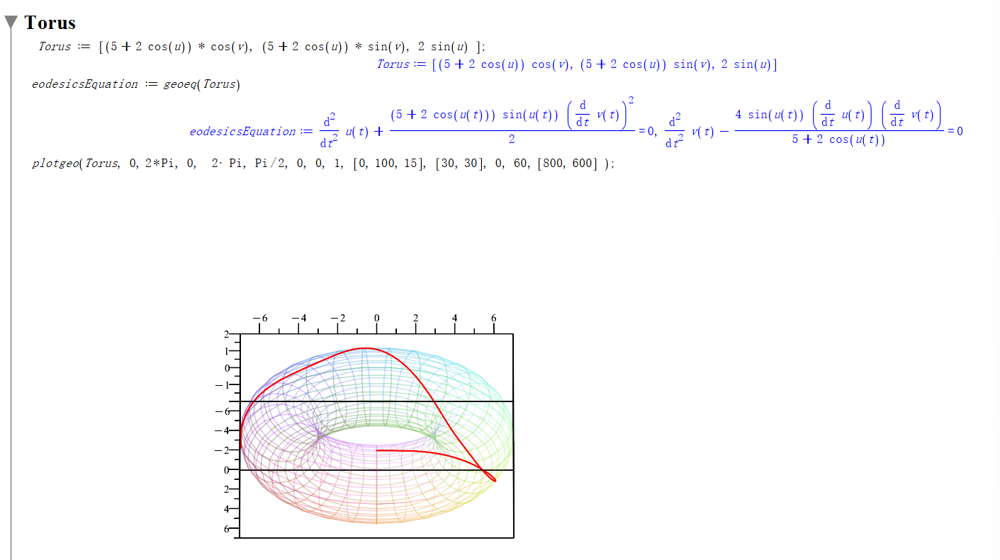

   小圆：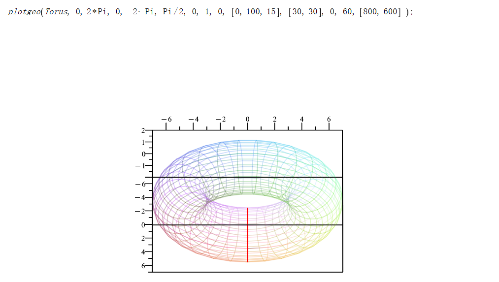

   大圆：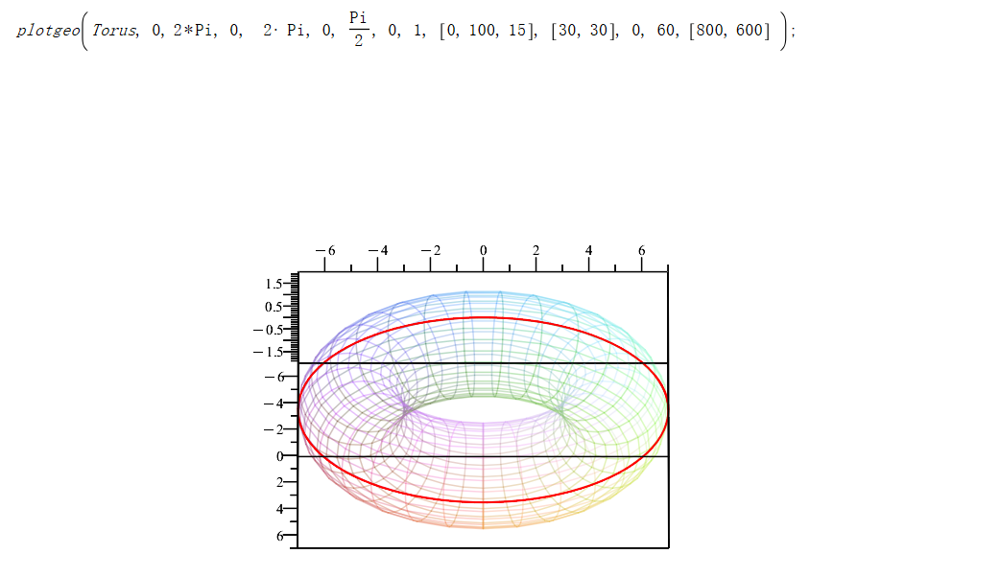

2. Sphere: 始终是大圆

   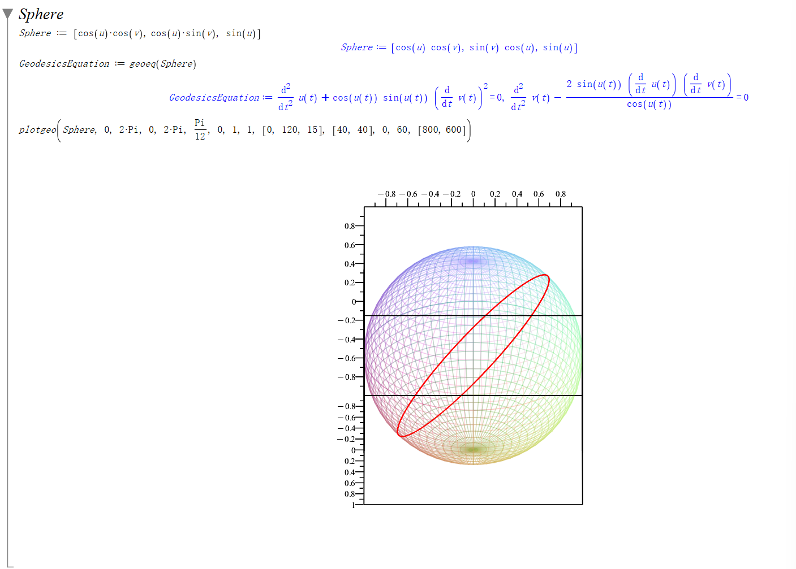

3. Ellipsoid

   一般：

   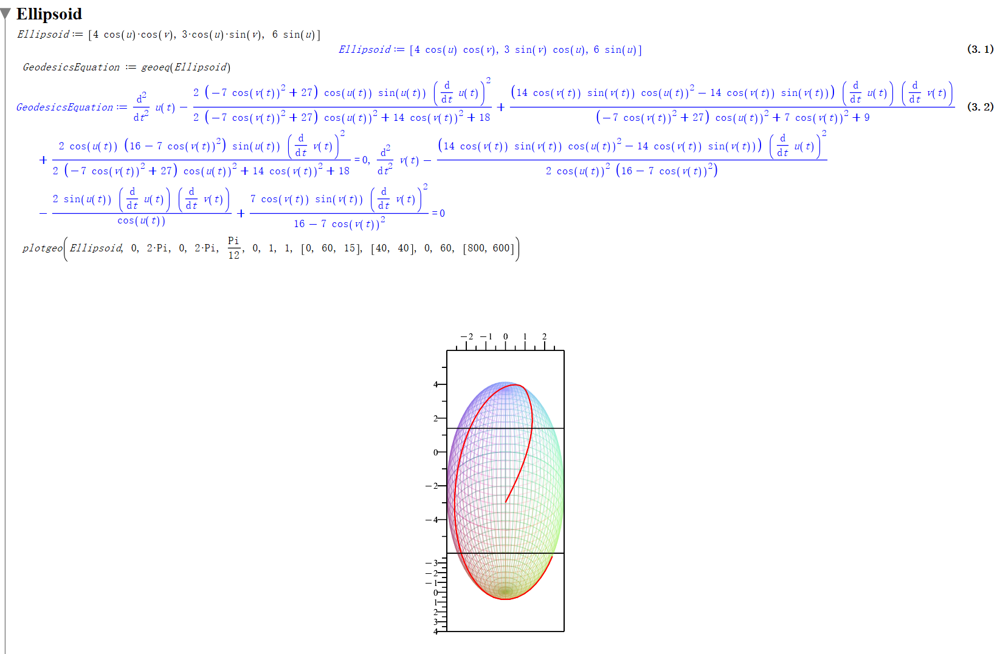

   大圆：

   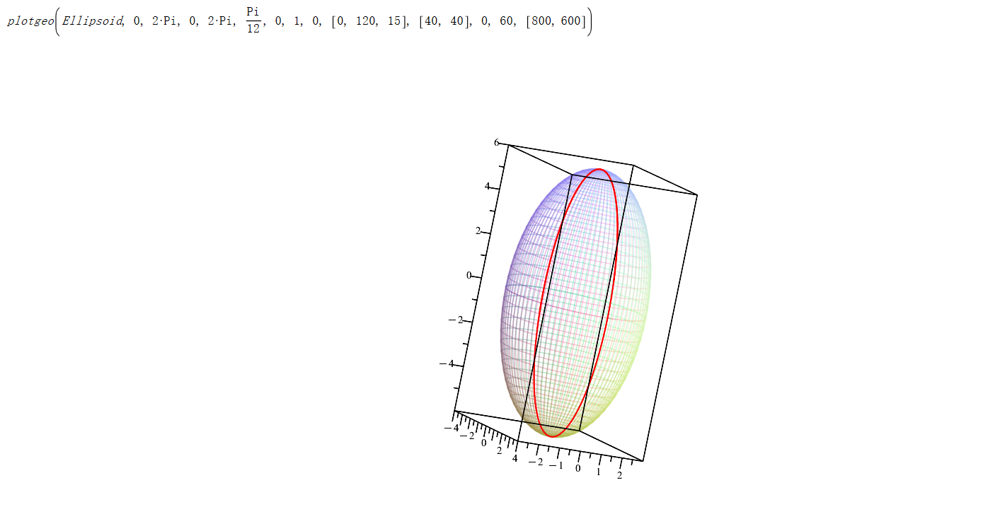

   小圆：

   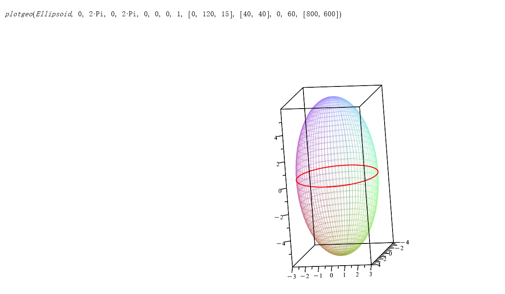

4. Conical：

   一般：

   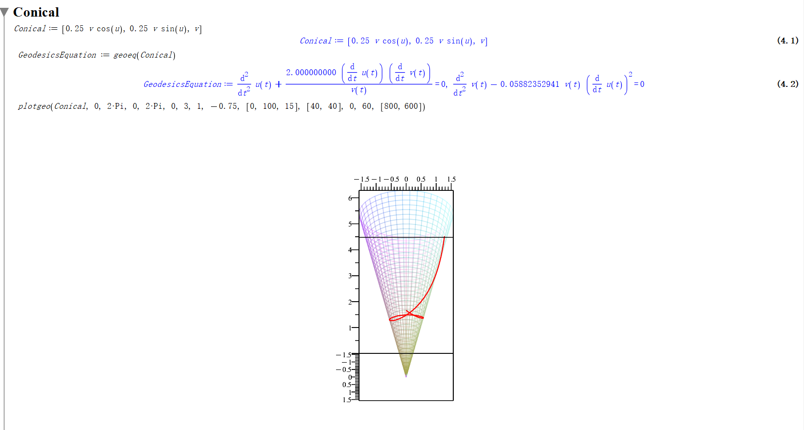

   母线：

   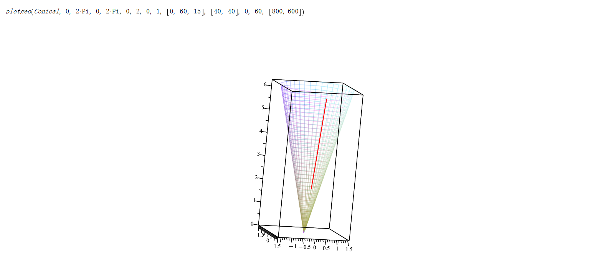

5. Paraboloid

   一般：

   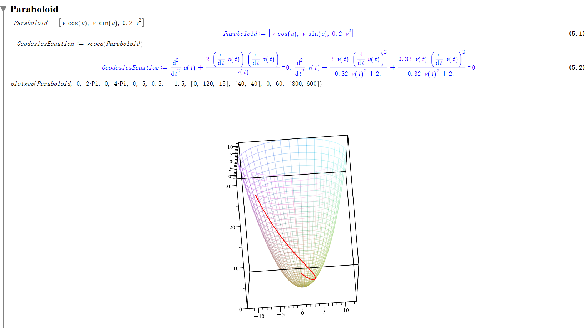

   母线：

   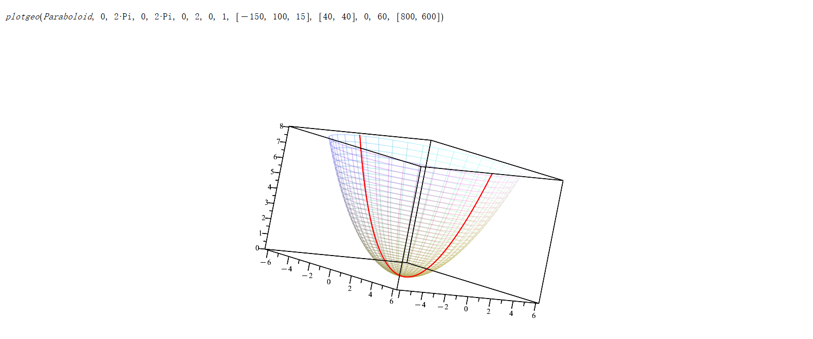

6. Hyperboloid（直纹面）

   腰：

   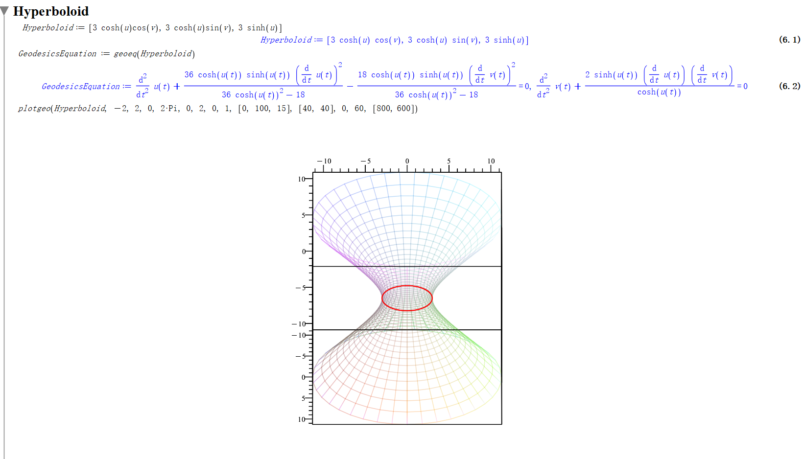

   母线：

   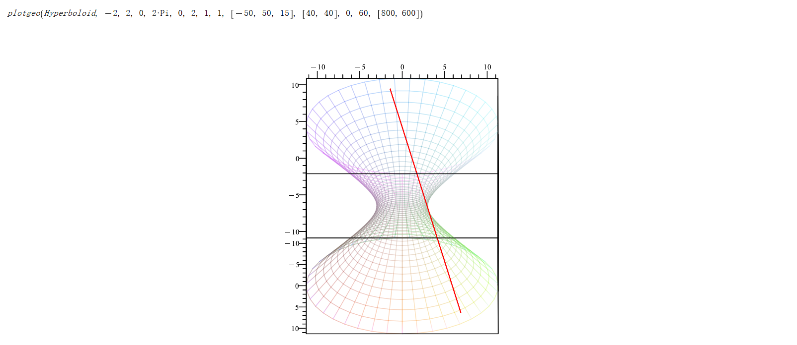

   一般：

   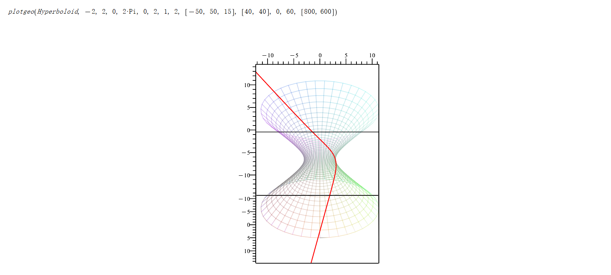

7. Cylindrical 

   一般：

   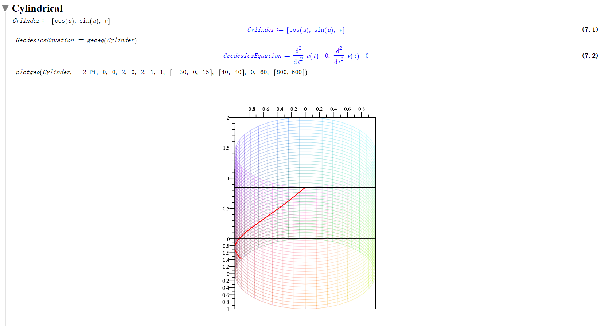

   母线：

   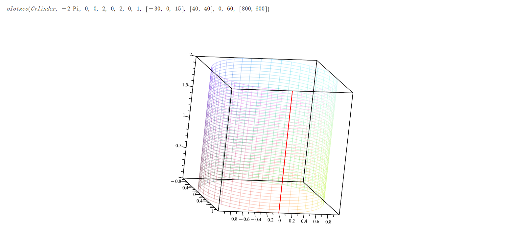

   腰线：

   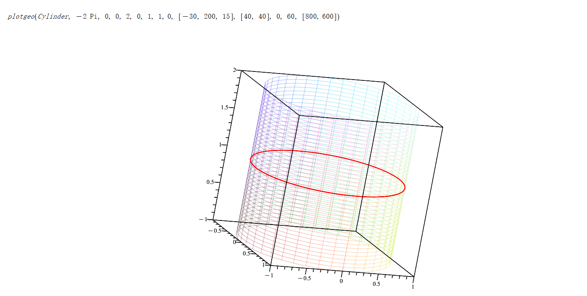

8. 其他曲面：

   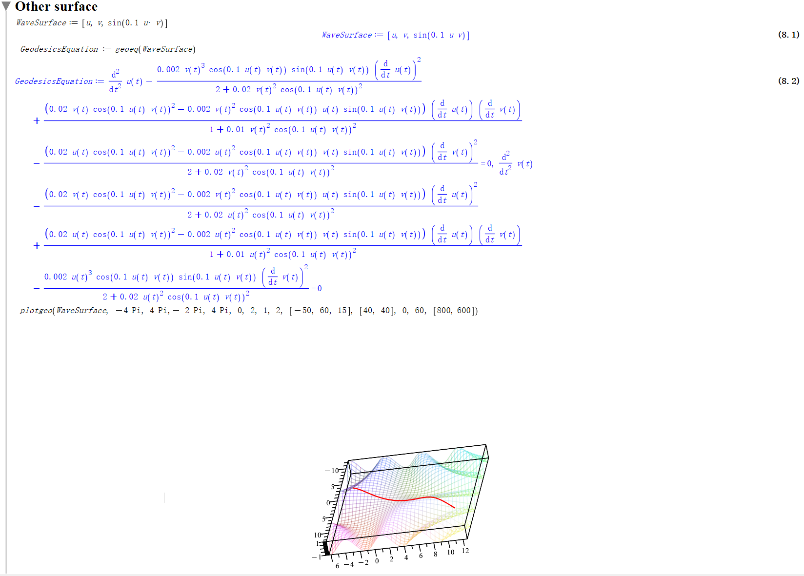