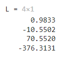

## Q1

$$
G(s)=\dfrac{3}{s(s^2+4s+5)}
$$

A PID controller has the transmit function
$$
G_c(s)=K_p+\dfrac{K_i}{s}+K_d s
$$
Thus,
$$
\begin{align}
G(s)G_c(s)&=\dfrac{3}{s(s^2+4s+5)}(K_p+\dfrac{K_i}{s}+K_d s)\\
&=\dfrac{3K_d s^2+3K_ps+3K_i}{s^2(s^2+4s+5)}
\end{align}
$$
The feedback transmit function is,
$$
\dfrac{G(s)G_c(s)}{1+G(s)G_c(s)}=\dfrac{3K_d s^2+3K_p s+3K_i}{s^4+4s^3+(5+3K_d)s^2+3K_ps+3K_i}
$$
The parabolic input signal is $R(s)=\dfrac{1}{s^3}$, and the corresponding steady state acceleration error is given as 
$$
\lim_{s\to 0}s(1-\dfrac{G_c(s)G(s)}{1+G_c(s)G(s)})\dfrac{1}{s^3}=\dfrac{5}{3K_i}=\dfrac{1}{K_a}
$$
Hence let $K_a=2$, we'd have $K_i=\dfrac{5K_a}{3}=\dfrac{10}{3}\approx3.33$. Let $\omega_c>2.8$ be the bandwidth, $\varphi=\dfrac{\pi}{4}$ be the phase margin, then 
$$
\begin{align}
|G(j\omega_c)G_c(j\omega_c)|&=\left|\dfrac{-3K_d \omega_c^2+3j\omega_c s+3K_i}{-\omega_c^2(-\omega_c^2+j\omega_c+5)}\right|=1\\
\angle G(j\omega_c)G_c(j\omega_c)&=-\pi+\varphi=-\dfrac{3\pi}{4}
\end{align}
$$
Take $\omega_c=3$, we can solve out that $K_p\approx 5.66,K_d\approx 4.14$. Therefore the PID controller could have the transmit function
$$
G_c(s)=5.66+\dfrac{3.33}{s}+4.14 s
$$
Select the following pre-filter $F(s)=\dfrac{1}{s+1}$ to resolve the overshoot issue, the final transmit function will be
$$
T(s)=\dfrac{F(s)G_c(s)G(s)}{1+G_c(s)G(s)}=\dfrac{3K_d s^2+3K_p s+3K_i}{s^5+5s^4+(9+3K_d)s^3+(3K_p+3K_d+5)s^2+3(K_i+K_p)s+3K_i}
$$

```matlab
Ki = 3.33;
Kp = 5.66;
Kd = 4.14;

F = tf(1, [1, 1])
G = tf(3, [1, 4, 5, 0])
Gc = tf([Kd, Kp, Ki], [1, 0])

T = F * feedback(G * Gc, 1)

step(T, feedback(G * Gc, 1))
legend(["With pre-filter", "Without pre-filter"])
title("Step Response")
xlabel("Time (s)")
ylabel("Amplitude")
```

Q2

1. The cost function is fully determined by the input signal and we don't need to consider the output $x(t)$. Hence to minimize $\displaystyle \sum_{k=0}^Nu(k)^2$, we only need to make the input zero. That is,
   $$
   u(k)=0,\quad \forall k\geqslant 0
   $$
   At this time, the minimal cost will be $0$.

2. Similar to 1., we can also let
   $$
   u(k)=0,\quad \forall k\geqslant 0
   $$
   to make the minimal cost be $0$.

3. The cost function in this subproblem
   $$
   J=\sum_{k=0}^Nx(k)^2
   $$
   contains only the output. Hence we can minimize $J$ by perfectly manipulate the input, i.e. as $x(0)=2$, we can adopt a dead beat control to make $x(1)$ zero, and keeps $x(k)$ zero for $k\geqslant 1$.

   Thus the optimal control law would be 
   $$
   u(0)=-8,u(k)=-4x(k)
   $$
   And the minimal cost would be $J=x(0)^2=64$.

Q3

The transfer function can be written as 
$$
T(s)=\dfrac{s(s+1)}{(s+2)(s+3)(s^2+6s+10)}=\dfrac{s^2+s}{s^4+11s^3+46s^2+86s+60}
$$

1. Insert the coefficients into the state space model, we have
   $$
   \begin{align}
   &\dot x(t)=\begin{bmatrix}
   0&1&0&0\\0&0&1&0\\0&0&0&1\\-60&-86&-46&-11
   \end{bmatrix}x(t)+\begin{bmatrix}
   0\\0\\0\\1
   \end{bmatrix}u(t)\\
   &y(t)=\begin{bmatrix}
   1&1&0&0
   \end{bmatrix}x(t)
   \end{align}
   $$
   This is the observable canonical form of state-space model. If take noises into account, it can be expressed as
   $$
   \begin{align}
   &\dot x(t)=\begin{bmatrix}
   0&1&0&0\\0&0&1&0\\0&0&0&1\\-60&-86&-46&-11
   \end{bmatrix}x(t)+\begin{bmatrix}
   0\\0\\0\\1
   \end{bmatrix}u(t)+w(t)\\
   &y(t)=\begin{bmatrix}
   1&1&0&0
   \end{bmatrix}x(t)+v(t)
   \end{align}
   $$
   where $w(t)\sim N(0,Q_t), v(t)\sim N(0,R_t)$.

2. Applying Roth-Hurwitz stability criterion, the characteristic equation of this system is
   $$
   1+T(s)=\dfrac{s^4+11s^3+47s^2+87s+60}{s^4+11s^3+46s^2+86s+60}=0
   $$
   i.e. $s^4+11s^3+47s^2+87s+60=0$.

   | $a_0=1$                                                      | $a_2=47$                                                     | $a_4=60$ |
   | ------------------------------------------------------------ | ------------------------------------------------------------ | -------- |
   | $a_1=11$                                                     | $a_3=87$                                                     |          |
   | $b_1=-\dfrac{1}{11}\begin{vmatrix}1&47\\11&87\end{vmatrix}=\dfrac{430}{11}$ | $b_3=-\dfrac{1}{87}\begin{vmatrix}47&60\\87&0\end{vmatrix}=60$ |          |
   | $c_1=-\dfrac{11}{430}\begin{vmatrix}11&87\\430/11&60\end{vmatrix}=\dfrac{3015}{43}$ |                                                              |          |
   | $d_1=60$                                                     |                                                              |          |

   Since all the coefficients in the first column are of the same sign (positive), the given equation has no roots with positive real parts, therefore the system is stable.

3. Using Matrix notation, the state-space equation can be written as 
   $$
   \begin{align}
   &\dot x(t)=Ax(t)+Bu(t)+w(t)\\
   &y(t)=Cx(t)+v(t)
   \end{align}
   $$
   where $w(t)\sim N(0,Q_t),v(t)\sim N(0,R_t)$ and $x(0)\sim N(x_0,P_0)$ unrelated. Adopting Euler's approximation for small sampling period, we'd have
   $$
   \begin{align}
   &x_{k+1}=(I+AT)x_k+BTu_{k}+w_k\\
   &y_k=Cx_k+v_k
   \end{align}
   $$
   where $w(t)\sim N(0,Q_tT),v(t)\sim N(0,R_t/T)$ and $x(0)\sim N(x_0,P_0)$ unrelated. Then adopting the discretized Kalman Filter's properties, we have the following procedures (referring to the textbook):

   1. Initialization: $\hat{x}=\bar{x}_0$.
   2. Time update: 
      - Error covariance: $P_{k+1}^-=A_k P_k A_k^T+Q_k$
      - Estimate: $\hat{x}_{k+1}^-=A_k \hat{x}_k+B_ku_k$
   3. Measure update:
      - Error covariance: $P_{k+1}=[(P_{k+1}^-)^{-1}+C_{k+1}^-R_{k+1}^{-1}C_{k+1}]^{-1}$
      - Estimate: $\hat{x}_{k+1}=\hat{x}_{k+1}^-+P_{k+1}C_{k+1}^TR_{k+1}^{-1}(y_{k+1}-C_{k+1}\hat{x}_{k+1}^{-1})$

   Next, we shall let $T$ tends to zero. Let $K_k=P_{k}^-C^T(CP_{k+1}^-C^T+R/T)^{-1}$, then $P_{k}=(I-K_kH)P_k^{-1}$. Hence $\lim_{T\to 0}K_k=0$. And then we can get
   $$
   \dot{P}(t)=AP(t)+P(t)A^T+Q-P(t)C^TR^{-1}CP(t)\\
   K(t)=P(t)C^TR^{-1}\\
   \dot{\hat{x}}=A\hat{x}+Bu+K(y-C\hat{x})
   $$
   Therefore we got our Kalman Filter's procedure for 
   $$
   \begin{align}
   &\dot x(t)=Ax(t)+Bu(t)+w(t)\\
   &y(t)=Cx(t)+v(t)
   \end{align}
   $$

   1. Initialization: $P(0)=P_0$, $\hat{x}(0)=\bar{x}_0$.
   2. Error covariance upate: $\dot{P}(t)=AP(t)+P(t)A^T+Q-P(t)C^TR^{-1}CP(t)$
   3. Kalman gain: $K=PC^TR^{-1}$.
   4. Estimate update: $\dot{\hat{x}}=A\hat{x}+Bu+K(y-C\hat{x})$


5. Kalman Filter:

   ```matlab
   A = [[0, 1, 0, 0];[0, 0, 1, 0];[0, 0, 0, 1]; [-60, -86, -46, -11]];
   B = [0;0;0;1];
   C = [1, 1, 0, 0];
   D = 0;
   
   Plant = ss(A,B,C,D,-1);
   Plant.InputName = 'un';
   Plant.OutputName = 'yt';
   
   Sum = sumblk('un = u + w');
   sys = connect(Plant,Sum,{'u','w'},'yt');
   
   Q = 1;
   R = 1;
   N = 0;
   
   [kalmf,L,P] = kalman(sys,Q,R,N);
   size(kalmf)
   
   L
   ```

   Gain output:

   
