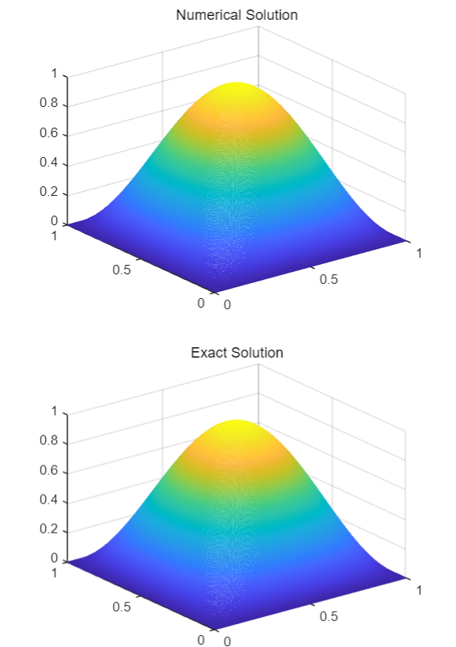
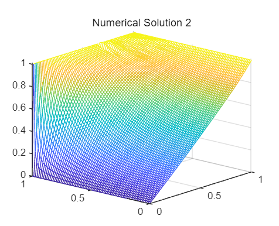
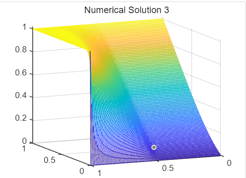

## Q2

1. Given PDE:

	$$
	\begin{array}{rl}
	-\Delta u=2\pi^2 \sin\pi x\sin\pi y&\text{on }\Omega=(0,1)^2\\
	u(x,y)=0&(x,y)\in\partial\Omega
	\end{array}
	$$
	
	The 5-point center difference method gives
	$$
	\Delta_h u_{ij}=\dfrac{u_{i-1,j}+u_{i+1,j}+u_{i,j-1}+u_{i,j+1}-4u_{ij}}{h^2}=-f_{ij}
	$$
	where $f(x,y)=2\pi^2 \sin\pi x\sin\pi y,f(x_i,y_j)=f_{ij}=2\pi^2\sin\pi x_{i}\sin\pi y_j$. Hence
	$$
	\dfrac{u_{i-1,j}+u_{i+1,j}+u_{i,j-1}+u_{i,j+1}-4u_{ij}}{h^2}=-2\pi^2\sin\pi x_{i}\sin\pi y_j
	$$
	with BC: $u_{0,j}=u_{N,j}=u_{x,0}=u_{x,N}=0$ if we use $(N+1)\times(N+1)$ grid points.
	
	```matlab
	N = 200;
	L = 1.0;
	h = L / (N - 1);
	
	alloc = @(i, j) (i - 1) * N + j;
	A = GenerateCoeffMatrix5Point(N, h, alloc);
	
	f = @(x, y) 2 * pi^2 * sin(pi * x) .* sin(pi * y);
	f_ij = @(i, j) f((i - 1) * h, (j - 1) * h);
	
	sz = size(A);
	rhs = zeros(sz(1), 1);
	
	for k = 1 : N
	    rhs(alloc(k, 1)) = 0;
	    rhs(alloc(k, N)) = 0;
	    rhs(alloc(1, k)) = 0;
	    rhs(alloc(N, k)) = 0;
	end
	
	for i = 2 : N - 1
	    for j = 2 : N - 1
	        rhs(alloc(i, j)) = -f_ij(i, j);
	    end
	end
	
	% 5 points
	maxit = 1000;
	[sol, flag, relres, iter, resvec] = gmres(A, rhs, [], 1e-10, maxit, [], []);
	sol = reshape(sol, [N N]);
	
	[X, Y] = meshgrid(0:h:1, 0:h:1);
	
	Z = sin(pi * X) .* sin(pi * Y);
	
	mesh(X, Y, sol)
	title("Numerical Solution")
	mesh(X, Y, Z)
	title("Exact Solution")
	```
	
	

2. We have
   $$
   \begin{align}
   &\dfrac{\partial }{\partial x}(a(x,y)\dfrac{\partial u}{\partial x})+
   \dfrac{\partial }{\partial y}(b(x,y)\dfrac{\partial u}{\partial y})+
   c(x,y)\dfrac{\partial u}{\partial x}=0\label{1eq4}\\
   =&a_xu_x+a u_{xx}+b_xu_y+bu_{yy}+cu_x
   \end{align}
   $$
   The central difference method gives
   $$
   \begin{align}
   &u_x=\dfrac{1}{2h}(u_{i,j+1}-u_{i,j-1}),\quad u_y=\dfrac{1}{2h}(u_{i+1,j}-u_{i-1,j})\label{1eq6}\\
   &u_{xx}=\dfrac{u_{i,j-1}-2u_{ij}+u_{i+1,j}}{h^2},\quad u_{yy}=\dfrac{u_{i-1,j}-2u_{ij}+u_{i,j+1}}{h^2}
   \end{align}
   $$
   Similar formula for $a,b$. Thus $\refeq{eq4}$ can be discretized to 
   $$
   \dfrac{1}{4h^2}(a_{i,j+1}-a_{i,j-1})(u_{i,j+1}-u_{i,j-1})+\dfrac{1}{4h^2}(b_{i+1,j}-b_{i-1,j})(u_{i+1,j}-u_{i-1,j})\\+a_{ij}\dfrac{u_{i,j-1}-2u_{ij}+u_{i,j+1}}{h^2}+b_{ij}\dfrac{u_{i-1,j}-2u_{ij}+u_{i+1,j}}{h^2}+\dfrac{c_{ij}}{2h}(u_{i,j+1}-u_{i,j-1})=0
   $$
   Take $a(x,y)=\sin x,b(x,y)=\cos (x+y),c(x,y)=\sin y$, and apply 3 Dirichlet BCs and 1 Neumann BC

   ```
   N = 75;
   L = 1.0;
   h = L / (N - 1);
   
   a = @(x, y) sin(x);
   b = @(x, y) cos(x + y);
   c = @(x, y) sin(y);
   aij = @(i, j) a((i - 1) * h, (j - 1) * h);
   bij = @(i, j) b((i - 1) * h, (j - 1) * h);
   cij = @(i, j) c((i - 1) * h, (j - 1) * h);
   
   alloc = @(i, j) (i - 1) * N + j;
   A = GenerateCoeffMatrix2(N, h, aij, bij, cij, alloc);
   
   sz = size(A);
   rhs = zeros(sz(1), 1);
   
   for k = 1 : N
       rhs(alloc(k, 1)) = 0;
       rhs(alloc(k, N)) = 1 / h ^ 2;
       rhs(alloc(1, k)) = 0;
       rhs(alloc(N, k)) = 1 / h ^ 2;
   end
   
   % 5 points
   maxit = 1000;
   [sol, ~, ~, ~, ~] = gmres(A, rhs, [], 1e-10, maxit, [], []);
   sol = reshape(sol, [N N]);
   [X, Y] = meshgrid(0:h:1, 0:h:1);
   
   mesh(X, Y, sol)
   title("Numerical Solution 2")
   ```

   

3. Another equation is like
   $$
   u_{x}+xu_{yy}=0
   $$
   Similarly we can get the discretized equation making use of $\refeq{eq6}$
   $$
   \dfrac{u_{i,j+1}-u_{i,j-1}}{2h}+x_i\dfrac{u_{i-1,j}-2u_{ij}+u_{i+1,j}}{h^2}=0
   $$
   Result:

   

## Appendix

```matlab
function A = GenerateCoeffMatrix5Point(N, h, allocator)
    nonzero_size = (N - 2) * (N - 2) * 5 + 4 * N - 4;
    ids_row = zeros(1, nonzero_size);
    ids_col = zeros(1, nonzero_size);

    values = zeros(1, nonzero_size);

    row = 1;
    count = 1;
    for i = 1:N
        for j = 1:N
        if i ~= 1 && i ~= N && j ~= 1 && j ~= N
            ids_row(count) = row;
            ids_col(count) = allocator(i - 1, j);
            values(count) = 1 / h^2;
            count = count + 1;

            ids_row(count) = row;
            ids_col(count) = allocator(i + 1, j);
            values(count) = 1 / h^2;
            count = count + 1;

            ids_row(count) = row;
            ids_col(count) = allocator(i, j - 1);
            values(count) = 1 / h^2;
            count = count + 1;

            ids_row(count) = row;
            ids_col(count) = allocator(i, j + 1);
            values(count) = 1 / h^2;
            count = count + 1;
        end

        % center
        ids_row(count) = row;
        ids_col(count) = allocator(i, j);
        values(count) = -4 / h^2;
        count = count + 1;

        % next equation
        row = row + 1;
        end
    end

    A = sparse(ids_row, ids_col, values);
end

function A = GenerateCoeffMatrix2(N, h, a, b, c, allocator)
    nonzero_size = (N - 2) * (N - 2) * 5 + 5 * N - 4;
    ids_row = zeros(1, nonzero_size);
    ids_col = zeros(1, nonzero_size);

    values = zeros(1, nonzero_size);

    row = 1;
    count = 1;
    for i = 1:N
        for j = 1:N
        if i ~= 1 && i ~= N && j ~= 1 && j ~= N
            ids_row(count) = row;
            ids_col(count) = allocator(i - 1, j);
            values(count) = (b(i-1,j)-b(i+1,j)+4*b(i,j))/(4*h^2);
            count = count + 1;

            ids_row(count) = row;
            ids_col(count) = allocator(i + 1, j);
            values(count) = (b(i+1,j)-b(i-1,j)+4*b(i,j))/(4*h^2);
            count = count + 1;

            ids_row(count) = row;
            ids_col(count) = allocator(i, j - 1);
            values(count) = (a(i-1,j)-a(i+1,j)+4*a(i,j))/(4*h^2)-c(i,j)/(2*h);
            count = count + 1;

            ids_row(count) = row;
            ids_col(count) = allocator(i, j + 1);
            values(count) = (a(i+1,j)-a(i-1,j)+4*a(i,j))/(4*h^2)+c(i,j)/(2*h);
            count = count + 1;
        end

        % center
        ids_row(count) = row;
        ids_col(count) = allocator(i, j);
        if i == 1 || i == N || j == 1 || j == N
            values(count) = 1 / h^2;
        else
            values(count) = -(2 * a(i, j) + 2 * b(i, j)) / h^2;
        end
        count = count + 1;

        if j == 1
            ids_row(count) = row;
            ids_col(count) = allocator(i, j + 1);
            values(count) = -1/h^2;
            count = count + 1;
        end

        % next equation
        row = row + 1;
        end
    end

    A = sparse(ids_row, ids_col, values);
end

function A = GenerateCoeffMatrix3(N, h, x, allocator)
    nonzero_size = (N - 2) * (N - 2) * 5 + 5 * N - 4;
    ids_row = zeros(1, nonzero_size);
    ids_col = zeros(1, nonzero_size);

    values = zeros(1, nonzero_size);

    row = 1;
    count = 1;
    for i = 1:N
        for j = 1:N
        if i ~= 1 && i ~= N && j ~= 1 && j ~= N
            ids_row(count) = row;
            ids_col(count) = allocator(i - 1, j);
            values(count) = x(i) / h ^ 2;
            count = count + 1;

            ids_row(count) = row;
            ids_col(count) = allocator(i + 1, j);
            values(count) = x(i) / h ^ 2;
            count = count + 1;

            ids_row(count) = row;
            ids_col(count) = allocator(i, j - 1);
            values(count) = -1/(2*h);
            count = count + 1;

            ids_row(count) = row;
            ids_col(count) = allocator(i, j + 1);
            values(count) = 1/(2*h);
            count = count + 1;
        end

        % center
        ids_row(count) = row;
        ids_col(count) = allocator(i, j);
        if i == 1 || i == N || j == 1 || j == N
            values(count) = 1 / h^2;
        else
            values(count) = -2 * x(i) / h ^ 2;
        end
        count = count + 1;

        if j == 1
            ids_row(count) = row;
            ids_col(count) = allocator(i, j + 1);
            values(count) = -1/h^2;
            count = count + 1;
        end

        % next equation
        row = row + 1;
        end
    end

    A = sparse(ids_row, ids_col, values);
end
```


