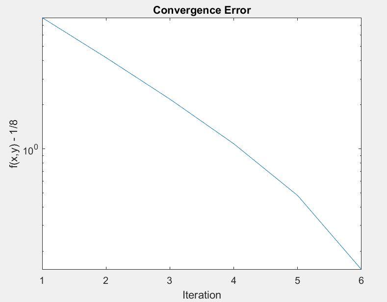
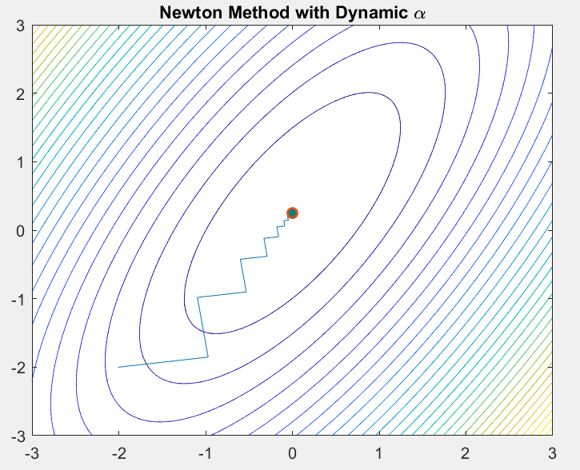
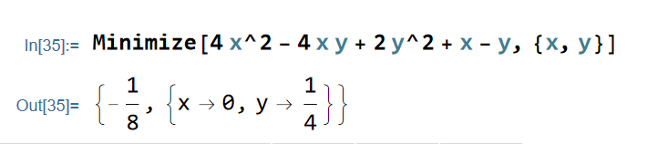
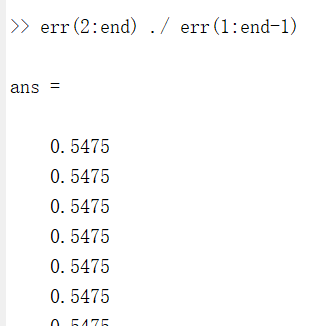
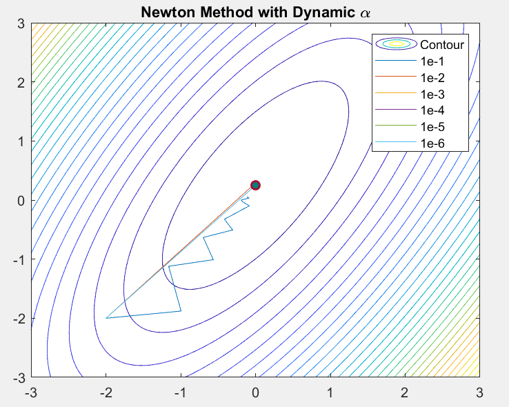
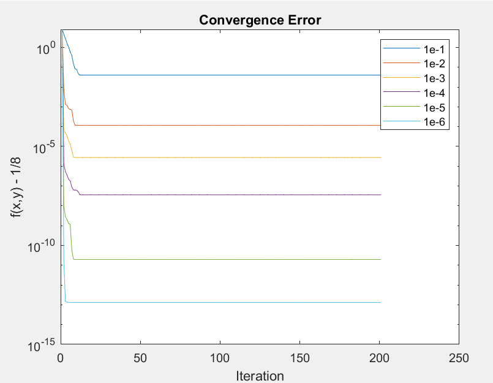

## Abstract

In this short report, we practiced some unconstrained optimization numerical methods (Mainly Newton’s Methods with dynamic step size) introduced in the lecture on a quadratic function, and get an intuitive comprehension of them. Besides, we also tried numerical derivatives when computing the gradian, and compared the performance when taking different grid size $h$.

## Introduction

The lecture introduces some numerical optimization methods, the methods are mainly based on the idea that the value of a function must change the most rapid along its tangent line or gradian direction. Hence when we are searching for the extremum of a function, we could searching along those directions by stepping and iterating.

The lecture debates on 

1. Newton methods applied on single variable functions. The iteration formula is
   $$
   x_{k+1}=x_{k}-\dfrac{f(x_k)}{f'(x_k)}
   $$

2. Newton methods applied on multivariate functions with fixed step size, usually cause oscillation. The iteration formula is 
   $$
   x^{(k+1)}=x^{(k)}-\alpha_k\bar{c}(x^{(k)}),\ \text{where }\bar{c}=\dfrac{c}{\sqrt{c^Tc}},c=\nabla f(x^{(k)})\label{eqdynamica}
   $$

3. Improve on 2., i,e. applied with dynamic step size $\alpha$. The basic idea is consider $f(x^{(k+1)})$ as a function of $\alpha_{k}$, and  let $\alpha_k$ be the solution to the implicit equilibrium condition $\dfrac{\mathrm{d}f(\alpha_k)}{\mathrm{d}\alpha_k}=0$.

And furthermore, the lecture note teaches how to identify multidimensional critical point through Jacobian & Hessian matrices. 

| $|H(a,b)|$ | $f_{xx}(a,b)$ | property             |
| ---------- | ------------- | -------------------- |
| $>0$       | $>0$          | local minimum        |
| $>0$       | $<0$          | local maximum        |
| $<0$       |               | saddle point         |
| $=0$       |               | cannot be determined |

This is usually useful since when applying Newton’s method, the critical point doesn’t always equal to the extremum point. 

Besides, the lecture note introduces numerical derivative approximation $f'(x)\approx \dfrac{f(x+h)-f(x-h)}{2h}$, this works when the analytical derivative is hard to get.

## Problem

My student number is 000834179, according to the given document, the corresponding coefficients are 
$$
A=4, B=4,C=2,x_0=9,y_0=9
$$
Hence the function to minimize would be 
$$
f(x,y)=4x^2-4xy+2y^2+x-y=\begin{bmatrix}
4&-2\\
-2&2
\end{bmatrix}\begin{bmatrix}x\\y\end{bmatrix}+\begin{bmatrix}1&-1\end{bmatrix}\begin{bmatrix}x\\y\end{bmatrix}=AX+b^TX
$$
Thus,
$$
\nabla f(x,y)=\begin{bmatrix}
\dfrac{\partial f}{\partial x}&\dfrac{\partial f}{\partial y}
\end{bmatrix}=\begin{bmatrix}
1+8x-4y&-1-4x+4y
\end{bmatrix}\\
Hf(x,y)=\begin{bmatrix}
\dfrac{\partial^2 f}{\partial x^2}&\dfrac{\partial^2 f}{\partial x \partial y}\\
\dfrac{\partial^2 f}{\partial x \partial y}&\dfrac{\partial^2 f}{\partial y^2}
\end{bmatrix}=\begin{bmatrix}
8&-4\\-4&4
\end{bmatrix}
$$

### Newton’s Method with dynamic $\alpha$

Referring to $\eqref{eqdynamica}$, for a point $x^{(k)}$, we have $X^{(k+1)}=X^{(k)}-\alpha\bar{c}^{(k)}$, thus $x_{k+1}=x_k-\alpha \bar{c_x}_k$, $y_{k+1}=y_k-\alpha \bar{c_y}_k$
$$
\begin{align}
f(\alpha_k)&=f(X_{k+1})=4x_{k+1}^2-4x_{k+1}y_{k+1}+2y_{k+1}^2+x_{k+1}-y_{k+1}\\
&=4(x_k-\alpha_k \bar{c_x}_k)^2-4(x_k-\alpha_k \bar{c_x}_k)(y_k-\alpha_k \bar{c_y}_k)+2(y_k-\alpha_k \bar{c_y}_k)^2+(x_k-\alpha_k \bar{c_x}_k)-(y_k-\alpha_k \bar{c_y}_k)\\
f'(\alpha_k)&=-8\bar{c_x}_k(x_k-\alpha_k \bar{c_x}_k)+4\bar{c_x}_k(y_k-\alpha_k \bar{c_y}_k)+4\bar{c_y}_k(x_k-\alpha_k \bar{c_x}_k)-4\bar{c_y}_k(y_k-\alpha_k \bar{c_y}_k)-\bar{c_x}_k+\bar{c_y}_k\label{fa}\\
&=\alpha_k(8\bar{c_x}_k^2-8\bar{c_x}_k\bar{c_y}_k+4\bar{c_y}_k^2)+4x_k(\bar{c_y}_k-2\bar{c_x}_k)+(4y_k-1)(\bar{c_x}_k-\bar{c_y}_k)
\end{align}
$$
Solving for the root of $\refeq{fa}$, we can get an approximate $\alpha$. Since $\eqref{fa}$ is a single variable function and is linear, we can solve it directly,
$$
\alpha_k=-\dfrac{4x_k(\bar{c_y}_k-2\bar{c_x}_k)+(4y_k-1)(\bar{c_x}_k-\bar{c_y}_k)}{8\bar{c_x}_k^2-8\bar{c_x}_k\bar{c_y}_k+4\bar{c_y}_k^2}
$$
where $\bar{c}_k=[\bar{c_x}_k,\bar{c_y}_k]=\bar{c}=\dfrac{c}{\sqrt{c^Tc}},c=\nabla f(x^{(k)})$.

Here is my Matlab codes:

```matlab
clear all; 

global f;
global fp;
global fpp;

f = @(x, y) 4.*x.^2-4*x.*y+2*y.^2+x-y; % f(x,y)
fp = @(x, y) [1 + 8*x - 4*y, -1 - 4*x + 4*y]; % f'(x,y)
fpp = @(x, y) [[8, -4],[-4, 4]]; % H(x,y)

global tol;
tol = 1e-10;

x0 = [-2, -2];

xs = [x0];
vals = [f(x0(1), x0(2))];

i = 0;
max_iter = 100;
while i < max_iter
    i = i + 1;
    [status, a, cbar] = fa(x0); % calculate alpha
    x0 = x0 - a * cbar; % update point
    sz = size(xs);
    xs(sz(1) + 1, :) = x0; % record process
    vals(sz(1) + 1, :) = f(x0(1), x0(2));
    
    if ~status
        break;
    end
end
```

In which the $\alpha$‘s calculation is implemented as 

```
function [res, a, cbar] = fa(X)
    global fp;
    global tol;
    
    a = 0; res = true;
    c = fp(X(1), X(2));
    cbar = c / norm(c, 2);
    
    if norm(c, 2) < tol
        res = false;
        return;
    end
     
    x = X(1);    y = X(2);
    cx = cbar(1); cy = cbar(2);
    a = -(4*x*(cy-2*cx)+(4*y-1)*(cx-cy))/ ...
        (8*cx*(cx-cy)+4*cy*cy);
end
```

### Using approximated derivatives

It’s not always easy to calculate $\nabla f(x,y)$, hence we need a numerical method to approximate it. One is the second order forward finite difference method, naming
$$
f'(x)=\dfrac{f(x+h)-f(x)}{h}
$$
for a small $h$. Hence 
$$
\nabla f(x,y)\approx \dfrac{f(x+h,y+h)-f(x,y)}{h}
$$
According to the instruction, it is enough that only the second term in the dot product is analyzed using numerical derivatives, 
$$
\varphi'(\alpha)=\nabla f(x-\alpha\nabla x,y-\alpha \nabla y)\cdot \color{orange}\nabla f(x,y)
$$
Thus we only need to modify how $c,\bar{c}$ is calculated. The codes are listed below

```matlab
function res = fp(x, y, h)
    global f;
    % use numerical derivative
    res = [f(x+h,y) - f(x,y), f(x,y+h) - f(x,y)]/h;
end
```

The other processes are like what we done in the first subproblem.

## Results & Conclusions

### Subproblem 1

We got some graphs showing the convergence:




Figure 1.1 Function values at iteration points



Figure 1.2 Iteration points

Using Mathematica, we can know easily that the analytical solution (global minimum) is $-\dfrac{1}{8}$, achieved at $(0,\dfrac{1}{4})$. By calculating $\dfrac{f(x_{k+1},y_{k+1})}{f(x_k,y_k)}$, we can find that it keep around $0.5475$, hence the convergence of this specific operation on this problem is of the first order, and of rate about $0.5475$.



Figure 1.3 Analytical solution



Figure 1.4 The convergence rate is about 0.5475.

Besides, we can also note that the line segments connecting adjacent iteration points are perpendicular to their neighbor line segments.  

The solution we got is $\min f(x,y)=f(0.00000,0.25000)=-0.12500$.

### Subproblem 2/3

We got some graphs showing the convergence:



Figure 2.1 Newton’s Method with Dynamic $\alpha$ and numerical derivatives



Figure 2.2 Convergence

From the graphs, we can see that the smaller we take $h$, the better result we’ll get. For $h=10^{-6}$, the error is already down to $10^{-13}$, which is really precise. Observe the tangent of the decrease of errors in the first several iterations before we got steady error, we could also find that the smaller $h$ is, the fewer iterations we need. More precisely, the number of iterations are listed below:

| $h$                        | $10^{-1}$ | $10^{-2}$ | $10^{-3}$ | $10^{-4}$ | $10^{-5}$  | $10^{-6}$  |
| -------------------------- | --------- | --------- | --------- | --------- | ---------- | ---------- |
| Iteration                  | 17        | 17        | 14        | 15        | 9          | 4          |
| Iterations (err$=10^{-5}$) | -         | -         | 6         | 2         | 1          | 1          |
| Final error                | $10^{-1}$ | $10^{-3}$ | $10^{-5}$ | $10^{-6}$ | $10^{-11}$ | $10^{-12}$ |

To achieve the same accuracy as we get in the first subproblem, we must take $h$ less than $10^{-3}$, and the smaller $h$ is, the fewer iterations we need to achieve this.

## Reflection

1. Through this assignment, I got an intuitive comprehension of the basic idea of Newton’s method and its properties. I’ve known how to optimize an unconstrained function and how to use numerical derivative to approximate complex and possibly symbolic calculation.
2. Besides, by trying to use Matlab, I have got some programming and CAS experience, which may be useful in future study.
3. And also, I have some topics for future to investigate, including optimization when constrains are applied. For example, if the function above is limited to a specific region, how to find its optimal value.