## Problem 1

The given equation is  $\def\re{\mathrm{Re}\ }\def\im{\mathrm{Im}\ }$
$$
C\dfrac{dv}{dt}=k(v-v_r)(v-v_t)-u+I\qquad \dfrac{du}{dt}=b(v-v_r)-u
$$
Let $\bar v = V(v-v_r),\bar u=U u$, then 
$$
\dfrac{d\bar v}{dt}=V\dfrac{dv}{dt}\qquad \dfrac{d\bar u}{dt}= U\dfrac{du}{dt}
$$
Plug it into the original equation, we have
$$
\dfrac{C}{V}\dfrac{d\bar v}{dt}=\dfrac{k}{V}\bar v(\dfrac{\bar v}{V}+v_r-v_t)-\dfrac{\bar u}{U}+I\qquad \dfrac{d\bar u}{dt}=\dfrac{Ub}{V}\bar v-\bar u
$$
Hence 
$$
\dfrac{d\bar v}{dt}=\dfrac{k}{C}\bar v(\dfrac{\bar v}{V}+v_r-v_t)-\dfrac{V}{UC}\bar u+\dfrac{VI}{C}\qquad \dfrac{d\bar u}{dt}=\dfrac{Ub}{V}\bar v-\bar u
$$
Let $V=\dfrac{k}{C},U=\dfrac{k}{C^2}$, $\alpha=\dfrac{k(v_r-v_t)}{C},\beta=\dfrac{b}{C},\delta=\dfrac{kI}{C^2}$, then the equations are transformed into
$$
\dfrac{d\bar v}{dt}=\bar v^2+\alpha\bar v-\bar u+\delta\qquad \dfrac{d\bar u}{dt}=\beta\bar v-\bar u
$$
which is desired. Note that $V,U,\beta,\delta$ are none-zero since $C,I,v_r,v_t,k,b$ are non-zero. But $\alpha$ may be zero. 

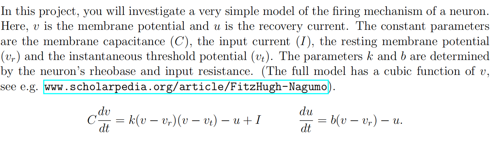

## Problem 2

Set $\alpha=1$ (and re-denote $\bar v$ as $v$, $\bar u$ as $u$), the system becomes
$$
\dfrac{dv}{dt}=v^2+v-u+\delta\qquad \dfrac{du}{dt}=\beta v-u
$$
==**(a)**== Rewrite the system into matrix form 
$$
\dfrac{d}{dt}\begin{bmatrix}v\\u\end{bmatrix}=\begin{bmatrix}v^2+v-u+\delta\\\beta v-u\end{bmatrix}=\begin{bmatrix}f_1(v,u)\\f_2(v,u)\end{bmatrix}=F(v,u)
$$
At the critical points, we have
$$
\dfrac{d}{dt}\begin{bmatrix}v\\u\end{bmatrix}=0,\quad\left\{\begin{aligned}&v^2+v-u+\delta=0\\&\beta v-u=0\end{aligned}\right.\quad \Rightarrow\left\{\begin{aligned}
&v=\dfrac{1}{2}(\beta-1-s),\quad u=\dfrac{\beta}{2}(\beta-1-s)\\
&v=\dfrac{1}{2}(\beta-1+s),\quad u=\dfrac{\beta}{2}(\beta-1+s)
\end{aligned}\right.\label{cp}
$$
where $s^2=(1-\beta)^2-4\delta,s>0$ and can take any non-negative value if fix $\beta$ and vary $\delta$. For convenience, let $m_0=\dfrac{(\beta-1)^2}{4}$.

The Jacobi matrix at $(u,v)$ is 
$$
J(v,u)=\nabla F(v,u)=\begin{bmatrix}\dfrac{\partial f_1}{\partial v}&\dfrac{\partial f_1}{\partial u}\\\dfrac{\partial f_2}{\partial v}&\dfrac{\partial f_2}{\partial u}\end{bmatrix}=\begin{bmatrix}2v+1&-1\\\beta&-1\end{bmatrix}
$$
which contains no $u$. Fix $v$, we can find the eigenvalues of it at $(v,u)$
$$
|J(v, u)-\lambda I|=\begin{vmatrix}2v+1-\lambda&-1\\\beta&-1-\lambda\end{vmatrix}=0\quad \Rightarrow\quad \left\{\begin{aligned}
\lambda_1=v-t\\
\lambda_2=v+t
\end{aligned}\right.
$$
where $t^2=(v+1)^2-\beta$. 

Therefore, 

1. If $(1-\beta)^2<4\delta$, then $s^2<0$, $(\refeq{cp})$ has no solutions. I.e. there's <u>no critical point</u>.

2. If $(1-\beta)^2=4\delta$, then $s=0,v=\dfrac{\beta-1}{2},t=\dfrac{1}{2}|b-1|\sqrt{4+b^2}$, $(\refeq{cp})$ has only one solution (critical point) 
   $$
   (v,u)=(\dfrac{\beta-1}{2},\dfrac{\beta(\beta-1)}{2})\label{cps0}
   $$
   at this critical point, since $t^2\geqslant 0$, the 2 eigenvalues are all reals.
   $$
   \lambda_1=\dfrac{1}{2}(\beta^2-\beta-|\beta-1|\sqrt{\beta^2+4}),\lambda_2=\lambda_1=\dfrac{1}{2}(\beta^2-\beta+|\beta-1|\sqrt{\beta^2+4})
   $$
   Note that 
   $$
   \dfrac{d\lambda_1}{d\beta}=\frac{(b-1) \left(-2 b^2+b-4\right)}{2 \sqrt{(b-1)^2
      \left(b^2+4\right)}}+b-\frac{1}{2},\dfrac{d\lambda_2}{d\beta}=\frac{(b-1) (b (2 b-1)+4)}{2 \sqrt{(b-1)^2
      \left(b^2+4\right)}}+b-\frac{1}{2}
   $$
   We know that when $\beta<1$, $\dfrac{d\lambda_1}{d\beta}>0,\dfrac{d\lambda_2}{d\beta}<0$, and when $\beta>1$, $\dfrac{d\lambda_1}{d\beta}<0,\dfrac{d\lambda_2}{d\beta}>0$, the two functions are all piecewise. When $\beta=1$, $\lambda_1=\lambda_2=0$, hence on $\mathbb{R}$, $\lambda_1\leqslant 0$ while $\lambda_2\geqslant 0$, equality hold iff $\beta=1,\delta=0$. Therefore

   - If $\beta=1$, then $\delta=0$, $\lambda_1=\lambda_2=0$, the critical point $(\refeq{cps0})$ is an <u>unstable saddle point</u>.

     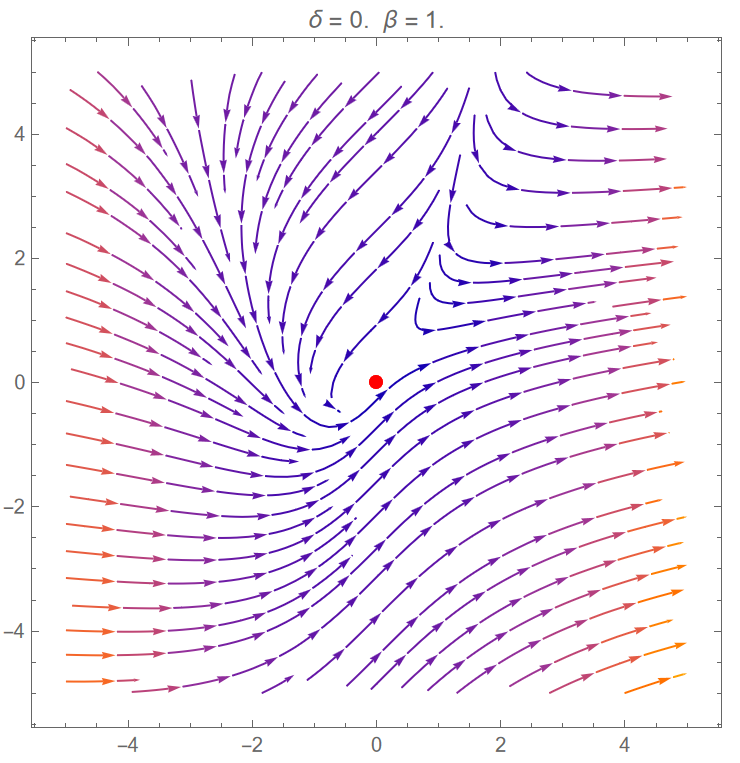

   - Otherwise, $\lambda_1<0,\lambda_2>0$, the critical point $(\refeq{cps0})$ is an <u>unstable saddle point</u>.

     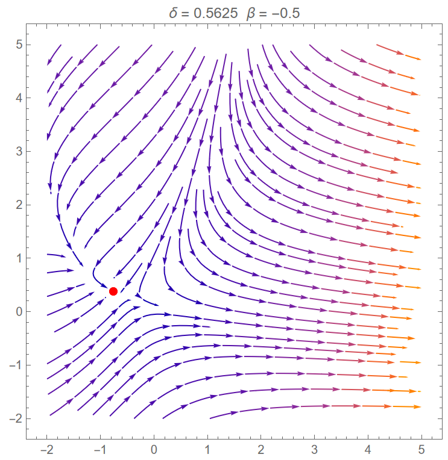

3. If $(1-\beta)^2>4\delta$, then $s^2>0$, $s$ has 2 values, denoted $-s,s$ without mess, one positive and one negative, $(\refeq{cp})$ has 2 distinct solutions (critical points)
   $$
   P_1=(v_1,u_1)= \left[\frac{1}{2} \left(-\sqrt{\beta ^2-2 \beta -4 \delta +1}+\beta -1\right),\frac{1}{2}
      \beta  \left(-\sqrt{\beta ^2-2 \beta -4 \delta +1}+\beta -1\right)\right]\\
   P_2=(v_2,u_2)=\left[\frac{1}{2} \left(\sqrt{\beta ^2-2 \beta -4 \delta +1}+\beta -1\right), \frac{1}{2} \beta
       \left(\sqrt{\beta ^2-2 \beta -4 \delta +1}+\beta -1\right)\right]
   $$

   $P_1$, $P_2$ corresponds to $-s,s$ respectively. Consider $P_2$ first. 

   _At $P_2$_ $t^2=s + \dfrac{1}{4}(-1 + b + s)^2\geqslant 0$, hence $\lambda_1,\lambda_2$ are all real numbers. furtherly,
   $$
   v_2-t=\frac{1}{2} \left(s+\beta -1\right)-\sqrt{\frac{1}{4} \left(s+\beta -1\right)^2+s}\leqslant 0
   $$
   Equality hold iff. $s=0,$ i.e. $\beta=1,\delta=0$. While
   $$
   v_2+t=\frac{1}{2} \left(s+\beta -1\right)+\sqrt{\frac{1}{4} \left(s+\beta -1\right)^2+s}\geqslant 0
   $$
   Also equality hold iff. $s=0,$ i.e. $\beta=1,\delta=0$. Therefore as long as $\beta\neq 1$ or $\delta\neq 0$, we have $\lambda_1<0,\lambda_2>0$, indicating that $P_2$ is an <u>unstable saddle point</u>.

   _At $P_1$_ If ==$t^2=\dfrac{1}{4}(s+1-\beta)^2-s<0$==, solve $t^2<0$, we have
   $$
   \beta>0\land \delta\in\left[-\sqrt{\beta ^3+2 \beta ^2+\beta }-2 \beta ,\sqrt{\beta ^3+2 \beta ^2+\beta }-2 \beta\right]=[m_1,m_2]\label{eqm12}
   $$
   Denote this region as $R_{tn1}$ (blue).

   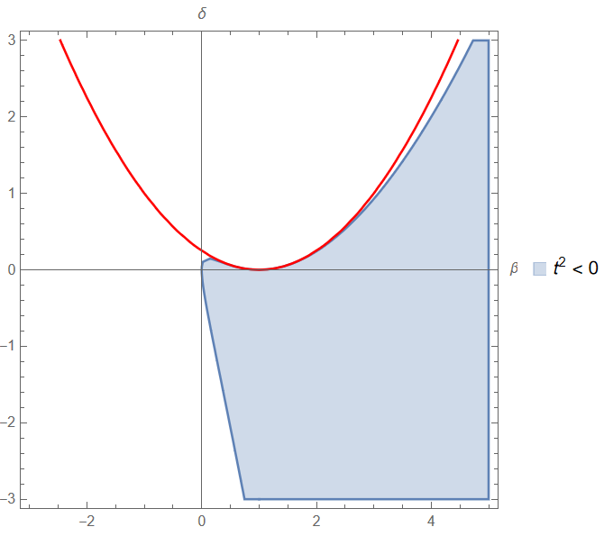

   Solve $v_1>0,v_2>0$, we have 
   $$
   v_1>0\quad\Rightarrow\quad\beta\in(1,+\infty),\delta\in(0,\dfrac{1}{4}(1-\beta)^2]\quad\text{(denoted as $R_{vp}$)}
   $$
   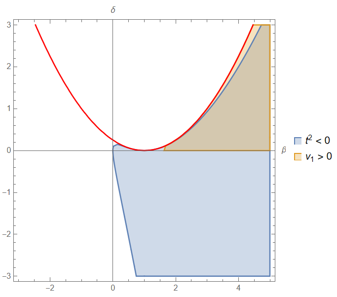

   - In $R_{vp}\cap R_{tn}$,  $\lambda_1$, $\lambda_2$ at $P_1$ is imaginary and conjugated, $v_1>0$ (orange), $\re\lambda_1,\re\lambda_2>0$, $P_1$ is an unstable spiral

     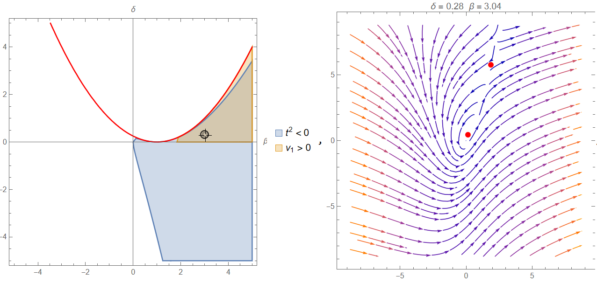

     **Figure: ** unstable spiral and unstable saddle

   - Similarly, on $R_{vp}^c\cap R_{tn}$, $\lambda_1$, $\lambda_2$ at $P_1$ is imaginary and conjugated, $v_1<0$, it's a stable spiral.

     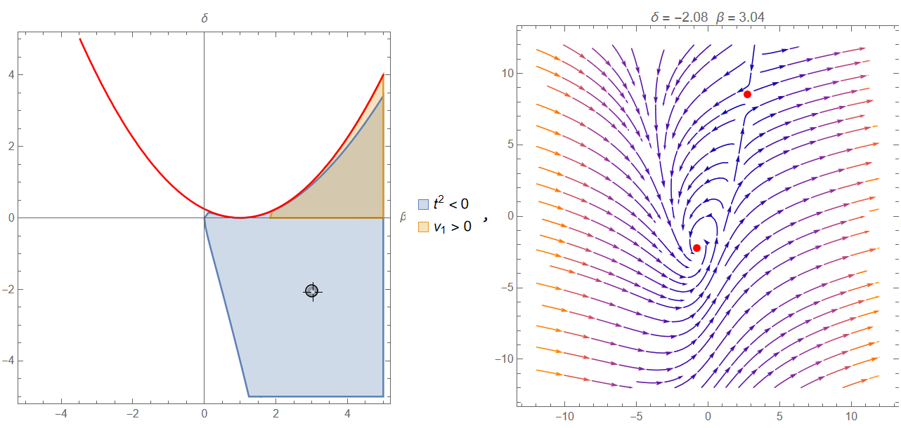

     **Figure:** stable spiral and unstable saddle

   If ==$t^2=\dfrac{1}{4}(s+1-\beta)^2-s>0$==, then $\lambda_1,\lambda_2$ are all real numbers. Note that if $t>0$, we have
   $$
   \dfrac{1}{4}(1-\beta+s)^2-s>0\quad\Rightarrow\quad \beta<0\or s\in(-\infty,(1-\sqrt{\beta})^2)\cup((1+\sqrt{\beta})^2,+\infty)
   $$
   hence when $\beta<1$, $(\beta,\delta)\not\in R_{tn}$,
   $$
   \lambda_1=v_1-t<\lambda_2=v_1+t=-\dfrac{1-\beta+s}{2}-\sqrt{-s+\dfrac{1}{4}(1-\beta+s)^2}<0\\
   $$
   $\lambda_1,\lambda_2$ are real and negative. Hence $P_1$ is a <u>stable sink.</u>

   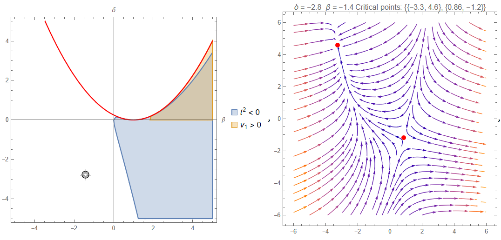

   when $\beta>1$, $(\beta,\delta)\not\in R_{tn}$,
   $$
   \lambda_2=v_1+t<\lambda_1=v_1-t=-\dfrac{1-\beta+s}{2}-\sqrt{-s+\dfrac{1}{4}(1-\beta+s)^2}>0\\
   $$
   $\lambda_1,\lambda_2$ are real and positive. Hence $P_1$ is a <u>unstable source.</u>
   
   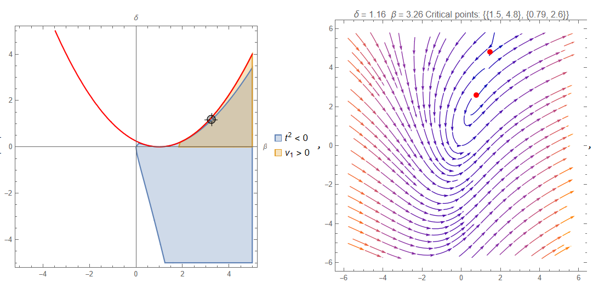

   _Boundary_ Now we dive into the boundary occasions.

   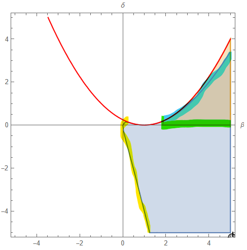
   
   ==$\partial R_{tn}\cap R_{vp}^c$== On the <span style="color: orange">yellow</span> boundary, $t=0$ while $v_1<0$, hence $\R\ni\lambda_1,\lambda_2<0$ at $P_1$, $P_1$ is a <u>degenerated stable sink</u>.
   
   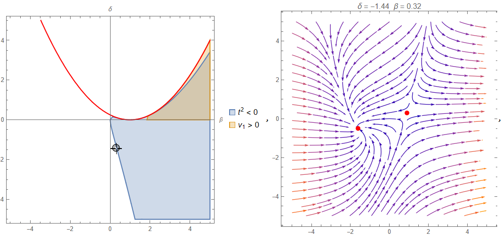
   
   ==$\partial R_{vp}\cap R_{tn}$== On the <span style="color: green">green</span> boundary, $t^2<0$ while $v_1=0$, hence $\lambda_1,\lambda_2$ are conjugated pure imaginary numbers, $P_1$ is a <u>center</u>.
   
   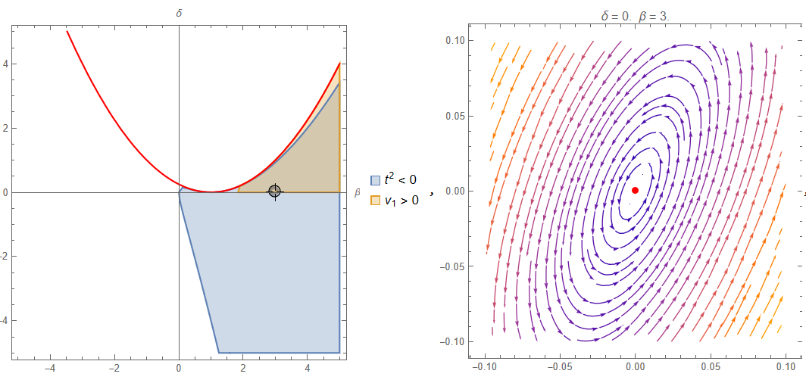
   
   ==$\partial R_{tn}\cap R_{vp}$== On the <span style="color: skyblue">blue</span> boundary, $t=0$ and $v_1>0$, hence $\R \ni \lambda_1,\lambda_2>0$, $P_1$ is a <u>degenerated unstable source</u>.
   
    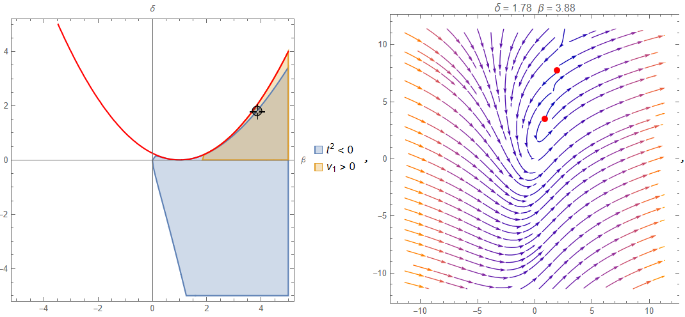
   
   _$\beta=1,\delta=0$_ There is a special point $\beta=1,\delta=0$ to discuss. When taking this parameter, the critical point is $(0,0)$, the Jacobi matrix is
   $$
   J(v,u)=\begin{bmatrix}2v+1&-1\\1&-1\end{bmatrix}=\begin{bmatrix}1&-1\\1&-1\end{bmatrix}
   $$
   of which the eigenvalues are $0$. Thus we should take second order derivative:
   $$
   H(v,u)=\begin{bmatrix}2&0\\0&0\end{bmatrix}
   $$
   Hence it is a saddle point.
   
   **Now we have discussed all behaviors when $(\beta,\delta)$ is varying.**
   
   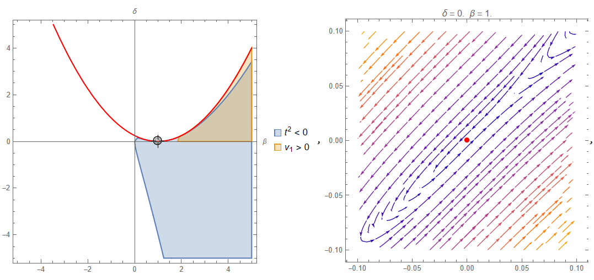

==**(b)**== Set $\beta=2$, the equation becomes
$$
\dfrac{d}{dt}\begin{bmatrix}v\\u\end{bmatrix}=\begin{bmatrix}v^2+v-u+\delta\\2 v-u\end{bmatrix}=\begin{bmatrix}f_1(v,u)\\f_2(v,u)\end{bmatrix}=F(v,u)
$$
If furtherly $\delta=0$, referring to the debate in (a), since $(1-\beta)^2>4\delta$, there're 2 critical points $P_1=(0,0),P_2=(2,1)$, and at $P_1$, $\lambda_1=\lambda_2=0$, $P_1$ is a <u>center</u>.

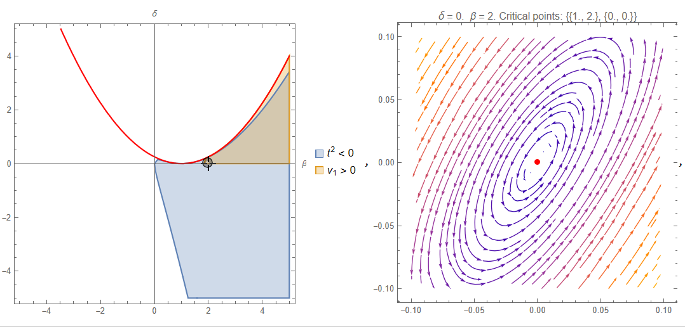

Besides, when $\beta=2$, we get $s^2=1-4\delta$, $t^2=-1$ at $P_1$ and $t^2=2$ at $P_2$. Referring to the debate above in (a), $m_0=\dfrac{1}{4}$ and in $(\refeq{eqm12})$, $m_1=-4-3\sqrt{2},m_2=-4+3\sqrt{2}$

- when $\delta <-4-3\sqrt{2}$, there're a stable sink and an unstable saddle.
- when $-4-3\sqrt{2}<\delta <0$, there're a stable spiral and an unstable saddle.
- when $\delta =0$, there're a center and an unstable saddle point.
- when $-4+3\sqrt{2}>\delta>0$, there're an unstable spiral and a saddle.
- when $\delta=-4+3\sqrt{2}$, there're an degenerated unstable source and a saddle.
- when $\dfrac{1}{4}>\delta>-4+3\sqrt{2}$, there're an unstable source and a saddle.

By $(\refeq{cp})$, 
$$
P_1=(u_1,v_1)=(\dfrac{1}{2}(1-\sqrt{1-4\delta}),1-\sqrt{1-4\delta})\\
P_2=(u_2,v_2)=(\dfrac{1}{2}(1+\sqrt{1-4\delta}),1+\sqrt{1-4\delta})
$$
as $\delta$ increases, $u_1\uparrow$, $u_2\downarrow$, $u_2>u_1$,  $v_1\uparrow$, $v_2\downarrow$, $v_2>v_1$,

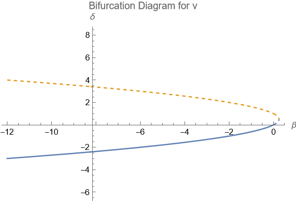

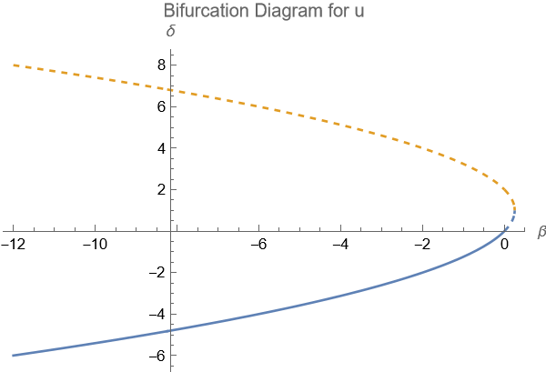

We can conclude that there's a <u>homoclinic</u> bifurcation when $\delta$ goes through.

==**(c)**== If there is limit cycles, then there could be some $\delta,\beta$, making the eigenvalues of the Jacobi at the center of the trajectory purely imaginary (sufficient condition). Thus, by the discussion above, we must have $v=0$ and $t^2=(1+v)^2-\beta<0$. To make critical point exist, we must have $\beta>0$.

Since $v=\dfrac{1}{2} \left(-\sqrt{(\beta -1)^2-4 \delta }+\beta -1\right)=0$, we have $\beta\geqslant 1,\delta=0$.

- Assume $\beta=1,\delta =0$, by the debate above, $P_2$ is a stable center, hence there exists infinite limit cycles around it. 

- When $\beta\neq 1$, as

    $$
    \dfrac{\partial f_1}{\partial v}+\dfrac{\partial f_2}{\partial u}=2v\neq 0,\quad \forall\ (u,v)\in\mathbb{R}^2
    $$

	Applying Bendixson's Criterion, the system has no closed trajectories inside $\R^-\times\mathbb{R}\cup \R^+\times\R$.

- According to the index theory, there must be a sink, source or center when a closed orbit presents.

	In summary, we can conclude that limit cycles exist if $\beta>1$ and $\delta=0$.

	> The following graph shows the existence of a limit cycle when $\beta=3$, $\delta=0$:
	>
	> 

==**(d)**== To produce homoclinic orbits, we'd better produce saddle point first. By (c), when $\beta>1,\delta=0$, there appears a center $P_1$ and a saddle point $P_2$, note that the trajectory emitted from $P_2$, hence there exists homoclinic orbits for the same parameter values.

==**(e)**== The bifurcation occurs when $\dfrac{1}{4}(1-\beta)^2=\delta$, and at this time, the critical point
$$
v=\dfrac{1}{2}(\beta-1),\quad u=\dfrac{\beta}{2}(\beta-1)
$$
Hence the parametric expression of the curve of the points where bifurcation occurs should be
$$
C_v(\beta)=(\dfrac{1}{4}(1-\beta)^2,\dfrac{\beta-1}{2}),C_u(\beta)=(\dfrac{1}{4}(1-\beta)^2,\dfrac{\beta(\beta-1)}{2})
$$
If we put it onto the $vu$ plane, then the expression is 
$$
C(\beta)=(\dfrac{\beta-1}{2},\dfrac{\beta(\beta-1)}{2})
$$
When $\beta<1$, $P_2$ is stable, otherwise, it's unstable.

The curve and the animation of the bifurcation diagram is shown below


**Figure 1: **Bifurcation Diagram for $u$ as $\beta$ (x-axis) changes


**Figure 2: **Bifurcation Diagram for $v$ as $\beta$ (x-axis) changes

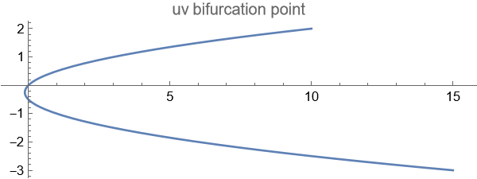

**Figure 3:** Bifurcation Points on $u,v$ plane

We can also fix $\delta$ and vary $\beta$. For these occasions, we can divide the $\beta,\delta$ into 5 regions:

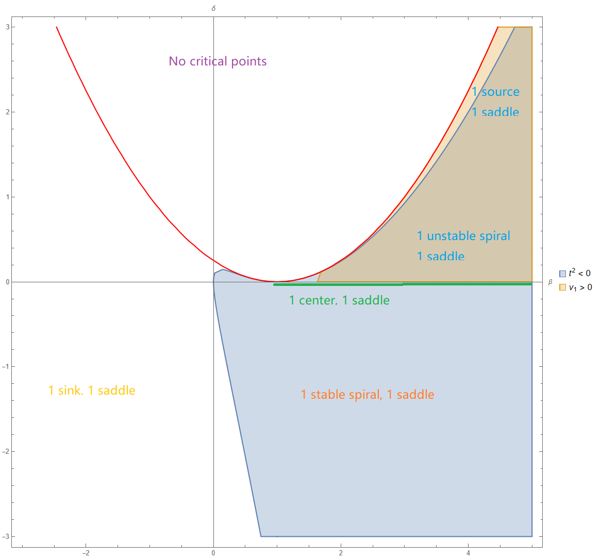

**Figure 4:** Critical point classification on $\beta,\delta$ plane

Hence the bifurcation diagram will be


**Figure 5:** Bifurcation diagram for $u$ as $\delta$ changes


**Figure 6:** Bifurcation diagram for $v$ as $\delta$ changes

## Question 3

I chose 2 sets of parameters which produce distinct behaviors:

==one== is the only parameter region in which a stable center appears. i.e. $\beta >1,\delta =0$. The corresponding phase plane, by the debate above, contains a saddle point in the first quadrant, coordinates at $(\beta-1,\beta(\beta-1))$, and a center, coordinated at $(0,0)$, they're symmetric about the origin. See the animation below:


​		At $\beta=1$, the 2 critical point will merge to a single one, and the limit cycles (closed trajectories) will disappear. As $\beta$ exceed $1$, those critical point will disappear as well. Near the saddle, we can calculate out the eigenvectors of its linearized expression. For example, when $\beta=2$, the saddle is $(1,2)$ the Jacobi matrix is
$$
J(1,2)=\begin{bmatrix}
2\beta-1&-1\\2&-1
\end{bmatrix}=\begin{bmatrix}
3&-1\\2&-1
\end{bmatrix}, \lambda_1=1+\sqrt2,v_1=(1+\sqrt2,\sqrt2)^T,\lambda_2=1-\sqrt2,v_2=(\sqrt2-1,\sqrt2)^T
$$
Hence along the line $(1,2)+\mu (1+\sqrt2,\sqrt{2})$, the trajectories will converge to $(1,2)$ but along the line $(1,2)+\mu(-1+\sqrt2,\sqrt2)$, the trajectories will diverge. 

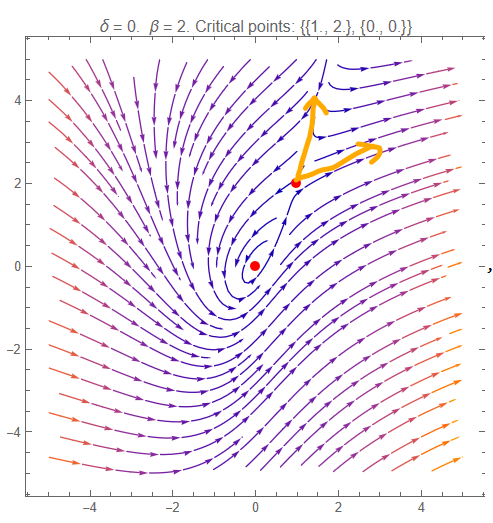

Also, at the other critical point (center) $(0,0)$, the Jacobi matrix is
$$
J(0,0)=\begin{bmatrix}
1&-1\\2&-1
\end{bmatrix}, \lambda_1=i,v_1=(1+i,2)^T,\lambda_2=-i,v_2=(1-i,2)^T
$$
Hence the trajectories around $(0,0)$ is counter-clockwise.

This behavior indicates that when $k$ or $I$ is nearly zero (membrane capacitance), if we set $b>C$ and a non-zero small recovery current, they will oscillate of the nearly same range of amplitude and reaching steady state costs a long time.

==The other== is the region that no stable critical point exists. i.e $\beta >1,\delta>0$. When the membrane potential $|v|$ is large enough, we can find that $u'/v'$ is small, hence the change of recovery current will be small, thus the trajectories will be more horizontal.

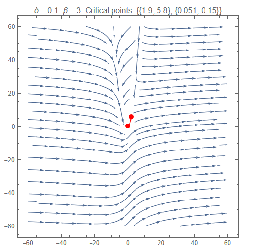

At this time, there're at most 2 (or 1 or none) unstable critical points, one is unstable saddle, the other is an unstable source or unstable spiral. For example, when $\beta = 3, \delta = 0.1$, The critical point in the first quadrate is $(6,2)$ and the Jacobi matrix is 
$$
J(1,2)=\begin{bmatrix}
1.1026&-1\\2&-1
\end{bmatrix}, \lambda_1\approx0.05+0.95i,v_1\approx(0.43+0.39i,0.82)^T,\\\lambda_2\approx0.05-0.95i,v_2\approx(0.43-0.39i,0.82)^T
$$
Thus the spiral is contour-clockwise and unstable. Nearly all trajectories will diverge to the far right.

This behavior indicates that when $b>C$ (membrane capacitance) and $\delta>0$, any initial membrane potential and recovery current will result in the destruct of the cell neutron (surely exactly on the critical point will prevent this, but any small perturbation will result in this). The steady-state of the neutron cannot be recovered anymore.

## Appendix

Draw regions:

```mathematica
Show[
 RegionPlot[{Rtn1}, {b, -3, 5}, {d, -3, 3}, Axes -> True, 
  AxesLabel -> {"\[Beta]", "\[Delta]"}, 
  PlotLegends -> {"\!\(\*SuperscriptBox[SubscriptBox[\(t\), \(1\)], \
\(2\)]\) < 0"}],
 ContourPlot[1 - 2 b + b^2 - 4 d == 0, {b, -3, 5}, {d, -3, 3}, 
  ContourStyle -> Red]
 ]
 
 Show[
 RegionPlot[{Rtn1, Rvp1}, {b, -3, 5}, {d, -3, 3}, Axes -> True, 
  AxesLabel -> {"\[Beta]", "\[Delta]"}, 
  PlotLegends -> {"\!\(\*SuperscriptBox[\(t\), \(2\)]\) < 0", 
    "\!\(\*SubscriptBox[\(v\), \(1\)]\) > 0", 
    "\!\(\*SubscriptBox[\(v\), \(2\)]\) > 0"}],
 ContourPlot[1 - 2 b + b^2 - 4 d == 0, {b, -3, 5}, {d, -3, 3}, 
  ContourStyle -> Red]
 ]
```

Plot phase portrait:

```mathematica
plt1 = Show[
   RegionPlot[{Rtn1, Rvp1}, {b, -5, 5}, {d, -5, 5}, Axes -> True, 
    AxesLabel -> {"\[Beta]", "\[Delta]"}, 
    PlotLegends -> {"\!\(\*SuperscriptBox[\(t\), \(2\)]\) < 0", 
      "\!\(\*SubscriptBox[\(v\), \(1\)]\) > 0", 
      "\!\(\*SubscriptBox[\(v\), \(2\)]\) > 0"}],
   ContourPlot[1 - 2 b + b^2 - 4 d == 0, {b, -5, 5}, {d, -5, 5}, 
    ContourStyle -> Red]];
Manipulate[{
  Show[
   plt1,
   Graphics[Locator[{b, d}], PlotRange -> 2, ImagePadding -> 20, 
    Frame -> True, ImageSize -> Medium, Axes -> True], 
   ImageSize -> Medium
   ],
  img = StreamPlot[F[v, u, d, b], {v, -s, s}, {u, -s, s},
    Epilog -> {Red, PointSize[0.02]}~
      Join~(Point[{v, u}] /. 
        NSolve[# == 0 & /@ F[v, u, d, b], {v, u}]),
    PlotLabel -> 
     "\[Delta] = " <> ToString[N@d] <> "  \[Beta] = " <> 
      ToString[N@b] <> " Critical points: " <> 
      ToString[
       NumberForm[{v, u} /. NSolve[# == 0 & /@ F[v, u, d, b], {v, u}],
         2]], ImageSize -> Medium
    ], Button["Save", 
   Export[NotebookDirectory[] <> "\\images\\img,b=" <> ToString[b] <> 
     ",d=" <> ToString[d] <> ".png", img]]
  }, {{d, 0}, -5, 5}, {{b, 2}, -5, 5}, {{s, 5}, 0.01, 40, 0.01}]
```

Draw bifurcation diagram:

```mathematica
img1 = Show[
  (Plot[{1/2 (1 - Sqrt[1 - 4 d]), 
       1/2 (1 + Sqrt[1 - 4 d])}, {d, #1, #2}, 
      PlotStyle -> #3] & @@@ {{-12, -4 - 3 Sqrt[2], {_, 
       Dashed}}, {-4 - 3 Sqrt[2], 0, {_, Dashed}}, {0, -4 + 3 Sqrt[2],
       Dashed}, {-4 + 3 Sqrt[2], 1/4, Dashed}}),
  PlotRange -> {All, {-6, 8}}, 
  PlotLabel -> "Bifurcation Diagram for v", ImageSize -> Medium, 
  AxesLabel -> {"\[Beta]", "\[Delta]"}
  ]
Export[NotebookDirectory[] <> "ans.assets\\bifur_v.png", img1]

img2 = Show[
  (Plot[{(1 - Sqrt[1 - 4 d]), (1 + Sqrt[1 - 4 d])}, {d, #1, #2}, 
      PlotStyle -> #3] & @@@ {{-12, -4 - 3 Sqrt[2], {_, 
       Dashed}}, {-4 - 3 Sqrt[2], 0, {_, Dashed}}, {0, -4 + 3 Sqrt[2],
       Dashed}, {-4 + 3 Sqrt[2], 1/4, Dashed}}),
  PlotRange -> {All, {-6, 8}}, 
  PlotLabel -> "Bifurcation Diagram for u", ImageSize -> Medium, 
  AxesLabel -> {"\[Beta]", "\[Delta]"}
  ]
Export[NotebookDirectory[] <> "ans.assets\\bifur_u.png", img2]
```

Draw dynamic bifurcation diagram:

```mathematica
Animate[
 Show[(Plot[{b/2 (b - 1 - Sqrt[(1 - b)^2 - 4 d]), 
       b/2 (b - 1 + Sqrt[(1 - b)^2 - 4 d])}, {d, #1, #2}, 
      PlotStyle -> #3, PlotRange -> {{-12, 12}, {-6, 6}}] & @@@
    (Evaluate@
      If[b < 0, {{-12, 1/4 (1 - 2 b + b^2), {_, Dashed}}}, 
       If[b < 1, {{-12, -2 b - Sqrt[b + 2 b^2 + b^3], {_, 
           Dashed}}, {-2 b - Sqrt[b + 2 b^2 + b^3], -2 b + Sqrt[
           b + 2 b^2 + b^3], Dashed}, {-2 b + Sqrt[b + 2 b^2 + b^3], 
          1/4 (1 - 2 b + b^2), 
          Dashed}}, {{-12, -2 b - Sqrt[b + 2 b^2 + b^3], {_, 
           Dashed}}, {-2 b - Sqrt[b + 2 b^2 + b^3], 
          0, {_, Dashed}}, {0, -2 b + Sqrt[b + 2 b^2 + b^3], 
          Dashed}, {-2 b + Sqrt[b + 2 b^2 + b^3], 1/4 (1 - 2 b + b^2),
           Dashed}}]])), 
  PlotLabel -> "Bifurcation Diagram for u, \[Beta] = " <> ToString[b],
   ImageSize -> Medium, AxesLabel -> {"\[Beta]", "\[Delta]"}]
 , {b, -3, 5}
 ]
```

