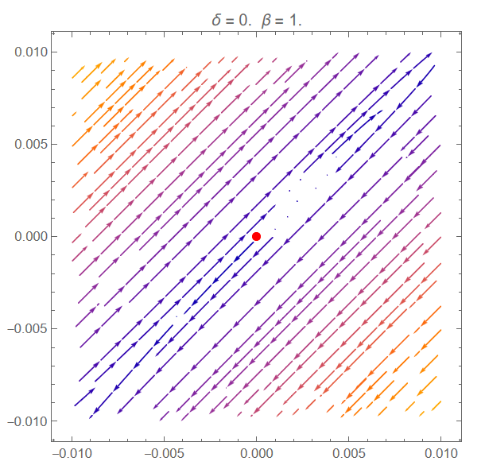
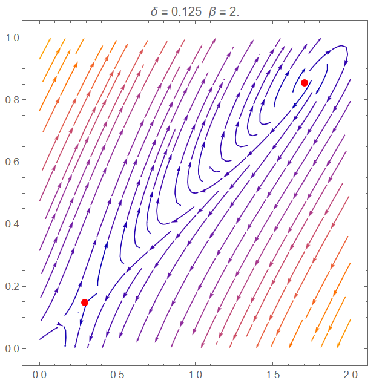
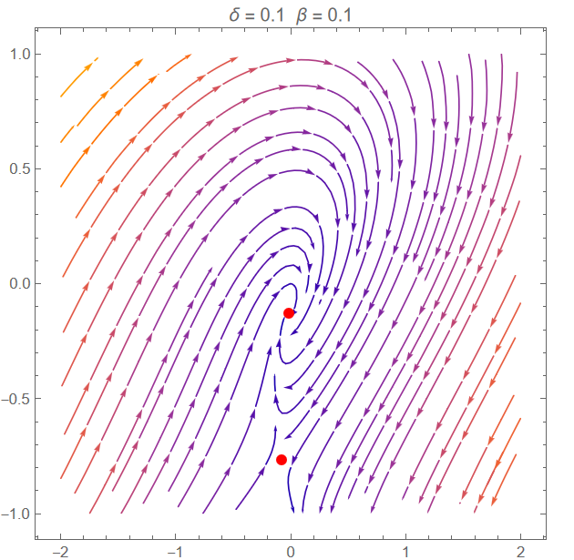
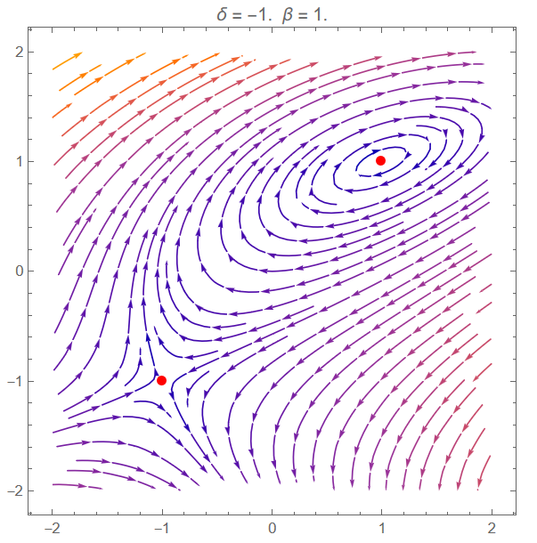
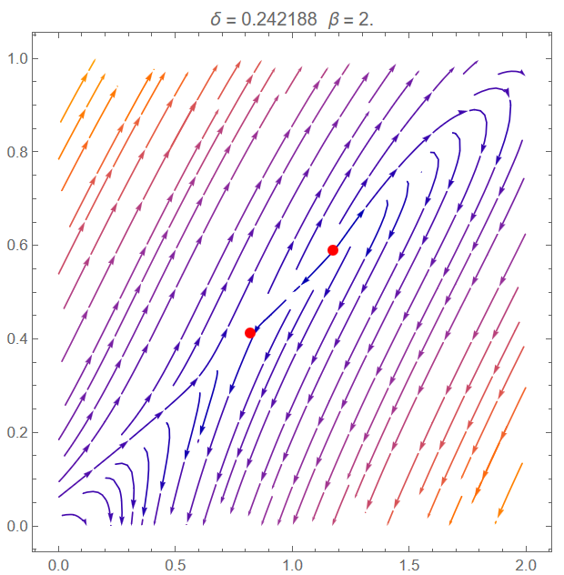
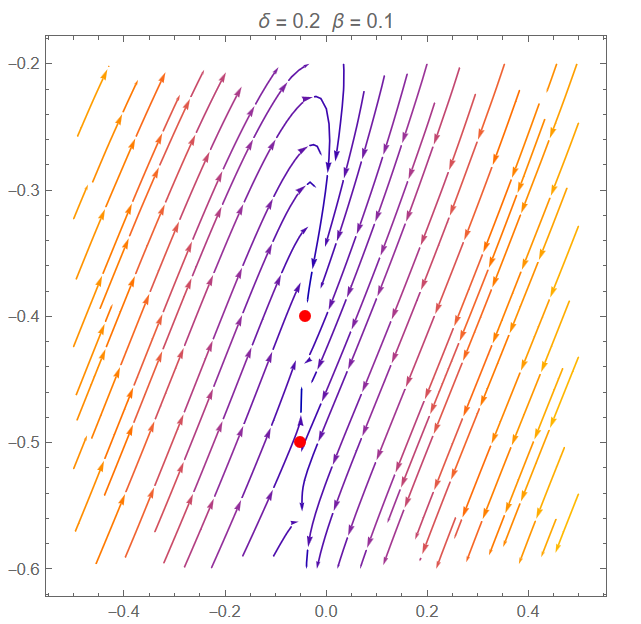
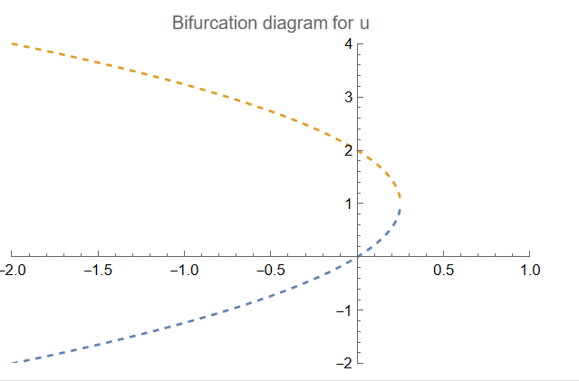
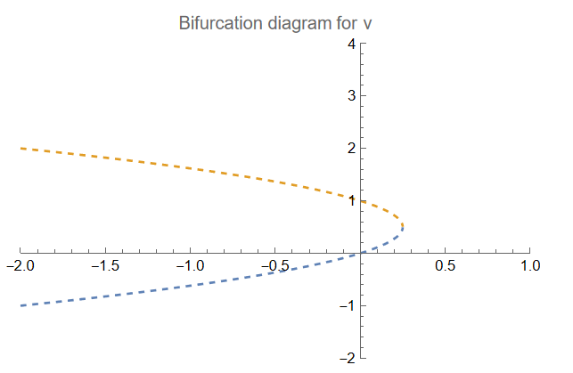

## Problem 1

The given equation is  $\def\re{\mathrm{Re}\ }\def\im{\mathrm{Im}\ }$
$$
C\dfrac{dv}{dt}=k(v-v_r)(v-v_t)-u+I\qquad \dfrac{du}{dt}=b(v-v_r)-u
$$
Let $\bar v = V(v-v_r),\bar u=U u$, then 
$$
\dfrac{d\bar v}{dt}=V\dfrac{dv}{dt}\qquad \dfrac{d\bar u}{dt}= U\dfrac{du}{dt}
$$
Plug it into the original equation, we have
$$
\dfrac{C}{V}\dfrac{d\bar v}{dt}=\dfrac{k}{V}\bar v(\dfrac{\bar v}{V}+v_r-v_t)-\dfrac{\bar u}{U}+I\qquad \dfrac{d\bar u}{dt}=\dfrac{Ub}{V}\bar v-\bar u
$$
Hence 
$$
\dfrac{d\bar v}{dt}=\dfrac{k}{C}\bar v(\dfrac{\bar v}{V}+v_r-v_t)-\dfrac{V}{UC}\bar u+\dfrac{VI}{C}\qquad \dfrac{d\bar u}{dt}=\dfrac{Ub}{V}\bar v-\bar u
$$
Let $V=\dfrac{k}{C},U=\dfrac{k}{C^2}$, $\alpha=\dfrac{k(v_r-v_t)}{C},\beta=\dfrac{b}{C},\delta=\dfrac{kI}{C^2}$, then the equations are transformed into
$$
\dfrac{d\bar v}{dt}=\bar v^2+\alpha\bar v-\bar u+\delta\qquad \dfrac{d\bar u}{dt}=\beta\bar v-\bar u
$$
which is desired. Note that $V,U,\beta,\delta$ are none-zero since $C,I,v_r,v_t,k,b$ are non-zero. But $\alpha$ may be zero. 

## Problem 2

Set $\alpha=1$ (and re-denote $\bar v$ as $v$, $\bar u$ as $u$), the system becomes
$$
\dfrac{dv}{dt}=v^2+v-u+\delta\qquad \dfrac{du}{dt}=\beta v-u
$$
==**(a)**== Rewrite the system into matrix form 
$$
\dfrac{d}{dt}\begin{bmatrix}u\\v\end{bmatrix}=\begin{bmatrix}v^2+v-u+\delta\\\beta v-u\end{bmatrix}=\begin{bmatrix}f_1(u,v)\\f_2(u,v)\end{bmatrix}=F(u,v)
$$
At the critical points, we have
$$
\dfrac{d}{dt}\begin{bmatrix}u\\v\end{bmatrix}=0,\quad\left\{\begin{aligned}&v^2+v-u+\delta=0\\&\beta v-u=0\end{aligned}\right.\quad \Rightarrow\left\{\begin{aligned}
&u=\dfrac{\beta}{2}(\beta-1-s),\quad v=\dfrac{1}{2}(\beta-1-s)\\
&u=\dfrac{\beta}{2}(\beta-1+s),\quad v=\dfrac{1}{2}(\beta-1+s)
\end{aligned}\right.\label{cp}
$$
where $s^2=(1-\beta)^2-4\delta$. The Jacobi matrix at $(u,v)$ is 
$$
J(u,v)=\nabla F(u,v)=\begin{bmatrix}\dfrac{\partial f_1}{\partial u}&\dfrac{\partial f_1}{\partial v}\\\dfrac{\partial f_2}{\partial u}&\dfrac{\partial f_2}{\partial v}\end{bmatrix}=\begin{bmatrix}-1&2v+1\\-1&\beta\end{bmatrix}
$$
which contains no $u$. Fix $v$, we can find the eigenvalues of it at $(u,v)$
$$
|J(u,v)-\lambda I|=\begin{vmatrix}-1-\lambda&2v+1\\-1&\beta-\lambda\end{vmatrix}=0\quad \Rightarrow\quad \left\{\begin{aligned}
\lambda_1=\dfrac{1}{2}(-1+\beta-t)\\
\lambda_2=\dfrac{1}{2}(-1+\beta+t)
\end{aligned}\right.
$$
where $t^2=(\beta-1)(\beta+3)-8v=(1-\beta)^2\pm4s$. Therefore, 

1. If $(1-\beta)^2<4\delta$, then $s^2<0$, $(\refeq{cp})$ has no solutions. I.e. there's <u>no critical point</u>.

2. If $(1-\beta)^2=4\delta$, then $s=0$, $(\refeq{cp})$ has only one solution (critical point) 
   $$
   (u,v)=(\dfrac{\beta(\beta-1)}{2},\dfrac{\beta-1}{2})\label{cps0}
   $$
   at this critical point, $t^2=(1-\beta)^2\geqslant 0$ , hence $\lambda_1$, $\lambda_2$ are both real. 

   - If $\beta=1$, then $\delta=0$, $\lambda_1=\lambda_2=0$, the critical point $(\refeq{cps0})$ is an <u>unstable saddle point</u>.

     

   - If $\beta >1$, then $\lambda_1>0,\lambda_2=0$, the critical point $(\refeq{cps0})$ is an <u>unstable source</u>.

     

   - If $\beta < 1$, then $\lambda_1<0,\lambda_2=0$, the critical point $(\refeq{cps0})$ is an <u>unstable saddle point</u> referring to the graph below:

     

3. If $(1-\beta)^2>4\delta$, then $s^2>0$, $s$ has 2 values, one positive and one negative, $(\refeq{cp})$ has 2 distinct solutions (critical points)
   $$
   P_1=(u_1,v_1)=(\dfrac{\beta}{2}(\beta-1-\sqrt{(1-\beta)^2-4\delta}),\dfrac{1}{2}(\beta-1-\sqrt{(1-\beta)^2-4\delta}))\\
   P_2=(u_2,v_2)=(\dfrac{\beta}{2}(\beta-1+\sqrt{(1-\beta)^2-4\delta}),\dfrac{1}{2}(\beta-1+\sqrt{(1-\beta)^2-4\delta}))\label{cpcoord}
   $$

   - At $P_1$, $t^2=(1-\beta)^2+4s=(1-\beta)^2+4\sqrt{(1-\beta)^2-4\delta}>0$, therefore about $P_1$, we know that 

     - $\lambda_1\leqslant 0$, '=' holds iff $\beta=2,\delta=\dfrac{1}{4}$

     - $\lambda_2\geqslant  0$, '=' holds iff $\beta =0,\delta=\dfrac{1}{4}$

     Since $(1-\beta)^2>4\delta$ as we assumed, $\lambda_1<0$, $\lambda_2>0$ always holds at $P_1$, that is, $P_1$ is an <u>unstable saddle point</u>.

   - At $P_2$, $t^2=(1-\beta)^2-4s=(1-\beta)^2-4\sqrt{(1-\beta)^2-4\delta}$, let
     $$
     m=\dfrac{1}{64}(15-28\beta+10\beta^2+4\beta^3-\beta^4)
     $$
     therefore about $P_1$, we know that 

     1. When $\delta=m$, $t=0$, there's $\lambda_1=\lambda_2=\dfrac{\beta-1}{2}$

        - If $\beta >1$, then $\lambda_1,\lambda_2>0$, $P_2$ is an <u>unstable source</u>
        - If $\beta <1$, then $\lambda_1,\lambda_2<0$, $P_2$ is a <u>stable sink</u>

     2. When $\delta <m, t^2<0$, there's $\lambda_1,\lambda_2\in\mathbb{C}$, 

        - If $\beta >1$, then $\re\lambda_1,\re\lambda_2>0$, $P_2$ is an <u>unstable spiral</u>

          

        - If $\beta <1$, then $\re\lambda_1,\re\lambda_2<0$, $P_2$ is a <u>stable spiral</u>

          

        - If $\beta=1$, then $\re \lambda_1=\re \lambda_2=0,\im \lambda_1,\im \lambda_2\neq 0$, $P_2$ is a stable <u>center</u>,

          

     3. When $\delta >m,t^2>0$, there's $\lambda_1,\lambda\in\mathbb{R}$,

        - If $\beta>1$ and $m\leqslant \delta< \dfrac{(1-\beta)^2}{4}$, $-1+\beta+t>-1+\beta-t>0$, i.e. $\lambda_2>\lambda_1>0$, $P_2$ is an <u>unstable source</u>

          

        - If $\beta<1$ and $m\leqslant \delta< \dfrac{(1-\beta)^2}{4}$, $-1+\beta-t<-1+\beta+t<0$, i.e. $\lambda_1<\lambda_2<0$, $P_2$ is a <u>stable sink</u>.

          

        - If $\beta=1$, as $m=0$, $0=m\leqslant \delta< \dfrac{(1-\beta)^2}{4}=0$ never holds.

==**(b)**== Set $\beta=2$, the equation becomes
$$
\dfrac{d}{dt}\begin{bmatrix}u\\v\end{bmatrix}=\begin{bmatrix}v^2+v-u+\delta\\2 v-u\end{bmatrix}=\begin{bmatrix}f_1(u,v)\\f_2(u,v)\end{bmatrix}=F(u,v)
$$
If furtherly $\delta=0$, referring to the debate in (a), since $(1-\beta)^2>4\delta$, there're 2 critical points $P_1=(0,0),P_2=(2,1)$, and at $P_1$, $\lambda_1<0,\lambda_2>0$, $P_1$ is an <u>unstable saddle point</u>.

Besides, when $\beta=2$, we get $s^2=1-4\delta$, $t^2=1\pm 4s$, $m=\dfrac{15}{64}$. Referring to the debate above in (a),

- when $\delta >\dfrac{1}{4}$, there's no critical points
- when $\delta=\dfrac{1}{4}$, there's only one unstable source critical point.
- when $\delta <\dfrac{1}{4}$, there're 2 critical points, one is an unstable saddle point, and the other one is,
  - if $\dfrac{15}{64}\leqslant \delta<\dfrac{1}{4}$, is an unstable source
  - if $\delta<\dfrac{15}{64}$, is and unstable spiral.

By $(\refeq{cpcoord})$, 
$$
P_1=(u_1,v_1)=(1-\sqrt{1-4\delta},\dfrac{1}{2}(1-\sqrt{1-4\delta}))\\
P_2=(u_2,v_2)=(1+\sqrt{1-4\delta},\dfrac{1}{2}(1+\sqrt{1-4\delta}))
$$
as $\delta$ increases, $u_1\uparrow$, $u_2\downarrow$, $u_2>u_1$,  $v_1\uparrow$, $v_2\downarrow$, $v_2>v_1$,





==**(c)**== If there is limit cycles, then there could be some $\delta,\beta$, making the eigenvalues of the Jacobi at the center of the trajectory purely imaginary (sufficient condition). Thus, by the debate above, we must have $\beta=1$ and $t^2=(1-\beta)^2\pm s=\pm s<0$. To make critical point exist, we must have $\delta <0$.

- Assume $\beta=1,\delta <0$, by the debate above, $P_2$ is a stable center, hence there exists infinite limit cycles around it. 

- When $\beta\neq 1$, as

    $$
    \dfrac{\partial f_1}{\partial u}+\dfrac{\partial f_2}{\partial v}=-1+\beta\neq 0,\quad \forall\ (u,v)\in\mathbb{R}^2
    $$

	Applying Bendixson's Criterion, the system has no closed trajectories inside $\mathbb{R}^2$. 

- When $\beta=1,\delta\geqslant 0$, there's either no critical point, or only one saddle point. Since the index of a saddle is $-1$ and that of a closed orbit is $1$, there exist no limit cycles.

	In summary, we can conclude that limit cycles exist if and only if $\beta=1$ and $\delta <0$.

	> The following graph shows the existence of a limit cycle when $\beta=1$, $\delta=-1$:
	>
	> 

==**(d)**== To produce homoclinic orbits, we'd better produce saddle point first. By (c), when $\beta=1,\delta<0$, there appears a center $P_2$ and a saddle point $P_1$, note that the trajectory emitted from $P_1$, hence there exists homoclinic orbits for the same parameter values.

==**(e)**== The bifurcation occurs when $\dfrac{1}{4}(1-\beta)^2=\delta$, and at this time, the critical point
$$
u=\dfrac{\beta}{2}(\beta-1),\quad v=u=\dfrac{1}{2}(\beta-1)
$$
Hence the parametric expression of the curve of the points where bifurcation occurs should be
$$
C_u(\beta)=(\dfrac{1}{4}(1-\beta)^2,\dfrac{\beta(\beta-1)}{2}),\quad C_v(\beta)=(\dfrac{1}{4}(1-\beta)^2,\dfrac{\beta-1}{2})
$$
If we put it onto the $uv$ plane, then the expression is 
$$
C(\beta)=(\dfrac{\beta(\beta-1)}{2},\dfrac{\beta-1}{2})
$$
When $\beta<1$, $P_2$ is stable, otherwise, it's unstable.

The curve and the animation of the bifurcation diagram is shown below


**Figure 1: **Bifurcation Diagram for $u$ as $\beta$ (x-axis) changes


**Figure 2: **Bifurcation Diagram for $v$ as $\beta$ (x-axis) changes


**Figure 3:** Bifurcation Points on $u,v$ plane

On the $\beta,\delta$ 

## Appendix

Code to get $m$ and draw graphs:

```mathematica
F[u_, v_, d_, b_] := {v^2 + v - u + d, b v - u}

Reduce[(1 - b)^2 - 4 Sqrt[(1 - b)^2 - 4 d] < 0, {b, d}]

With[{d = -0.1, b = 2},
 Print@MatrixForm@Grad[F[u, v, d, b], {u, v}];
 Print@NSolve[# == 0 & /@ F[u, v, d, b], {u, v}];
 Print@(MatrixForm /@ (Grad[F[u, v, d, b], {u, v}] /. 
      NSolve[# == 0 & /@ F[u, v, d, b], {u, v}]));
 Print@(Eigenvalues[Grad[F[u, v, d, b], {u, v}]] /. 
    NSolve[# == 0 & /@ F[u, v, d, b], {u, v}]);
 StreamPlot[F[u, v, d, b], {u, -3, 3}, {v, -3, 3},
  Epilog -> {Red, PointSize[0.02]}~
    Join~(Point[{u, v}] /. 
      NSolve[# == 0 & /@ F[u, v, d, b], {u, v}]),
  PlotLabel -> 
   "\[Delta] = " <> ToString[N@d] <> "  \[Beta] = " <> ToString[N@b]
  ]
 ]
```

Code to draw bifurcation diagram:

```mathematica
Plot[
 {(1 - Sqrt[1 - 4 d]), (1 + Sqrt[1 - 4 d])}, {d, -2, 1}, 
 PlotStyle -> Dashed, PlotLabel -> "Bifurcation diagram for u", 
 PlotRange -> {{-2, 1}, {-2, 4}}
 ]
Plot[
 {1/2 (1 - Sqrt[1 - 4 d]), 1/2 (1 + Sqrt[1 - 4 d])}, {d, -2, 1}, 
 PlotStyle -> Dashed, PlotLabel -> "Bifurcation diagram for v", 
 PlotRange -> {{-2, 1}, {-2, 4}}
 ]
```

Code to generate bifurcation diagram fixing $\beta$ and change $\delta$:

```mathematica
dat = Table[
   Show[Plot[{b/2 (b - 1 - Sqrt[(1 - b)^2 - 4 d]), 
      b/2 (b - 1 + Sqrt[(1 - b)^2 - 4 d])}, {d, -10, 10}, 
     PlotRange -> {{-10, 10}, {-10, 20}}, PlotStyle -> Dashed, 
     PlotLabel -> "b = " <> ToString[b]],
    ParametricPlot[{(1 - x)^2/4, (x (x - 1))/2}, {x, -10, 10}, 
     PlotStyle -> {Gray, Dotted}
     ]
    ], {b, -5, 5, 0.1}];
Export["ani_u.gif", dat]

dat = Table[
   Show[Plot[{1/2 (b - 1 - Sqrt[(1 - b)^2 - 4 d]), 
      1/2 (b - 1 + Sqrt[(1 - b)^2 - 4 d])}, {d, -10, 10}, 
     PlotRange -> {{-10, 10}, {-10, 20}}, PlotStyle -> Dashed, 
     PlotLabel -> "b = " <> ToString[b]],
    ParametricPlot[{(1 - x)^2/4, (x - 1)/2}, {x, -10, 10}, 
     PlotStyle -> {Gray, Dotted}
     ]
    ], {b, -5, 5, 0.1}];
Export["ani_v.gif", dat]
```


