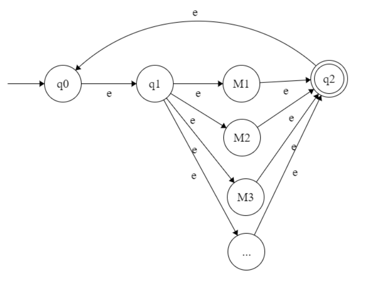
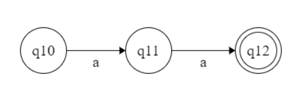
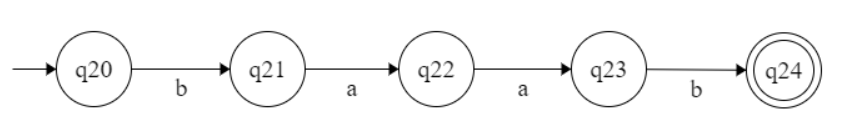
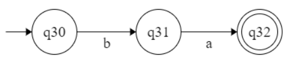
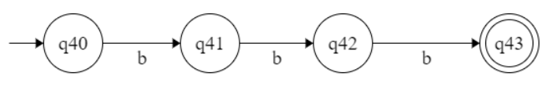
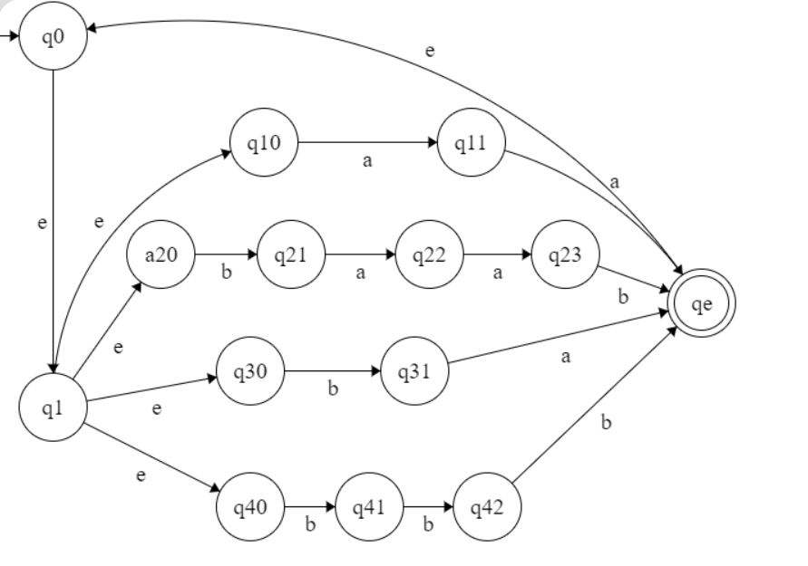
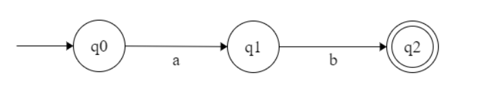
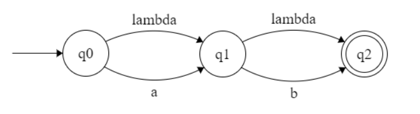
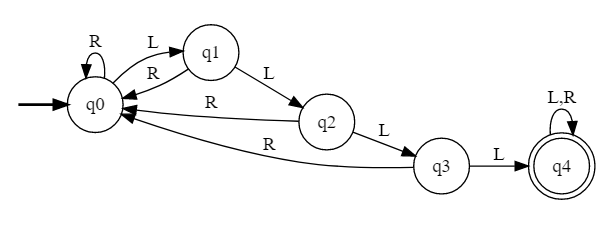
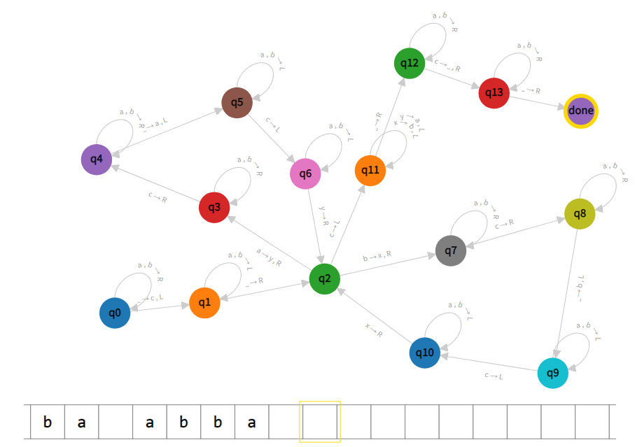

## Question 1 

Apparently, $\forall\ w=\underbrace{(a\Sigma^*b)^*}_{\in A^*}=a(\Sigma^*ba\Sigma^*\cdots \Sigma^*)b{\color{purple}\text{ or }\lambda}\in A\cup \{\lambda\}$, hence $A^*\sub A\cup \{\lambda\}$.

Also $A\sub A^*,\{\lambda\}\sub A^*$ corresponding $0$ or $1$ reptations of $a\Sigma^*b$ respectively. Therefore $A^*=A\sub \{\lambda\}$

## Question 2

==$L(M_1)\cap L(M_2)\sub L(M_1\times M_2)$==

For any $w=a_1a_2\ldots a_n\in L(M_1)\cap L(M_2)$ of length $n$, since $w\in L(M_1),L(M_2)$,  it is accepted by $M_1$ and $M_2$, hence 
$$
\delta_1^n(s_1,w)=\delta_1(\delta_1(\delta_1(\cdots),a_{n-1}),a_n)=\iota_1\\
\delta_2^n(s_2,w)=\delta_2(\delta_2(\delta_2(\cdots),a_{n-1}),a_n)=\iota_2\\
$$
Hence in $M_1\times M_2$, $\delta=\delta_1\times \delta_2$
$$
\delta^n((s_1,s_2),w)=\delta(\delta(\delta(\ldots),a_{n-1}),a_{n})=(\iota_1,\iota_2)
$$
i.e. $w$ can be accepted by $M_1\times M_2$. $L(M_1)\cap L(M_2)\sub L(M_1\times M_2)$.

==$L(M_1\times M_2)\sub L(M_1)\cap L(M_2)$==

Since $M_1$ decides $L(M_1)$, $M_2$ decides $L(M_2)$, 

- for $w\not\in L(M_1)$, $\delta_1^n(s_1,w)\neq \iota_1$ for $n=|w|$.
- for $w\not\in L(M_2)$, $\delta_2^n(s_2,w)\neq \iota_2$ for $n=|w|$.

Thus for $w\not\in L(M_1)\cap L(M_2)$, either $w\not\in L(M_1)$ or $w\not\in L(M_2)$. i.e. either $\delta_1^n(s_1,w)=a_i\neq \iota_1$ or $\delta_2^n(s_2,w)=a_j\neq \iota_2$. Therefore $\delta^n((s_1,s_2),w)=(a_i,a_j)\neq (\iota_1,\iota_2)$, hence $w$ is not accepted by $L(M_1\times M_2)$. $L(M_1\times M_2)\sub L(M_1)\cap L(M_2)$

Thus we can conclude that $L(M_1\times M_2)= L(M_1)\cap L(M_2)$, $M_1\times M_2$ decides the language $L(M_1)\cap L(M_2)$.

## Question 3

==Method 1:==

Suppose there's a DFA $M$ for $L$. Consider a subset of $L=\{s\mid s\text{ contains same count of $a$ and $b$}\}$, $S=\{a^nb^n\mid n\geqslant 0\}$. If for any $s\neq t$, $a^s,b^t$ put $M$ in the same state, then $\forall z\in\{a,b\}^*$, $a^s,b^t$ put $M$ in the same state.

But $M$ accepts $a^sb^s,a^tb^t$ but not $a^sb^t,a^tb^s$, hence for any $s\neq t$ $a^s,b^t$ must put $M$ in distinct states. Therefore, to handle $S_n=\{a^nb^n\mid0\leqslant n\leqslant N\}$, $M$ need at least $N$ states. Therefore to accept $S$ and $L$, $M$ needs infinity states. This contradicts the definition of DFA. 

Therefore $L$ can not be accepted by any DFA.

==Method 2:==

A language can be accepted by a DFA if and only if it is regular. By Pumping Lemma, for $L=\{s\mid s\text{ contains same count of $a$ and $b$}\}$, also, we consider the subset of it $S=\{a^nb^n\mid n\geqslant 0\}$.

Consider $xyz=a^nb^n\in L,|xy|\leqslant n$, hence $y$ can only contain $a$'s, $y\neq\varepsilon$, hence $y$ must contains at least one $a$. let $y=a$, then $xy^2z\not\in L$. By the Pumping Lemma, $L$ could not be regular, hence there's no DFA accepts it.

## Question 4

Since $S$ is finite, we can plug finite independent state into NFA and use union (or) structure to combine them:

 

In the diagram, $M_1,M_2,\cdots$ are the states for $S$ with merged accepting state (it's also ok not to merge and create new transition to $q_2$), `q2->q1` for the closure.

For example, $S=aa+baab+ba+bbb$, $aa$ is like



$baab$ is like



$ba$ is like



$bbb$ is like



Hence $S^*$ is like 



$e$ for $\varepsilon/\lambda$.

## Question 5

1. The NFA is 

   

   which defines $\{ab\}$. Apply the rule we get

   

   The language becomes $\{\lambda,a,b,ab\}$.

2. If the original NFA decides $L$, then the modified NFA defines $L'=\{s\in w\mid w\in L\}$, where $s\in w$ means $s=\lambda$ or $s$ is a substring of $w$.

## Question 6 _No material_


## Question 7  _No material_

==Basic idea:== we define the following states:

1. `q0` initial state with excess 0, eat R to stay `q0`, eat L to go to `q1`
2. `q1` excess 1, eat R to return to `q0`, eat L to go to `q2`
3. `q2` excess 2, eat R to return to `q0`, eat L to go to `q3`
4. `q3` excess 3, eat R to return to `q0`, eat L to go to `q4`
5. `q4` excess 4 or more, accepting state, eat R/L to stay `q4`

Note that this is already a DFA.



Try minimizing:

1. Split $S_1=\{q_0,q_1,q_2,q_3\},S_2=\{q_4\}$
2. Since $q_3\to^L q_4\in S_2,q_0,q_1,q_2\to^{R,L} S_1 $, divide $S_1=S_3\cup S_4$, $S_3=\{q_0,q_1,q_2\},S_4=\{q_3\}$
3. Since $q_2\to ^L q_3\in S_4,q_0,q_1\to^{L/R} S_3$, divide $S_3=S_5\cup S_6$, $S_5=\{q_0,q_1\},S_6=\{q_2\}$
4. Since $q_1\to^L q_2\in S_6,q_0\to^{L/R} S_5 $, divide $S_5=S_7\cup S_8$, $S_7=\{q_0\},S_8=\{q_1}¹$

Now we get exactly the same DFA as the previous one. Hence this DFA is already minimized.

Regex: `(L|R)*(LLL)(L|R)*`

## Question 8

==Basic Idea:== follow the following procedure:

1. we scan the length to reach the blank right after $w$ and write a new character to flag end
2. move head back to the far left
3. for each character in the string, move the head to the far end and write down it and convert all a, b to x, y, then go back to the nearest x, y
4. loop 3 until c met.
5. go back and transform x, y back to a, b
6. go right and cancel c to blank

==Description of steps in detailed states:==

1. First convert all a’s, b’s into a’s, b’s and go right then the right most blank into $c$ and go left 
2. Then convert all a’s, b’s into a’s, b’s and go left
3. If b convert it into $x$ and go right convert all a’s, b’s into a’s, b’s and go right then, convert $c$ into $c$ and go right then convert all a’s, b’s into a’s, b's and go right then convert blank into $1$ and go left then convert all a’s, b’s into a’s, b’s and go left then convert $c$ into $c$ and go left then convert all a’s, b’s into a’s, b’s and go left then convert all x into x and go right and then repeat all the process from step-2 till end 
4. If a then convert it into y and go right then convert all a’s, b’s into a’s, b’s and go right then convert c into c and go right then convert all a’s, b’s into a’s, b’s and go right then convert blank into a and go left then convert all a’s, b’s into a’s, b’s and go left then convert c into c and go left then convert all a’s, b’s into a’s, b’s and go left then convert all y into y and go right and then repeat all the process from step-2 till end 
5. Otherwise if c found convert it into c and go left then convert all x into b and y into a and go left then convert blank into blank, c into blank and go right and **stop the machine.** 



[Turing machine visualization](https://turingmachine.io/) code:

```yaml
input: 'abba'
blank: ' '
start state: start
table:
  start:
    ['a','b']: R
    ' '  : {write: 'c', L: q1}
  q1:
    ['a','b']: L
    ' ': {R: q2}
  q2:
    'a': {write: 'y', R: q3}
    'c': {L: q11}
    'b': {write: 'x', R: q7}
  q3: 
    ['a','b']: R
    'c': {R: q4}
  q4: 
    ['a','b']: R
    ' ': {write: 'a', L: q5}
  q5:
    ['a','b']: L
    'c': {L: q6}
  q6:
    ['a','b']: L
    'y': {R: q2}
  q7:
    ['a','b']: R
    'c': {R: q8}
  q8:
    ['a','b']: R
    ' ': {write: 'b', L: q9}
  q9:
    ['a','b']: L
    'c': {L: q10}
  q10:
    ['a','b']: L
    'x': {R: q2}
  q11:
    'x': {write: 'b', L: q11}
    'y': {write: 'a', L: q11}
    ' ': {R: q12}
  q12:
    ['a','b']: R
    'c': {write: ' ', R: q13}
  q13:
    ['a','b']: R
    ' ': {R: done}
  done:
```

