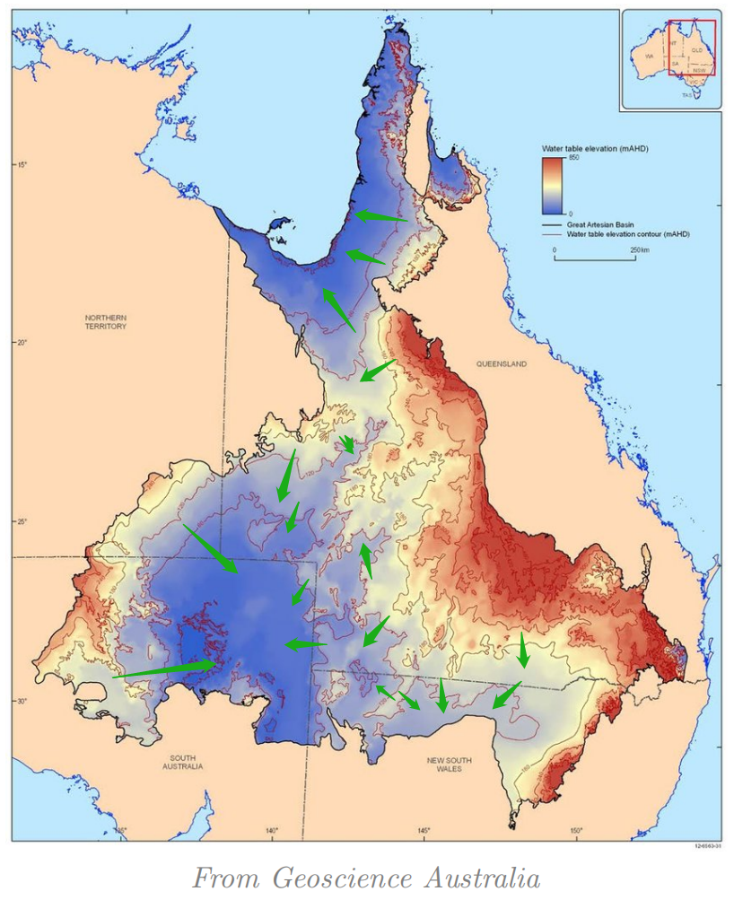
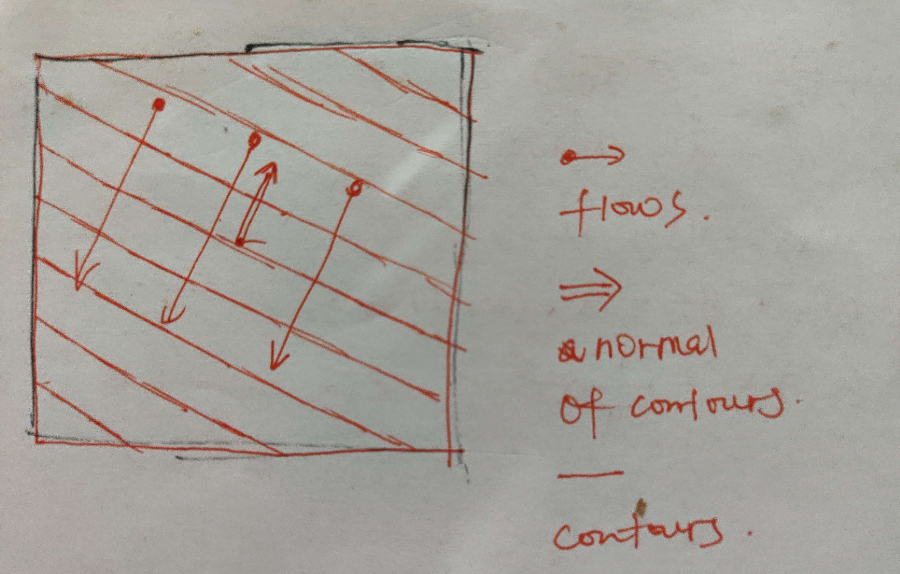
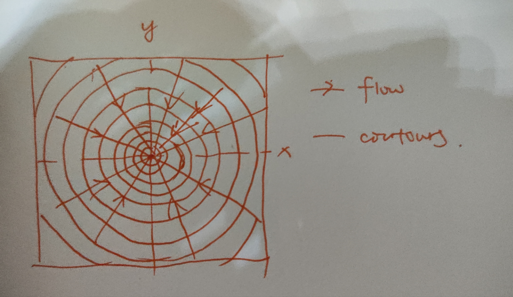

### Q1

The Darcy's Law says that the velocity of the groundwater flow is proportional to the horizontal gradient of pressure distribution in the rock. The easier (hydraulic conductivity) a given fluid can flow through the given rock, or the more rapid the horizontal pressure changes, the higher the velocity is. And the direction of flows along the decreasing direction of pressure distribution.

### Q2

See the arrows, they represents the direction of flows. Generally, by the governing equation, they should be perpendicular to the contours.

### Q3

Let $p=-x-2y$, then 
$$
\dfrac{\partial p}{\partial x}=-1,\quad \dfrac{\partial p}{\partial y}=-2,\quad \dfrac{\partial^2 p}{\partial x^2}=\dfrac{\partial^2 p}{\partial y^2}=0
$$
therefore for the given $p$, we have
$$
\Delta p=\dfrac{\partial^2 p}{\partial x^2}+\dfrac{\partial^2 p}{\partial y^2}=0
$$
it is a solution of the pressure equation. If $\lambda=1$, then $v=-\lambda \nabla p=-(\dfrac{\partial p}{\partial x},\dfrac{\partial p}{\partial y})=(1,2)$

### Q4

By Q3, we know that $\nabla p = (\dfrac{\partial p}{\partial x},\dfrac{\partial p}{\partial y})=(-1,-2)$, hence all contour of $p$ are lines perpendicular to the vector $(-1,-2)$ and they should be equally distributed. The direction of the flow is along the direction $(1,2)$. Sketch:

### Q5

The flow is uniformly distributed, with identical direction along $(1,2)$ and along the descending direction of $p$. If $\lambda=1$, the quantity of velocity is $\sqrt 5$. Also, the flow is perpendicular to the contours of $p$.

### Q6

Let $p=\log(x^2+y^2)$, then
$$
\dfrac{\partial p}{\partial x}=\dfrac{2x}{x^2+y^2},\quad \dfrac{\partial p}{\partial y}=\dfrac{2y}{x^2+y^2},\quad \dfrac{\partial^2 p}{\partial x^2}=\dfrac{2(y^2-x^2)}{(x^2+y^2)^2},\quad\dfrac{\partial^2 p}{\partial y^2}=\dfrac{2(x^2-y^2)}{(x^2+y^2)^2}
$$
hence
$$
\dfrac{\partial^2 p}{\partial x^2}+\dfrac{\partial^2 p}{\partial y^2}=\dfrac{2(y^2-x^2)}{(x^2+y^2)^2}+\dfrac{2(x^2-y^2)}{(x^2+y^2)^2}=0
$$
$p=\log(x^2+y^2)$ is a solution of the pressure equation.

### Q7

Since $p=\log(x^2+y^2)=\log r^2=2\log r$, $\dfrac{\text{d}p}{\text{d}r}=\dfrac{2}{r}$, where $r=\sqrt{x^2+y^2}$ is the distance from the origin to point $(x,y)$. Hence the contour is circles centered at the origin, and as we go farther from the origin, the contours will be sparser and sparser. Moreover, since $\dfrac{\partial p}{\partial x}/\dfrac{\partial p}{\partial y}=\dfrac{x}{y}$, $v=-\lambda \nabla p$, the direction of flow will be perpendicular to the contours and points to the origin.

### Q8

The flows are angularly uniformly distributed, and all perpendicular to to contours, which are circles centered at the origin, hence the flows point to the origin as well. And since $v=-\lambda\nabla p=-\dfrac{2\lambda}{r}$, if $\lambda=0$, $v$ is $0$ everywhere, and if $\lambda>0$, the velocity increases more and more rapidly as we go nearer to the origin. At the origin, it will be infinitely large.

### Q9

The operator $v\cdot \nabla$ describes the directional derivatives along $v$, hence $v\cdot \nabla C $ can be interpreted as the quantity of pollutant brought away from $(x,y)$ by the flow in a unit piece of time. 

### Q10

$v=(1,2)$. $C(t;x,y)=\dfrac{1}{\sqrt t}\exp (-(x-y+t)^2/8Dt)$, hence
$$
\begin{aligned}
&\dfrac{\partial C}{\partial x}=\dfrac{(y-x-t)\exp(-\dfrac{(t+x-y)^2}{8Dt})}{4Dt^{3/2}}\\
&\dfrac{\partial C}{\partial y}=\dfrac{(t+x-y)\exp(-\dfrac{(t+x-y)^2}{8Dt})}{4Dt^{3/2}}\\
&\dfrac{\partial^2 C}{\partial x^2}=\dfrac{((t+x-y)^2-4Dt)\exp(-\dfrac{(t+x-y)^2}{8Dt})}{16D^2t^{5/2}}\\
&\dfrac{\partial^2 C}{\partial y^2}=\dfrac{((t+x-y)^2-4Dt)\exp(-\dfrac{(t+x-y)^2}{8Dt})}{16D^2t^{5/2}}\\
&\dfrac{\partial C}{\partial t}=\dfrac{((x-y)^2-t^2-4Dt)\exp(-\dfrac{(t+x-y)^2}{8Dt})}{8D^2t^{5/2}}\\
\end{aligned}
$$
 Therefore
$$
\begin{aligned}
\text{LHS}&=\dfrac{\partial C}{\partial t}+v\cdot\nabla C\\
&=\dfrac{\exp(-\dfrac{(t+x-y)^2}{8Dt})}{16D^2 t^{5/2}}\left[(x-y)^2-t^2-4Dt+4(y-x-t)+8(x-y+t)\right]\\
&=\dfrac{\exp(-\dfrac{(t+x-y)^2}{8Dt})}{16D^2 t^{5/2}}\left[(x-y)^2-t^2-4Dt+4(x-y+t)\right]\\
&=\frac{e^{-\frac{(t+x-y)^2}{8 d t}} \left((t+x-y)^2-4 d
   t\right)}{8 D t^{5/2}}
\end{aligned}
$$
and 
$$
\begin{aligned}
\text{RHS}&=D\Delta C=\dfrac{\exp(-\dfrac{(t+x-y)^2}{8Dt})}{16D^2 t^{5/2}}\left[(x-y)^2-t^2-4Dt+4(x-y+t)\right]\\
&=\frac{e^{-\frac{(t+x-y)^2}{8 d t}} \left((t+x-y)^2-4 d
   t\right)}{8 d t^{5/2}}
\end{aligned}
$$
Therefore RHS=LHS, $C(t;x,y)=\dfrac{1}{\sqrt t}\exp (-(x-y+t)^2/8Dt)$ is a solution to the transportation equation. 