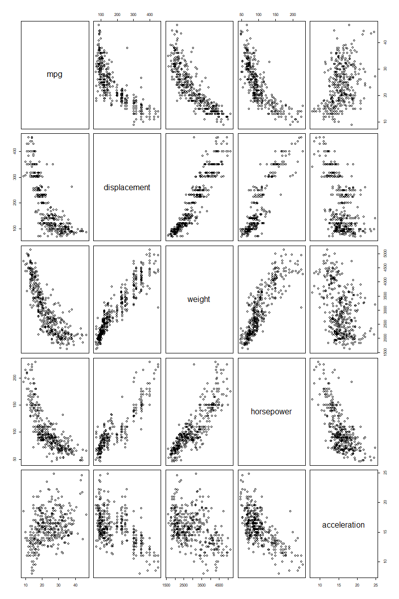
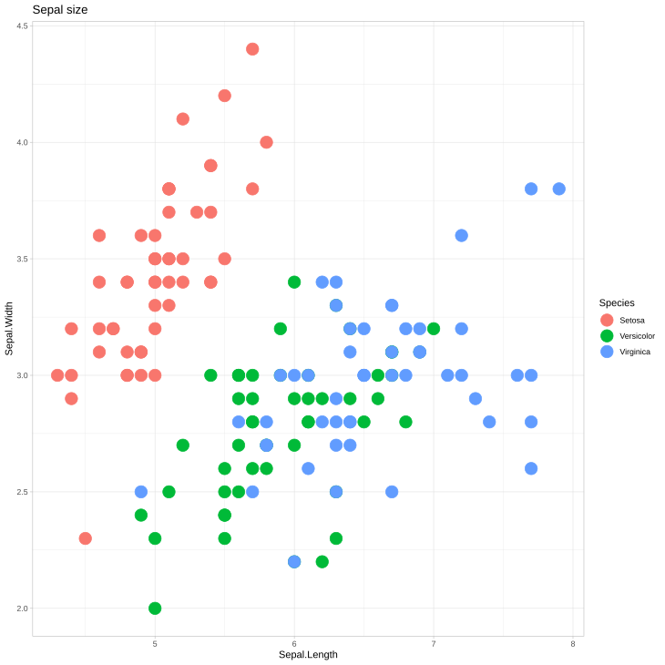
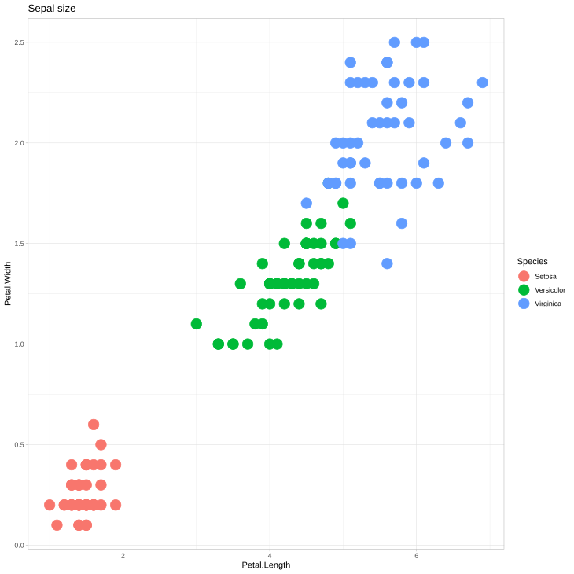
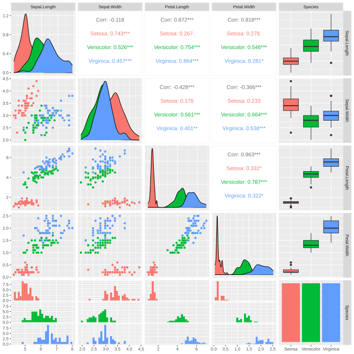
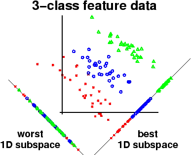
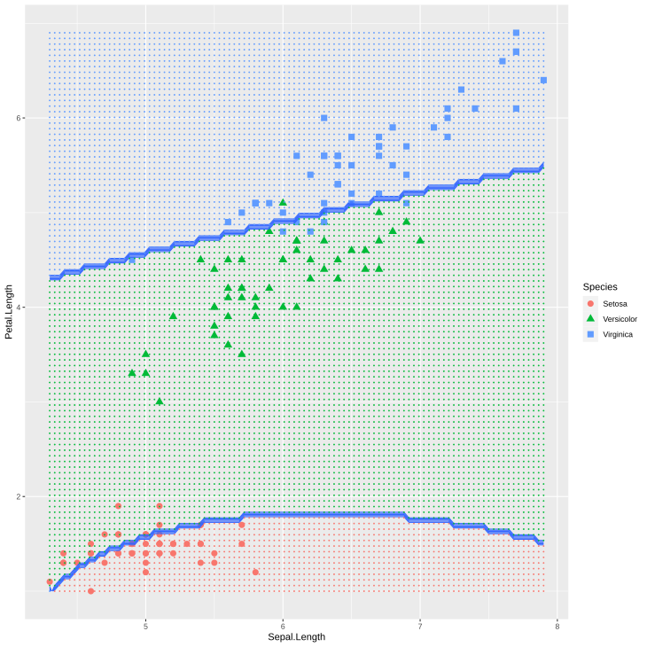
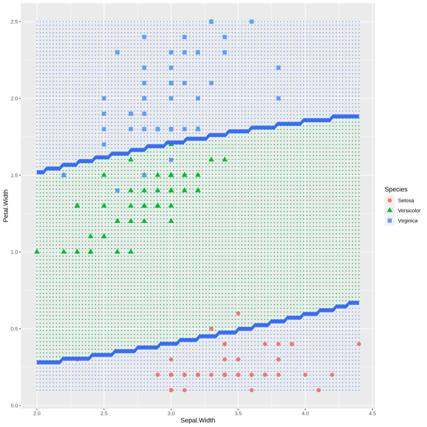
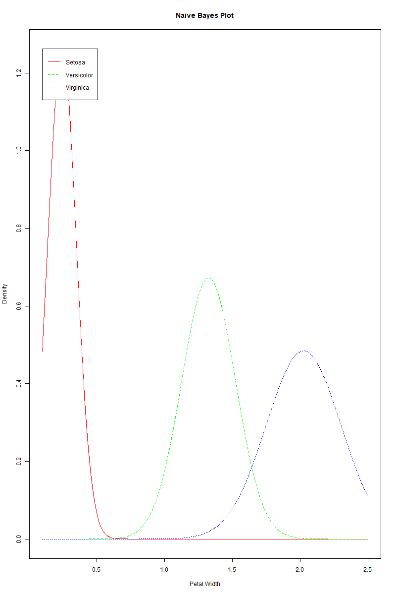
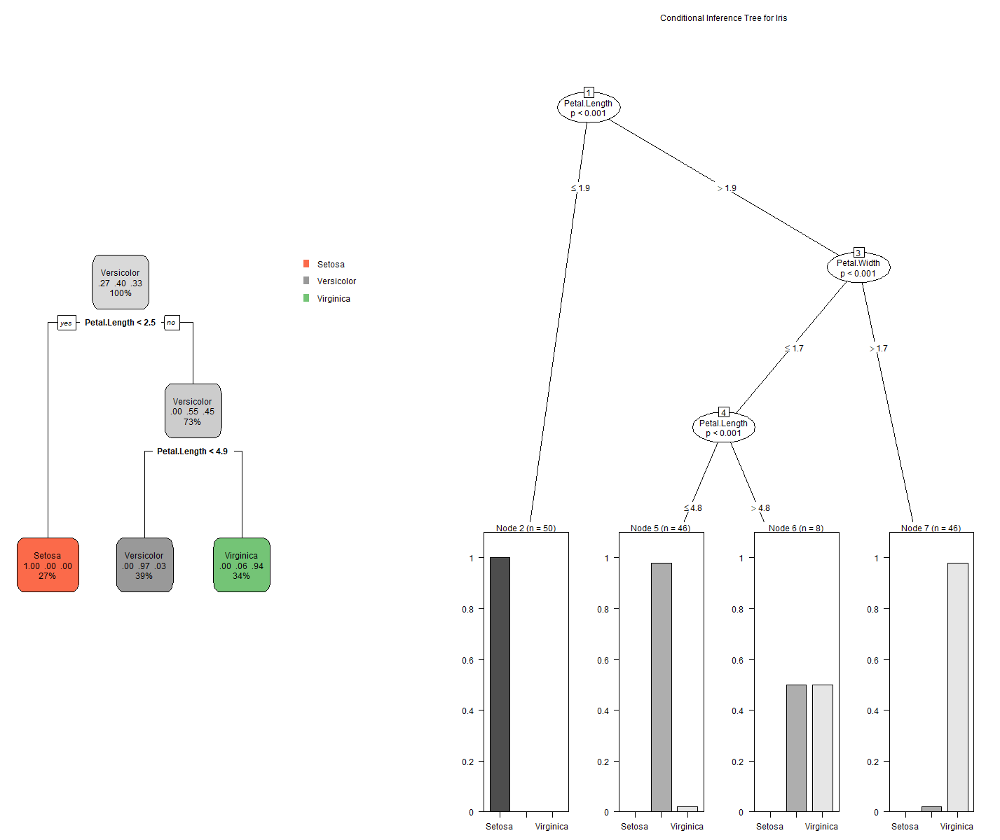

## Abstract

Basically, I'm going to perform some regression practice on the `Auto` dataset, and use the `iris` to do some classification practice. 

## Regression

We're going to use the ISLR2's `Auto` dataset. First the `pair` plot:



We can see good linear relation between `displacement`, `weight`, `horsepower`, and clear relation between `mpg` and the 3 features.

### Validation Set

It's quite a straight method, just divide the dataset into a training set and a validation set, use the former one to train the model and use the latter one to test the model, and select out the best one by comparing MSEs.

A variant of this method is the $k$-fold cross-validation method, which picks 1 fold as the validation set the the remaining $k-1$ folds as the training set, and repeat $k$ times. Then the k-fold CV estimation would be 
$$
CV_{(k)}=\dfrac{1}{k}\sum_iMSE_i
$$

### Bootstrap

Bootstrapping means sampling with replacement on the dataset, for example, if we have got a model, and want to know the SE of $\hat\beta$, we can pick $n$ data points with replacement, and repeat $r$ times, then the estimation of SE would be 
$$
SE(\hat\beta)=\sqrt{\dfrac{1}{r-1}\sum_i (\hat\beta_i-\dfrac{1}{r}\sum_i\hat\beta_i)^2}
$$
In this report, we're going to research into the relation of `mpg` and `horsepower`.

```R
library(ISLR2)
train <- sample(dim(Auto)[1], dim(Auto)[1] / 2)

lm_fit1 <- lm(mpg~horsepower,data = Auto,subset = train)
lm_fit2 <- lm(mpg~poly(horsepower,2),data = Auto,subset = train)
lm_fit3 <- lm(mpg~poly(horsepower,3),data = Auto,subset = train)

lm_pred1 <- predict(lm_fit1,Auto)
MSE1 <- mean((mpg-lm_pred_1)[-train]^2)
lm_pred2 <- predict(lm_fit2,Auto)
MSE2 <- mean((mpg-lm_pred_2)[-train]^2)
lm_pred3 <- predict(lm_fit3,Auto)
MSE3 <- mean((mpg-lm_pred_3)[-train]^2)
```

the resulting MSEs are 24.3, 22.3, 22.7 respectively, hence it's better to include the quadratic term.

```R
glm_fit <- glm(mpg ~ horsepower, data = Auto)
cv.glm(Auto, glm_fit, K=10)$delta[1]
glm_fit <- glm(mpg ~ poly(horsepower, 2), data = Auto)
cv.glm(Auto, glm_fit, K=10)$delta[1]
```

Also, use the k-fold method, we get the CV error estimation is 24.20037, 19.25086 respectively, hence we can choose the quadratic regression. Next, we are going to estimation the SE of the coefficients using bootstrapping technique.

```R
library(boot)
boot_fn_2 <- function(data, index) {
      coef(lm(mpg ~ horsepower + I(horsepower^2),
            data = auto,
            subset = index
      ))
}
boot_fn_2(auto, seq_len(nrow(auto)))
boot_fn_2(auto, sample(nrow(auto), nrow(auto), replace = T))
boot(auto, boot_fn_2, 1000)
summary(lm(mpg ~ horsepower + I(horsepower^2), data = auto))$coef
```

result

```text
> boot_fn_2(auto, sample(nrow(auto), nrow(auto), replace = T))
    (Intercept)      horsepower I(horsepower^2)
    59.28463049     -0.50542322      0.00137756
> boot(auto, boot_fn_2, 1000)

ORDINARY NONPARAMETRIC BOOTSTRAP

Call:
boot(data = auto, statistic = boot_fn_2, R = 1000)

Bootstrap Statistics :
        original        bias     std. error
t1* 56.900099702  1.169621e-01 2.1226214533
t2* -0.466189630 -1.922842e-03 0.0338131622
t3*  0.001230536  7.396546e-06 0.0001218748
> summary(lm(mpg ~ horsepower + I(horsepower^2), data = auto))$coef
                    Estimate   Std. Error   t value      Pr(>|t|)
(Intercept)     56.900099702 1.8004268063  31.60367 1.740911e-109
horsepower      -0.466189630 0.0311246171 -14.97816  2.289429e-40
I(horsepower^2)  0.001230536 0.0001220759  10.08009  2.196340e-21
```

## Classification

Given a set of sample points, possibly contain several dimensions, a major task is to distinguish how points from different classification have different numerical features, and if we can extract the essential characteristic to inversely predict the classification of a new sample accurately. I practiced some methods and compared their performances.

In this section, we'll use the IRIS data set. The following graph shows the pair graph matrix of the 4 properties and the data points (width, length) with respect to `Sepal` and `Petal`:



**Image 1: **Sepal data points



**Image 2: **Petal data points



Note that the data shows perfect classifiability, data points from different classes forms clusters with clearer boundaries. So it's feasible to try some basic classifiers.

### Quadratic Discriminant



The graph above shows the basic idea of **Linear** discriminant analysis, that is, we're going to find and axis on which the sample points project results in the least variance for those of the same class, and the largest distance for those of distinct classes. This works well if each class has the same covariance matrix, but for the occasion that the covariance matrices are distinct for the classes, we need to adopt **quadratic discriminant analysis algorithm**. The target is to maximize 
$$
\begin{aligned}
h(x)&=\underset{k}{\mathrm{argmax}}P(k\mid x)\\
&=\underset{k}{\mathrm{argmax}} \ln P(k\mid x)\\
&=\underset{k}{\mathrm{argmax}} \ln f_k(x)+\ln P(k)\\
&=\underset{k}{\mathrm{argmax}} \ln\dfrac{\exp-\dfrac{(x-\mu_k)^T\Sigma_k^{-1}(x-\mu_k)}{2}}{|\Sigma_k|^{1/2}(2\pi)^{p/2}}+\ln P(k)\\
&=\underset{k}{\mathrm{argmax}}-\dfrac{1}{2}(x-\mu_k)^T\Sigma_k^{-1}(x-\mu_k)-\dfrac{1}{2}\ln|\Sigma_k|+\ln P(k)
\end{aligned}
$$
the final expression is quadratic. 

```R
iris_qda <- qda(Species ~ ., data = iris, cv = T)
table <- table(iris$Species, predict(iris_qda, iris)$class)
knitr::kable(table, caption = "Quadratic result ", booktabs = TRUE)
sum(diag(prop.table(table)))
```

|            | Setosa | Versicolor | Virginica |
| :--------- | -----: | ---------: | --------: |
| Setosa     |     50 |          0 |         0 |
| Versicolor |      0 |         48 |         2 |
| Virginica  |      0 |          1 |        49 |

R package `MASS` provided method `qda` and the final result is shown above, with an accuracy of $98\%$. and the decision plot is like





### Naive Bayes

Naive Beyes method makes use of conditional independence. Under the assumption that all feature variables are independent. Therefore the method may not work well for this dataset, since the length and with of a sepal or petal is positively related. But we can try it. The target function is
$$
\begin{aligned}
h(x)&=\underset{k}{\mathrm{argmax}}P(k\mid x)\\
&=\underset{k}{\mathrm{argmax}} P(k\mid x_1,x_2,\cdots,x_p)\\
&=\underset{k}{\mathrm{argmax}} \dfrac{P(k)P(x_1,x_2,\cdots,x_p\mid k)}{P(x_1,x_2,\cdots,x_p)}\\
&=\underset{k}{\mathrm{argmax}}P(k)P(x_1\mid k)P(x_2\mid k)\cdots P(x_p\mid k)\\
\end{aligned}
$$




```R
library(MASS)
iris_beyes <- lda(Species ~ ., data = iris, prior = c(1, 1, 1) / 3)
table <- table(iris$Species, predict(iris_beyes, iris)$class)
knitr::kable(table, caption = "Navie Beyes result", booktabs = TRUE)
sum(diag(prop.table(table)))

library(e1071)
naive_iris <- NaiveBayes(iris$Species ~ ., data = iris)
plot(naive_iris)
```

|            | Setosa | Versicolor | Virginica |
| :--------- | -----: | ---------: | --------: |
| Setosa     |     50 |          0 |         0 |
| Versicolor |      0 |         48 |         2 |
| Virginica  |      0 |          1 |        49 |

Total accuracy is $98\%$. Not so bad.

### Support Vector Machine

The basic idea of support vector machine is to find a plane that makes the minimal of a sample point to the plane is maximized, the expression of a plane is $w^t x+b=0$ and for a 2 class classifier, when every sample point is correctly classified, it will be satisfied that 
$$
\begin{cases}
w^T x_i+b>0&y_i=+1\\
w^Tx_i+b<0 &y_i=-1
\end{cases}
$$
as the distance from a point $x$ to a plane $w^T x+b$ is $d=\dfrac{|w^Tx+b|}{|w|}$, the distance between $w^Tx+b=\pm 1$ would be $2/|w|$, hence the target function can be expressed as
$$
\underset{w,b}{\max}\dfrac{2}{|w|},\quad \text{s.t.}\quad y_i(w^Tx_i+b)\geqslant 1
$$
which is equivalent to 
$$
\underset{w,b}{\max}\dfrac{1}{2}w^Tw,\quad \text{s.t.}\quad y_i(w^Tx_i+b)\geqslant 1
$$
By Lagrange's multiplier method, the corresponding KKT conditions are
$$
\max_\lambda \sum_{i}\lambda_i-\dfrac{1}{2}\sum_i\sum_j \lambda_i,\lambda_jy_iy_jx_i^Tx_j,\quad\text{s.t.}\quad \sum_i \lambda_iy_i=0,\lambda_i\geqslant 0
$$
The detailed mathematical implication and algorithm description is omitted here for the space limit. We use `tune` package to do this.

```R
iris_svm <- tune.svm(Species ~ .,
      data = train,
      gamma = 10^(-6:-1), cost = 10^(1:2)
)
summary(iris_svm)
iris_tuned <- svm(Species ~ ., data = train, gamma = 0.01, cost = 10)
summary(iris_tuned)
pred <- predict(iris_tuned, test)
table <- table(pred, test$Species)
knitr::kable(table, caption = "SVM result 2", booktabs = TRUE)
```

From the output, we found when $\gamma=0.01$, and the cost is $10$, the model is optimized.

```text
Parameter tuning of 'svm':
- sampling method: 10-fold cross validation
- best parameters:
 gamma cost
  0.01   10
- best performance: 0.04
```

final accuracy:

|            | Setosa | Versicolor | Virginica |
| :--------- | -----: | ---------: | --------: |
| Setosa     |     16 |          0 |         0 |
| Versicolor |      0 |         16 |         0 |
| Virginica  |      0 |          1 |        17 |

It performs good on the test dataset.

### Decision Tree

Tree-based learning algorithms are supervised learning methods that have a pre-defined target variable. But Unlike other ML algorithms based on statistical techniques, ==decision tree== is a non-parametric and non-linear classification model, having no underlying assumptions for the model.

The decision tree model follows a series of **steps** to classify data:

1. All training examples are placed at the root.
2. Training examples are divided based on selected attributes.
3. Attributes are selected using statistical measures.
4. Recursive partitioning continues until no training example remains, or until no attribute remains, or the remaining training examples belong to the same class.

There're many packages in `R` that implements decision tree algorithms, and we choose 2 of them `rpart` and `party`:

```R
indx <- sample(150, 100)
train <- iris[indx, ]
test <- iris[-indx, ]
dt_model <- rpart::rpart(Species ~ ., data = train,
           method = "class")
rpart.plot::rpart.plot(dt_model)

p <- predict(dt_model, test, type = "class")
res = table(p, test$Species)
knitr::kable(
  res, caption = 'Decision tree result',
  booktabs = TRUE
)

library(party)
tree <- ctree(Species ~ ., data = iris)
plot(tree, main = "Conditional Inference Tree for Iris")
table(predict(tree), iris$Species)
```

And the final decision tree is shown below. (by `rpart` and `party` from left to the right)



The classification result on the test set is shown below, with an accuracy of 96%.

|            | Setosa | Versicolor | Virginica |
| :--------- | -----: | ---------: | --------: |
| Setosa     |     23 |          0 |         0 |
| Versicolor |      0 |          8 |         2 |
| Virginica  |      0 |          2 |        15 |

But since the sample size of IRIS dataset is very small, the disadvantages of decision tree may show when predicting on real samples, especially about the difficulty to handle continuous variables, since it is discretized and discretization on continuous brings information loss.

