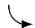
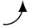
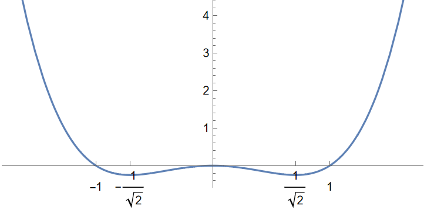
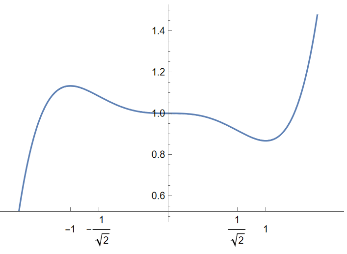
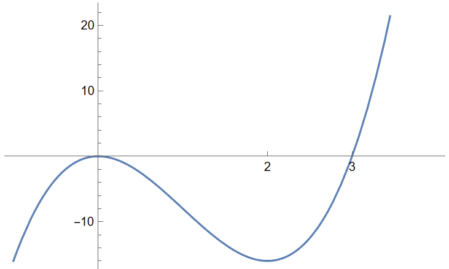
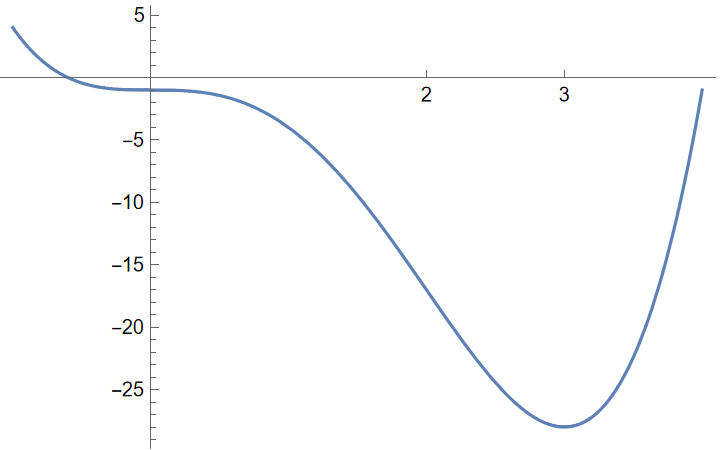

$y=\dfrac{1}{5}x^5-\dfrac{1}{3}x^3+1$

上式を微分すれば、

$y'=x^4-x^2=x^2(x-1)(x+1)$,

 $y''=4x^3-2x=4x(x-1/\sqrt2)(x+1/\sqrt2)$

がわかる。

$y'=0$を解くと $x=0,1,-1$を得る、そして $y''=0$を解くと$x=0,\dfrac{1}{\sqrt 2},-\dfrac{1}{\sqrt 2}$を得る。

凹凸増減表は：

| $x$   | $\cdots$                                                     | $-1$             | $\cdots$                                                     | $-1/\sqrt{2}$           | $\cdots$                                                     | $0$  | $\cdots$                                                     | $1/\sqrt{2}$            | $\cdots$                                                     | $1$              | $\cdots$                                                     |
| ----- | ------------------------------------------------------------ | ---------------- | ------------------------------------------------------------ | ----------------------- | ------------------------------------------------------------ | ---- | ------------------------------------------------------------ | ----------------------- | ------------------------------------------------------------ | ---------------- | ------------------------------------------------------------ |
| $y'$  | $+$                                                          | 0                | $-$                                                          | $-$                     | $-$                                                          | 0    | $-$                                                          | $-$                     | $-$                                                          | 0                | $+$                                                          |
| $y''$ | $-$                                                          | $-$              | $-$                                                          | 0                       | $+$                                                          | 0    | $-$                                                          | 0                       | $+$                                                          | $+$              | $+$                                                          |
| $y$   |  | $\dfrac{17}{15}$ |  | $1+\dfrac{7}{60\sqrt2}$ |  | $1$  |  | $1-\dfrac{7}{60\sqrt2}$ |  | $\dfrac{13}{15}$ |  |

$y'$のグラフを書くと以下のようになり

$y$のグラフは以下のようになる

------

$y=x^4-4x^3-1$

式を微分すると、$y'=x^4-x^2=x^2(x-1)(x+1)$, $y''=4x^3-2x=2x(2x^2-1)$が得られる。

$y'=0$の解が $x=0,3$で、 $y''=0$の解が$x=0,2$である。

凹凸増減表は：

| $x$   | $\cdots$                                                     | $0$  | $\cdots$                                                     | $2$   | $\cdots$                                                     | $3$   | $\cdots$                                                     |
| ----- | ------------------------------------------------------------ | ---- | ------------------------------------------------------------ | ----- | ------------------------------------------------------------ | ----- | ------------------------------------------------------------ |
| $y'$  | $-$                                                          | 0    | $-$                                                          | $-$   | $-$                                                          | 0     | $+$                                                          |
| $y''$ | $+$                                                          | $0 $ | $-$                                                          | 0     | $+$                                                          | $+$   | $+$                                                          |
| $y$   |  | $-1$ |  | $-17$ |  | $-28$ |  |

$y'$のグラフ

$y$のグラフ

