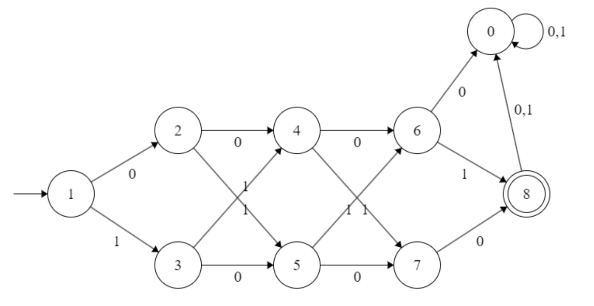
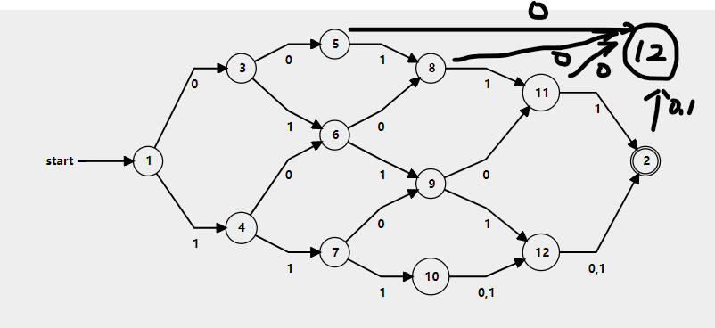
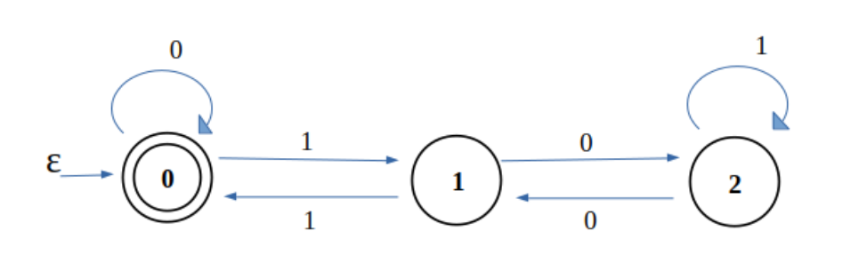
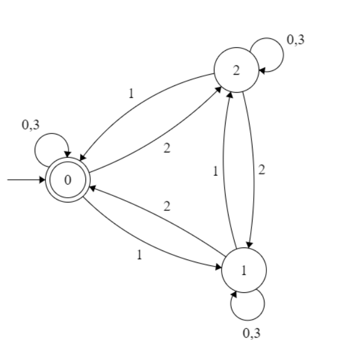
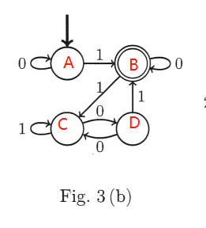
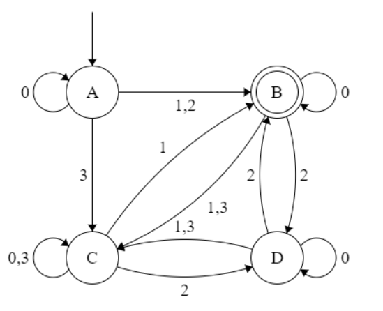
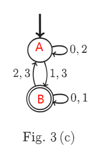
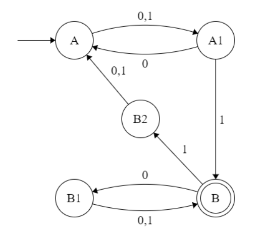
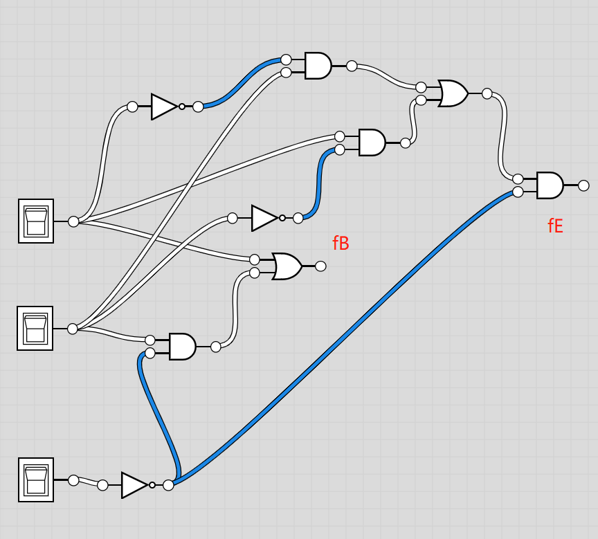
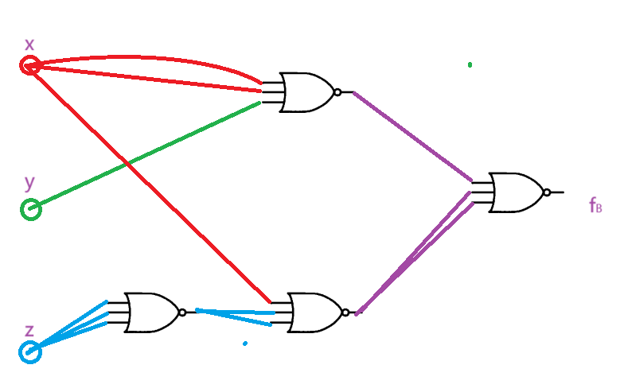

## 201803

1. - $x_1\or(x_1\and x_2)=x_1+x_1x_2=x_1(1+x_2)=x_1$
   - $x_1\or(x_1\and x_2)\or x_2\or(x_2\and x_3)=x_1+x_1x_2+x_2+x_2x_3=x_1(1+x_2)+x_2(1+x_3)=x_1+x_2$
   - $x_1\or (x_1\and x_2\and x_3)\or (x_2\and x_3)=x_1+x_1x_2x_3+x_2x_3=x_1(1+x_2x_3)+x_2x_3=x_1+x_2x_3$

   ==Google "Boolean Algebra Identities" for the computation rules==

2. Yes. Consider the logic function $f(x_1,x_2)$
   $$
   f(0,0)=f(1,1)=I_{w_1+w_2\geqslant \theta}=I_{0\geqslant \theta}=1,\quad f(1,0)=f(0,1)=I_{w_1\geqslant \theta}=I_{w_2\geqslant \theta}=0
   $$
   then $\theta \leqslant0,w_1+w_2\geqslant 0,w_1<\theta,w_2<\theta\implies w_1+w_2<2\theta\leqslant 0$ but $w_1+w_2\geqslant 0$, contradictory. Hence this $f(x_1,x_2)$ is not a threshold function. 

   ==$w_1x_1+\cdots +w_nx_n=\theta$ is a plane, think about a distribution of $0,1$ in the grid points $(x_1,\cdots, x_n)$ that cannot be divided by a plane.==

   ==$I_p$ usually denotes the indicating function, it equals to $1$ if the statement $p$ holds, otherwiser to $0$.== 

3. A SIMPLIFIED positive function $f(x_1,x_2,x_3)$ must contain one or several of the items $0,1,x_1,x_2,x_3,x_1x_2,x_1x_3,x_2x_3,x_1x_2x_3$. Note that

   - If $f$ contains $0,1$, then it contains no other items since $1+A=1,0+A=A$ for any boolean expression $A$. *2 such functions*
   - If $f$ contains $x_1$, then it contains no $x_1x_3,x_1x_2,x_1x_2x_3$ that contains $x_1$ as well. So for $x_2,x_3$. So $f$ can be $x_1,x_2,x_3,x_1+x_2,x_1+x_3,x_2+x_3,x_1+x_2+x_3,x_1+x_2x_3,x_2+x_1x_3,x_3+x_1x_2$, *10 such functions in total*
   - $f$ can be $x_1x_2,x_2x_3,x_1x_3,x_1(x_2+x_3),x_2(x_1+x_3),x_3(x_1+x_2),x_1x_2+x_2x_3+x_1x_3$. *7 such functions*
   - $f$ can be $x_1x_2x_3$. *1 such function*

   In summary, there're $2+10+7+1=20$ such functions.

4. No. Consider the following occasions:

   - If $f=0$, we can let $w_1=w_2=w_3=-1$, $\theta=1$. If $f=1$, we can let $w_1,w_2,w_3=1,\theta =0$.
   - If $f=\sum_{i\in K} x_i$, we can let $w_i=I_{i\in K}$, other $w$ be $0$, $\theta=1$. Here $K\sube \{1,2,3\}$ is an index set.
   - If $f=x_ix_j$, we can let $w_i=w_j=1$, other $w$ be $0$, $\theta =2$. Here $i,j\in\{1,2,3\},i\neq j$.
   - If $f=x_i+x_jx_k$, we can let $w_i=2,w_j=w_k=1,\theta=2$. Here $i,j,k\in\{1,2,3\},i,j,k$ not identical.
   - If $f=x_1x_2x_3$, we can let $w_1=w_2=w_3=1,\theta=3$.
   - If $f=x_i(x_j+x_k)$, we can let $w_i=2,w_j=w_k=1,\theta =3$. Here $i,j,k\in\{1,2,3\},i,j,k$ not identical.
   - If $f=x_1x_2+x_2x_3+x_1x_3$, we can let $w_1=w_2=w_3=1,\theta =2$.

   Thus all positive function can be written as a threshold function.

## 201808

==注：这里minimized没有提还是不是标准式前提下，按标准式算了。不是的话要复杂些。一般DFA不需要画和计算dead state, 但题里例子画了，那我也画了。==

1. $({x_1}\land \neg {x_2}\land \neg {x_3}\land \neg
      {x_4})\lor (\neg {x_1}\land {x_2}\land \neg
      {x_3}\land \neg {x_4})\lor (\neg {x_1}\land \neg
      {x_2}\land {x_3}\land \neg {x_4})\lor\\ (\neg
      {x_1}\land \neg {x_2}\land \neg {x_3}\land
      {x_4})\lor ({x_1}\land {x_2}\land {x_3}\land
      \neg {x_4})\lor ({x_1}\land {x_2}\land \neg
      {x_3}\land {x_4})\\\lor ({x_1}\land \neg
      {x_2}\land {x_3}\land {x_4})\lor (\neg
      {x_1}\land {x_2}\land {x_3}\land {x_4})$

2. Minimized DFA:

   

3. The DNF formula should be the conjunction of $\displaystyle\sum_{k=1}^{\lceil n/2\rceil}\binom{n}{2k-1}$ disjunctions of $n$ literals, hence the minimized size is $\displaystyle\sum_{k=1}^{\lceil n/2\rceil}n\binom{n}{2k-1}$.

4. The states should indicates the number (odd or even) of 1's and the length of already read substring, and we need a starting state to express the empty string, hence there're at least $2n+1$ states.

5. For $n=5$, $f$ should return 1 if $3,4,5$ of the arguments are assigned $1$, hence the formula
   $$
   (x_1\and x_2\and x_3\and x_4\and x_5)\or(\neg x_1\and x_2\and x_3\and x_4\and x_5)\or (x_1\and \neg x_2\and x_3\and x_4\and x_5)\\
   \or (x_1\and x_2\and \neg x_3\and x_4\and x_5)\or (x_1\and x_2\and x_3\and \neg x_4\and x_5)\or (x_1\and x_2\and x_3\and x_4\and \neg x_5)\\
   \or (x_1\and x_2\and x_3\and \neg x_4\and \neg x_5)\or (x_1\and x_2\and \neg x_3\and x_4\and \neg x_5)\or (x_1\and \neg x_2\and x_3\and x_4\and \neg x_5)\\
   \or (x_1\and \neg x_2\and x_3\and x_4\and \neg x_5)\or (\neg x_1\and x_2\and x_3\and x_4\and \neg x_5)\or (x_1\and x_2\and \neg x_3\and \neg x_4\and x_5)\\
   \or (x_1\and \neg x_2\and x_3\and \neg x_4\and x_5)\or (\neg x_1\and x_2\and x_3\and \neg x_4\and x_5)\or (x_1\and \neg x_2\and \neg x_3\and x_4\and x_5)\\
   \or (\neg x_1\and x_2\and \neg x_3\and x_4\and x_5)\or (\neg x_1\and \neg x_2\and x_3\and x_4\and x_5)
   $$

6. DFA:

   

7. The DNF formula should be the conjunction of $\displaystyle\sum_{k=\lceil n/2\rceil}^{n}\binom{n}{k}$ disjunctions of $n$ literals, hence the minimized size is $\displaystyle\sum_{k=\lceil n/2\rceil}^{n}\binom{n}{k}n$.
8. There're at most $m$ 0's, hence we need $m$ states to express the number of $0$'s and $m+1$ states connected to one of them to furtherly express the number of 1's, and we need a sink to express a string longer than $2m+1$ or with in efficient 1's. Thus the total number of states is $(m+1)(m+2)+1$.

## 201903

==该题来源于k进制数==

1. $\phi_2(11001110100)=\phi_4(121310)$  (decimal 1652)

2. $\phi_4(130321)=\phi_2(11100111001)$ (decimal 1849)

3. DFA:

   

4. note that $4x+k\equiv x+k\mod 3$, let the state $i$ express the remainder when divided by 3, and when read in new digits, the original number is multiplied by 4, hence $0\to^{1}1,0\to^2 2,0\to^3 0,1\to^01,1\to^12,1\to^2 0,1\to ^31,$$2\to ^02,2\to ^13,2\to^21,2\to^32,3\to^00,3\to^11,3\to^22,3\to^30$

   the DFA

   

5. From the figure 3(b), 

   
   $$
   A\to^{00}A,A\to^{01}B,A\to^{11}C,A\to^{10}B\\
   B\to^{00}B,B\to^{01}C,B\to^{11}C,B\to^{10}D\\
   C\to^{00}C,C\to^{01}B,C\to^{11}C,C\to^{10}D\\
   D\to^{00}D,D\to^{01}C,D\to^{11}C,D\to^{10}B
   $$
   Since $A\to^{0}A$, for any binary number string accepted by this DFA, we can append zeros to the front to make it contain even symbols. Note that $00_2=0_4,01_2=1_4,11_2=3_4,10_2=2_4$, the corresponding DFA for $L$ is

   

6. From the figure 3(c),

   

   As $00_2=0_4,01_2=1_4,11_2=3_4,10_2=2_4$, we have
   $$
   A\to^{00,10}A,A\to^{01,11}B,B\to^{00,01}B,B\to^{10,11}A
   $$
   hence where A goes depends on the second binary symbol, while where B goes depends on the first symbol, we can changed it to $L$'s DFA by introducing 3 extra states to remember the middle symbol:

   

## 201908

1. $$
   \small x_1x_2+x_1x_2\overline{x_3x_4}+\overline{x_1x_4}=x_1x_2(1+\overline{x_3x_4})+\overline{x_1x_4}=x_1x_2+\overline{x_1x_4}=x_1x_2+\overline{x_1}+\overline{x_4}=\overline{x_1}+x_2+\overline{x_4}
   $$

2. $$
   \small x_1+\bar x_1x_2+\bar x_1\bar x_2x_3=x_1+\bar x_1(x_2+\bar x_2x_3)=x_1+x_2+\bar x_2x_3=x_1+x_2+x_3
   $$

> Must note that we used a derived identity: $x+\bar xy=x(1+y)+\bar xy=x+xy+\bar x y=x+(x+\bar x)y=x+y$

3. `sum(x,y,c)` equals to 1 if $x+y+c=1$ (1 or 3 of $x,y,c$ = 1), otherwise to 0.

   Suppose the equivelent threshold function exists, let $c=0$, consider `sum(1,0,0)`, `sum(1,1,0)` and `sum(0,1,0)` we have $w_1\geqslant \theta,w_2\geqslant \theta, w_1+w_2 < \theta$, contradictory, hence it's not a threshold function.

   $\text{carry}(x,y,c)=xy+yc+xc$, hence its a positive function, by 201803.Q4, it's a threshold function.

4. Since $f_s(x_1,x_2,x_3)=1\Leftrightarrow w_1x_1+w_2x_2+w_3x_3\geqslant s>t\implies f_t(x_1,x_2,x_3)=1$, and the 2 functions are all boolean function, we have $f_t(x_1,x_2,x_3)\geqslant  f_s(x_1,x_2,x_3)$.

   The given expression (denoted as $E$) equals to 1 iff

   $f_s(x_1,x_2,x_3)=1\Leftrightarrow w_1x_1+w_2x_2+w_3x_3=x_1-2x_2+3x_3\geqslant s$, this implies $f_t(x_1,x_2,x_3)=1$ and $(f_t+f_s)(x_1,x_2,x_3)=1$

   Hence $E=f_s(x_1,x_2,x_3)$

## 202003

1. We simplify it first,
   $$
   \small f_1(x,y,z)=\bar xz+x\bar y+\bar xy\bar z+xy\bar z=\bar xz+x\bar y+(\bar x+x)y\bar z=\bar xz+x\bar y+y\bar z=(x+y+z)(\bar x+\bar y+\bar z)
   $$
   The last format shows that $f_1(x,y,z)$ is symmetric.

   Note that $f_1(0,1,1)=1$ but $f_1(1,1,1)=0$, its not unate.

2. - if $k=0$, then $f(x,y,z)=1$ iff $x=y=z=0$, thus $f(x,y,z)=\overline{x+y+z}=\bar x\bar y\bar z=f_0$

   - if $k=1$, then $f(x,y,z)=1$ iff $x=1,y=z=0$ or $x=z=0,y=1$ or $x=y=0,z=1$, hence
     $$
     f(x,y,z)=x\bar y\bar z+\bar xy\bar z+\bar x\bar yz=f_1
     $$

   - if $k=2$, then $f(x,y,z)=1$ iff  $x=0,y=z=1$ or $x=z=1,y=0$ or $x=y=1,z=0$, hence
     $$
     f(x,y,z)=\bar xyz+x\bar yz+xy\bar z=f_2
     $$

   - if $k=3$, then $f(x,y,z)=1$ iff $x=y=z=1$, hence $f(x,y,z)=xyz=f_3$

   There're 4 elementary symmetric boolean functions of 3 variables, and we have listed all of them.

   By the condition, 
   $$
   \begin{aligned}
   M(x,y,z)&=f_2+f_3={\color{green}{(\bar xyz+x\bar yz+xy\bar z)}}+{\color{blue}xyz}\\
   &=\bar x yz+x\bar y z+xy(z+\bar z)\\
   &=\bar x yz+x(y+z\bar y)=\bar xyz+x(y+z)\\
   &=y(\bar x z+x)+xz=y(x+z)+xz\\
   &=xy+yz+xz\\
   \end{aligned}
   $$

3. - Consider the 1 varible symmetric monotonically increasing boolean function, we can find 3, instead of $n+1=2$ of them:
     $$
     f_1(x)=0,f_1(x)=1,f_1(x)=x
     $$
     hence the statement is false.

   - If $f_2(x,y,z)$ is monotonically increasing with respect to $x$, we have $f_2(1,y,z)\geqslant  f_2(0,y,z)$, thus

     - if $a=b=0$ or $1$, then $f_2(ab,y,z)=f_2(a,y,z)=f_2(a,y,z)f_2(a,y,z)=f_2(a,y,z)f_2(b,y,z)$
     - if $a=0,b=1$ or $a=1,b=0$, then $f_2(ab,y,z)=f_2(0,y,z)=f_2(0,y,z)f_2(0,y,z)= f_2(1,y,z)f_2(0,y,z)=f_2(a,y,z)f_2(b,y,z)$ holds either for 
       - $f_2(0,y,z)=f_2(1,y,z)=0$ or $1$
       - $f_2(0,y,z)=0,f_2(1,y,z)=1$

     Hence the given equation always holds. It's true.

   ## 202008

   1. The given expression can be written as
      $$
      f(x,y,z,w)=\underbrace{\bar xy\bar z\bar w}_{0100=4}+\underbrace{\bar xy\bar zw}_{0101=5}+\underbrace{xy\bar z\bar w}_{1100=12}+\underbrace{xy\bar zw}_{1101=13}+\underbrace{x\bar y\bar z w}_{1001=9}+\underbrace{x\bar y zw}_{1011=11}=\sum m(4,5,9,11,12,13)
      $$
      thus we have the table for prime implicants

      | count of 1's | min  | binary |
      | ------------ | ---- | ------ |
      | 1            | m4   | 0100   |
      | 2            | m5   | 0101   |
      |              | m9   | 1001   |
      |              | m12  | 1100   |
      | 3            | m11  | 1011   |
      |              | m13  | 1101   |

      Then

      | Group | Decimal | Binary |
      | ----- | ------- | ------ |
      | 1     | 12, 4   | -100 √ |
      |       | 4,5     | 010- √ |
      | 2     | 13,5    | -101 √ |
      |       | 13,9    | 1-01 * |
      |       | 11,9    | 10-1 * |
      |       | 12,13   | 110- √ |

      And

      | Group | Decimal   | Binary |
      | ----- | --------- | ------ |
      | 1     | 12,13,4,5 | -10- * |

      Therefore the prime implicants are $x\bar z w$, $x\bar yw$ and $y\bar z$, the prime implicants chart is 

      | Minterms    | 4                               | 5                               | 9                                       | 11                              | 12                              | 13                                      | Cost |
      | ----------- | ------------------------------- | ------------------------------- | --------------------------------------- | ------------------------------- | ------------------------------- | --------------------------------------- | ---- |
      | $x\bar z w$ |                                 |                                 | $\colorbox{lightgreen}{\color{green}*}$ |                                 |                                 | $\colorbox{lightgreen}{\color{green}*}$ | 5    |
      | $x\bar yw$  |                                 |                                 | $\colorbox{pink}{\color{green}*}$       | $\colorbox{pink}{\color{red}*}$ |                                 |                                         | 5    |
      | $y\bar z$   | $\colorbox{pink}{\color{red}*}$ | $\colorbox{pink}{\color{red}*}$ |                                         |                                 | $\colorbox{pink}{\color{red}*}$ | $\colorbox{pink}{\color{green}*}$       | 4    |

      And we can find the unique midterms from the chart above. Therefore the essential implicants are $x\bar y w$ and $y\bar z$, the minimization of the given expression is $f(x,y,z,w)=x\bar y w+y \bar z$.

   2. - Simplication:
        $$
        \small
        \begin{aligned}
        f_1(x,y,z)&=\bar x\bar y\bar z+\bar x\bar yz+\bar xyz+x\bar yz=\bar x\bar y(z+\bar z)+\bar xyz+x\bar yz\\
        &=\bar x\bar y+\bar xyz+x\bar yz=\bar x(\bar y+yz)+x\bar yz\\
        &=\bar x(\bar y+z)+x\bar yz=\bar y(\bar x+xz)+\bar x z\\
        &=\bar y(\bar x+z)+\bar xz\\
        &=\bar y(1\oplus(1\oplus \bar x)(1\oplus z))+\bar xz\\
        &=\bar y(1\oplus(1(1\oplus z)\oplus \bar x(1\oplus z)))+\bar xz\\
        &=\bar y (0\oplus z\oplus \bar x\oplus \bar xz)+\bar xz\\
        &=\bar y(0\oplus z\oplus1\oplus x\oplus z\oplus xz)+(z\oplus zx)\\
        &=\bar y\oplus \bar y x\oplus \bar yxz+z\oplus zx\\
        &=1\oplus x\oplus y\oplus xy\oplus xz\oplus xyz+z\oplus zx\\
        &=1\oplus(1\oplus z\oplus zx)(0\oplus x\oplus y\oplus xy\oplus xz\oplus xyz)\\
        &=1\oplus1(0\oplus x\oplus y\oplus xy\oplus xz\oplus xyz)\oplus z(0\oplus x\oplus y\oplus xy\oplus xz\oplus xyz)\oplus zx(0\oplus x\oplus y\oplus xy\oplus xz\oplus xyz)\\
        &=1\oplus x\oplus y\oplus xy\oplus xz\oplus xyz\oplus zx\oplus zy\oplus xyz\oplus xz\oplus xyz\oplus xz\oplus xyz\oplus xyz\oplus xz\oplus xyz\\
        &=1\oplus x\oplus y\oplus xy\oplus xz\oplus yz
        \end{aligned}
        $$
        Thus it's not linear.

      - Simplication:
        $$
        \small
        \begin{aligned}
        f_2(x,y,z)&=\bar x\bar y\bar z+\bar x\bar yz+xy\bar z+xyz=\bar x\bar y(z+\bar z)+xy(z+\bar z)=\bar x\bar y+xy\\
        &=1\oplus(1\oplus \bar x\bar y)(1\oplus xy)\\
        &=1\oplus (1(1\oplus xy)\oplus \bar x\bar y(1\oplus xy))\\
        &=1\oplus (1\oplus xy)\oplus (\bar x\bar y\oplus \bar x\bar y xy)\\
        &=1\oplus1\oplus xy\oplus (1\oplus x)(1\oplus y)\oplus 0\\
        &=0\oplus xy\oplus (1\oplus y)\oplus (x\oplus xy)\\
        &=0\oplus xy\oplus 1\oplus y\oplus x\oplus xy\\
        &=1\oplus x\oplus y
        \end{aligned}
        $$
        Let $c_0=c_1=c_2=1$, $c_3=0$ then $f(x,y,z)=c_0\oplus c_1x\oplus c_2y\oplus c_3 z$, hence it's a linear function.

   3. For a linear function of $n$ variables $f(x_1,\cdots, x_n)=c_0\oplus c_1x_1\oplus\cdots \oplus c_n x_n$, there're $n+1$ coefficients unknown: $c_0,c_1,\cdots, c_n$, each can be $0$ or $1$ (2 possible values), hence the count of linear functions is $2^{n+1}$. This statement is true.

   4. As $P(1,0,0)=P(0,1,0)=P(0,0,1)=P(1,1,1)=1$, $P(0,0,0)=P(1,1,0)=P(0,1,1)=P(1,0,1)=0$, we have 
      $$
      \begin{aligned}
      P(x,y,z)&=x\bar y\bar z+\bar xy\bar z+\bar x\bar yz+xyz=\bar z(\bar x y+x\bar y)+z(\bar x\bar y+xy)\\
      &=\bar z(x\oplus y)+z\overline{x\oplus y}\\
      &=(1\oplus z)(x\oplus y)+z(1\oplus x\oplus y)\\
      &=x\oplus xz\oplus y\oplus yz+z\oplus x\oplus y\\
      &=1\oplus(1\oplus x\oplus xz\oplus y\oplus yz)(1\oplus z\oplus x\oplus y)\\
      &=x\oplus y\oplus z
      \end{aligned}
      $$

==Refer to [Algebraic normal form - Wikipedia](https://en.wikipedia.org/wiki/Algebraic_normal_form) for how to convert a boolean expression into ANF.==

## 202103

1. - $f_1(x_1,x_2,x_3)=x_1\oplus x_2\oplus x_3$, hence
     $$
     \begin{aligned}
     f_1^d(x_1,x_2,x_3)&=\overline{\bar x_1\oplus \bar x_2\oplus\bar x_3}=1\oplus(1\oplus x_1)\oplus (1\oplus x_2)\oplus (1\oplus x_3)\\
     &=1\oplus 1\oplus x_1\oplus 1\oplus x_2\oplus 1\oplus x_3\\
     &=x_1\oplus x_2\oplus x_3\\
     &=f_1(x_1,x_2,x_3)
     \end{aligned}
     $$
     Thus $f_1$ is a self-dual function instead of a self-anti-dual function.

   - $f_2=x_1\bar x_2+\bar x_1x_2x_3+\bar x_1x_2\bar x_3$, hence
     $$
     \begin{aligned}
     f_2(x_1,x_2,x_3)&=x_1\bar x_2+\bar x_1x_2(x_3+\bar x_3)=x_1\bar x_2+\bar x_1x_2=x_1\oplus x_2\\
     f_2^d(x_1,x_2,x_3)&=\overline{\bar x_1\oplus \bar x_2}=1\oplus (1\oplus x_1)\oplus (1\oplus x_2)\\
     &=1\oplus (x_1\oplus x_2)=\overline{x_1\oplus x_2}\\
     &=\overline{f_2(x_1,x_2,x_3)}
     \end{aligned}
     $$
     Thus $f_2$ is a self-anti-dual function, not a self-dual function.

2. If $f_3$ is self-dual, then $f_3^d=\overline{f_3(\bar x_1,\cdots,\bar x_n)}=f_3$, hence
   $$
   (\bar f_3)^d(x_1,\cdots,x_n)=\overline{\overline{f_3(\bar x_1,\cdots,\bar x_n)}}=\overline{f_3(x_1,\cdots,x_n)}=\bar f_3
   $$
   Thus $\bar f_3$ is a self-dual function as well.

3. Since for any $x_1,x_2,\cdots x_n$, $g(x_1,x_2,\cdots, x_n)\geqslant h(x_1,x_2,\cdots, x_n)$ holds, then for any $x_1,x_2,\cdots x_n$,
   $$
   g(\bar x_1,\bar x_2,\cdots,\bar x_n)\geqslant h(\bar x_1,\bar x_2,\cdots, \bar x_n)
   $$
   holds as well, hence
   $$
   g^d(x_1,x_2,\cdots,x_n)=\overline{g(\bar x_1,\bar x_2,\cdots,\bar x_n)}\leqslant \overline{h(\bar x_1,\bar x_2,\cdots, \bar x_n)}=h^d(x_1,x_2,\cdots,x_n)
   $$
   holds for any $x_1,x_2,\cdots, x_n$.

## 202108

By the desciprtion, $\forall\ x\in X$, $x\and \neg x=0,x\or \neg x=1$.

1. $\forall\ F\in\mathcal{F}$, as it's non-empty, we can find $x\in F$, and as the lattice is complemented, we have $\neg x\in X$, by (3A), $x\or \neg x=1\in F$.

2. - Suppose (a) holds, then 

     If $x,\neg x\in F$  at the same time, then $x\or \neg x=0\in F$, contradictory to $0\not\in F$; Note that by (a)$x\or \neg x=1\in F\implies x\in F$ or $\neg x\in F$, hence at least one of them $\in F$. Therefore exactly one of $x$ and $\neg x$ belongs to $F$

     Therefore (a) $\implies$ (b)

   - Suppose (b) holds but (a) doesn't hold, then

     Take any $x,y\in X, $ such that $x\or y \in F$, if $x,y\notin F$, then since $x\or \neg x=1\in F,y\or \neg y=1\in F$, we have $x\text{ or } \neg x\in F$, $y$ or $\neg y\in F$ by (b). consider the assumption that (a) doesn't hold, we have $\neg x,\neg y\in F$, thus $\neg x\and \neg y=\neg (x\or y)\in F$ by (3B), and $1=(x\or y)\or (\neg (x\or y))\in F$, by (b) again, we'll get $x\or y\notin F$, contradictory. 

     Therefore (b) $\implies $ (a)

   In summary (a) $\Leftrightarrow$ (b) 

3. If $\forall\ F_i,F_i\not\sube F$, then we can take $a_i\in F_i,a_i\notin F$ for all $i\in \{1,2,\cdots, n\}$, consider $b=a_1\or a_2\or \cdots \or a_n\or \neg x$, where $x\in F_1\cap F_2\cap \cdots \cap F_n\sube F$, since $F$ satisfies (a), (b), we know that $\neg x\notin F$. 

   If $b\in F$, then $a_1\or a_2\or a_3 \or\cdots \or a_n\in F$, applying (a) recursively, we have at least one of $a_1,a_2,\cdots, a_n$, say $a_i\in F$,  contradictory. Therefore $b\notin F$. 

   But on the other hand, since $F_i$ satisfies (3A) for all $i$,
   $$
   \forall\ i\in\{1,2,\cdots,n\},\quad b=a_i\or \underbrace {((\bigvee_{j\neq i,j=1}^n a_j)\or \neg x)}_{\in X}\quad\implies\quad b\in F_i
   $$
   Thus $b\in F_1\cap F_2\cap \cdots \cap F_n\sube F$, contradictory.

   Therefore $\exist\ i\in\{1,2,\cdots, n\}$ such that $F_i\sube F$.

## 202203

<u>这个"don't care item" 是随便赋值还是怎么样不清楚，暂时随便赋值了，只影响结果不影响过程，且目前赋值与简化中的Don't Care结果一致。</u>

1. See the truth table below, let $f_A(1,1,1)=f_B(1,1,1)=f_C(1,1,1)=f_D(1,1,1)=1,f_E(1,1,1)=0$.

   | $x$  | $y$  | $z$  | $f_A$ | $f_B$ | $f_C$ | $f_D$ | $f_E$ |
   | ---- | ---- | ---- | ----- | ----- | ----- | ----- | ----- |
   | 0    | 0    | 0    | 0     | 0     | 0     | 0     | 0     |
   | 0    | 0    | 1    | 0     | 0     | 1     | 0     | 0     |
   | 0    | 1    | 0    | 0     | 1     | 1     | 1     | 1     |
   | 0    | 1    | 1    | 1     | 0     | 1     | 1     | 0     |
   | 1    | 0    | 0    | 1     | 1     | 0     | 1     | 1     |
   | 1    | 0    | 1    | 1     | 1     | 1     | 0     | 0     |
   | 1    | 1    | 0    | 1     | 1     | 1     | 1     | 0     |
   | 1    | 1    | 1    | 1     | 1     | 1     | 1     | 0     |

2. By the truth table
   $$
   \begin{aligned}
   f_B(x,y,z)&=\bar xy\bar z+x\bar y\bar z+x\bar yz+xy\bar z+xyz=\bar xy\bar z+x=x+y\bar z\\
   f_E(x,y,z)&=\bar xy\bar z+x\bar y\bar z
   \end{aligned}
   $$
   This is the minimum sum of products form, the canonical product of sum forms are
   $$
   \begin{aligned}
   f_B(x,y,z)&=(x+y+z)(x+y+\bar z)(x+\bar y+\bar z)\\
   f_E(x,y,z)&=(x+y+z)(x+y+\bar z)(x+\bar y+\bar z)(\bar x+y+\bar z)(\bar x+\bar y+z)(\bar x+\bar y+\bar z)
   \end{aligned}
   $$
   ==Refer to [Sum of Products (SOP) and Product of Sums (POS) Expressions (elprocus.com)](https://www.elprocus.com/sum-of-products-and-product-of-sums/) for the methods==

3. The switch represents $x,y,z$ from up to bottom:

   

4. Note that if we connect the same wire to the 3 inputs of a 3-input NOR gate, then it become a NOT gate, if to 2 of the 3 inputs, then it become a normal 2-input NOR gate, and since
   $$
   f_B(x,y,z)=(x \text{ NOR }y)\text{ NOR }(x\text{ NOR }\neg z)
   $$
   hence

   

   ==Solution not unique, this is the easiest one==

## 202208

1. Note that the values of $f$ when $x_1,x_2,\cdots,x_n$ contains $s,t(s\neq t)$ 1's respectively, are independent, and we can assign $0,1$ to them independently, forming different functions and keep its symmetricity. Thus there're $2^{n+1}$ such symmetric boolean functions.

2. A linear function is like $f(x_1,\cdots, x_n)=c_0\oplus c_1x_1\oplus \cdots \oplus c_n x_n$. Since it's symmetric, $c_1=c_2=\cdots =c_n$, and $c_0$ independent, hence there're $2^2=4$ such symmetric linear functions.

3. As $f(\bar x_1,\bar x_2,\cdots, \bar x_n)=f(x_1,x_2,\cdots,x_n)$, when we creating functions, when $f(x_1,x_2,\cdots,x_n)$ is assigned, then $f(\bar x_1,\bar x_2,\cdots, \bar x_n)$ is determined. For symmetric functions, when the function value when $x_1,x_2,\cdots, x_n$ contain $k$ 1's is assigned, then the function value that $x_1,x_2,\cdots, x_n$ contain $n-k$ 1's is also determined. Hence there're $2^{\lceil\frac{n+1}{2}\rceil}$ such functions.

4. Consider the threshold function as a plane in $\R^n$ that divides the whole space into 2, by the symmetricity, the plane must be orthogonal to $(1,1,\cdots, 1)$, hence there're $n+2$ ways to partition the points in $\{0,1\}^n$. Note that the place is directed, one side is positive and the other one is negative, hence the total number of the threashold symmetric boolean functions is $2(n+2)=2n+4$.

5. Among symmetric functions, a positive function must be a constant function or contains at least one of
   $$
   a_1=\sum_ix_i,a_2=\sum_{i\neq j}x_ix_j,\cdots, a_n=x_1x_2\cdots x_n
   $$
   and note that $a_{k+1}=1\implies a_k=1$ for all valid $k$, hence in fact they can only contain one of them. Therefore the total count of symmetric positive boolean function is $n+2$.

## 202303

1. The given expression can be written as
   $$
   f(x,y,z,w)=\underbrace{\bar x_1x_2\bar x_3x_4}_{0101=5}+\underbrace{\bar x_1\bar x_2x_3\bar x_4}_{0010=2}+\underbrace{x_1x_2\bar x_3x_4}_{1101=13}+\underbrace{x_1\bar x_2\bar x_3\bar x_4}_{1000=8}+\underbrace{x_1\bar x_2x_3x_4}_{1011=11}+\underbrace{x_1x_2x_3\bar x_4}_{1110=14}+\underbrace{x_1\bar x_2x_3\bar x_4}_{1010=10}+\underbrace{x_1x_2x_3x_4}_{1111=15}=\sum m(2,5,8,10,11,13,14,15)
   $$
   thus we have the table for prime implicants

   | count of 1's | minterm | binary |
   | ------------ | ------- | ------ |
   | 1            | m2      | 0010   |
   |              | m8      | 1000   |
   | 2            | m5      | 0101   |
   |              | m10     | 1010   |
   | 3            | m11     | 1011   |
   |              | m13     | 1101   |
   |              | m14     | 1110   |
   | 4            | m15     | 1111   |

   Then for the first comparasion

   | Group | Decimal | Binary |
   | ----- | ------- | ------ |
   | 1     | 10, 2   | -010 * |
   |       | 10, 8   | 10-0 * |
   | 2     | 13, 5   | -101 * |
   |       | 11, 10  | 101- √ |
   |       | 14, 10  | 1-10 √ |
   | 3     | 15, 11  | 1-11 √ |
   |       | 15, 13  | 11-1 * |
   |       | 15, 14  | 111- √ |

   And for the second comparasion

   | Group | Decimal        | Binary |
   | ----- | -------------- | ------ |
   | 2     | 10, 11, 14, 15 | 1-1- * |

   Therefore the prime implicants are $\bar yz\bar w,x\bar y\bar w,y\bar zw,xyw,xz$, the prime implicants chart is 

   | Minterms        | 2                               | 5                               | 8                               | 10                                | 11                              | 13                                      | 14                              | 15                                      | Cost |
   | --------------- | ------------------------------- | ------------------------------- | ------------------------------- | --------------------------------- | ------------------------------- | --------------------------------------- | ------------------------------- | --------------------------------------- | ---- |
   | $\bar yz\bar w$ | $\colorbox{pink}{\color{red}*}$ |                                 |                                 | $\colorbox{pink}{\color{green}*}$ |                                 |                                         |                                 |                                         | 6    |
   | $x\bar y\bar w$ |                                 |                                 | $\colorbox{pink}{\color{red}*}$ | $\colorbox{pink}{\color{green}*}$ |                                 |                                         |                                 |                                         | 6    |
   | $y\bar zw$      |                                 | $\colorbox{pink}{\color{red}*}$ |                                 |                                   |                                 | $\colorbox{pink}{\color{green}*}$       |                                 |                                         | 5    |
   | $xyw$           |                                 |                                 |                                 |                                   |                                 | $\colorbox{lightgreen}{\color{green}*}$ |                                 | $\colorbox{lightgreen}{\color{green}*}$ | 4    |
   | $xy$            |                                 |                                 |                                 | $\colorbox{pink}{\color{green}*}$ | $\colorbox{pink}{\color{red}*}$ |                                         | $\colorbox{pink}{\color{red}*}$ | $\colorbox{pink}{\color{green}*}$       | 3    |

   And we can find the unique midterms from the chart above. Therefore the essential implicants are $\bar yz\bar w,x\bar y\bar w,y\bar zw,xz$ the minimization of the given expression is $f(x,y,z,w)=\bar yz\bar w+x\bar y\bar w+y\bar zw+xz$.

2. By the definition, 

   - $M(x,0,y)$ functions just like the AND gate, in which $x,y$ are the inputs.

   Thus $[M,NOT]$ is such a minimal functionally complete set as $[NAND]$ is minimal functionally set.

3. In fact, the LHS is true.
   $$
   \begin{aligned}
   \bar x_1x_3+\bar x_1\bar x_2\bar x_3+x_1+x_2&=\bar x_1(x_3+\bar x_2\bar x_3)+x_1+x_2\\
   &=\bar x_1 (x_3+\bar x_2)+x_1+x_2\\
   &=(\bar x_1x_3+x_1)+(\bar x_1\bar x_2+x_2)\\
   &=x_1+x_3+x_2+\bar x_1\\
   &= 1\geqslant x_1+\bar x_2+x_3
   \end{aligned}
   $$

4. The number of the minterms of it is equal to the number of tuples of $(x_1,x_2,\cdots,x_n)$ such that $f_p$ outputs 1. Thus the number of 1's in the tuple must be odd. Hence it's
   $$
   \sum_{k=0}^n\binom{2m+1}{2k+1}=4^{m}=4^{(n-1)/2}
   $$
   for odd $n=2m+1$ and 
   $$
   \sum_{k=0}^{n-1}\binom{2m}{2k+1}=2^{2m-1}=2^{n-1}
   $$
   for even $n=2m$. Thus the statement is false.