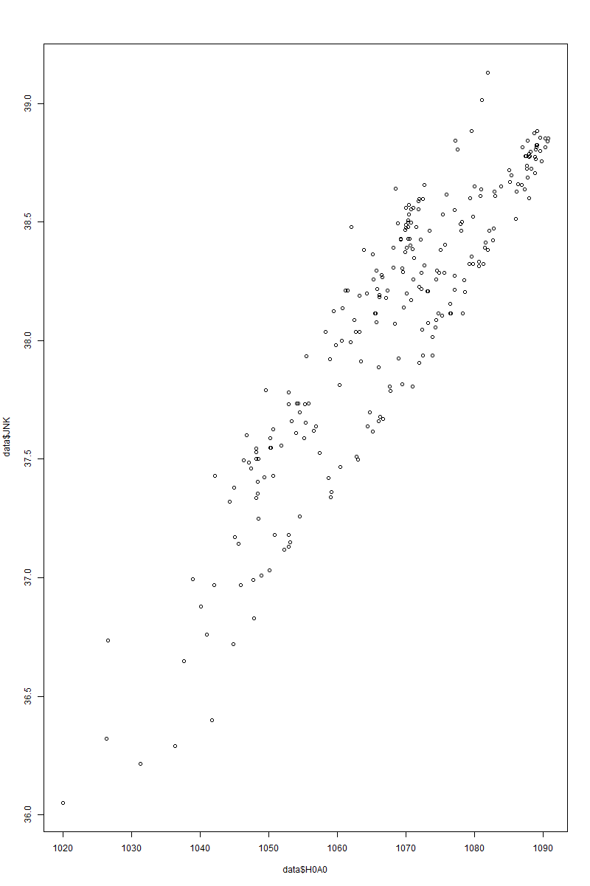
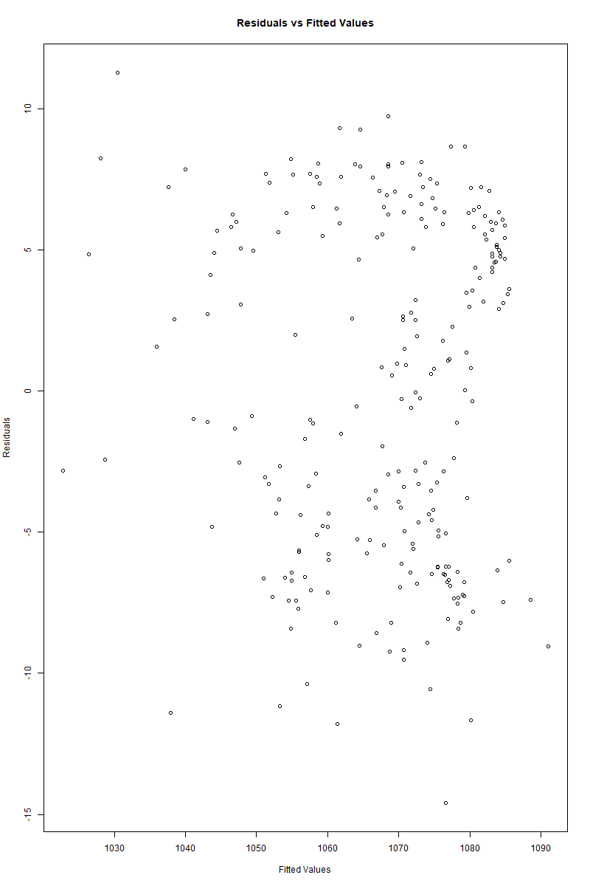
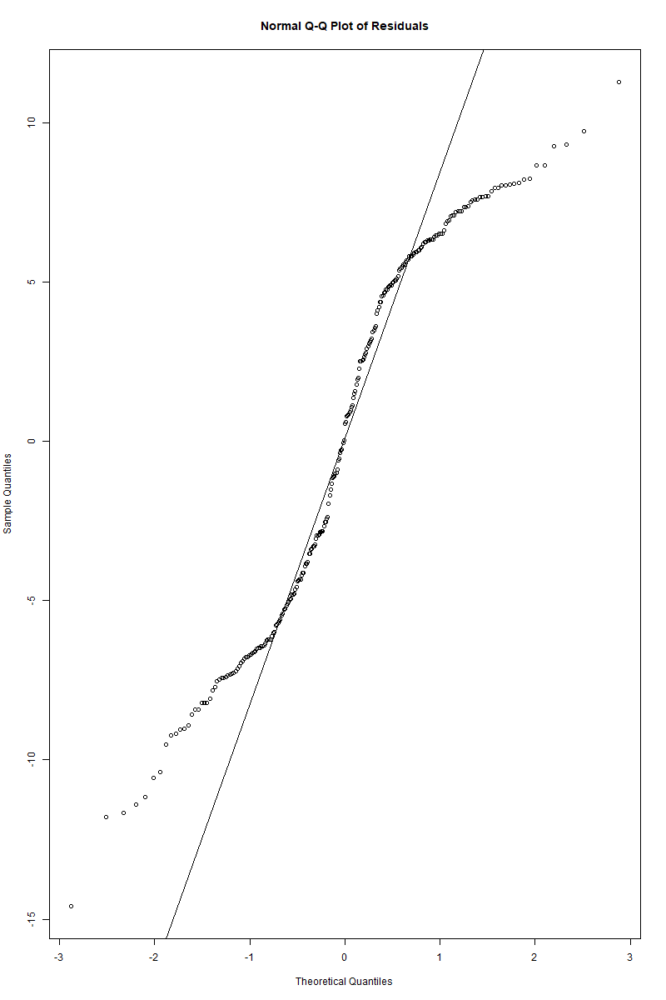
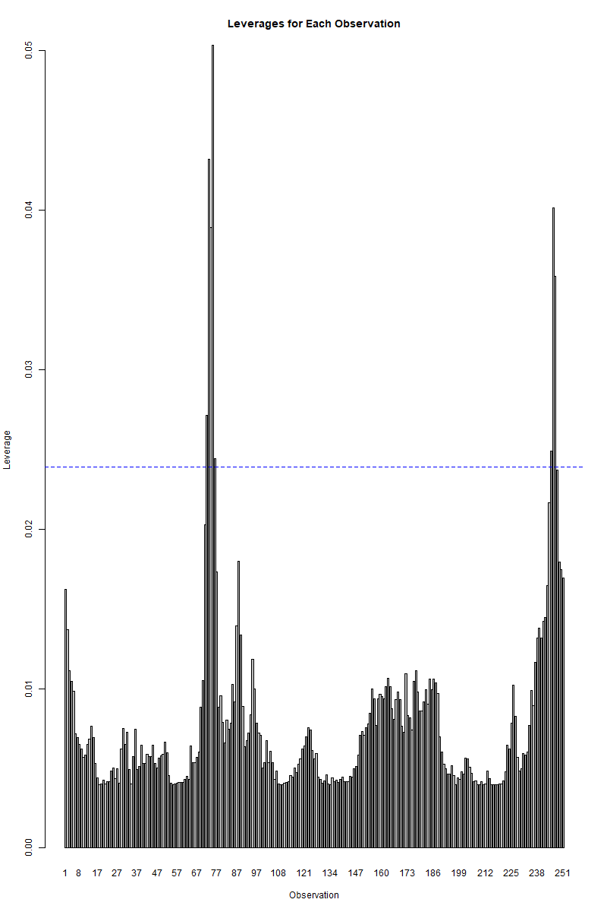
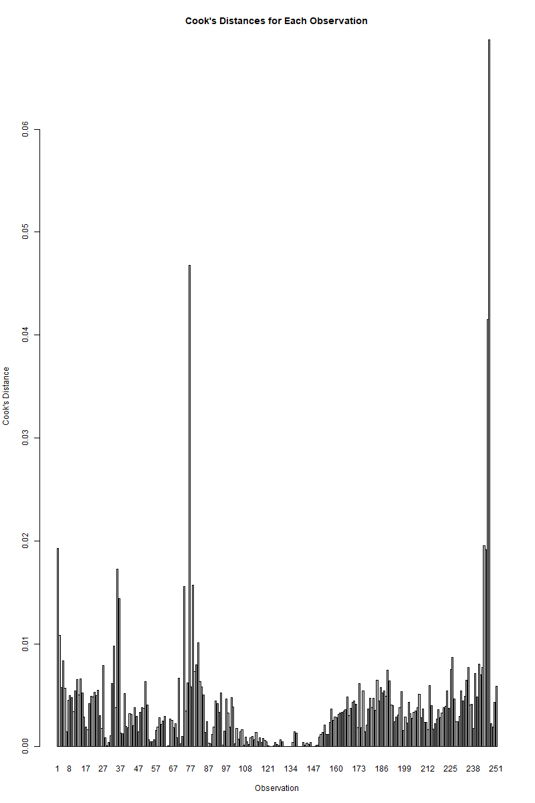

## Q1

Hypothesis: The correlation factor of H0A0 and JNK is 0 (i.e. they have no relationship)

Code:

```R
data <- read.csv("etf.csv")
summary(data)
plot(data$H0A0, data$JNK)
correlation_test <- cor.test(data$H0A0, data$JNK)
print(correlation_test)
```

Plot:



 From the plot, H0A0 seems to be positively correlated. 

```
        Pearson's product-moment correlation

data:  data$H0A0 and data$JNK
t = 35.092, df = 249, p-value < 2.2e-16
alternative hypothesis: true correlation is not equal to 0
95 percent confidence interval:
 0.8885582 0.9307471
sample estimates:
      cor
0.9120348
```

The correlation test reported $p$ value less than $2.2\times 10^{-16}$, hence the hypotheses is rejected. There is a statistically significant correlation between the 2 variables.

## Q2

```R
model <- lm(H0A0 ~ JNK, data=data)
plot(model$fitted.values, model$residuals, xlab="Fitted Values", ylab="Residuals",
     main="Residuals vs Fitted Values")

qqnorm(model$residuals, main="Normal Q-Q Plot of Residuals")
qqline(model$residuals)

leverages <- hatvalues(model)
barplot(leverages, names.arg=rownames(data), xlab="Observation", ylab="Leverage",
        main="Leverages for Each Observation")
abline(h = mean(leverages) * 3, col = "blue", lty = 2)

cooks_dist <- cooks.distance(model)
barplot(cooks_dist, names.arg=rownames(data), xlab="Observation", ylab="Cook's Distance",
        main="Cook's Distances for Each Observation")
abline(h = 0.5, col = "blue", lty = 2)
abline(h = 1.0, col = "red", lty = 2)

cooks_dist[cooks_dist > 0.5]
```

Residual plot:



Q-Q Plot of the residuals:



Bar plot of the leverages for each observation, the blue dashed line is 3 times average value line:



And a bar plot of Cook's distances for each observation:



```R
> leverages[leverages > mean(leverages) * 3]
        72         73         74         75         76        245        246
0.02712175 0.04317568 0.03886299 0.05033517 0.02441578 0.02488531 0.04012345
       247
0.03583063
```

These points, in leverages' bar plot graph, have leverages larger than 3 times average, hence it's possible that they are unusual points. But taken Cook's distance graph into account, none of them has a Cook's distance larger than 0.5, therefore actually we cannot simply consider them as unusual points, the linear regression is actually reliable.

Moreover, from the Q-Q plot, the normal Q-Q plot of the residuals is not a line, hence the peak of the residuals is more flat than the normal distribution, and since the Q-Q line has roughly 4 intersections with the data points' interpolation, there may be 2 subpeaks in the density plot of the distribution of residuals. Also, it has thin tails. In summary, probably it doesn't obey standard normal distribution.

## Q3

A linear regression model $Y=X\beta +\varepsilon$ general has the following assumptions:

- Linearity: $E(Y) = X \beta$. The expected (mean) outcome is a linear function of the predictors. This implies that the expected error, conditional on $X$, is zero: $E(\varepsilon | X) = 0$.
- Normality: $\varepsilon_i \sim \mathcal{N}(0, \sigma^{2}_\varepsilon)$. Errors follow a normal distribution.
- Homoscedasticity: $Var(\varepsilon | X) = \sigma^2$. Errors, conditional on $X$, have constant variance.
- Independence: $\text{Cov}(\varepsilon_i , \varepsilon_j \mid X) = 0$. Errors do not covary after conditioning on $X$.

In this model, only 1 predictors are adopted, hence linearity and independence are naturally satisfied. In terms of normality, 

- first, we check the mean of residuals:

  ```R
  resimean <- mean(model$residuals)
  stderr <- sd(model$residuals) / sqrt(length(model$residuals))
  
  t_statistic <- (resimean - 0) / stderr
  
  df <- length(model$residuals) - 1
  
  p_value <- 2 * pt(-abs(t_statistic), df)
  
  cat("T-statistic:", t_statistic, "\n")
  cat("P-value:", p_value, "\n")
  ```

  the P-value is about 1, hence we'd reject the null hypothesis (mean is not 0), that is, the mean of residuals can be thought as 0.

- Secondly, the normal Q-Q plot doesn't support that the residual follows a normal distribution.

To resolve this, we could transform the response variable, applying a function to it to make the residual conform with normal distribution better, and do linear regression on the new response variable.

## Q4

Code:

```R
coefficients <- coef(model)
standard_errors <- sqrt(diag(vcov(model)))
print(model)
print(coefficients)
print(standard_errors)

# Output
> print(coefficients)
(Intercept)         JNK
  223.16240    22.17901
> print(standard_errors)
(Intercept)         JNK
 24.0738557   0.6320252
```

From the result, the SLR formula is $\text{H0A0}=22.17901\cdot\text{JNK}+223.16240=\beta_1\cdot\text{JNK}+\beta_2$. The standard error of $\beta_1$ and $\beta_2$ are 0.6320252, 24.0738557 respectively.

Hypothesis of our t-test in this question:

- Null Hypothesis $H_0$: The population correlation coefficient IS NOT significantly different from zero. There IS NOT a significant linear relationship(correlation) between JNK and H0A0 in the population.
- Alternate Hypothesis $H_\alpha$: The population correlation coefficient IS significantly DIFFERENT FROM zero. There IS A SIGNIFICANT LINEAR RELATIONSHIP (correlation) between JNK and H0A0 in the population.

```R
alpha <- 0.05
t_values <- coefficients / standard_errors
p_values <- 2 * pt(-abs(t_values), df = nrow(data) - 2)
print(t_values)
print(p_values)

# Output
> print(t_values)
(Intercept)         JNK
   9.269907   35.091975
> print(p_values)
 (Intercept)          JNK
9.199804e-18 2.269664e-98
```

Note that the 2 $p$-values are so small, much smaller than the threshold $0.05$, hence we should reject the null hypothesis and conclude that, there is sufficient evidence to conclude that there is a significant linear relationship between JNK and H0A0 with the correlation coefficient is significantly different from zero.

## Q5

```R
anova_table <- anova(model)
print(anova_table)

# Output
> print(anova_table)
Analysis of Variance Table

Response: H0A0
           Df Sum Sq Mean Sq F value    Pr(>F)    
JNK         1  43874   43874  1231.4 < 2.2e-16 ***
Residuals 249   8871      36
---
Signif. codes:  0 '***' 0.001 '**' 0.01 '*' 0.05 '.' 0.1 ' ' 1
```

From the ANOVA table, the F-statistic is 1231.4, and the $p$-value Pr(>F) is $2.2\times 10^{-16}$, which is much smaller than 0.05, even 0.001. The hypothesis is
$$
H_0:\beta=0\qquad H_\alpha:\beta\neq 0
$$
Therefore we should reject the null hypothesis, and conclude that there're enough evidence that at least 1 variable has significant effect on the response variable. The linear regression is meaningful.

```R
rsquared <- summary(model)$r.squared
print(rsquared)

# Output 
0.8318075
```

Thus the coefficient of determination is 0.8318075, approximately 83.18075 % of the variability in the response variable can be explained by the linear regression model.

## Q6

Code:

```R
predicted_h0a0 <- predict(model, newdata = data.frame(JNK = 37.55))
print(predicted_h0a0)

conf_level <- 0.99
conf_interval <- predict(model, newdata = data.frame(JNK = 37.55),
                         interval = "confidence", level = conf_level)
print(conf_interval)

# Output
> print(predicted_h0a0)
       1
1055.984
> print(conf_interval)
       fit     lwr      upr
1 1055.984 1054.67 1057.299
```

From the output, the expected value for H0A0 on that day is 1055.984, and a 99% interval estimate for it is $[1054.67,1057.299]$.
