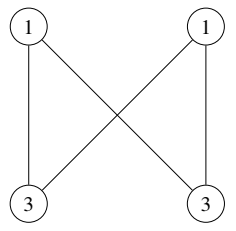
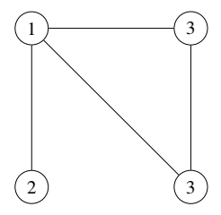
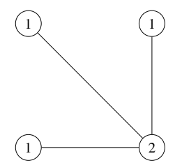
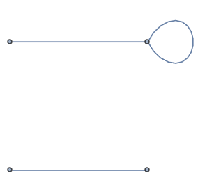
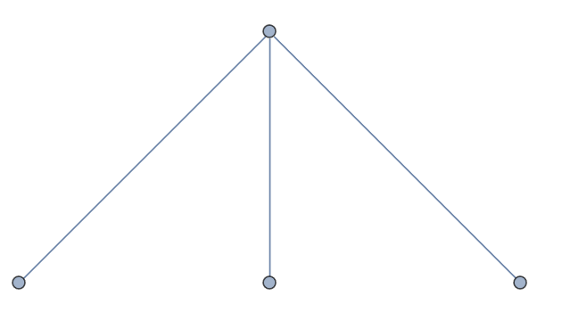

## Q1

$\beta=(0.5,0.25,0.25),\pi=\begin{bmatrix}0&1&0.5\\1&0.4&0.2\\0.5&0.2&1\end{bmatrix}$

1. The graph contains 2 communities $1$ and $3$, each contains 2 nodes, $(1,1,3,3)$ has $6$ permutations, hence the probability to generate such communities is $P_1=6\times 0.5^2\times 0.25^2=0.09375$. 

   Besides, $4$ edges are generated, the probability of the given distribution is $P_2=0.5^4$.

   Hence the final probability is $P=P_1P_2=\dfrac{3}{512}$ 

   

2. The graph contains 3 communities $1,2,3$, each contains $1,1,2$ nodes, $(1,2,3,3)$ has $12$ permutations, hence the probability to generate such communities is $P_1=12\times 0.5\times 0.25^3=\dfrac{3}{32}$. 

   Besides, $4$ edges are generated, the probability of the given distribution is $P_2=1\times0.5^2\times1\times(1-0.2)^2=\dfrac{4}{25}$.

   Hence the final probability is $P=P_1P_2=\dfrac{3}{200}$ .

   

3. The graph contains 2 communities $1,2$, each contains $3,1$ nodes, $(1,1,1,2)$ has $4$ permutations, hence the probability to generate such communities is $P_1=4\times 0.5^3\times0.25=\dfrac{1}{8}$. 

   Besides, $4$ edges are generated, the probability of the given distribution is $P_2=1^3\times (1-0)^3=1$.

   Hence the final probability is $P=P_1P_2=\dfrac{1}{8}$.

   

## Q2

Degree sequence $1, 1, 1, 3$, following the generation algorithm of Configuration Model, we get

1. Check existence: $1+1+1+3=6$ which is even, hence the graph exists

2. Create stubs: $v_1:1$, $v_2:1$, $v_3:1$,  $v_4:1,1,1$

3. Match the stubs: There're $5!!=15$ occasions if we consider the vertices as distinct, each of the same possibility $\dfrac{1}{15}$ due to symmetricity:

   - $\{(v_1,v_2),(v_3,v_4),(v_5,v_6)\}$
   - $\{(v_1,v_2),(v_3,v_5),(v_4,v_6)\}$
   - $\{(v_1,v_2),(v_3,v_6),(v_4,v_5)\}$
   - $\{(v_1,v_3),(v_2,v_4),(v_3,v_6)\}$
   - $\{(v_1,v_3),(v_2,v_5),(v_4,v_6)\}$
   - $\{(v_1,v_3),(v_2,v_6),(v_4,v_5)\}$
   - $\{(v_1,v_4),(v_2,v_3),(v_5,v_6)\}$
   - $\{(v_1,v_4),(v_2,v_5),(v_3,v_6)\}$
   - ……
   - $\{(v_1,v_6),(v_2,v_5),(v_3,v_4)\}$

   Observe the matchings, we can find that they form 2 distinct unlabeled graphs, 

   

   and 

   

   which corresponds $9,6$ occasions respectively, hence the possibilities are $\dfrac{9}{15}=\dfrac{3}{5}$ and $\dfrac{6}{15}=\dfrac{2}{5}$.

## Q3

$n\in\mathbb{N}$, $p\in[0,1]$, $U\subset \{1,\cdots,n\}$, $H$ on $U$ with $k$ edges.

1. Since $U$ is of size $l$, by the generating method of $G(n,p)$ model, the probability that $H$ is a subgraph of a graph in $G(n,p)$ is $p^l$.

2. For the same reason, the probability that $H$ is an induced subgraph in $G(n,p)$ is $p^l(1-p)^{\binom{k}{2}-l}$.

3. The expected number of $K_l$-subgraphs in $G(n,p)$, due to that each such subgraph is generated under equal probability, will be the number of subgraphs times the probability to generate one such subgraph, i.e. the expected number is 
   $$
   \binom{n}{l}p^{\binom{l}{2}},\ l\geqslant 2\qquad\text{and}\qquad n,\  l=1
   $$

## Q4

$\forall\ i\in\{1,2,\cdots,n\}$, let $X_i=\left\{\begin{array}{ll}1&\text{vertex }i \text{ is of degree }k\\0&\text{otherwise}\end{array}\right.$ be the $i$-th indicator random variable, then $\displaystyle X=\sum_{i=1}^n X_i$ would be the count of vertices of order $k$.  By the definition of $G(n,p)$, $\forall\ i,X_i\sim b(n-1,p)$, thus
$$
 E(X_i)=\binom{n-1}{k}p^k(1-p)^{n-1-k}
$$
thus,
$$
EX=\sum_{k=1}^nE(X_i)=nEX_1=n\binom{n-1}{k}p^k(1-p)^{n-1-k}
$$
